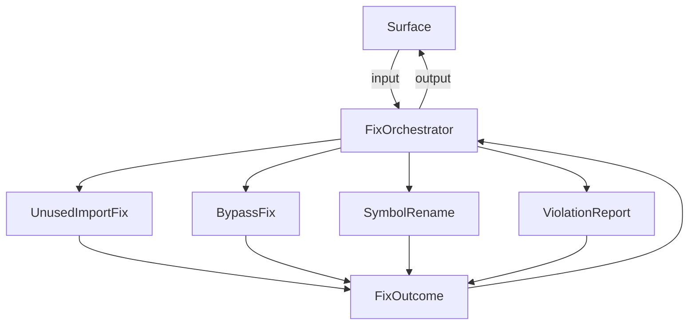

# FRD — auto-fix (v3.0.0)

---

## Feature Overview

The auto-fix crate applies safe, deterministic corrections to source files that violate AES rules. It consumes lint results from the analysis pipeline, filters violations by fixable error code, and writes corrected files back to disk.

- **Allowed Operation Classes (product policy — locked)**
| Class       | Examples                                                          | Notes                                   |
| ----------- | ----------------------------------------------------------------- | ----------------------------------------|
| **Remove**  | Delete unused import lines; delete `#[allow(...)]` / bypass comment lines | No new code introduced                 |
| **Replace** | `unwrap()` → `expect("safe")` on the same line                    | Local token/line substitution only     |
| **Rename**  | Prepend `renamed_` (or keep valid snake_case) for AES101 symbols   | Mechanical rename of extracted symbol tokens|

**Out of scope:** multi-file renames, structural refactors, adding new imports/types, semantic rewrites, formatting-only passes, `panic!` removal (requires semantic error handling).

Every fix attempt MUST return a **reason-coded outcome** (`Applied` / `Skipped(reason)` / `Failed(reason)`), not a bare boolean. Dry-run reports the same outcomes without writing files.

- **Architecture & Data Flow**

Each of the 4 FRs maps to exactly 1 protocol trait and exactly 1 capability struct.

---

## Functional Requirements

### FR-AutoFix-001: Unused Import Removal (AES203)

#### Description

| No | Detail |
| --- | --- |
| 1 | Remove the unused import at a flagged line, in place or as a dry-run preview. |
| 2 | — |
| ∞ | — |

#### Business Rules

| No | Detail |
| --- | --- |
| 1 | One call fixes exactly one flagged line; the flag must sit on an import line (`NotAnImportLine` otherwise) and must not span multiple lines (`MultiLineImport`). |
| 2 | The import list must not fall out of bounds (`LineOutOfBounds`); dry-run reports the would-be change without writing. |
| ∞ | — |

#### Edge Cases

| No | Detail |
| --- | --- |
| 1 | A clean file yields no call at all; an already-valid import list skips with `AlreadyValid`. |
| 2 | A missing or unreadable file fails with `FileNotFound`/`ReadError` rather than succeeding silently; dry-run never modifies the file on disk. |
| ∞ | — |

#### Capability

| No | Detail |
| --- | --- |
| 1 | `UnusedImportFix` implements `IUnusedImportFixProtocol` (`fix_unused_import`, plus the `fix_unused_import_dry` seam the FR-AutoFix-004 pipeline drives). |

#### Protocol

| No | Detail |
| --- | --- |
| 1 | `IUnusedImportFixProtocol` in `shared/auto_fix`. |

#### Method

| No | Detail |
| --- | --- |
| 1 | `fix_unused_import(&self, file_path: &str, line: LineNumber) -> FixOutcome` |
| 2 | — |
| ∞ | — |

#### Input

| No | Detail |
| --- | --- |
| 1 | `file_path: &str` and `line: LineNumber` carried by the flagged violation. |
| 2 | — |

#### Output

| No | Detail |
| --- | --- |
| 1 | `FixOutcome` — `Applied { changes }` on a successful rewrite. |
| 2 | `Skipped(reason)` when the line is not fixable; `Failed(reason)` on I/O trouble. |
| ∞ | — |

#### Error

| No | Detail |
| --- | --- |
| 1 | Read/write failures surface as `FixOutcome::Failed(FailReason::...)`. |
| 2 | An unfixable line returns `Skipped`, so the caller still gets a structured outcome, never a panic. |

#### Event

| No | Detail |
| --- | --- |
| 1 | `lint-arwaky-cli fix <path> --dry-run` runs the same seam with `dry_run` selected per `FixRequest`. |
| 2 | `scan`/`check` only detect, they do not fix. |
| ∞ | — |

#### Test

| No | Detail |
| --- | --- |
| 1 | `acceptance_AES201_fix` suite proves the fix path reports fixable codes. |
| 2 | `e2e_auto_fix_flow` — `e2e_dry_run_file_with_unused_import`, `e2e_dry_run_clean_file`; `contract_auto_fix` — `unused_import_fix_implements_unused_import_fix_protocol`. |
| ∞ | — |

#### Metric

| No | Detail |
| --- | --- |
| 1 | Every flagged `AES203` violation under `fix <path> --dry-run` yields `Applied` or an explicit `Skipped` reason. |
| 2 | Files stay byte-identical in dry-run as pinned by `e2e_dry_run_file_with_unused_import`. |
| ∞ | — |

### FR-AutoFix-002: Bypass Fix (AES304)

#### Description

| No | Detail |
| --- | --- |
| 1 | Strip a bypass comment or bypass macro at the flagged line, in place or as a dry-run preview. |
| 2 | — |
| ∞ | — |

#### Business Rules

| No | Detail |
| --- | --- |
| 1 | Known bypass surface only: allow attributes, hack comments, noqa inline markers, and unwrap macros are in scope; an unmatched pattern skips with `NoBypassPattern`. |
| 2 | Unsafe removals refuse with `UnsafeRemoval`; context-bearing patterns skip with `AlreadyHasContext`. |
| ∞ | — |

#### Edge Cases

| No | Detail |
| --- | --- |
| 1 | Multiple bypass markers on one line are rewritten in one pass when all are known; an unwrap in a macro context still skips rather than corrupt code. |
| 2 | Dry-run previews the edit and leaves the file untouched; a missing file fails with `FileNotFound`. |
| ∞ | — |

#### Capability

| No | Detail |
| --- | --- |
| 1 | `BypassFix` implements `IBypassFixProtocol` (`fix_bypass_comments`, plus the `fix_bypass_dry` seam the FR-AutoFix-004 pipeline drives). |

#### Protocol

| No | Detail |
| --- | --- |
| 1 | `IBypassFixProtocol` in `shared/auto_fix`. |

#### Method

| No | Detail |
| --- | --- |
| 1 | `fix_bypass_comments(&self, file_path: &str, line: LineNumber) -> FixOutcome` |
| 2 | — |
| ∞ | — |

#### Input

| No | Detail |
| --- | --- |
| 1 | `file_path: &str` plus `line: LineNumber` from the flagged violation. |
| 2 | — |

#### Output

| No | Detail |
| --- | --- |
| 1 | `FixOutcome` — `Applied` with the change count. |
| 2 | `Skipped(reason)` for an unmatched or unsafe pattern; `Failed(reason)` on I/O trouble. |
| ∞ | — |

#### Error

| No | Detail |
| --- | --- |
| 1 | Read/write failures return `Failed(FailReason::...)`. |
| 2 | A non-bypass line returns `Skipped(NoBypassPattern)` so the orchestrator can keep walking other violations. |

#### Event

| No | Detail |
| --- | --- |
| 1 | `lint-arwaky-cli fix <path> --dry-run` (and without `--dry-run` to apply), routed through `FixRequest::Execute { path, dry_run }`. |
| 2 | — |
| ∞ | — |

#### Test

| No | Detail |
| --- | --- |
| 1 | `acceptance_AES304_fix` — `aes304_bypass_comment_is_fixable`, `aes304_unwrap_pattern_detected`, `aes304_dry_run_does_not_modify_file`. |
| 2 | `unit_auto_fix_fix_processor` — `fix_bypass_strips_allow_attr`, `fix_bypass_strips_hack_comment`, `fix_bypass_strips_noqa_inline`, `fix_bypass_replaces_unwrap`. |
| ∞ | — |

#### Metric

| No | Detail |
| --- | --- |
| 1 | All in-scope `AES304` bypass patterns are removed by `fix <path>` and only previewed by `--dry-run`. |
| 2 | Out-of-scope lines come back `Skipped` with a reason. |
| ∞ | — |

### FR-AutoFix-003: Symbol Renaming (AES101)

#### Description

| No | Detail |
| --- | --- |
| 1 | Rename a flagged symbol across the whole file with word-boundary awareness, in place or as a dry-run preview. |
| 2 | — |
| ∞ | — |

#### Business Rules

| No | Detail |
| --- | --- |
| 1 | Rename is mechanical: the new name carries the `renamed_` prefix; matching is word-boundary aware so substrings survive. |
| 2 | A name that collides with a keyword skips with `KeywordConflict`; an absent target skips with `SymbolNotFound`; `AlreadyValid` when the file is already compliant. |
| ∞ | — |

#### Edge Cases

| No | Detail |
| --- | --- |
| 1 | Symbols appearing inside strings/comments move with the rename because the pass is textual and boundary-based, never AST-based. |
| 2 | A missing file fails with `FileNotFound`; dry-run prints the would-be rename without writing; zero occurrences skip rather than inventing one. |
| ∞ | — |

#### Capability

| No | Detail |
| --- | --- |
| 1 | `SymbolRename` implements `ISymbolRenameProtocol` (`rename_symbol`, plus the `rename_symbol_dry` seam the FR-AutoFix-004 pipeline drives). |

#### Protocol

| No | Detail |
| --- | --- |
| 1 | `ISymbolRenameProtocol` in `shared/auto_fix`. |

#### Method

| No | Detail |
| --- | --- |
| 1 | `rename_symbol(&self, file_path: &str, old_name: &SymbolName, new_name: &SymbolName) -> FixOutcome` |
| 2 | — |
| ∞ | — |

#### Input

| No | Detail |
| --- | --- |
| 1 | `file_path: &str`, `old_name: &SymbolName`, `new_name: &SymbolName`; the dry variant additionally takes `dry_run: bool`. |
| 2 | — |

#### Output

| No | Detail |
| --- | --- |
| 1 | `FixOutcome` — `Applied { changes }` with the replacement count. |
| 2 | `Skipped(reason)` or `Failed(reason)`. |
| ∞ | — |

#### Error

| No | Detail |
| --- | --- |
| 1 | Keyword collisions return `Skipped(KeywordConflict)`; missing symbols return `Skipped(SymbolNotFound)`. |
| 2 | I/O errors return `Failed(FailReason::...)`. |

#### Event

| No | Detail |
| --- | --- |
| 1 | `lint-arwaky-cli fix <path> --dry-run` for preview; `lint-arwaky-cli fix <path>` to write. |
| 2 | Driven per request through `FixRequest::Execute { path, dry_run }`. |
| ∞ | — |

#### Test

| No | Detail |
| --- | --- |
| 1 | `acceptance_AES101_fix` — `aes101_naming_violation_is_fixable_dry_run`, `aes101_dry_run_does_not_modify_file`. |
| 2 | `contract_auto_fix` — `symbol_rename_implements_symbol_rename_protocol`; `unit_auto_fix_fix_processor` includes the rename processor cases. |
| ∞ | — |

#### Metric

| No | Detail |
| --- | --- |
| 1 | Every flagged `AES101` naming violation previews with `Applied` under `--dry-run`. |
| 2 | Running for real rewrites every word-boundary occurrence. |
| ∞ | — |

### FR-AutoFix-004: Violation Reporting (Dry-Run + Non-Fixable)

#### Description

| No | Detail |
| --- | --- |
| 1 | Run the whole fix pipeline over a path and report what was fixed versus what still needs a human. |
| 2 | — |
| ∞ | — |

#### Business Rules

| No | Detail |
| --- | --- |
| 1 | `dry_run` is selectable per request: report what would change without writing, or apply every fixable violation and skip the rest. |
| 2 | Violations that have no fixer are never rewritten — they are listed as manual work; exit signal comes from the `FixResult`, which merges applied changes with the non-fixable list. |
| ∞ | — |

#### Edge Cases

| No | Detail |
| --- | --- |
| 1 | An empty path or a project with no violations returns a clean `FixResult` with zero changes. |
| 2 | A path that does not exist fails the CLI with a non-zero exit; per-file failures never abort other files. |
| ∞ | — |

#### Capability

| No | Detail |
| --- | --- |
| 1 | `ViolationReport` implements `IViolationReportProtocol` (`report_violations`, `report_non_fixable`); it walks the tree, delegates each fixable violation to the three fix capabilities, and keeps non-fixable codes as a manual report. |

#### Protocol

| No | Detail |
| --- | --- |
| 1 | `IViolationReportProtocol` in `shared/auto_fix`. |

#### Method

| No | Detail |
| --- | --- |
| 1 | `report_violations(&self, path: &FilePath, dry_run: bool) -> FixResult` and `report_non_fixable(&self, violations: &[LintResult]) -> Vec<LintMessage>` |
| 2 | — |
| ∞ | — |

#### Input

| No | Detail |
| --- | --- |
| 1 | `path: &FilePath` (file or directory) and `dry_run: bool` from `FixRequest::Execute { path, dry_run }`. |
| 2 | — |

#### Output

| No | Detail |
| --- | --- |
| 1 | `FixResult` wrapping applied changes plus the non-fixable manual messages. |
| 2 | The orchestrator returns it as `FixResponse::Execute { result }`. |
| ∞ | — |

#### Error

| No | Detail |
| --- | --- |
| 1 | Failure outcomes set the error half of the result so the CLI can exit non-zero; a missing path is a hard CLI error. |
| 2 | Per-file failures are `SkipReason`/`FailReason` entries; they never abort other files. |

#### Event

| No | Detail |
| --- | --- |
| 1 | `lint-arwaky-cli fix <path> --dry-run` (preview) and `lint-arwaky-cli fix <path>` (apply); the request factory is `FixRequest::Execute`. |
| 2 | — |
| ∞ | — |

#### Test

| No | Detail |
| --- | --- |
| 1 | `integration_auto_fix` — `orchestrator_execute_on_empty_project_dry_run`, `orchestrator_report_no_manual_violations_on_empty`, `orchestrator_execute_per_request_dry_run_false`. |
| 2 | `e2e_auto_fix_flow` — `e2e_per_request_dry_run_toggle`; `dogfood_auto_fix` — `dogfood_cli_exits_nonzero_on_a_path_that_does_not_exist`; `contract_auto_fix` — protocol/aggregate impl coverage. |
| ∞ | — |

#### Metric

| No | Detail |
| --- | --- |
| 1 | Under `--dry-run` zero bytes change on disk across the batch while every fixable violation is accounted for. |
| 2 | A missing path exits non-zero every time. |
| ∞ | — |

## Public Interface

| Aspect | Detail|
|--------|-------|
| Agent | `FixOrchestrator` — the agent-layer orchestrator behind the fix command (built by the auto-fix container from `FixOrchestratorDeps`: violation report, unused-import fix, bypass fix, symbol rename). |
| Aggregate | `IFixAggregate` — the feature's single front door. |
| Method | `execute(&self, request: FixRequest) -> FixResponse`. |
| Request | `FixRequest::Execute { path, dry_run }` — the sole variant; dry-run is chosen per request, not by global state. |
| Response | `FixResponse::Execute { result: FixResult }` — applied change count plus the non-fixable manual report. |

## Reference

| Artifact | Purpose | Link|
|----------|---------|------|
| BACKLOG.md | Backlog tracking | [BACKLOG.md](BACKLOG.md)|
| PRD.md | Product requirements | [PRD.md](../../PRD.md)|
| FRD.md | Feature requirements | [FRD.md](FRD.md)|
| ROADMAP.md | Roadmap status | [ROADMAP.md](../../ROADMAP.md)|
| ARCHITECTURE.md | Layer contract | [ARCHITECTURE.md](../../ARCHITECTURE.md)|
