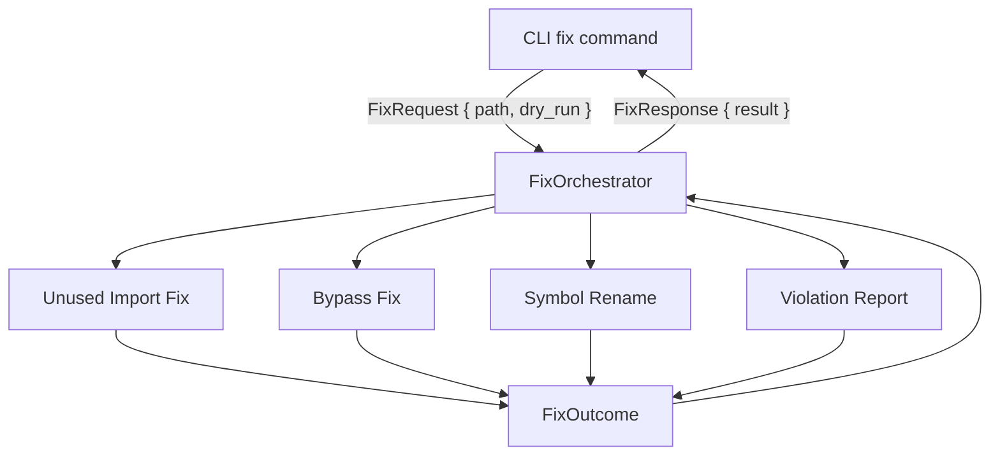

# FRD — auto-fix

## Feature Overview

The **auto-fix** feature sits in the infrastructure layer and is called by the CLI `fix` command through the agent-layer orchestrator. It consumes lint findings from the analysis pipeline, applies safe, deterministic corrections, and returns a reason-coded result. It calls the filesystem layer for read/write of source files and returns a `FixResult` that separates applied changes from violations that need a human.

**Allowed operation classes (product policy — locked):**

| Class | Examples | Notes |
|-------|----------|-------|
| **Remove** | Delete unused import lines; delete allow-attribute or bypass marker lines | No new code introduced |
| **Replace** | Replace an unwrap macro with an equivalent safe call on the same line | Local token/line substitution only |
| **Rename** | Prepend `renamed_` to flagged symbol names | Mechanical rename of symbol tokens, word-boundary aware |

**Out of scope:** multi-file renames, structural refactors, adding new imports or types, semantic rewrites, formatting-only passes, and panic-removal that requires semantic error handling.

Every fix attempt shall return a **reason-coded outcome** (`Applied` / `Skipped(reason)` / `Failed(reason)`), never a bare boolean. Dry-run shall report the same outcomes without writing files.

## Functional Requirements

### FR-AutoFix-001: Unused Import Removal

**Description:** The auto-fix feature shall remove the unused import flagged at a specific line, in place or as a dry-run preview. One call fixes exactly one flagged line; when the flag sits on an import line, the fix deletes that line. The result shall carry a reason-coded outcome so the caller distinguishes applied changes from skipped and failed attempts.

#### Business Logic
- One call shall fix exactly one flagged line; a flag that does not sit on an import line shall be rejected with `NotAnImportLine`
- A flagged import that spans multiple lines shall be rejected with `MultiLineImport`
- The flagged line shall not fall outside the file's line range; out-of-bounds flags shall fail with `LineOutOfBounds`
- Dry-run shall report the would-be change without writing the file on disk

#### Edge Cases
- A clean file yields no fix call at all; a file whose import list is already valid shall skip with `AlreadyValid`
- A missing or unreadable file shall fail with `FileNotFound` or `ReadError` rather than succeed silently
- Dry-run shall never modify the file on disk

#### Technical Specification
| Aspect | Detail |
|--------|--------|
| **Input** | `file_path` and flagged line number carried by the violation. Source: the fix pipeline driven by the CLI `fix` command. |
| **Output** | `FixOutcome` — `Applied { changes }` on a successful rewrite; `Skipped(reason)` when the line is not fixable; `Failed(reason)` on I/O trouble. Destination: the fix orchestrator. |
| **Protocol** | `IUnusedImportFixProtocol` |
| **Method** | `fix_unused_import` |
| **Event** | `FixApplied`, `FixSkipped`, `FixFailed` |
| **Error** | `FileNotFound`, `ReadError`, `NotAnImportLine`, `MultiLineImport`, `LineOutOfBounds`, `AlreadyValid` |

#### Test
| Context | When Action | Then Observable Result |
|---------|-------------|------------------------|
| A file contains one unused import at a flagged line | The unused import fix is invoked in place | `FixOutcome::Applied` is returned and the import line is removed from the file on disk |
| The flagged line is not an import line | The unused import fix is invoked | `FixOutcome::Skipped(NotAnImportLine)` is returned and the file is untouched |
| The file does not exist | The unused import fix is invoked | `FixOutcome::Failed(FileNotFound)` is returned |
| Dry-run is selected for a file with an unused import | The fix pipeline runs with dry-run | The preview lists the would-be removal and the file on disk stays byte-identical |

#### Metric
| Target Metric | Value |
|---------------|-------|
| Unused-import flags resolved per batch | 100% |
| Files modified by dry-run | 0 |
| Unreasoned skipped outcomes | 0 |

### FR-AutoFix-002: Bypass Fix

**Description:** The auto-fix feature shall strip a bypass marker at a flagged line, in place or as a dry-run preview. Known bypass surface — allow-attribute macros, hack comments, no-qa inline markers, and unwrap macro replacements — is in scope; an unmatched pattern skips with a reason so the caller can keep walking other violations.

#### Business Logic
- Only known bypass patterns shall be removed: allow-attribute macros, hack comments, no-qa inline markers, and unwrap macro replacements
- An unmatched pattern on the flagged line shall skip with `NoBypassPattern`
- A removal that would drop an error-handling context shall refuse with `UnsafeRemoval`
- A pattern that already carries its own context marker shall skip with `AlreadyHasContext`

#### Edge Cases
- Multiple bypass markers on one line are rewritten in one pass when all are known
- An unwrap macro in a context that needs error handling skips rather than corrupting the code
- Dry-run previews the edit and leaves the file untouched; a missing file fails with `FileNotFound`

#### Technical Specification
| Aspect | Detail |
|--------|--------|
| **Input** | `file_path` and flagged line number from the flagged violation. Source: the fix pipeline driven by the CLI `fix` command. |
| **Output** | `FixOutcome` — `Applied` with the change count; `Skipped(reason)` for an unmatched or unsafe pattern; `Failed(reason)` on I/O trouble. Destination: the fix orchestrator. |
| **Protocol** | `IBypassFixProtocol` |
| **Method** | `fix_bypass_comments` |
| **Event** | `FixApplied`, `FixSkipped`, `FixFailed` |
| **Error** | `NoBypassPattern`, `UnsafeRemoval`, `AlreadyHasContext`, `FileNotFound`, `ReadError` |

#### Test
| Context | When Action | Then Observable Result |
|---------|-------------|------------------------|
| A file carries a known bypass marker at a flagged line | The bypass fix is invoked in place | `FixOutcome::Applied` is returned and the marker is removed from the file on disk |
| The flagged line carries no known bypass pattern | The bypass fix is invoked | `FixOutcome::Skipped(NoBypassPattern)` is returned and the file is untouched |
| The bypass marker guards error handling that is still needed | The bypass fix is invoked | `FixOutcome::Skipped(UnsafeRemoval)` is returned |
| Dry-run is selected for a file with a bypass marker | The fix pipeline runs with dry-run | The preview lists the would-be removal and the file on disk stays byte-identical |

#### Metric
| Target Metric | Value |
|---------------|-------|
| In-scope bypass markers removed per batch | 100% |
| Out-of-scope lines skipped with a reason | 100% |
| Files modified by dry-run | 0 |

### FR-AutoFix-003: Symbol Renaming

**Description:** The auto-fix feature shall rename a flagged symbol across its entire file with word-boundary awareness, in place or as a dry-run preview. The rename is mechanical: the new name carries the `renamed_` prefix, and matching is word-boundary aware so substrings survive.

#### Business Logic
- The new name shall carry the `renamed_` prefix
- Occurrence matching shall be word-boundary aware so substrings of longer identifiers are not touched
- A new name that collides with a keyword shall skip with `KeywordConflict`
- A symbol with zero occurrences shall skip with `SymbolNotFound`; a file already compliant shall skip with `AlreadyValid`

#### Edge Cases
- Symbol occurrences inside string literals or comments move with the rename because the pass is textual and boundary-based
- A missing file fails with `FileNotFound`; dry-run previews the would-be rename without writing
- Zero occurrences skip rather than inventing one

#### Technical Specification
| Aspect | Detail |
|--------|--------|
| **Input** | `file_path`, `old_name`, and `new_name`. Source: the fix pipeline driven by the CLI `fix` command. |
| **Output** | `FixOutcome` — `Applied { changes }` with the replacement count; `Skipped(reason)` or `Failed(reason)`. Destination: the fix orchestrator. |
| **Protocol** | `ISymbolRenameProtocol` |
| **Method** | `rename_symbol` |
| **Event** | `FixApplied`, `FixSkipped`, `FixFailed` |
| **Error** | `KeywordConflict`, `SymbolNotFound`, `AlreadyValid`, `FileNotFound`, `ReadError` |

#### Test
| Context | When Action | Then Observable Result |
|---------|-------------|------------------------|
| A file contains occurrences of a flagged symbol | The symbol rename is invoked in place | `FixOutcome::Applied` is returned and every word-boundary occurrence is rewritten with the `renamed_` prefix |
| The new name collides with a language keyword | The symbol rename is invoked | `FixOutcome::Skipped(KeywordConflict)` is returned and the file is untouched |
| The flagged symbol has zero occurrences in the file | The symbol rename is invoked | `FixOutcome::Skipped(SymbolNotFound)` is returned |
| Dry-run is selected for a file with a flagged symbol | The fix pipeline runs with dry-run | The preview lists the would-be rename and the file on disk stays byte-identical |

#### Metric
| Target Metric | Value |
|---------------|-------|
| Flagged symbol occurrences rewritten per file | 100% |
| Substring collisions introduced by a rename | 0 |
| Files modified by dry-run | 0 |

### FR-AutoFix-004: Violation Reporting

**Description:** The auto-fix feature shall run the whole fix pipeline over a path and report what was fixed versus what still needs a human. `dry_run` is selectable per request: report what would change without writing, or apply every fixable violation and skip the rest. Violations that have no fixer shall never be rewritten — they shall be listed as manual work.

#### Business Logic
- `dry_run` shall be selectable per request: report would-be changes without writing, or apply every fixable violation and skip the rest
- Violations that have no fixer shall be listed as manual work and never rewritten
- The result shall merge applied changes with the non-fixable list in one `FixResult`
- Per-file failures shall never abort other files in the same batch

#### Edge Cases
- An empty path or a project with no violations shall return a clean result with zero changes
- A path that does not exist shall fail the CLI with a non-zero exit
- Per-file failures are reported as reason-coded entries and never abort the remaining files

#### Technical Specification
| Aspect | Detail |
|--------|--------|
| **Input** | `path` (file or directory) and `dry_run` flag from the fix request. Source: the CLI `fix` command. |
| **Output** | `FixResult` wrapping applied changes plus the non-fixable manual messages. Destination: the fix orchestrator. |
| **Protocol** | `IViolationReportProtocol` |
| **Method** | `report_violations` |
| **Event** | `FixApplied`, `FixSkipped`, `FixFailed` |
| **Error** | Missing path fails the CLI with a non-zero exit; per-file failures are reason-coded entries that never abort other files |

#### Test
| Context | When Action | Then Observable Result |
|---------|-------------|------------------------|
| The target project has no violations | The fix pipeline runs over the path | A clean result with zero changes is returned |
| The path does not exist | The CLI fix command runs | The CLI exits with a non-zero exit code |
| A project mixes fixable and non-fixable violations | The fix pipeline runs with dry-run off | Applied changes are reported and the non-fixable violations are listed as manual work |
| One file in the batch fails | The fix pipeline runs over the batch | The failure is reported as a reason-coded entry and the remaining files are processed |

#### Metric
| Target Metric | Value |
|---------------|-------|
| Bytes changed on disk under dry-run | 0 |
| Fixable violations accounted for in the result | 100% |
| Missing-path batches exiting non-zero | 100% |

## Public Interface

| Aspect | Detail |
|--------|--------|
| Agent | `FixOrchestrator` |
| Aggregate | `IFixAggregate` |
| Method | `execute` |
| Request | `FixRequest::Execute { path, dry_run }` |
| Response | `FixResponse::Execute { result }` |

## Reference

| Artifact | Purpose | Link |
|----------|---------|------|
| PRD | Business goals, user stories, and scope | [PRD.md](../../PRD.md) |
| Backlog | Task tracking, epics, and implementation status | [BACKLOG.md](./BACKLOG.md) |
| Roadmap | Timeline, phasing, and dependencies | [ROADMAP.md](../../ROADMAP.md) |
| Architecture | System boundaries, tech stack, and infra | [ARCHITECTURE.md](../../ARCHITECTURE.md) |
