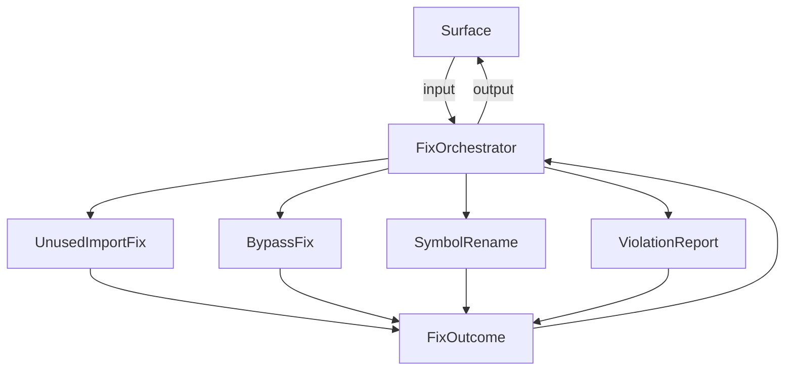

# FRD — auto-fix (v3.0.0)

---

## Feature Overview

The auto-fix crate applies safe, deterministic corrections to source files that violate AES rules. It consumes lint results from the analysis pipeline, filters violations by fixable error code, and writes corrected files back to disk.

- **Allowed Operation Classes (product policy — locked)**

| Class       | Examples                                                          | Notes                                    |
| ----------- | ----------------------------------------------------------------- | ---------------------------------------- |
| **Remove**  | Delete unused import lines; delete `#[allow(...)]` / bypass comment lines | No new code introduced                  |
| **Replace** | `unwrap()` → `expect("safe")` on the same line                    | Local token/line substitution only      |
| **Rename**  | Prepend `renamed_` (or keep valid snake_case) for AES101 symbols   | Mechanical rename of extracted symbol tokens |

**Out of scope:** multi-file renames, structural refactors, adding new imports/types, semantic rewrites, formatting-only passes, `panic!` removal (requires semantic error handling).

Every fix attempt MUST return a **reason-coded outcome** (`Applied` / `Skipped(reason)` / `Failed(reason)`), not a bare boolean. Dry-run reports the same outcomes without writing files.

- **Architecture & Data Flow**

Each of the 4 FRs maps to exactly 1 protocol trait and exactly 1 capability struct.

---

## Functional Requirements

### FR-AutoFix-001: Unused Import Removal (AES203)

- **Description**: Automatically remove import lines (`use`, `import`, `from`, `require(`, `= require(`) that are not referenced in the file.
- **Input**: A file path containing an unused import violation reported as AES203 by the linter.
- **Output**: The file with the unused import line deleted. A reason-coded `FixOutcome` is returned.
- **Business Rules**:

  - Only lines matching import patterns (`use`, `import`, `from`, `require(`, `= require(`) at the target line are removed.
  - The target line number must be valid (1-indexed, within file length).
  - **Multi-line imports**: If the target line is part of a multi-line import block (detected by unclosed `{`, trailing `,`, or previous-line continuation), the fix is `Skipped(multi_line_import)` — removing a single line from a multi-line import would break syntax.
  - In dry-run mode, returns `Applied` (would apply) without modifying the file.
- **Edge Cases**:

  - File does not exist → `Failed(file_not_found)`, no modification.
  - Line number is 0 or exceeds file length → `Skipped(line_out_of_bounds)`.
  - Target line is not an import statement → `Skipped(not_an_import_line)`.
  - Multi-line import block → `Skipped(multi_line_import)`.
  - File has no trailing newline after the removed line → content is reconstructed with newlines preserved.
- **Error Handling**:

  - File read failure (I/O error) → `Failed(read_error)`.
  - File write failure → `Failed(write_error)`, file is not modified.

---

### FR-AutoFix-002: Bypass Fix (AES304)

- **Description**: Remove or replace bypass patterns from source lines. Only patterns with safe mechanical fixes are applied. Patterns requiring semantic understanding are skipped.
- **Input**: A file path and line number containing an AES304 bypass violation.
- **Output**: The bypass is removed or replaced. A reason-coded `FixOutcome` is returned.
- **Business Rules**:

  | Pattern             | Fix Action                            | Outcome                          |
  | ------------------- | ------------------------------------- | -------------------------------- |
  | `#[allow(...)]`     | Remove entire line                    | `Applied`                        |
  | `// noqa`           | Strip comment from line, keep code    | `Applied`                        |
  | `# noqa`            | Strip comment from line, keep code    | `Applied`                        |
  | `# type: ignore`    | Strip comment from line, keep code    | `Applied`                        |
  | `// FIXME`          | Strip comment from line, keep code    | `Applied`                        |
  | `// HACK`           | Strip comment from line, keep code    | `Applied`                        |
  | `// XXX`            | Strip comment from line, keep code    | `Applied`                        |
  | `unwrap()`          | Replace with `expect("safe")`         | `Applied`                        |
  | `unwrap();`         | Replace with `expect("safe");`        | `Applied`                        |
  | `panic!(...)`       | **Skip** — requires semantic error handling | `Skipped(unsafe_removal)`   |
  | `todo!(...)`        | **Skip** — future-logic placeholder             | `Skipped(unsafe_removal)`   |
  | `unimplemented!(...)` | **Skip** — future-logic placeholder             | `Skipped(unsafe_removal)`   |
  | `unreachable!(...)` | **Skip** — requires semantic analysis      | `Skipped(unsafe_removal)`   |
  | `expect(...)`       | **Skip** — already has context message      | `Skipped(already_has_context)` |

  - Inline comment patterns (`noqa`, `type: ignore`, `FIXME`, `HACK`, `XXX`) are **stripped** from the line (the surrounding code is preserved), not deleted entirely.
  - Standalone comment-only lines and `#[allow]` attribute lines are **removed entirely** (entire line deleted).
  - `unwrap_or()`, `unwrap_or_else()`, `unwrap_or_default()` → NOT modified (safe variants, not violations).
  - In dry-run mode, returns `Applied` or `Skipped` (would apply) without modifying the file.
- **Edge Cases**:

  - File does not exist → `Failed(file_not_found)`.
  - Line number out of bounds → `Skipped(line_out_of_bounds)`.
  - Target line has no bypass pattern → `Skipped(no_bypass_pattern)`.
  - Stripping comment leaves only whitespace → entire line removed.
- **Error Handling**:

  - File read failure → `Failed(read_error)`.
  - File write failure → `Failed(write_error)`.

---

### FR-AutoFix-003: Symbol Renaming (AES101)

- **Description**: Rename symbols that violate snake_case naming conventions by applying a mechanical rename transform with word-boundary-aware replacement.
- **Input**: A file path, old symbol name, and new symbol name.
- **Output**: All word-boundary occurrences of the old symbol name are replaced with the new name. A reason-coded `FixOutcome` is returned with the change count.
- **Business Rules**:

  - The rename uses word-boundary-aware replacement to avoid false positives inside strings, comments, or unrelated identifiers.
  - Only applied if old name ≠ new name and old name exists in the file.
  - **Limitation**: This is a mechanical rename that ensures the symbol is flagged differently on re-scan. It does NOT produce semantically correct snake_case names (e.g., `MyStruct` → `renamed_MyStruct`, not `my_struct`). Correct renaming requires developer judgment.
  - In dry-run mode, returns `Applied` with change count without modifying the file.
- **Edge Cases**:

  - File does not exist → `Failed(file_not_found)` with change count 0.
  - Old name not found in file content → `Skipped(symbol_not_found)` with change count 0.
  - Symbol appears multiple times → all word-boundary occurrences are replaced; `Applied` with change count.
  - New name is a Rust keyword → `Skipped(keyword_conflict)`.
- **Error Handling**:

  - File read failure → `Failed(read_error)`.
  - File write failure → `Failed(write_error)`.

---

### FR-AutoFix-004: Violation Reporting (Dry-Run + Non-Fixable)

- **Description**: Run the fix pipeline over a file, apply all fixable violations (AES101, AES203, AES304), and produce a report containing both applied fix summaries and any non-fixable violations requiring manual attention.
- **Input**: A file path and a `dry_run` flag (selectable per request).
- **Output**: A `FixResult` summarizing what was fixed and listing non-fixable violations.
- **Business Rules**:

  - Fixable codes: `AES101`, `AES203`, `AES304` (subset — see FR-AutoFix-002 table for which AES304 patterns are fixable).
  - All other error codes are reported as requiring manual attention.
  - AES304 violations with `Skipped(unsafe_removal)` or `Skipped(already_has_context)` outcome during fix are included in the manual report as skipped items.
  - In dry-run mode, no files are modified; outcomes mirror a real run.
  - The `dry_run` flag is a per-request parameter, not a process-level setting.
  - **Process exit code aggregation**: Aligned with PRD Exit Code Contract, if any item produces `Failed(reason)` the aggregate exit code is 2; if all items are `Applied` and/or `Skipped(reason)` with zero failures, the exit code is 0 with skip warnings emitted.
- **Edge Cases**:

  - No violations found → reports "No automatic fixes applied".
  - Empty violation list → returns empty report.
- **Error Handling**: Linter pipeline failure → propagated as error in `FixResult`.

---

- **Reason Code Reference**

`Skipped(reason)` and `Failed(reason)` carry a **closed** set of reason codes,
not free text. This table is the canonical enumeration across every fix
capability; a consumer (CI dashboard, MCP tool surface, report renderer) may
treat any value outside it as a contract breach.

| Reason | Outcome | Capability | Meaning |
|---|---|---|---|
| `MultiLineImport` | Skipped | import removal | The target line belongs to a multi-line import block; deleting one line would break syntax |
| `LineOutOfBounds` | Skipped | import removal, bypass removal | Line number is 0 or past end of file |
| `NotAnImportLine` | Skipped | import removal | The target line is not an import statement |
| `NoBypassPattern` | Skipped | bypass removal | The target line carries no recognised bypass pattern |
| `UnsafeRemoval` | Skipped | bypass removal | The pattern needs semantic understanding (`panic!`, `todo!`, `unimplemented!`, `unreachable!`) |
| `AlreadyHasContext` | Skipped | bypass removal | The pattern already carries a context message (e.g. `expect("…")`) |
| `AlreadyValid` | Skipped | rename | The symbol name is already valid snake_case |
| `SymbolNotFound` | Skipped | rename | The old symbol name does not occur in the file |
| `KeywordConflict` | Skipped | rename | The new name collides with a language keyword |
| `FileNotFound` | Failed | all | The target file does not exist |
| `ReadError` | Failed | all | The file could not be read |
| `WriteError` | Failed | all | The file could not be written; the file is left untouched |

Nine skip reasons and three fail reasons, twelve in total. The FR sections
above spell out when each one fires, using the lower-case spelling
(`Skipped(multi_line_import)`); the canonical identifier is the enumerated name
in this table. Adding a fix capability means adding its reasons here in the
same change — `CONTRIBUTING.md`'s Feature Change checklist carries the
obligation, and the cross-document consistency gate in CI fails when this table
and the enumerated reason set disagree.

---

## Public Interface

### Protocol API

| Protocol Trait | Method | Input | Output | Error | Event | Description |
|---|---|---|---|---|---|---|
| `IUnusedImportFixProtocol` (FR-001) | `fix_unused_import` | &str, LineNumber | `FixOutcome` | — | — | Remove unused import at line. |
| `IBypassFixProtocol` (FR-002) | `fix_bypass_comments` | &str, LineNumber | `FixOutcome` | — | — | Fix bypass comments at line. |
| `ISymbolRenameProtocol` (FR-003) | `rename_symbol` | &str, &str, &str | `FixOutcome` | — | — | Rename symbol across file. |
| `IViolationReportProtocol` (FR-004) | `report_violations` | &FilePath, bool | `FixResult` | — | — | Execute pipeline + report non-fixable. |

### Aggregate API

| Method | Input | Output | Error | Event | Description |
|---|---|---|---|---|---|
| `execute` | FixRequest | `FixResponse` | — | — | Single composite entry point over the feature. |

## Reference

- Backlog: [BACKLOG.md](BACKLOG.md) — real condition for this feature; this file is specification only.
- PRD: [PRD.md](../../PRD.md)
- Architecture: [ARCHITECTURE.md](../../ARCHITECTURE.md)
- Quality Rules FRD: `crates/quality-rules/FRD.md` (AES304 bypass patterns)

| Roadmap | {Link to ROADMAP.md} | [{link}](ROADMAP.md) |
