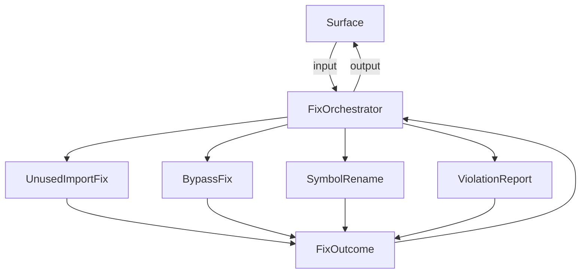

# FRD — auto-fix

---

## Feature Overview

---

## Functional Requirements

### FR-AutoFix-001: Unused Import Removal (AES203)

| Aspect | Detail|
|--------|-------|
| Description | Remove the unused import at a flagged line, in place or as a dry-run preview. |
| Business Rules | One call fixes exactly one flagged line; the flag must sit on an import line (`NotAnImportLine` otherwise) and must not span multiple lines (`MultiLineImport`); the import list must not fall out of bounds (`LineOutOfBounds`); dry-run reports the would-be change without writing. |
| Edge Cases | A clean file yields no call at all; an already-valid import list skips with `AlreadyValid`; a missing or unreadable file fails with `FileNotFound`/`ReadError` rather than succeeding silently; dry-run never modifies the file on disk. |
| Capability | `UnusedImportFix` implements `IUnusedImportFixProtocol` (`fix_unused_import`, plus the `fix_unused_import_dry` seam the FR-AutoFix-004 pipeline drives). |
| Protocol | `IUnusedImportFixProtocol` in `shared/auto_fix`. |
| Method | `fix_unused_import(&self, file_path: &str, line: LineNumber) -> FixOutcome` |
| Input | `file_path: &str` and `line: LineNumber` carried by the flagged violation. |
| Output | `FixOutcome` — `Applied { changes }` on a successful rewrite, `Skipped(reason)` when the line is not fixable, `Failed(reason)` on I/O trouble. |
| Error | Read/write failures surface as `FixOutcome::Failed(FailReason::...)`; an unfixable line returns `Skipped`, so the caller still gets a structured outcome, never a panic. |
| Event | `lint-arwaky-cli fix <path> --dry-run` runs the same seam with `dry_run` selected per `FixRequest`; `scan`/`check` only detect, they do not fix. |
| Test | `acceptance_AES201_fix` suite proves the fix path reports fixable codes; `e2e_auto_fix_flow` — `e2e_dry_run_file_with_unused_import`, `e2e_dry_run_clean_file`; `contract_auto_fix` — `unused_import_fix_implements_unused_import_fix_protocol`. |
| Metric | Every flagged `AES203` violation under `fix <path> --dry-run` yields `Applied` or an explicit `Skipped` reason, and files stay byte-identical in dry-run as pinned by `e2e_dry_run_file_with_unused_import`. |

### FR-AutoFix-002: Bypass Fix (AES304)

| Aspect | Detail|
|--------|-------|
| Description | Strip a bypass comment or bypass macro at the flagged line, in place or as a dry-run preview. |
| Business Rules | Known bypass surface only: allow attributes, hack comments, noqa inline markers, and unwrap macros are in scope; the replacement class is a same-line token substitution (unwrap becomes expect carrying a reason on that line) with no structural change; an unmatched pattern skips with `NoBypassPattern`; unsafe removals refuse with `UnsafeRemoval`; context-bearing patterns skip with `AlreadyHasContext`. |
| Edge Cases | Multiple bypass markers on one line are rewritten in one pass when all are known; an unwrap in a macro context still skips rather than corrupt code; dry-run previews the edit and leaves the file untouched; a missing file fails with `FileNotFound`. |
| Capability | `BypassFix` implements `IBypassFixProtocol` (`fix_bypass_comments`, plus the `fix_bypass_dry` seam the FR-AutoFix-004 pipeline drives). |
| Protocol | `IBypassFixProtocol` in `shared/auto_fix`. |
| Method | `fix_bypass_comments(&self, file_path: &str, line: LineNumber) -> FixOutcome` |
| Input | `file_path: &str` plus `line: LineNumber` from the flagged violation. |
| Output | `FixOutcome` — `Applied` with the change count, `Skipped(reason)` for an unmatched or unsafe pattern, `Failed(reason)` on I/O trouble. |
| Error | Read/write failures return `Failed(FailReason::...)`; a non-bypass line returns `Skipped(NoBypassPattern)` so the orchestrator can keep walking other violations. |
| Event | `lint-arwaky-cli fix <path> --dry-run` (and without `--dry-run` to apply), routed through `FixRequest::Execute { path, dry_run }`. |
| Test | `acceptance_AES304_fix` — `aes304_bypass_comment_is_fixable`, `aes304_unwrap_pattern_detected`, `aes304_dry_run_does_not_modify_file`; `unit_auto_fix_fix_processor` — `fix_bypass_strips_allow_attr`, `fix_bypass_strips_hack_comment`, `fix_bypass_strips_noqa_inline`, `fix_bypass_replaces_unwrap`. |
| Metric | All in-scope `AES304` bypass patterns are removed by `fix <path>` and only previewed by `--dry-run`; out-of-scope lines come back `Skipped` with a reason. |

### FR-AutoFix-003: Symbol Renaming (AES101)

| Aspect | Detail|
|--------|-------|
| Description | Rename a flagged symbol across the whole file with word-boundary awareness, in place or as a dry-run preview. |
| Business Rules | Rename is mechanical: the new name carries the `renamed_` prefix; matching is word-boundary aware so substrings survive; a name that collides with a keyword skips with `KeywordConflict`; an absent target skips with `SymbolNotFound`; `AlreadyValid` when the file is already compliant. |
| Edge Cases | Symbols appearing inside strings/comments move with the rename because the pass is textual and boundary-based, never AST-based; a missing file fails with `FileNotFound`; dry-run prints the would-be rename without writing; zero occurrences skip rather than inventing one. |
| Capability | `SymbolRename` implements `ISymbolRenameProtocol` (`rename_symbol`, plus the `rename_symbol_dry` seam the FR-AutoFix-004 pipeline drives). |
| Protocol | `ISymbolRenameProtocol` in `shared/auto_fix`. |
| Method | `rename_symbol(&self, file_path: &str, old_name: &SymbolName, new_name: &SymbolName) -> FixOutcome` |
| Input | `file_path: &str`, `old_name: &SymbolName`, `new_name: &SymbolName` (the dry variant additionally takes `dry_run: bool`). |
| Output | `FixOutcome` — `Applied { changes }` with the replacement count, `Skipped(reason)`, or `Failed(reason)`. |
| Error | Keyword collisions and missing symbols return `Skipped(SymbolNotFound)`/`Skipped(KeywordConflict)`; I/O errors return `Failed(FailReason::...)`. |
| Event | `lint-arwaky-cli fix <path> --dry-run` for preview, `lint-arwaky-cli fix <path>` to write; driven per request through `FixRequest::Execute { path, dry_run }`. |
| Test | `acceptance_AES101_fix` — `aes101_naming_violation_is_fixable_dry_run`, `aes101_dry_run_does_not_modify_file`; `contract_auto_fix` — `symbol_rename_implements_symbol_rename_protocol`; `unit_auto_fix_fix_processor` includes the rename processor cases. |
| Metric | Every flagged `AES101` naming violation previews with `Applied` under `--dry-run` and rewrites every word-boundary occurrence when run for real. |

### FR-AutoFix-004: Violation Reporting (Dry-Run + Non-Fixable)

| Aspect | Detail|
|--------|-------|
| Description | Run the whole fix pipeline over a path and report what was fixed versus what still needs a human. |
| Business Rules | `dry_run` is selectable per request: report what would change without writing, or apply every fixable violation and skip the rest; violations that have no fixer are never rewritten — they are listed as manual work; exit signal comes from the `FixResult`, which merges applied changes with the non-fixable list. Every attempt returns a reason-coded outcome — `Applied`, `Skipped(reason)`, or `Failed(reason)` — and dry-run reports the same codes without writing files. Out of scope: multi-file renames, structural refactors, added imports or types, semantic rewrites, formatting-only passes, and `panic!` removal. |
| Edge Cases | An empty path or a project with no violations returns a clean `FixResult` with zero changes; a path that does not exist fails the CLI with a non-zero exit (dogfood pins this); a file that appears mid-walk is read once; walker-level skips (`MultiLineImport`, `LineOutOfBounds`) never abort the batch. |
| Capability | `ViolationReport` implements `IViolationReportProtocol` (`report_violations`, `report_non_fixable`); it walks the tree, delegates each fixable violation to the three fix capabilities, and keeps non-fixable codes as a manual report. |
| Protocol | `IViolationReportProtocol` in `shared/auto_fix`. |
| Method | `report_violations(&self, path: &FilePath, dry_run: bool) -> FixResult` and `report_non_fixable(&self, violations: &[LintResult]) -> Vec<LintMessage>` |
| Input | `path: &FilePath` (file or directory) and `dry_run: bool` from `FixRequest::Execute { path, dry_run }`. |
| Output | `FixResult` wrapping applied changes plus the non-fixable manual messages; the orchestrator returns it as `FixResponse::Execute { result }`. |
| Error | Failure outcomes set the error half of the result so the CLI can exit non-zero; a missing path is a hard CLI error; per-file failures are `SkipReason`/`FailReason` entries, they never abort other files. |
| Event | `lint-arwaky-cli fix <path> --dry-run` (preview) and `lint-arwaky-cli fix <path>` (apply); the request factory is `FixRequest::Execute`. |
| Test | `integration_auto_fix` — `orchestrator_execute_on_empty_project_dry_run`, `orchestrator_report_no_manual_violations_on_empty`, `orchestrator_execute_per_request_dry_run_false`; `e2e_auto_fix_flow` — `e2e_per_request_dry_run_toggle`; `dogfood_auto_fix` — `dogfood_cli_exits_nonzero_on_a_path_that_does_not_exist`; `contract_auto_fix` — protocol/aggregate impl coverage. |
| Metric | Under `--dry-run` zero bytes change on disk across the batch while every fixable violation is accounted for; a missing path exits non-zero every time. |

## Public Interface

| Aspect | Detail|
|--------|-------|
| Agent | `FixOrchestrator` — the agent-layer orchestrator behind the fix command (built by the auto-fix container from `FixOrchestratorDeps`: violation report, unused-import fix, bypass fix, symbol rename). |
| Aggregate | `IFixAggregate` — the feature's single front door. |
| Method | `execute(&self, request: FixRequest) -> FixResponse`. |
| Request | `FixRequest::Execute { path, dry_run }` — the sole variant; dry-run is chosen per request, not by global state. |
| Response | `FixResponse::Execute { result: FixResult }` — applied change count plus the non-fixable manual report. |

## Reference

| Artifact | Purpose | Link |
|----------|---------|------|
| PRD | Business goals, user stories, and scope | [PRD.md](../../PRD.md) |
| Backlog | Task tracking, epics, and implementation status | [BACKLOG.md](BACKLOG.md) |
| Roadmap | Timeline, phasing, and dependencies | [ROADMAP.md](../../ROADMAP.md) |
| Architecture | System boundaries, tech stack, and infra | [ARCHITECTURE.md](../../ARCHITECTURE.md) |
