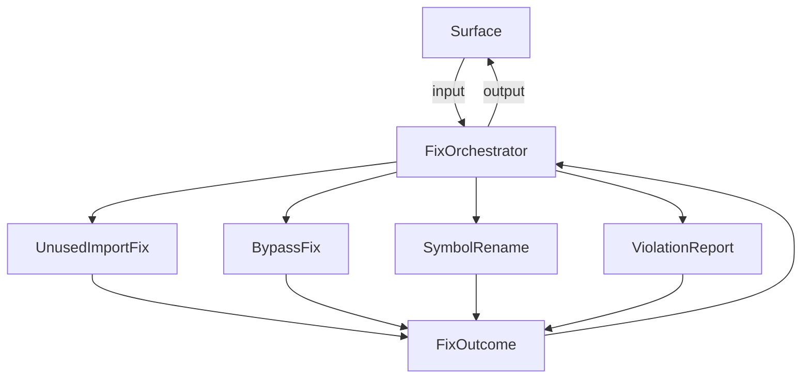

# FRD — auto-fix (v3.0.0)

---

## Feature Overview

The auto-fix crate applies safe, deterministic corrections to source files that violate AES rules. It consumes lint results from the analysis pipeline, filters violations by fixable error code, and writes corrected files back to disk.

- **Allowed Operation Classes (product policy — locked)**

| Class       | Examples                                                          | Notes                                   |
| ----------- | ----------------------------------------------------------------- | ----------------------------------------|
| **Remove**  | Delete unused import lines; delete `#[allow(...)]` / bypass comment lines | No new code introduced                 |
| **Replace** | `unwrap()` → `expect("safe")` on the same line                    | Local token/line substitution only     |
| **Rename**  | Prepend `renamed_` (or keep valid snake_case) for AES101 symbols   | Mechanical rename of extracted symbol tokens|

**Out of scope:** multi-file renames, structural refactors, adding new imports/types, semantic rewrites, formatting-only passes, `panic!` removal (requires semantic error handling).

Every fix attempt MUST return a **reason-coded outcome** (`Applied` / `Skipped(reason)` / `Failed(reason)`), not a bare boolean. Dry-run reports the same outcomes without writing files.

- **Architecture & Data Flow**

Each of the 4 FRs maps to exactly 1 protocol trait and exactly 1 capability struct.

---

## Functional Requirements

### FR-AutoFix-001: Unused Import Removal (AES203)

| Aspect | Detail|
|--------|-------|
| Description | |
| Business Rules | |
| Edge Cases | |
| Capability | |
| Protocol | |
| Method | |
| Input | |
| Output | |
| Error | |
| Event | |
| Test | |
| Metric | |

### FR-AutoFix-002: Bypass Fix (AES304)

| Aspect | Detail|
|--------|-------|
| Description | |
| Business Rules | |
| Edge Cases | |
| Capability | |
| Protocol | |
| Method | |
| Input | |
| Output | |
| Error | |
| Event | |
| Test | |
| Metric | |

### FR-AutoFix-003: Symbol Renaming (AES101)

| Aspect | Detail|
|--------|-------|
| Description | |
| Business Rules | |
| Edge Cases | |
| Capability | |
| Protocol | |
| Method | |
| Input | |
| Output | |
| Error | |
| Event | |
| Test | |
| Metric | |

### FR-AutoFix-004: Violation Reporting (Dry-Run + Non-Fixable)

| Aspect | Detail|
|--------|-------|
| Description | |
| Business Rules | |
| Edge Cases | |
| Capability | |
| Protocol | |
| Method | |
| Input | |
| Output | |
| Error | |
| Event | |
| Test | |
| Metric | |

## Public Interface

| Aspect | Detail|
|--------|-------|
| — | — |

## Reference

| Artifact | Purpose | Link|
|----------|---------|------|
| BACKLOG.md | Backlog tracking | [BACKLOG.md](BACKLOG.md)|
| PRD.md | Product requirements | [PRD.md](../../PRD.md)|
| FRD.md | Feature requirements | [FRD.md](FRD.md)|
| ROADMAP.md | Roadmap status | [ROADMAP.md](../../ROADMAP.md)|
| ARCHITECTURE.md | Layer contract | [ARCHITECTURE.md](../../ARCHITECTURE.md)|
