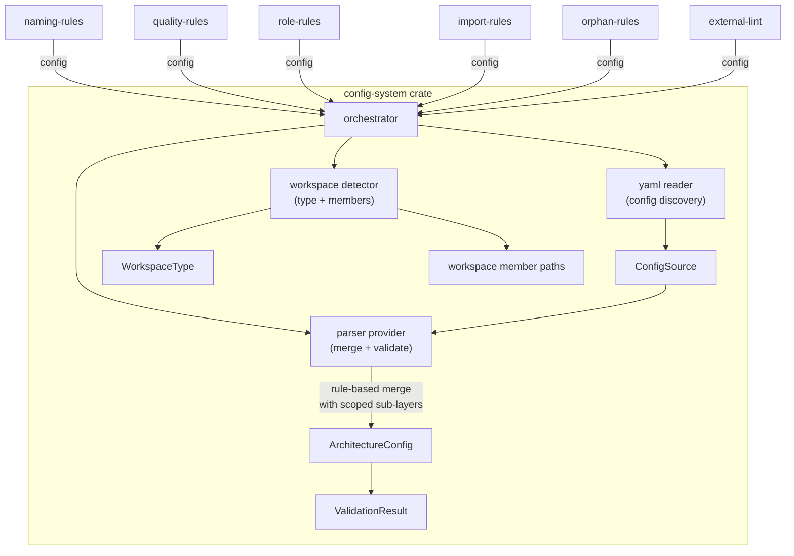

# FRD — config-system

---

## Feature Overview

The config-system crate manages lint-arwaky configuration as a business capability: discovering projects, loading and merging configuration, validating thresholds, and determining which paths the linter should ignore. It is an **infrastructure crate** — at compile time it depends only on `shared` and `filesystem` (for config file I/O via `IFileSystemIOProtocol`). Other crates receive config at runtime via DI (aggregate trait injection through `shared` re-exports).

- **Architecture & Data Flow**


- **Config Loading Priority Chain**

```text
Priority 1: Project root
  lint_arwaky.config.yaml at project root
      │ (not found)
      ▼
Priority 2: Parent directories (project root plus up to 4 ancestor levels — 5 levels total)
  Walk up 5 levels (root, then 4 ancestors) looking for config file
      │ (not found)
      ▼
Priority 3: XDG user config
  ~/.config/lint-arwaky/lint_arwaky.config.yaml
      │ (not found)
      ▼
Priority 4: XDG system dirs
  /etc/xdg/lint-arwaky/ (max 8 dirs, absolute paths only)
      │ (not found)
      ▼
Priority 5: Embedded defaults
  Compiled into binary, always available

First match wins — no merge across priority levels.
Loaded config is merged with embedded defaults via rule-based layer merging (FR-ConfigSystem-003).
```

---

## Functional Requirements

### FR-ConfigSystem-001: Config Discovery

#### Description

| No | Detail |
| --- | --- |
| 1 | Locate and load the first config matching a project root and language, following the 5-level priority chain. |
| 2 | — |
| ∞ | — |

#### Business Rules

| No | Detail |
| --- | --- |
| 1 | Local project files are tried first in the language's filename order, then parents within the depth bound; `None` means the caller falls back to embedded defaults. |
| 2 | Every config file present at the root is listed deduplicated by path; a raw YAML string parses to the adapter entry list, and a string with no `adapters:` key yields an empty vector so defaults apply. |
| ∞ | — |

#### Edge Cases

| No | Detail |
| --- | --- |
| 1 | No config anywhere returns `Ok(None)` rather than an error; an empty config string yields no adapters. |
| 2 | A symlink target outside the root is refused; a crafted language value cannot escape the root; parent-directory search stops at the depth bound and never leaves the tree. |
| ∞ | — |

#### Capability

| No | Detail |
| --- | --- |
| 1 | `ConfigYamlReader` implements `IConfigReadProtocol` (`read_config`, `list_config_files`, `read_config_from_content`). |

#### Protocol

| No | Detail |
| --- | --- |
| 1 | `IConfigReadProtocol` in `shared/config_system`. |

#### Method

| No | Detail |
| --- | --- |
| 1 | `read_config(&self, project_root: &FilePath, language: ConfigLanguage) -> Result<Option<ConfigSource>, ConfigError>` |
| 2 | — |
| ∞ | — |

#### Input

| No | Detail |
| --- | --- |
| 1 | `project_root: &FilePath`, `language: ConfigLanguage`, or a raw YAML `content: &str` for the content reader. |
| 2 | — |

#### Output

| No | Detail |
| --- | --- |
| 1 | `Result<Option<ConfigSource>, ConfigError>` — first match in the priority chain, or `None` for fallback. |
| 2 | The lister returns deduped paths; the content reader returns `Vec<AdapterEntry>`. |
| ∞ | — |

#### Error

| No | Detail |
| --- | --- |
| 1 | Missing files are `None`/empty vectors (never hard errors); malformed content reaches the caller as `ConfigError` only when the parse path opts into it. |
| 2 | Traversal and injection attempts are rejected outright. |

#### Event

| No | Detail |
| --- | --- |
| 1 | `lint-arwaky-cli config show` reads through `ConfigRequest::ReadConfig`/`show`; `check`, `ci`, and `scan` consume the same discovery when they load project config. |
| 2 | — |
| ∞ | — |

#### Test

| No | Detail |
| --- | --- |
| 1 | `acceptance_FR_001` — `us1_config_in_project_root_is_found`, `us1_config_in_parent_directory_is_found`. |
| 2 | `acceptance_FR_005` — `us5_symlink_outside_root_is_rejected`, `us5_config_language_prevents_path_injection`; `unit_config_system_yaml_reader` — `read_config_searches_parent_directories_up_to_depth_3`, `read_config_returns_none_when_no_file_found`, `list_config_files_finds_unified_config`. |
| ∞ | — |

#### Metric

| No | Detail |
| --- | --- |
| 1 | A project with a config is found on the first correct priority level every run. |
| 2 | With none present, loads return `None` from defaults within a single walk of the bounded parent chain. |
| ∞ | — |

### FR-ConfigSystem-002: Multi-Workspace

#### Description

| No | Detail |
| --- | --- |
| 1 | Detect workspace type, probe workspace roots, and enumerate member directories under the layout roots. |
| 2 | — |
| ∞ | — |

#### Business Rules

| No | Detail |
| --- | --- |
| 1 | Workspace type comes from marker files (`Cargo.toml`, `pyproject.toml`, `package.json`, and Python secondary markers); a root is a workspace when it holds `crates/`, `packages/`, or `modules/`. |
| 2 | Members are the immediate directories of those layout roots; detection probes marker files first and folder structure second. |
| ∞ | — |

#### Edge Cases

| No | Detail |
| --- | --- |
| 1 | A plain directory with none of the markers is `NonWorkspace`; an empty but valid workspace root returns zero members rather than an error. |
| 2 | One root holding several layout folders contributes all of them; a marker file alone without layout folders is detected as a typed project but reports non-workspace until layout roots exist. |
| ∞ | — |

#### Capability

| No | Detail |
| --- | --- |
| 1 | `WorkspaceDetector` implements `IWorkspaceMembersProtocol` (`detect`, `is_workspace`, `discover_workspace_members`). |

#### Protocol

| No | Detail |
| --- | --- |
| 1 | `IWorkspaceMembersProtocol` in `shared/config_system`. |

#### Method

| No | Detail |
| --- | --- |
| 1 | `discover_workspace_members(&self, root: &FilePath) -> Vec<FilePath>` (with `detect(&self, path: &FilePath) -> WorkspaceType` and `is_workspace(&self, path: &FilePath) -> bool`). |
| 2 | — |
| ∞ | — |

#### Input

| No | Detail |
| --- | --- |
| 1 | `root: &FilePath` — the candidate workspace root (or any path, for `detect`/`is_workspace`). |
| 2 | — |

#### Output

| No | Detail |
| --- | --- |
| 1 | `Vec<FilePath>` — one member directory per layout entry; `WorkspaceType` for detection; a boolean for the workspace probe. |
| 2 | — |
| ∞ | — |

#### Error

| No | Detail |
| --- | --- |
| 1 | No I/O failures are surfaced: an unreadable root behaves like an empty one. |
| 2 | Enumeration returns an empty vector rather than an error. |

#### Event

| No | Detail |
| --- | --- |
| 1 | `check` runs `ConfigRequest::DiscoverWorkspaces { root }` to scope a run; `ci` and multi-member `scan` rely on the same enumeration. |
| 2 | — |
| ∞ | — |

#### Test

| No | Detail |
| --- | --- |
| 1 | `acceptance_FR_004` — `us4_discovers_all_workspace_member_types`, `us4_each_member_gets_own_config`, `us4_empty_workspace_returns_empty`; `acceptance_FR_002` — per-language workspace config loads. |
| 2 | `unit_config_system_workspace_detector` — `detect_rust_workspace_by_cargo_toml`, `detect_typescript_workspace_by_package_json`, `detect_python_workspace_by_pyproject_toml`. |
| ∞ | — |

#### Metric

| No | Detail |
| --- | --- |
| 1 | Every workspace with layout roots enumerates exactly its member directories — zero false roots, zero misses. |
| 2 | As pinned by `us4_discovers_all_workspace_member_types`. |
| ∞ | — |

### FR-ConfigSystem-003: Config Merger

#### Description

| No | Detail |
| --- | --- |
| 1 | Merge parsed configuration into embedded defaults with rule-based layer merging, including scoped sub-layer creation. |
| 2 | — |
| ∞ | — |

#### Business Rules

| No | Detail |
| --- | --- |
| 1 | YAML parses into `ProjectConfig` (wrapping `ArchitectureConfig`); warnings are collected rather than thrown. |
| 2 | Merging overlays user rules onto embedded defaults so a user rule wins on conflict and untouched layers keep defaults; TOML reads only the `tool.lint-arwaky` section — a missing section returns `None` rather than an error. |
| ∞ | — |

#### Edge Cases

| No | Detail |
| --- | --- |
| 1 | A YAML file that does not exist fails with `ConfigError` file-not-found; invalid YAML fails with a parse error; an empty file keeps defaults. |
| 2 | A TOML file without the tool section returns `None`; underscore key aliases are accepted; score thresholds outside 0–100 fail validation later at the orchestrator. |
| ∞ | — |

#### Capability

| No | Detail |
| --- | --- |
| 1 | `ConfigParserProvider` implements `IConfigMergeProtocol` (`parse_yaml_config`, `parse_config_yaml_with_warnings`, `merge_config_with_defaults`, `parse_toml_config`). |

#### Protocol

| No | Detail |
| --- | --- |
| 1 | `IConfigMergeProtocol` in `shared/config_system`. |

#### Method

| No | Detail |
| --- | --- |
| 1 | `merge_config_with_defaults(&self, ...)` alongside `parse_yaml_config(&self, path: &FilePath) -> Result<ProjectConfig, ConfigError>` and `parse_toml_config(&self, path: &FilePath) -> Result<Option<ProjectConfig>, ConfigError>` |
| 2 | — |
| ∞ | — |

#### Input

| No | Detail |
| --- | --- |
| 1 | `path: &FilePath` pointing at a YAML or TOML config, or a raw YAML `yaml_str: &str` for the warning-carrying parse. |
| 2 | — |

#### Output

| No | Detail |
| --- | --- |
| 1 | `Result<ProjectConfig, ConfigError>` for file parses; `(ArchitectureConfig, Vec<String>)` for the warning parse; merged config plus warnings from `merge_config_with_defaults`. |
| 2 | — |
| ∞ | — |

#### Error

| No | Detail |
| --- | --- |
| 1 | File-not-found and invalid-YAML/TOML return `Err(ConfigError)`; a TOML without the tool section returns `Ok(None)`. |
| 2 | Warnings never downgrade a successful merge. |

#### Event

| No | Detail |
| --- | --- |
| 1 | Config loading for every command path that calls `ConfigRequest::LoadProjectConfig`/`LoadSync` (loaded once and cached by the orchestrator before rules apply). |
| 2 | — |
| ∞ | — |

#### Test

| No | Detail |
| --- | --- |
| 1 | `unit_config_system_parser_provider` — `parse_yaml_config_happy_path`, `parse_yaml_config_file_not_found`, `parse_yaml_config_invalid_yaml`, `parse_toml_config_with_tool_section`, `parse_toml_config_returns_none_without_tool_section`. |
| 2 | `unit_config_system_config_merger` — `merge_empty_config`, `merge_global_rule`; `acceptance_FR_003` — `us3_no_config_file_uses_defaults`, `us3_defaults_are_valid_and_usable`. |
| ∞ | — |

#### Metric

| No | Detail |
| --- | --- |
| 1 | A project with no config always scores through valid embedded defaults (`us3_defaults_are_valid_and_usable`). |
| 2 | Every successful merge reports zero unexplained warnings. |
| ∞ | — |

## Public Interface

| Aspect | Detail|
|--------|-------|
| Agent | `ConfigOrchestrator` — the agent-layer orchestrator for config (built from `ConfigOrchestratorDeps`; the companion `ConfigFileReader` agent fronts the file-read entry on the same feature). |
| Aggregate | `IConfigOrchestratorAggregate` — the feature's single front door. |
| Method | `execute(&self, request: ConfigRequest) -> ConfigResponse`. |
| Request | `ConfigRequest` — variants `LoadProjectConfig`, `LoadForLanguage`, `ReadConfig`, `DiscoverWorkspaces`, `LoadSync`, `IgnoredPaths`, `IgnoredPathsForLanguage`. |
| Response | `ConfigResponse` — matching variants carrying `ConfigResult`, `Option<ConfigSource>`, `Vec<WorkspaceInfo>`, `ArchitectureConfig`, or `PatternList`. |

## Reference

| Artifact | Purpose | Link|
|----------|---------|------|
| BACKLOG.md | Backlog tracking | [BACKLOG.md](BACKLOG.md)|
| PRD.md | Product requirements | [PRD.md](../../PRD.md)|
| FRD.md | Feature requirements | [FRD.md](FRD.md)|
| ROADMAP.md | Roadmap status | [ROADMAP.md](../../ROADMAP.md)|
| ARCHITECTURE.md | Layer contract | [ARCHITECTURE.md](../../ARCHITECTURE.md)|
