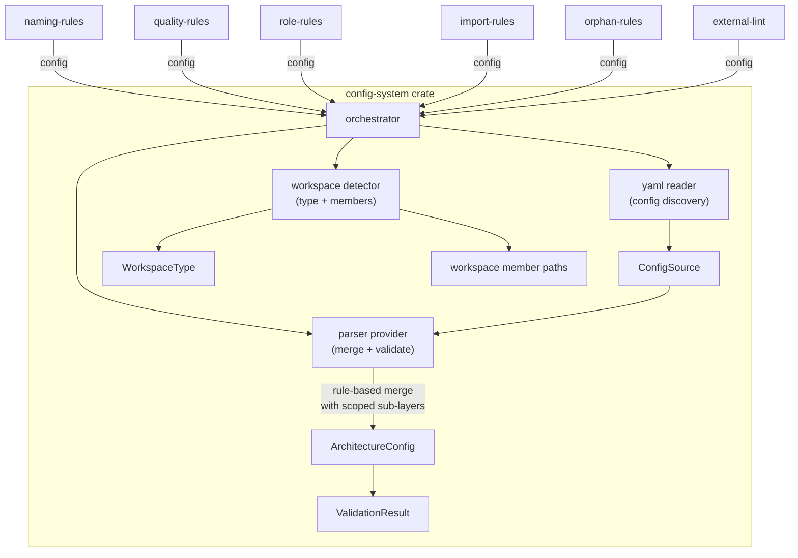

# FRD — config-system

---

## Feature Overview

The config-system crate manages lint-arwaky configuration as a business capability: discovering projects, loading and merging configuration, validating thresholds, and determining which paths the linter should ignore. It is an **infrastructure crate** — at compile time it depends only on `shared` and `filesystem` (for config file I/O via `IFileSystemIOProtocol`). Other crates receive config at runtime via DI (aggregate trait injection through `shared` re-exports).

- **Architecture & Data Flow**



- **Config Loading Priority Chain**

```text
Priority 1: Project root
  lint_arwaky.config.yaml at project root
      │ (not found)
      ▼
Priority 2: Parent directories (project root plus up to 4 ancestor levels — 5 levels total)
  Walk up 5 levels (root, then 4 ancestors) looking for config file
      │ (not found)
      ▼
Priority 3: XDG user config
  ~/.config/lint-arwaky/lint_arwaky.config.yaml
      │ (not found)
      ▼
Priority 4: XDG system dirs
  /etc/xdg/lint-arwaky/ (max 8 dirs, absolute paths only)
      │ (not found)
      ▼
Priority 5: Embedded defaults
  Compiled into binary, always available

First match wins — no merge across priority levels.
Loaded config is merged with embedded defaults via rule-based layer merging (FR-ConfigSystem-004).
```

---

## Functional Requirements

### FR-ConfigSystem-001: Config Discovery

| Aspect | Detail|
|--------|-------|
| Description | |
| Business Rules | |
| Edge Cases | |
| Capability | |
| Protocol | |
| Method | |
| Input | |
| Output | |
| Error | |
| Event | |
| Test | |
| Metric | |

### FR-ConfigSystem-002: Multi-Workspace

| Aspect | Detail|
|--------|-------|
| Description | |
| Business Rules | |
| Edge Cases | |
| Capability | |
| Protocol | |
| Method | |
| Input | |
| Output | |
| Error | |
| Event | |
| Test | |
| Metric | |

### FR-ConfigSystem-003: Config Merger

| Aspect | Detail|
|--------|-------|
| Description | |
| Business Rules | |
| Edge Cases | |
| Capability | |
| Protocol | |
| Method | |
| Input | |
| Output | |
| Error | |
| Event | |
| Test | |
| Metric | |

## Public Interface

| Aspect | Detail|
|--------|-------|
| — | — |

## Reference

| Artifact | Purpose | Link|
|----------|---------|------|
| BACKLOG.md | Backlog tracking | [BACKLOG.md](BACKLOG.md)|
| PRD.md | Product requirements | [PRD.md](../../PRD.md)|
| FRD.md | Feature requirements | [FRD.md](FRD.md)|
| ROADMAP.md | Roadmap status | [ROADMAP.md](../../ROADMAP.md)|
| ARCHITECTURE.md | Layer contract | [ARCHITECTURE.md](../../ARCHITECTURE.md)|
