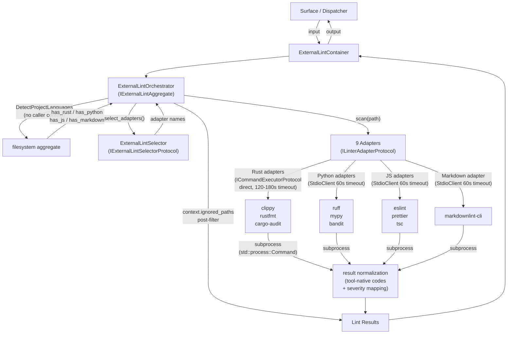

# FRD — external-lint (v1.14.0)

---

## Feature Overview

The external-lint crate is an aggregate bridge to external, industry-standard linters and formatters. It coordinates and executes Cargo Clippy, Rustfmt, cargo-audit, Ruff, Mypy, Bandit, ESLint, Prettier, TSC, and markdownlint-cli on Rust, Python, JS/TS, and Markdown files. It normalizes their JSON/text reports into the unified lint-arwaky violation format using **tool-native rule codes** (e.g., `clippy::needless_return`, `ruff::E501`, `markdownlint::MD041`) and integrates them into the compliance report.

The crate also provides **auto-fix** capabilities — each adapter exposes an `apply_fix` method that runs the tool's native fix command (e.g., `cargo clippy --fix`, `ruff check --fix`, `eslint --fix`).

All adapters execute **sequentially** (no threads, no async runtime). Each adapter runs its external tool as a subprocess, captures output, and normalizes results. The entry point is the DI container, which wires all adapters and exposes the aggregate trait.

The crate does **not** own language detection. Project-level language detection belongs to the `filesystem` aggregate, which serves it as `FilesystemRequest::DetectProjectLanguages` (see [crates/filesystem/FRD.md](../filesystem/FRD.md)). When a caller supplies no pre-computed context, the orchestrator asks the filesystem aggregate which language groups are present and uses the returned flags. It never walks the tree itself.

- **Architecture & Data Flow**

---

## Functional Requirements

### FR-ExternalLint-001: Select and Execute Adapters by Language

| Aspect | Detail|
|--------|-------|
| Description | Select the adapter set for the detected languages and execute each selected adapter's scan in sequence over the target path. |
| Business Rules | Language flags (has_rs, has_py, has_js, has_md) map to fixed groups: Rust = clippy, rustfmt, cargo-audit; Python = ruff, mypy, bandit; JS/TS = eslint, prettier, tsc; Markdown = markdownlint. All four flags false yields an empty adapter list. Language flags come from the filesystem aggregate (FilesystemRequest::DetectProjectLanguages) when the caller supplies no context; this crate never walks the tree itself. Result rows are post-filtered by context.ignored_paths and suppressed rule codes. |
| Edge Cases | No languages detected performs zero subprocess runs and returns an empty violation list. Overlapping groups are deduplicated so no adapter runs twice. A language is detected but its adapter group is absent from configuration: that group contributes nothing. Path does not exist: the executor surfaces a non-zero exit to the caller. |
| Capability | CapabilitiesExternalLintSelector (adapter selection) driving each adapter's scan through the DI container with ExternalLintExecutor as the command runner. |
| Protocol | IExternalLintSelectorProtocol::select_adapters; each adapter implements ILinterAdapterProtocol. |
| Method | select_adapters(has_rs, has_py, has_js, has_md) -> AdapterNameList, then ILinterAdapterProtocol::scan(path) on every returned adapter. |
| Input | Language flags (four booleans) and a FilePath from ExternalLintRequest::ScanAll { path } or ScanAllWithContext; source is the surface check/ct/ci path via the dispatcher. |
| Output | LintResultList of violations aggregated across all adapters, returned inside ExternalLintResponse::Scan { violations }. |
| Error | A scan that fails returns LinterOperationError from ILinterAdapterProtocol::scan; the orchestrator isolates the failure so remaining adapters still run, and the caller sees the violations collected from the successful adapters. |
| Event | None; results flow back synchronously through the aggregate response. |
| Test | acceptance_selector_has_exactly_ten_default_adapters asserts exactly ten default adapters; e2e_mixed_project_selects_all_ten, e2e_rust_only_project_selects_clippy_rustfmt_audit, and e2e_no_languages_detected_selects_nothing assert the language-to-adapter mapping end to end. |
| Metric | Ten default adapters selected for a fully mixed project; zero adapters and zero subprocesses when no language is detected. |

### FR-ExternalLint-002: Apply Auto-Fix via Adapters

| Aspect | Detail|
|--------|-------|
| Description | Run each adapter's native auto-fix command through the fix entry point and report the resulting compliance status. |
| Business Rules | fix(path) runs the tool's own fix mode (cargo clippy --fix, ruff check --fix, eslint --fix, prettier --write). Non-fixing adapters (mypy, bandit, tsc, cargo-audit) return a no-op ComplianceStatus and never mutate files. JS fixes resolve the tool binary through node_modules/.bin/ before executing. |
| Edge Cases | A tool that cannot be resolved returns a no-op ComplianceStatus rather than an error. cargo_audit_apply_fix returns true without rewriting sources because the auditor only reports. Bandit never rewrites files: bandit_apply_fix_always_returns_false. Fix on a path with no findings is a successful no-op. |
| Capability | Each linter adapter's fix method (RustLinterAdapter, RustFmtAdapter, RuffAdapter, ESLintAdapter, PrettierAdapter, MarkdownLintAdapter and siblings) plus JS tool resolution on ExternalLintExecutor. |
| Protocol | ILinterAdapterProtocol::fix(path); IJsToolResolutionProtocol::js_apply_fix(path, tool, fix_arg). |
| Method | fix(&self, path) -> Result<ComplianceStatus, LinterOperationError>; js_apply_fix; executes the fix subprocess in the resolved working directory. |
| Input | FilePath of the file or directory to fix; fix_arg from the adapter's own fix mode; source is the fix/autofix surface command routed through the aggregate. |
| Output | ComplianceStatus describing whether the fix ran, matched, or no-op'd; mutated files on disk when the tool applies changes. |
| Error | LinterOperationError when the fix subprocess exits non-zero for a runnable tool; unresolvable JS tools return a no-op status instead of failing. |
| Event | None; file mutations and status return synchronously. |
| Test | cargo_audit_apply_fix_returns_true, bandit_apply_fix_always_returns_false, and js_apply_fix assert fix-mode behavior per adapter contract. |
| Metric | Every runnable fixing adapter rewrites files and returns a success status; all four non-fixing adapters return a no-op status with zero byte changes. |

### FR-ExternalLint-003: Normalize External Tool Output

| Aspect | Detail|
|--------|-------|
| Description | Convert raw external tool output (JSON or text) into lint-arwaky violations carrying tool-native rule codes and mapped severities. |
| Business Rules | normalize(tool_name, raw_output, root) parses the tool's JSON report when present, otherwise falls back to text parsing. Relative paths are canonicalized onto root; absolute paths are kept verbatim. ANSI color escapes are stripped before any rule-code matching. map_severity translates tool codes to lint-arwaky severity (clippy correctness to critical, suspicious to high, style to medium; ruff E1xx indentation to low, E999 syntax to critical; bandit B0xx bugbear to high). |
| Edge Cases | Empty stdout and empty JSON arrays yield an empty violation list. Malformed JSON falls through to text parsing and yields no violations rather than an error. Delimiter or path text that happens to be colorized is cleaned so substring and regex matching still work. Codes with no known mapping fall back to a default severity instead of dropping the finding. |
| Capability | OutputNormalizer implements scanning and normalization, with color-escape stripping helpers on the utility path-normalization side. |
| Protocol | INormalizeProtocol::{normalize, map_severity}. |
| Method | normalize(tool_name, raw_output, root) returns normalized violations plus any unmatched lines; map_severity(tool_name, rule_code) returns the lint-arwaky severity. |
| Input | ToolName, raw stdout as a string, and the project root FilePath; source is the captured subprocess output from FR-ExternalLint-004. |
| Output | Tuple of LintResultList and leftover unmatched lines; violations carry the tool-native code (for example clippy::needless_return, ruff::E501, markdownlint::MD041). |
| Error | Malformed or empty input never fails; worst case is an empty result list. Parsing errors are reported as unmatched lines, not as an error to the caller. |
| Event | None; normalization is a pure transformation. |
| Test | unit_external_lint_utility_output_normalization covers colorized delimiter, path, and warn-prefix cleanup; correctness_lint_maps_to_critical, e1xx_indentation_maps_to_low, e5xx_line_length_maps_to_low, e999_syntax_error_maps_to_critical, and b0xx_bugbear_maps_to_high assert the severity table. |
| Metric | 100 percent of seeded findings across the five severity-mapping test families resolve to the documented severity; malformed JSON produces an empty list with no panic. |

### FR-ExternalLint-004: Subprocess Execution

| Aspect | Detail|
|--------|-------|
| Description | Run each external linter as a subprocess, capture stdout/stderr, and hand the raw output to normalization. |
| Business Rules | Rust tools run directly via std::process with 120-180 second timeouts; Python, JS, and Markdown tools run through StdioClient with a 60 second timeout. Where a tool offers a JSON mode the JSON flag is passed and its report preferred; the text-only binary path is used only when the JSON-capable binary reports nothing. Adapters execute sequentially with no threads and no async runtime. |
| Edge Cases | A path that does not exist makes the dogfood CLI exit non-zero. A binary missing the JSON flag falls back to the text-only binary. A JSON-capable binary that returns an empty report triggers retry with the text-only binary. The help flag prints usage and exits successfully. |
| Capability | ExternalLintExecutor (command execution and health checks) and StdioClient (bounded stdio transport for non-Rust tools), with each adapter naming its own tool binary and flags. |
| Protocol | ICommandExecutorProtocol::{execute_command, health_check, exec_cmd_scan, exec_cmd_adapter}. |
| Method | execute_command runs one command and returns captured output; exec_cmd_scan runs an adapter's scan invocation; exec_cmd_adapter runs a named adapter with its flag set; health_check probes tool availability. |
| Input | Command name plus arguments, a working directory, and the target FilePath; source is the adapter selected in FR-ExternalLint-001. |
| Output | ResponseData with captured stdout, stderr, and exit code, forwarded to OutputNormalizer. |
| Error | Non-zero exit, missing binary, or timeout surfaces as an executor error; callers see either collected violations from healthy adapters or the executor error surfaced through the aggregate. |
| Event | None; execution is synchronous and sequential. |
| Test | command_passes_the_json_flag_and_the_target_path, json_capable_binary_is_tried_before_the_text_only_binary, text_only_binary_is_used_when_json_binary_reports_nothing, malformed_json_falls_through_to_text_and_stays_empty, and dogfood_cli_exits_nonzero_on_a_path_that_does_not_exist cover the execution contract. |
| Metric | Every adapter scan completes inside its timeout band (120-180s Rust direct, 60s stdio) with parsed output captured on every seeded fixture run. |

### FR-ExternalLint-005: JS Tool Path Resolution

| Aspect | Detail|
|--------|-------|
| Description | Resolve the command line for a JS tool and the nearest configuration directory so node_modules-based tools run from the right folder. |
| Business Rules | resolve_js_cmd matches tool_name against a table of command templates and returns the full command vector with args appended. resolve_js_working_dir walks up to 10 parent directories from the target file looking for the nearest JS/TS config file and returns the directory containing it; when no config is found within the budget the starting directory is kept. Fixes run through node_modules/.bin/ resolution. |
| Edge Cases | No config within 10 levels returns the original directory unchanged. Unknown tool_name returns None from resolve_js_cmd so the caller falls back to plain undecorated args. Deeply nested fixture paths still resolve because the walk is bounded at 10 parents. |
| Capability | ExternalLintExecutor implements the JS resolution surface alongside its command-execution role; adapters ESLintAdapter, PrettierAdapter, and TSCAdapter consume it. |
| Protocol | IJsToolResolutionProtocol::{resolve_js_cmd, resolve_js_working_dir, js_apply_fix}. |
| Method | resolve_js_cmd(tool_name, args, working_dir) -> Option of command vec; resolve_js_working_dir(path) -> FilePath; js_apply_fix(path, tool, fix_arg). |
| Input | ToolName, argument vector, and FilePath of the file under fix or scan; source is the JS adapters during scan and fix. |
| Output | Option of the full command vector for execution and the resolved working-directory FilePath; js_apply_fix returns ComplianceStatus. |
| Error | Unresolvable tool returns None or a no-op ComplianceStatus; the adapter proceeds without the tool rather than erroring the whole scan. |
| Event | None; resolution is a pure lookup. |
| Test | resolve_js_cmd, resolve_js_working_dir, and external_lint_executor_implements_js_resolution_protocol assert command construction, upward config search, and the protocol contract. |
| Metric | Config search terminates within 10 parent levels on every seeded nested fixture; unrecognized tools return None with no panic. |

### FR-ExternalLint-006: Rust Working Directory Resolution

| Aspect | Detail|
|--------|-------|
| Description | Resolve the working directory for Rust tools so Cargo-based commands (clippy, rustfmt, cargo-audit) run from the crate or workspace root. |
| Business Rules | resolve_cargo_working_dir walks up from the target path to the directory containing the nearest Cargo workspace manifest and returns it, so cargo subcommands find the workspace. When no manifest is found within the walk budget the starting directory is used. Paths are canonicalized onto the project root before invocation so relative findings map back correctly. |
| Edge Cases | Target outside any Cargo project falls back to the supplied path's own directory. Nested fixture paths inside the workspace resolve to the workspace root. Paths that are already absolute are kept verbatim through JSON reporting. |
| Capability | ExternalLintExecutor implements the cargo-dir resolution alongside command execution; Rust adapters RustLinterAdapter, RustFmtAdapter, and CargoAuditAdapter consume it. |
| Protocol | ICargoDirProtocol::resolve_cargo_working_dir. |
| Method | resolve_cargo_working_dir(&self, path) -> FilePath. |
| Input | FilePath of the file or directory under scan; source is the Rust adapters during execution. |
| Output | FilePath of the directory from which cargo commands run. |
| Error | No Cargo project found returns the best-effort directory rather than an error; the ensuing cargo invocation reports its own failure through the executor path. |
| Event | None; resolution is a pure lookup. |
| Test | external_lint_executor_implements_cargo_dir_protocol asserts the contract, and json_absolute_paths_are_kept_verbatim plus json_relative_paths_are_canonicalized_onto_the_root assert path handling under reporting. |
| Metric | Cargo tools launch from the workspace root on every seeded nested fixture; path canonicalization keeps 100 percent of reported findings inside the project root. |

## Public Interface

| Aspect | Detail|
|--------|-------|
| Agent | ExternalLintOrchestrator — the agent-layer orchestrator behind the check, ct, and ci surface commands; wires the DI container and dispatches ExternalLintRequest. |
| Aggregate | IExternalLintAggregate — the feature's single front door. |
| Method | execute(&self, request: ExternalLintRequest) -> ExternalLintResponse |
| Request | ExternalLintRequest::{ScanAll { path }, ScanAllWithContext { path, context }, AdapterNames} |
| Response | ExternalLintResponse::{Scan { violations }, AdapterNames { names }} |

## Reference

| Artifact | Purpose | Link|
|----------|---------|------|
| BACKLOG.md | Backlog tracking | [BACKLOG.md](BACKLOG.md)|
| PRD.md | Product requirements | [PRD.md](../../PRD.md)|
| FRD.md | Feature requirements | [FRD.md](FRD.md)|
| ROADMAP.md | Roadmap status | [ROADMAP.md](../../ROADMAP.md)|
| ARCHITECTURE.md | Layer contract | [ARCHITECTURE.md](../../ARCHITECTURE.md)|
