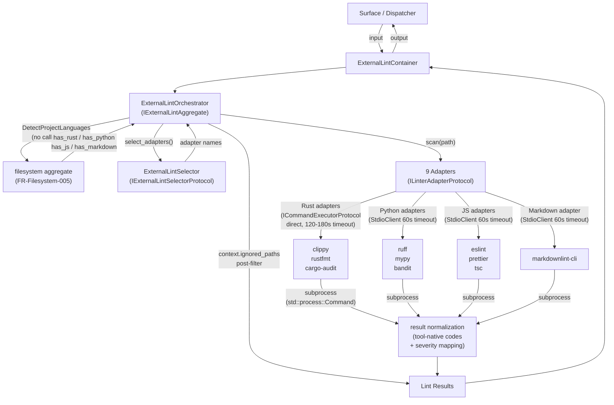

# FRD — external-lint (v1.14.0)

---

## Feature Overview

The external-lint crate is an aggregate bridge to external, industry-standard linters and formatters. It coordinates and executes Cargo Clippy, Rustfmt, cargo-audit, Ruff, Mypy, Bandit, ESLint, Prettier, TSC, and markdownlint-cli on Rust, Python, JS/TS, and Markdown files. It normalizes their JSON/text reports into the unified lint-arwaky violation format using **tool-native rule codes** (e.g., `clippy::needless_return`, `ruff::E501`, `markdownlint::MD041`) and integrates them into the compliance report.

The crate also provides **auto-fix** capabilities — each adapter exposes an `apply_fix` method that runs the tool's native fix command (e.g., `cargo clippy --fix`, `ruff check --fix`, `eslint --fix`).

All adapters execute **sequentially** (no threads, no async runtime). Each adapter runs its external tool as a subprocess, captures output, and normalizes results. The entry point is the DI container, which wires all adapters and exposes the aggregate trait.

The crate does **not** own language detection. Project-level language detection belongs to the `filesystem` aggregate, which serves it as `FilesystemRequest::DetectProjectLanguages` (see [crates/filesystem/FRD.md](../filesystem/FRD.md), FR-Filesystem-005). When a caller supplies no pre-computed context, the orchestrator asks the filesystem aggregate which language groups are present and uses the returned flags. It never walks the tree itself.

- **Architecture & Data Flow**

---

## Functional Requirements

### FR-ExternalLint-001: Select and Execute Adapters by Language

| Aspect | Detail|
|--------|-------|
| Description | |
| Business Rules | |
| Edge Cases | |
| Capability | |
| Protocol | |
| Method | |
| Input | |
| Output | |
| Error | |
| Event | |
| Test | |
| Metric | |

### FR-ExternalLint-002: Apply Auto-Fix via Adapters

| Aspect | Detail|
|--------|-------|
| Description | |
| Business Rules | |
| Edge Cases | |
| Capability | |
| Protocol | |
| Method | |
| Input | |
| Output | |
| Error | |
| Event | |
| Test | |
| Metric | |

### FR-ExternalLint-003: Normalize External Tool Output

| Aspect | Detail|
|--------|-------|
| Description | |
| Business Rules | |
| Edge Cases | |
| Capability | |
| Protocol | |
| Method | |
| Input | |
| Output | |
| Error | |
| Event | |
| Test | |
| Metric | |

### FR-ExternalLint-004: Subprocess Execution

| Aspect | Detail|
|--------|-------|
| Description | |
| Business Rules | |
| Edge Cases | |
| Capability | |
| Protocol | |
| Method | |
| Input | |
| Output | |
| Error | |
| Event | |
| Test | |
| Metric | |

### FR-ExternalLint-005: JS Tool Path Resolution

| Aspect | Detail|
|--------|-------|
| Description | |
| Business Rules | |
| Edge Cases | |
| Capability | |
| Protocol | |
| Method | |
| Input | |
| Output | |
| Error | |
| Event | |
| Test | |
| Metric | |

### FR-ExternalLint-006: Rust Working Directory Resolution

| Aspect | Detail|
|--------|-------|
| Description | |
| Business Rules | |
| Edge Cases | |
| Capability | |
| Protocol | |
| Method | |
| Input | |
| Output | |
| Error | |
| Event | |
| Test | |
| Metric | |

## Public Interface

| Aspect | Detail|
|--------|-------|
| — | — |

## Reference

| Artifact | Purpose | Link|
|----------|---------|------|
| BACKLOG.md | Backlog tracking | [BACKLOG.md](BACKLOG.md)|
| PRD.md | Product requirements | [PRD.md](../../PRD.md)|
| FRD.md | Feature requirements | [FRD.md](FRD.md)|
| ROADMAP.md | Roadmap status | [ROADMAP.md](../../ROADMAP.md)|
| ARCHITECTURE.md | Layer contract | [ARCHITECTURE.md](../../ARCHITECTURE.md)|
