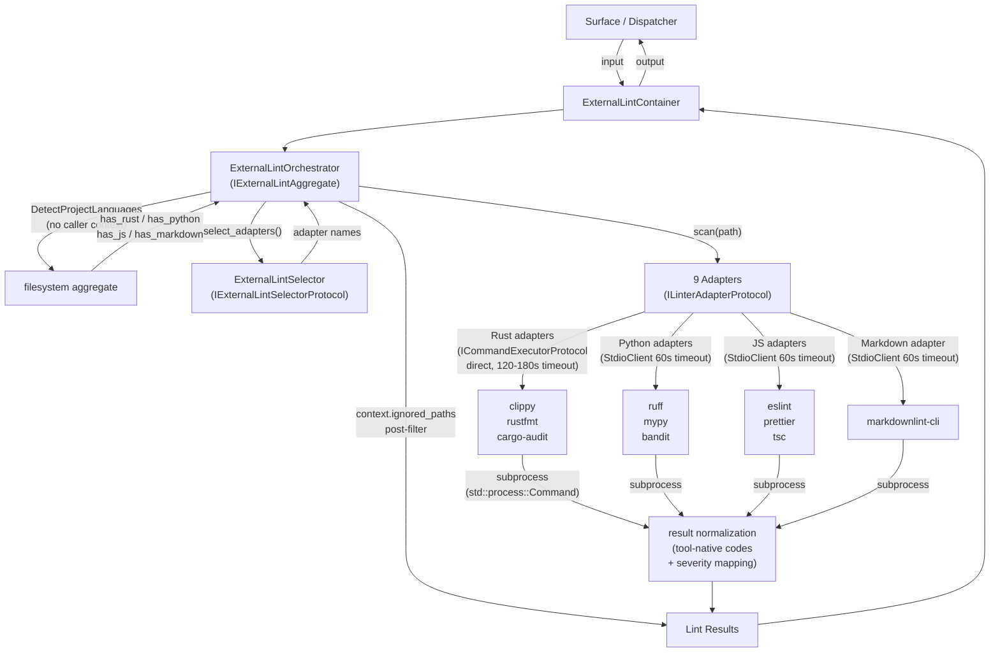

# FRD — external-lint (v1.14.0)

---

## Feature Overview

The external-lint crate is an aggregate bridge to external, industry-standard linters and formatters. It coordinates and executes Cargo Clippy, Rustfmt, cargo-audit, Ruff, Mypy, Bandit, ESLint, Prettier, TSC, and markdownlint-cli on Rust, Python, JS/TS, and Markdown files. It normalizes their JSON/text reports into the unified lint-arwaky violation format using **tool-native rule codes** (e.g., `clippy::needless_return`, `ruff::E501`, `markdownlint::MD041`) and integrates them into the compliance report.

The crate also provides **auto-fix** capabilities — each adapter exposes an `apply_fix` method that runs the tool's native fix command (e.g., `cargo clippy --fix`, `ruff check --fix`, `eslint --fix`).

All adapters execute **sequentially** (no threads, no async runtime). Each adapter runs its external tool as a subprocess, captures output, and normalizes results. The entry point is the DI container, which wires all adapters and exposes the aggregate trait.

The crate does **not** own language detection. Project-level language detection belongs to the `filesystem` aggregate, which serves it as `FilesystemRequest::DetectProjectLanguages` (see [crates/filesystem/FRD.md](../filesystem/FRD.md)). When a caller supplies no pre-computed context, the orchestrator asks the filesystem aggregate which language groups are present and uses the returned flags. It never walks the tree itself.

- **Architecture & Data Flow**

---

## Functional Requirements

### FR-ExternalLint-001: Select and Execute Adapters by Language

#### Description

| No | Detail |
| --- | --- |
| 1 | Based on the language flags for a project, select the appropriate set of linter adapters and run them in adapter-list order, aggregating the results. |
| 2 | — |
| ∞ | — |

#### Business Rules

| No | Detail |
| --- | --- |
| 1 | Append adapters in language-group order (Rust → Python → JS → Markdown): Rust `clippy`, `rustfmt`, `cargo-audit`; Python `ruff`, `mypy`, `bandit`; JS/TS `eslint`, `prettier`, `tsc`; Markdown `markdownlint`. |
| 2 | Hardcoded defaults via `with_defaults()`; when no caller-supplied context is present, language flags are requested from the `filesystem` aggregate via `DetectProjectLanguages` — this crate performs no extension walk of its own. |
| 3 | Iterate the adapter list in that order, each adapter receiving the same target path; optionally filter by `context.config_entries`, then post-filter results against `context.ignored_paths` via `should_ignore()`. |
| 4 | No threads — execution is strictly sequential; each adapter's scan method invokes subprocess and normalizes output. |
| ∞ | — |

#### Edge Cases

| No | Detail |
| --- | --- |
| 1 | No languages detected → empty adapter list, no scans run; all languages detected → up to 10 adapters selected. |
| 2 | All adapters return empty results → empty result list; one adapter fails → remaining adapters still run, failure logged as a warning. |
| 3 | Adapter binary not installed → warning printed, results for that adapter empty; adapter timeout exceeded → error logged, other adapters continue. |
| ∞ | — |

#### Capability

| No | Detail |
| --- | --- |
| 1 | capabilities_external_lint_selector |

#### Protocol

| No | Detail |
| --- | --- |
| 1 | IExternalLintSelectorProtocol |

#### Method

| No | Detail |
| --- | --- |
| 1 | `select_adapters` |
| 2 | — |
| ∞ | — |

#### Input

| No | Detail |
| --- | --- |
| 1 | Target path, booleans `has_rust`, `has_python`, `has_js`, `has_markdown`, and optional context (config entries, ignored paths). |
| 2 | The target path flows through `ExternalLintRequest` request variants carried by the aggregate entry point (`execute`). |

#### Output

| No | Detail |
| --- | --- |
| 1 | Ordered list of adapter names. |
| 2 | Aggregated lint results from all adapters. |
| ∞ | — |

#### Error

| No | Detail |
| --- | --- |
| 1 | No error on selection; empty list for no matches. |
| 2 | Per-adapter errors caught at the loop boundary; missing tool detected via OS error string matching; a failing adapter does not stop subsequent adapters. |

#### Event

| No | Detail |
| --- | --- |
| 1 | None. |
| 2 | — |
| ∞ | — |

#### Test

| No | Detail |
| --- | --- |
| 1 | `select_adapters(true, false, false, false)` yields `clippy`, `rustfmt`, `cargo-audit` in that order. |
| 2 | Empty flags yield an empty list. |
| ∞ | — |

#### Metric

| No | Detail |
| --- | --- |
| 1 | Zero unrequested adapters invoked. |
| 2 | Zero threads spawned per scan. |
| ∞ | — |

### FR-ExternalLint-002: Apply Auto-Fix via Adapters

#### Description

| No | Detail |
| --- | --- |
| 1 | Run an external linter tool's native fix command for a specific file, returning whether the fix succeeded. |
| 2 | — |
| ∞ | — |

#### Business Rules

| No | Detail |
| --- | --- |
| 1 | JS adapters resolve the working directory and absolute file path, then execute the tool via `js_apply_fix`. |
| 2 | Fix-capable adapters and commands: ESLint `npx eslint <file> --fix`; Prettier `npx prettier <file> --write`; Ruff `ruff check <file> --fix --exit-zero`; Clippy `cargo clippy --fix --allow-dirty --allow-staged`; Rustfmt `cargo fmt` (without `--check`). |
| 3 | Non-fixing adapters (Mypy, Bandit, TSC, cargo-audit) return a no-op result. |
| ∞ | — |

#### Edge Cases

| No | Detail |
| --- | --- |
| 1 | Fix command fails → failure status returned, no crash. |
| 2 | Tool not installed → failure status. |
| ∞ | — |

#### Capability

| No | Detail |
| --- | --- |
| 1 | capabilities_js_tool_resolver (executed through capabilities_command_executor) |

#### Protocol

| No | Detail |
| --- | --- |
| 1 | IJsToolResolutionProtocol |

#### Method

| No | Detail |
| --- | --- |
| 1 | `js_apply_fix` |
| 2 | — |
| ∞ | — |

#### Input

| No | Detail |
| --- | --- |
| 1 | Tool name, file path, fix argument (e.g., `--fix`, `--write`). |
| 2 | — |

#### Output

| No | Detail |
| --- | --- |
| 1 | Compliance status indicating success or failure. |
| 2 | — |
| ∞ | — |

#### Error

| No | Detail |
| --- | --- |
| 1 | Subprocess failure mapped to an adapter error; caller decides next step. |
| 2 | — |

#### Event

| No | Detail |
| --- | --- |
| 1 | None. |
| 2 | — |
| ∞ | — |

#### Test

| No | Detail |
| --- | --- |
| 1 | `js_apply_fix` against a fix-capable tool reports success after the tool rewrites the file. |
| 2 | Against Mypy it reports the no-op status. |
| ∞ | — |

#### Metric

| No | Detail |
| --- | --- |
| 1 | One subprocess spawn per invoked fix. |
| 2 | — |
| ∞ | — |

### FR-ExternalLint-003: Normalize External Tool Output

#### Description

| No | Detail |
| --- | --- |
| 1 | Each adapter normalizes its external tool's stdout/JSON output into `LintResult` structs compatible with the unified lint-arwaky format. |
| 2 | Rule codes use tool-native identifiers (e.g., `clippy::needless_return`, `ruff::E501`). |
| ∞ | — |

#### Business Rules

| No | Detail |
| --- | --- |
| 1 | Rule codes — tool-native identifiers prefixed with the tool name: Clippy `clippy::<lint_name>` (e.g. `clippy::needless_return`); Rustfmt `rustfmt::unformatted`; cargo-audit `cargo-audit::<RUSTSEC-ID>` (e.g. `cargo-audit::RUSTSEC-2021-0124`). |
| 2 | Ruff `ruff::<code>` (e.g. `ruff::E501`, `ruff::F401`); Mypy `mypy::<error-code>` (e.g. `mypy::arg-type`); Bandit `bandit::<test-id>` (e.g. `bandit::B101`); ESLint `eslint::<rule-id>` (e.g. `eslint::no-unused-vars`); Prettier `prettier::diff`; tsc `tsc::<error-code>` (e.g. `tsc::TS2345`); markdownlint `markdownlint::<MD-id>` (e.g. `markdownlint::MD041`). |
| 3 | File paths canonicalized to absolute; line numbers extracted from tool-specific JSON fields; severity mapped per tool. |
| 4 | Clippy `correctness`→CRITICAL, `suspicious`/`perf`→HIGH, `style`/`complexity`→MEDIUM, `pedantic`/`nursery`/`restriction`→LOW; Rustfmt diff→MEDIUM. |
| 5 | cargo-audit `Critical`→CRITICAL, `High`→HIGH, `Medium`→MEDIUM, `Low`/`Unknown`→LOW; Ruff `E999` and all `S*`→CRITICAL, `F8xx`/`B0xx`→HIGH, `F401`→MEDIUM, `E1xx`/`E5xx`/`W2xx`→LOW, default→MEDIUM. |
| 6 | Mypy `error`→HIGH, `warning`→MEDIUM, `note`→LOW; Bandit HIGH confidence + HIGH severity→CRITICAL, HIGH→HIGH, MEDIUM→MEDIUM, LOW→LOW; ESLint severity 2→HIGH, 1→MEDIUM; Prettier diff→MEDIUM; tsc error→HIGH; markdownlint any rule violation→MEDIUM. |
| 7 | Ruff severity is determined by the rule code, not the tool's severity field. |
| ∞ | — |

#### Edge Cases

| No | Detail |
| --- | --- |
| 1 | Tool produces invalid JSON → empty results with error logged. |
| 2 | Tool output contains zero violations → empty result list, not an error. |
| 3 | File path in tool output is relative → canonicalized to absolute; unknown tool severity/category → defaults to MEDIUM. |
| 4 | Mypy extension: any error message containing `syntax` or `parse` is escalated to CRITICAL (a parse failure blocks all type checking). |
| ∞ | — |

#### Capability

| No | Detail |
| --- | --- |
| 1 | capabilities_output_normalizer |

#### Protocol

| No | Detail |
| --- | --- |
| 1 | INormalizeProtocol |

#### Method

| No | Detail |
| --- | --- |
| 1 | `normalize` |
| 2 | — |
| ∞ | — |

#### Input

| No | Detail |
| --- | --- |
| 1 | Raw output from an external linter subprocess (JSON or text). |
| 2 | — |

#### Output

| No | Detail |
| --- | --- |
| 1 | Normalized lint results. |
| 2 | — |
| ∞ | — |

#### Error

| No | Detail |
| --- | --- |
| 1 | Parse failures return empty results with a warning; no crash on malformed output. |
| 2 | — |

#### Event

| No | Detail |
| --- | --- |
| 1 | None. |
| 2 | — |
| ∞ | — |

#### Test

| No | Detail |
| --- | --- |
| 1 | A ruff JSON report with `E501` normalizes to `ruff::E501` LOW. |
| 2 | A clippy `correctness` diagnostic normalizes to CRITICAL. |
| ∞ | — |

#### Metric

| No | Detail |
| --- | --- |
| 1 | Zero panics on malformed tool output. |
| 2 | 100% of results carry tool-native rule codes. |
| ∞ | — |

### FR-ExternalLint-004: Subprocess Execution

#### Description

| No | Detail |
| --- | --- |
| 1 | Spawn external linter tools as blocking subprocesses, capturing stdout/stderr, enforcing per-adapter timeouts, and mapping spawn/timeout errors. |
| 2 | — |
| ∞ | — |

#### Business Rules

| No | Detail |
| --- | --- |
| 1 | Python/JS adapters run with a 60-second timeout; Rust adapter Clippy with 180 seconds; Rust adapters Rustfmt and cargo-audit with 120 seconds. |
| 2 | `PYTHONUNBUFFERED=1` is set on all subprocesses; a spawn failure or timeout is reported as an adapter error; the scan continues with the next adapter. |
| 3 | No retry — an adapter gets exactly one attempt per scan, for both spawn failures and timeouts, per the Integration resilience decision in `PRD.md` (PR-LA-006). |
| 4 | No overall budget — each ceiling applies to one adapter; they sum rather than cap, so a scan with every language present can run up to 180 + 120 + 120 + (7 × 60) ≈ 840 s (~14 minutes) before returning. |
| 5 | Callers that need a bound — notably the MCP surface, which has no timeout of its own — must impose it themselves. |
| ∞ | — |

#### Edge Cases

| No | Detail |
| --- | --- |
| 1 | Executable absent from PATH → the adapter is reported unavailable, scan continues. |
| 2 | Timeout exceeded → error logged, other adapters continue, no retry. |
| 3 | Every adapter present and slow → the call blocks for the summed worst case; no layer above interrupts it. |
| ∞ | — |

#### Capability

| No | Detail |
| --- | --- |
| 1 | capabilities_stdio_client (error mapping in capabilities_command_executor) |

#### Protocol

| No | Detail |
| --- | --- |
| 1 | ICommandExecutorProtocol |

#### Method

| No | Detail |
| --- | --- |
| 1 | `exec_cmd_scan` / `exec_cmd_adapter` |
| 2 | — |
| ∞ | — |

#### Input

| No | Detail |
| --- | --- |
| 1 | Tool name, argument list, target path, and timeout in seconds. |
| 2 | — |

#### Output

| No | Detail |
| --- | --- |
| 1 | Captured stdout/stderr text plus a completion status (ok, timed out, spawn failure). |
| 2 | — |
| ∞ | — |

#### Error

| No | Detail |
| --- | --- |
| 1 | Spawn and timeout errors are surfaced as `LinterOperationError`. |
| 2 | — |

#### Event

| No | Detail |
| --- | --- |
| 1 | None. |
| 2 | — |
| ∞ | — |

#### Test

| No | Detail |
| --- | --- |
| 1 | A tool exceeding its ceiling returns the timed-out status while the remaining adapters still run. |
| 2 | A PATH-missing tool returns the unavailable status. |
| ∞ | — |

#### Metric

| No | Detail |
| --- | --- |
| 1 | Zero retries per adapter. |
| 2 | Total worst-case scan wall time ≤ ~840 s. |
| ∞ | — |

### FR-ExternalLint-005: JS Tool Path Resolution

#### Description

| No | Detail |
| --- | --- |
| 1 | Resolve the binary path for a JS/TS tool, preferring a local `node_modules/.bin/<tool>` installation over a global PATH lookup, and locate the working directory by walking up to 10 parent directories. |
| 2 | — |
| ∞ | — |

#### Business Rules

| No | Detail |
| --- | --- |
| 1 | Check `node_modules/.bin/<tool>` in the resolved working directory; if the local binary exists, use its absolute path. |
| 2 | Otherwise fall back to global PATH resolution. |
| 3 | Resolve the working directory by walking up to 10 parent directories looking for config files (`.eslintrc.*`, `prettier.config.*`, `tsconfig.json`, `package.json`). |
| ∞ | — |

#### Edge Cases

| No | Detail |
| --- | --- |
| 1 | No local binary and no global PATH entry → tool is reported unavailable. |
| 2 | Working directory not found within 10 levels → the scan is skipped for that file. |
| ∞ | — |

#### Capability

| No | Detail |
| --- | --- |
| 1 | capabilities_js_tool_resolver |

#### Protocol

| No | Detail |
| --- | --- |
| 1 | IJsToolResolutionProtocol |

#### Method

| No | Detail |
| --- | --- |
| 1 | `resolve_js_cmd` / `resolve_js_working_dir` |
| 2 | — |
| ∞ | — |

#### Input

| No | Detail |
| --- | --- |
| 1 | Tool name and a starting path. |
| 2 | — |

#### Output

| No | Detail |
| --- | --- |
| 1 | Absolute path to the resolved binary. |
| 2 | The working directory to run it from. |
| ∞ | — |

#### Error

| No | Detail |
| --- | --- |
| 1 | Resolution failures are reported as adapter errors; other adapters continue. |
| 2 | — |

#### Event

| No | Detail |
| --- | --- |
| 1 | None. |
| 2 | — |
| ∞ | — |

#### Test

| No | Detail |
| --- | --- |
| 1 | A file under `node_modules/.bin`-bearing project resolves to the local binary. |
| 2 | A bare file with no config within 10 levels reports the tool unavailable. |
| ∞ | — |

#### Metric

| No | Detail |
| --- | --- |
| 1 | One lookup per tool invocation. |
| 2 | Zero global installs required for the local-preference path. |
| ∞ | — |

### FR-ExternalLint-006: Rust Working Directory Resolution

#### Description

| No | Detail |
| --- | --- |
| 1 | Find the directory containing `Cargo.toml` or `Cargo.lock` for Rust tool execution, walking up the directory tree. |
| 2 | — |
| ∞ | — |

#### Business Rules

| No | Detail |
| --- | --- |
| 1 | Walk up the directory tree looking for `Cargo.toml` (for Clippy/Rustfmt) or `Cargo.lock` (for cargo-audit). |
| 2 | Return the directory if found; the caller skips the adapter with a warning if not found. |
| 3 | No directory is created or modified — resolution is read-only. |
| ∞ | — |

#### Edge Cases

| No | Detail |
| --- | --- |
| 1 | No `Cargo.toml` or `Cargo.lock` anywhere in the parent chain → the adapter is skipped with a warning. |
| 2 | — |
| ∞ | — |

#### Capability

| No | Detail |
| --- | --- |
| 1 | capabilities_cargo_dir_resolver |

#### Protocol

| No | Detail |
| --- | --- |
| 1 | ICargoDirProtocol |

#### Method

| No | Detail |
| --- | --- |
| 1 | `resolve_cargo_working_dir` |
| 2 | — |
| ∞ | — |

#### Input

| No | Detail |
| --- | --- |
| 1 | Starting path. |
| 2 | — |

#### Output

| No | Detail |
| --- | --- |
| 1 | Absolute path to the resolved cargo working directory, or none. |
| 2 | — |
| ∞ | — |

#### Error

| No | Detail |
| --- | --- |
| 1 | Resolution failure is reported as an adapter error; other adapters continue. |
| 2 | — |

#### Event

| No | Detail |
| --- | --- |
| 1 | None. |
| 2 | — |
| ∞ | — |

#### Test

| No | Detail |
| --- | --- |
| 1 | A path nested in a cargo project resolves to the directory carrying `Cargo.toml`. |
| 2 | A path with no cargo tree reports none. |
| ∞ | — |

#### Metric

| No | Detail |
| --- | --- |
| 1 | One upward walk per invocation. |
| 2 | Zero files created or modified. |
| ∞ | — |

## Public Interface

| Aspect     | Detail |
|------------|--------|
| Agent      | agent_external_lint_orchestrator (ExternalLintOrchestrator) |
| Aggregate  | IExternalLintAggregate — single composite entry point over the feature |
| Method     | `execute` |
| Request    | ExternalLintRequest: `ScanAll { path }`, `ScanAllWithContext { path, context }`, `AdapterNames` |
| Response   | ExternalLintResponse: `Scan { violations }` or `AdapterNames { names }` |

### Protocol API

| Method | Input | Output | Error | Event | Description |
|---|---|---|---|---|---|
| `scan` | &FilePath | `LintResultList` | `LinterOperationError` | — | Scan. |
| `fix` | &FilePath | `ComplianceStatus` | `LinterOperationError` | — | Apply fix. |
| `exec_cmd_scan` | Vec<String>, FilePath, f64, Option<AdapterName>, &FilePath | `ResponseData` | `LinterOperationError` | — | Exec cmd scan. |
| `exec_cmd_adapter` | Vec<String>, FilePath, f64, AdapterName | `ResponseData` | `LinterOperationError` | — | Exec cmd adapter. |
| `js_apply_fix` | &FilePath, &str, &str | `ComplianceStatus` | `LinterOperationError` | — | Js apply fix. |
| `select_adapters` | bool, bool, bool, bool | `AdapterNameList` | — | — | Select adapters. |

### Aggregate API

| Method | Input | Output | Error | Event | Description |
|---|---|---|---|---|---|
| `execute` | ExternalLintRequest | `ExternalLintResponse` | — | — | Single composite entry point over the feature. |

## Reference

| Artifact     | Purpose                                                | Link |
|--------------|--------------------------------------------------------|------|
| PRD          | Business goals and scope for external lint adapters    | [PRD.md](../../PRD.md) |
| Backlog      | Real condition for this feature; specification only here | [BACKLOG.md](BACKLOG.md) |
| Roadmap      | Timeline and dependencies                              | [ROADMAP.md](../../ROADMAP.md) |
| Architecture | System boundaries, tech stack, and infra               | [ARCHITECTURE.md](../../ARCHITECTURE.md)|
