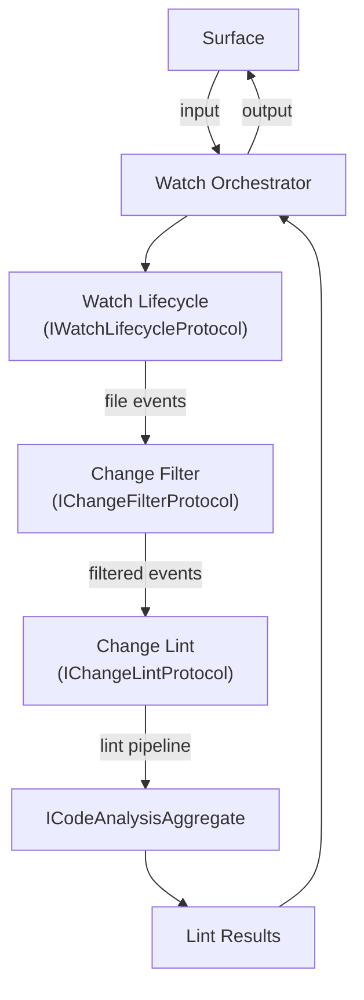

# FRD — file-watch

## Feature Overview

The file-watch crate provides a filesystem monitoring system that detects file
changes in real time and re-triggers analysis via an injected
`ICodeAnalysisAggregate`. It uses the `notify` crate (inotify on Linux) with
`notify-debouncer-mini` to debounce rapid changes and avoid redundant
processing.

**Configuration lifetime in a watch session.** A watch session is one
long-lived process holding one config orchestrator, and the config cache is
keyed by path with no modification-time check and no invalidation entry point
(see `crates/config-system/FRD.md`, FR-ConfigSystem-003). The configuration a
session uses is therefore the one parsed at startup, for the whole session:
editing `lint_arwaky.config.yaml` while `watch` runs changes nothing until the
session is restarted. Thresholds, ignored paths, and adapter toggles are
start-of-session values.

- **Architecture & Data Flow**

## Functional Requirements

### FR-FileWatch-001: Watch Filesystem Lifecycle

| Aspect | Detail|
|--------|-------|
| Description | |
| Business Rules | |
| Edge Cases | |
| Capability | |
| Protocol | |
| Method | |
| Input | |
| Output | |
| Error | |
| Event | |
| Test | |
| Metric | |

### FR-FileWatch-002: Filter and Deduplicate Change Events

| Aspect | Detail|
|--------|-------|
| Description | |
| Business Rules | |
| Edge Cases | |
| Capability | |
| Protocol | |
| Method | |
| Input | |
| Output | |
| Error | |
| Event | |
| Test | |
| Metric | |

### FR-FileWatch-003: Run Lint on Changed Files

| Aspect | Detail|
|--------|-------|
| Description | |
| Business Rules | |
| Edge Cases | |
| Capability | |
| Protocol | |
| Method | |
| Input | |
| Output | |
| Error | |
| Event | |
| Test | |
| Metric | |

## Public Interface

| Aspect | Detail|
|--------|-------|
| — | — |

## Reference

| Artifact | Purpose | Link|
|----------|---------|------|
| BACKLOG.md | Backlog tracking | [BACKLOG.md](BACKLOG.md)|
| PRD.md | Product requirements | [PRD.md](../../PRD.md)|
| FRD.md | Feature requirements | [FRD.md](FRD.md)|
| ROADMAP.md | Roadmap status | [ROADMAP.md](../../ROADMAP.md)|
| ARCHITECTURE.md | Layer contract | [ARCHITECTURE.md](../../ARCHITECTURE.md)|
