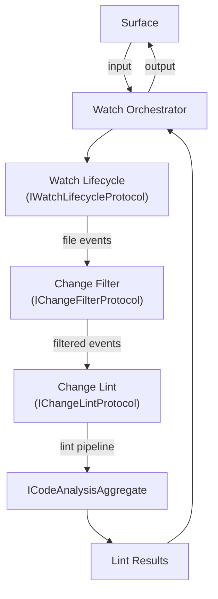

# FRD — file-watch

## Feature Overview

The file-watch crate provides a filesystem monitoring system that detects file
changes in real time and re-triggers analysis via an injected
`ICodeAnalysisAggregate`. It uses the `notify` crate (inotify on Linux) with
`notify-debouncer-mini` to debounce rapid changes and avoid redundant
processing.

**Configuration lifetime in a watch session.** A watch session is one
long-lived process holding one config orchestrator, and the config cache is
keyed by path with no modification-time check and no invalidation entry point
(see `crates/config-system/FRD.md`). The configuration a
session uses is therefore the one parsed at startup, for the whole session:
editing `lint_arwaky.config.yaml` while `watch` runs changes nothing until the
session is restarted. Thresholds, ignored paths, and adapter toggles are
start-of-session values.

- **Architecture & Data Flow**

## Functional Requirements

### FR-FileWatch-001: Watch Filesystem Lifecycle

#### Description

| No | Detail |
| --- | --- |
| 1 | Start, monitor, and stop the filesystem watcher that emits change events for linting. |
| 2 | — |
| ∞ | — |

#### Business Rules

| No | Detail |
| --- | --- |
| 1 | start(config) registers watches per NotifyWatchProvider (notify crate, inotify on Linux); is_available reports readiness as a BooleanVO; subscribe returns a broadcast receiver of WatchEvent; stop tears the watcher down cleanly. |
| 2 | The service runs under the container lifecycle with an AtomicBool run flag. |
| ∞ | — |

#### Edge Cases

| No | Detail |
| --- | --- |
| 1 | stop without a running watcher returns Ok. |
| 2 | start on an already-running service is idempotent. |
| 3 | watcher errors surface as WatchServiceError. |
| 4 | subscribe after stop still returns a receiver that simply receives nothing. |
| ∞ | — |

#### Capability

| No | Detail |
| --- | --- |
| 1 | NotifyWatchProvider implements the watch lifecycle over the notify crate. |

#### Protocol

| No | Detail |
| --- | --- |
| 1 | IWatchLifecycleProtocol. |

#### Method

| No | Detail |
| --- | --- |
| 1 | start(config), is_available(), subscribe() -> broadcast receiver of WatchEvent, stop(). |
| 2 | — |
| ∞ | — |

#### Input

| No | Detail |
| --- | --- |
| 1 | WatchConfig describing paths and filters. |
| 2 | Source is WatchRequest::Run through the aggregate. |

#### Output

| No | Detail |
| --- | --- |
| 1 | WatchResponse::Run carrying lifecycle status. |
| 2 | WatchEvents stream to subscribers. |
| ∞ | — |

#### Error

| No | Detail |
| --- | --- |
| 1 | Permission or path errors on registration fail with WatchServiceError. |
| 2 | The caller sees the error on the response. |

#### Event

| No | Detail |
| --- | --- |
| 1 | WatchEvent per filesystem change, delivered on the broadcast channel. |
| 2 | — |
| ∞ | — |

#### Test

| No | Detail |
| --- | --- |
| 1 | acceptance_watch_container_creates_successfully, container_lifecycle_accessible, e2e_file_watch_container_creates, and file_watch_container_creates assert construction and lifecycle wiring. |
| 2 | — |
| ∞ | — |

#### Metric

| No | Detail |
| --- | --- |
| 1 | Container constructs and reports available on the seeded fixture tree. |
| 2 | stop releases resources within one event-loop turn. |
| ∞ | — |

### FR-FileWatch-002: Filter and Deduplicate Change Events

#### Description

| No | Detail |
| --- | --- |
| 1 | Keep only lintable file changes and remove duplicate events for the same path and kind. |
| 2 | — |
| ∞ | — |

#### Business Rules

| No | Detail |
| --- | --- |
| 1 | is_lintable(path) checks the extension against the lintable set; filter_events(events) drops non-lintable entries and deduplicates repeated (path, kind) pairs preserving first occurrence. |
| 2 | Input order of kept events is preserved. |
| ∞ | — |

#### Edge Cases

| No | Detail |
| --- | --- |
| 1 | Empty input yields empty output. |
| 2 | An all-non-lintable batch yields empty output. |
| 3 | Mixed duplicates keep one event per unique key; a list with no duplicates passes through unchanged. |
| 4 | Temp and ignored paths are non-lintable. |
| ∞ | — |

#### Capability

| No | Detail |
| --- | --- |
| 1 | ChangeFilter implements filtering and deduplication. |

#### Protocol

| No | Detail |
| --- | --- |
| 1 | IChangeFilterProtocol. |

#### Method

| No | Detail |
| --- | --- |
| 1 | is_lintable(path) -> bool; filter_events(events) -> filtered event list. |
| 2 | — |
| ∞ | — |

#### Input

| No | Detail |
| --- | --- |
| 1 | Vec<WatchEvent> from the watcher broadcast. |
| 2 | Source is the subscribe loop in the watch orchestrator. |

#### Output

| No | Detail |
| --- | --- |
| 1 | Vec<WatchEvent> of lintable unique changes, passed to FR-FileWatch-003. |
| 2 | — |
| ∞ | — |

#### Error

| No | Detail |
| --- | --- |
| 1 | None; filtering is total and never fails. |
| 2 | — |

#### Event

| No | Detail |
| --- | --- |
| 1 | None of its own; it only narrows WatchEvents. |
| 2 | — |
| ∞ | — |

#### Test

| No | Detail |
| --- | --- |
| 1 | filter_events_keeps_lintable, filter_events_removes_non_lintable, filter_events_all_non_lintable, filter_events_empty_input, dedup_all_same_path, dedup_mixed_duplicates, and change_filter_implements_change_filter_protocol assert the contract. |
| 2 | — |
| ∞ | — |

#### Metric

| No | Detail |
| --- | --- |
| 1 | Dedup keeps exactly one event per unique key on every seeded batch. |
| 2 | Non-lintable share of the seeded fixture set drops to zero before lint runs. |
| ∞ | — |

### FR-FileWatch-003: Run Lint on Changed Files

#### Description

| No | Detail |
| --- | --- |
| 1 | Invoke the linter for each retained change event coming out of the filter. |
| 2 | — |
| ∞ | — |

#### Business Rules

| No | Detail |
| --- | --- |
| 1 | lint_changed(event) resolves the event path and hands it to the linter dependency injected through the container. |
| 2 | Only events that passed FR-FileWatch-002 reach the handler; failures of one file do not stop processing of the remaining events. |
| ∞ | — |

#### Edge Cases

| No | Detail |
| --- | --- |
| 1 | A deleted file between event and lint reports a watch-service error for that file only. |
| 2 | A non-lintable event reaching the handler by mistake is skipped. |
| 3 | Handler on an empty queue is a no-op. |
| ∞ | — |

#### Capability

| No | Detail |
| --- | --- |
| 1 | ChangeLintHandler integrates with linting via IChangeLintProtocol. |

#### Protocol

| No | Detail |
| --- | --- |
| 1 | IChangeLintProtocol. |

#### Method

| No | Detail |
| --- | --- |
| 1 | lint_changed(event) -> Result<(), WatchServiceError>. |
| 2 | — |
| ∞ | — |

#### Input

| No | Detail |
| --- | --- |
| 1 | Single WatchEvent (path plus kind). |
| 2 | Source is the filtered stream from FR-FileWatch-002. |

#### Output

| No | Detail |
| --- | --- |
| 1 | Linter invoked per event; Ok(()) on success. |
| 2 | Aggregated results surface through the watch response. |
| ∞ | — |

#### Error

| No | Detail |
| --- | --- |
| 1 | WatchServiceError for unreadable or vanished files; the error is scoped to that file. |
| 2 | — |

#### Event

| No | Detail |
| --- | --- |
| 1 | None emitted; lint results flow to the linter dependency. |
| 2 | — |
| ∞ | — |

#### Test

| No | Detail |
| --- | --- |
| 1 | change_lint_protocol_is_object_safe, container_aggregate_needs_linter, and filter_via_container assert the handler contract and container wiring. |
| 2 | — |
| ∞ | — |

#### Metric

| No | Detail |
| --- | --- |
| 1 | Every lintable seeded change file triggers exactly one lint invocation. |
| 2 | Vanished files produce one scoped error and no panic. |
| ∞ | — |

## Public Interface

| Aspect | Detail|
|--------|-------|
| Agent | WatchOrchestrator — the agent-layer orchestrator that owns the watcher lifecycle loop. |
| Aggregate | IWatchAggregate — the feature's single front door. |
| Method | execute(&self, request: WatchRequest) -> WatchResponse |
| Request | WatchRequest::{Run { config }, IsLintable { path }} |
| Response | WatchResponse::{Run { status }, IsLintable { lintable }} |

## Reference

| Artifact | Purpose | Link|
|----------|---------|------|
| BACKLOG.md | Backlog tracking | [BACKLOG.md](BACKLOG.md)|
| PRD.md | Product requirements | [PRD.md](../../PRD.md)|
| FRD.md | Feature requirements | [FRD.md](FRD.md)|
| ROADMAP.md | Roadmap status | [ROADMAP.md](../../ROADMAP.md)|
| ARCHITECTURE.md | Layer contract | [ARCHITECTURE.md](../../ARCHITECTURE.md)|
