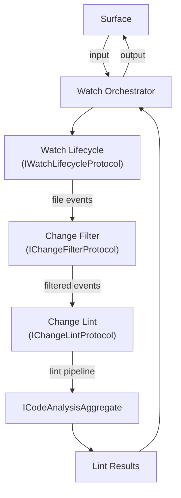

# FRD — file-watch

## Feature Overview

The file-watch crate provides a filesystem monitoring system that detects file
changes in real time and re-triggers analysis via an injected
`ICodeAnalysisAggregate`. It uses the `notify` crate (inotify on Linux) with
`notify-debouncer-mini` to debounce rapid changes and avoid redundant
processing.

**Configuration lifetime in a watch session.** A watch session is one
long-lived process holding one config orchestrator, and the config cache is
keyed by path with no modification-time check and no invalidation entry point
(see `crates/config-system/FRD.md`, FR-ConfigSystem-003). The configuration a
session uses is therefore the one parsed at startup, for the whole session:
editing `lint_arwaky.config.yaml` while `watch` runs changes nothing until the
session is restarted. Thresholds, ignored paths, and adapter toggles are
start-of-session values.

- **Architecture & Data Flow**

## Functional Requirements

### FR-FileWatch-001: Watch Filesystem Lifecycle

- **Description**: Start, maintain, and stop a debounced filesystem watcher on
  a target path. The lifecycle capability exposes subscribe for event consumers,
  start for path activation, and stop for clean shutdown.
- **Input**: `WatchConfig` containing path, debounce interval, recursive flag,
  and ignore patterns.
- **Output**: `Result<(), WatchServiceError>` — Ok on successful start/stop; Err
  with a descriptive message if the path does not exist, the debouncer fails to
  initialise, or the watch call fails.
- **Business Rules**:

  - Path must exist on disk before the watcher starts; otherwise `start` returns
    an error.
  - Debounce interval is configurable via `WatchConfig.debounce_ms`
    (default 200 ms via `notify-debouncer-mini`).
  - Recursive mode is controlled by `WatchConfig.recursive`.
  - Ignore patterns are matched via substring containment against event paths.
  - Only `Any`-kind events are forwarded to subscribers.
  - `subscribe` returns a broadcast receiver; each subscriber receives an
    independent copy of every event.
  - `is_available` returns true only when the `watch` feature gate is compiled
    in for the current platform.
- **Edge Cases**:

  - Path is a file (not a directory) — the watcher still attaches to it.
  - Multiple Ctrl+C presses — `stop` is idempotent because the internal mutex
    guard handles concurrent access safely.
  - Tokio runtime creation fails — the orchestrator falls back to a single-threaded
    runtime.
- **Error Handling**: Returns `WatchServiceError` for path-not-found, debouncer
  creation failure, and watch-path failure. Dropping an event because the
  broadcast channel is full is non-fatal.

---

### FR-FileWatch-002: Filter and Deduplicate Change Events

- **Description**: Given a batch of raw file-change events, deduplicate by path
  (last-write-wins) and then filter to lintable extensions only.
- **Input**: List of `WatchEvent` structs.
- **Output**: Filtered, deduplicated list of `WatchEvent` structs.
- **Business Rules**:

  - Deduplication key is the file path string. When duplicate paths exist the
    last-inserted event wins (hash-map insert semantics).
  - Lintable extensions: `.rs`, `.py`, `.js`, `.ts`, `.tsx`, `.jsx`, `.mjs`,
    `.cjs`, `.json`, `.css`, `.md`, `.toml`, `.yaml`, `.yml`.
  - Extension matching is suffix-based; no case normalization is applied.
  - The two operations are applied in sequence — deduplicate first, then filter.
- **Edge Cases**:

  - Empty input — returns an empty list.
  - All events for the same path — returns a single event.
  - File with no extension — excluded by the filter.
  - Hidden files (e.g. `.gitignore`) — not lintable; excluded.
  - Files with non-lintable extensions (e.g. `.txt`, `.png`, `.lock`) — excluded.
- **Error Handling**: No error paths; both operations are pure in-memory.

---

### FR-FileWatch-003: Run Lint on Changed Files

- **Description**: On each lintable change event, delegate to the injected
  `ICodeAnalysisAggregate` and report violations and score.
- **Input**: A single `WatchEvent` containing the changed file path.
- **Output**: Printed output line in the form
  `[change] <path> | <count> violations, score <score>`, plus an empty `Ok` on
  success.
- **Business Rules**:

  - Only lintable files (as determined by FR-FileWatch-002) trigger a lint run.
  - The aggregate computes violations and a compliance score; both are printed
    on completion.
  - Initial full lint runs on startup before the event loop begins, establishing
    a baseline.
- **Edge Cases**:

  - File deleted between event receipt and lint execution — the aggregate handles
    the missing file gracefully; no violation is reported.
  - Broadcast channel closed — the orchestrator breaks the event loop; this FR
    does not handle channel closure directly.
  - Broadcast lagged (events missed) — the orchestrator skips missed events;
    this FR continues processing the events it receives.
- **Error Handling**: Lint failures are non-fatal; the orchestrator logs the
  error and continues with the next event.

---

## Public Interface

### Protocol API

| Method | Input | Output | Error | Event | Description |
|---|---|---|---|---|---|
| `start` / `subscribe` / `stop` | `&WatchConfig` / `—` / `—` | `Result<(), WatchServiceError>` / `Receiver` / `Result<(), WatchServiceError>` | — | — | Watch lifecycle. |
| `filter_events` | `Vec<WatchEvent>` | `Vec<WatchEvent>` | — | — | Deduplicate then filter to lintable extensions. |
| `lint_changed` | `&WatchEvent` | `Result<(), WatchServiceError>` | — | — | Run lint pipeline on a changed file. |

### Aggregate API

| Method | Input | Output | Error | Event | Description |
|---|---|---|---|---|---|
| `execute` | `WatchRequest` | `WatchResponse` | — | — | Single composite entry point over the feature. |

## Reference

- PRD: [PRD.md](../../PRD.md)
- Backlog: [BACKLOG.md](BACKLOG.md) — real condition for this crate; this file is specification only.

| Roadmap | {Link to ROADMAP.md} | [{link}](ROADMAP.md) |
| Architecture | {Link to ARCHITECTURE.md} | [{link}](ARCHITECTURE.md) |
