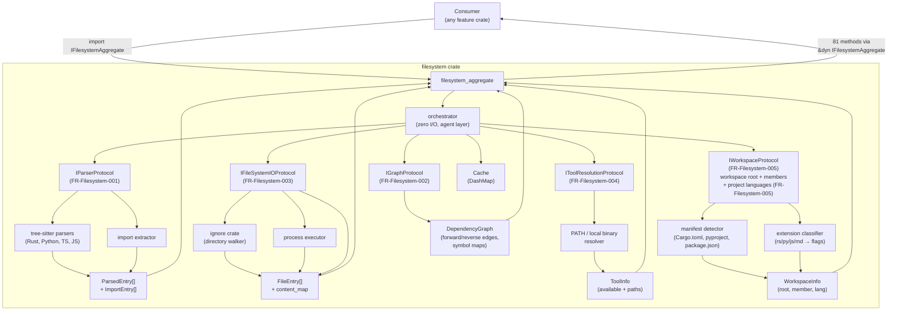

# FRD — filesystem

---

## Feature Overview

---

## Functional Requirements

### FR-Filesystem-001: AST Parsing & Import Extraction

| Aspect | Detail|
|--------|-------|
| Description | Parse source files with tree-sitter grammars and extract imports, identifiers, and declared symbols. |
| Business Rules | ParseAll processes a batch of file entries and returns per-file ParsedEntries (imports, function/class/enum definitions, trait declarations, identifiers). Rust, Python, and TypeScript grammars are used by language; grouped barrel-reexport symbols are resolved independently per declaration. |
| Edge Cases | A file with no imports yields an empty import list rather than an error. A broken tree-sitter fixture still parses to a partial result. Barrel re-exports that resolve to multiple files resolve each symbol independently. Empty input returns an empty result set. An unknowable extension defaults to Rust parse behavior. |
| Capability | ASTParser implements scanning (ParseAll, ImportsFor, UsedIdentifiers) over the tree-sitter utilities. |
| Protocol | IParserProtocol. |
| Method | ParseAll(entries) -> ParsedEntries; ImportsFor(path); UsedIdentifiers(path). |
| Input | Batch of FileEntry records or a single path; source is the aggregated scan pipeline from the surface check command. |
| Output | ParsedEntries carrying imports, definitions, and identifiers, returned through FilesystemResponse::ParsedEntries and related variants. |
| Error | Unreadable file surfaces as a read failure on the response; parse failure of a partial file still returns whatever was extracted. |
| Event | None; parsing is synchronous. |
| Test | ast_parser_implements_parser_protocol and ast_parser_resolves_each_grouped_barrel_symbol_independently assert object safety and barrel-resolution behavior. |
| Metric | Every seeded fixture file in the parse suite yields its expected import and symbol counts. |

### FR-Filesystem-002: Dependency Graph Construction

| Aspect | Detail|
|--------|-------|
| Description | Build a project-wide import graph from parsed entries so downstream rule crates can query reachability. |
| Business Rules | BuildFileIndex and BuildFileIndexWithIgnored produce a file index and a resolved import list; BuildOrphanGraphContext assembles the graph context using ignored-path settings. Container wiring identifiers are matched to their defining files with substring patterns; self-references and unknown identifiers are skipped. |
| Edge Cases | Repeated identifiers in one container dedupe their wiring edges. Files without a container in their name add no wiring edge. Missing implementations leave an existing forward entry untouched (noop when a trait has no definition). An empty project builds an empty graph without failure. |
| Capability | DependencyGraph implements graph construction (BuildFileIndex, ExtendImportCache, GraphContext assembly). |
| Protocol | IGraphProtocol. |
| Method | BuildFileIndex(root), BuildFileIndexWithIgnored(root, ignored), and BuildOrphanGraphContext(root, ignored). |
| Input | Project root filepath plus optional ignored-path list; source is the filesystem aggregate request. |
| Output | File index, import list snapshot, and orphan-graph context returned through FilesystemResponse::ImportListSnapshot and GraphContext. |
| Error | Unreadable directories skip their entries instead of failing the whole build; root that does not exist yields an empty graph. |
| Event | None; the graph is built in memory. |
| Test | dependency_graph_implements_graph_protocol, e2e_full_pipeline_with_graph_query, e2e_chained_python_import_graph_reaches_capabilities, and the add_container_wiring_edges_* family assert edge construction and dedup. |
| Metric | Seeded e2e import chain reaches the capabilities layer with zero missing edges; wiring-edge dedup keeps one edge per identifier. |

### FR-Filesystem-003: File I/O & Directory Operations

| Aspect | Detail|
|--------|-------|
| Description | Provide the file I/O primitives (read, write, discover, copy, remove, permissions) every rule crate builds on. |
| Business Rules | DiscoverSourceFiles and CollectSourceFiles respect ignored paths. ReadLintableFile returns content for lint-eligible files. WriteFile, CopyFile, RemoveFile, RemoveDirAll, and SetPermissions mutate the tree as named. Canonicalize resolves paths; PathExists reports existence; ReadDirEntries lists a directory. |
| Edge Cases | A missing file reports PathExists false and a read failure, not a panic. Discover with an empty root returns an empty entry list. Discovery prefers crates/ over packages/ for source dirs and falls back to the root when neither exists. A read of a path outside the project is rejected as non-member by IsMemberPath. |
| Capability | CapabilitiesFileSystemIO implements all directory and file operations. |
| Protocol | IFileSystemIOProtocol. |
| Method | ReadFile, WriteFile, DiscoverSourceFiles, CollectSourceFiles, PathExists, Canonicalize, SetPermissions, and the remaining I/O operations each map to one request variant. |
| Input | FilePath or directory path plus content where required; source is caller requests through IFilesystemAggregate::execute. |
| Output | Operation result through FilesystemResponse variants OpOk, Content, PathExists, Has, Files, and Paths. |
| Error | Missing or unreadable path yields a failed read or an OpOk=false style error result; callers see the error on the response variant for that operation. |
| Event | None; I/O is synchronous. |
| Test | capabilities_filesystem_io_implements_io_protocol, canonicalize_resolves_path, detect_source_dir_prefers_crates, and detect_source_dir_falls_back_to_root assert the I/O contract on seeded fixtures. |
| Metric | All I/O operations on the seeded fixture tree return their expected results; discovery order crates then packages then root holds on every run. |

### FR-Filesystem-004: Tool Resolution

| Aspect | Detail|
|--------|-------|
| Description | Locate external tool binaries so CLI and adapter layers can invoke them without hard-coding paths. |
| Business Rules | BinaryAvailable(bin_name) probes PATH for the named binary; resolution uses the shared tool-resolution utility; the response reports availability as a boolean rather than failing when the tool is missing. |
| Edge Cases | A binary absent from PATH responds unavailable (false) and the caller degrades gracefully (feature skipped, not fatal). Tool probes do not execute the binary, so a broken binary still reports available. Empty bin name resolves unavailable. |
| Capability | CapabilitiesToolResolution implements tool lookup. |
| Protocol | IToolResolutionProtocol. |
| Method | BinaryAvailable(bin_name) -> availability boolean. |
| Input | Binary name string; source is adapters and collectors that need an external tool. |
| Output | FilesystemResponse::BinaryAvailable { available }. |
| Error | A missing binary is not an error; it is reported as unavailable. Malformed names resolve unavailable without panicking. |
| Event | None; resolution is a pure lookup. |
| Test | capabilities_tool_resolution_implements_tool_resolution_protocol and filesystem_tool_resolution_responds assert the protocol contract and response shape. |
| Metric | Present binaries report available=true and absent binaries available=false on every seeded probe list. |

### FR-Filesystem-005: Workspace & Project Language Detection

| Aspect | Detail|
|--------|-------|
| Description | Detect the workspace root and the language groups present in a project so downstream rules can specialize. |
| Business Rules | FindWorkspaceRoot walks up from a start path to the nearest workspace manifest and returns it; inner projects prefer their own root when distinct. DetectProjectLanguages scans the tree and emits four flags: has_rust (Rust sources), has_python (Python sources), has_js (JavaScript/TypeScript sources), has_markdown (Markdown files). Path-based classification handles nested directories; an unknown extension defaults to Rust grouping. An empty project reports no languages. |
| Edge Cases | Empty project returns all four flags false. A file under a hidden or ignored directory does not flip its language flag. Workspace root beyond the project start falls back to the start directory. Nested language fixtures still detect each group independently. |
| Capability | CapabilitiesWorkspace implements root detection and language grouping; CapabilitiesFileSystemIO serves the same FR through DetectProjectLanguages. |
| Protocol | IWorkspaceProtocol. |
| Method | FindWorkspaceRoot(start) and DetectProjectLanguages(root) -> ProjectLanguages. |
| Input | Start path or project root FilePath; source is the container and cross-crate callers such as external-lint via FilesystemRequest::DetectProjectLanguages. |
| Output | Root path and ProjectLanguages flags through FilesystemResponse::Root and ProjectLanguages. |
| Error | No upward workspace found returns the start path rather than an error; unreadable subtrees are skipped. |
| Event | None; detection is a one-shot query. |
| Test | e2e_workspace_detection_in_pipeline, detects_each_language_group, detects_nested_files, empty_project_reports_no_languages, and detect_language_from_unknown_defaults_to_rust assert root and language detection. |
| Metric | Every seeded language fixture reports exactly its own group; empty project yields four false flags with zero walk errors. |

## Public Interface

| Aspect | Detail|
|--------|-------|
| Agent | FilesystemOrchestrator — the agent-layer orchestrator behind filesystem requests, with FilesystemPipelineOrchestrator driving the scan pipeline. |
| Aggregate | IFilesystemAggregate — the feature's single front door. |
| Method | execute(&self, request: FilesystemRequest) -> FilesystemResponse |
| Request | FilesystemRequest (ReadFile, WriteFile, DiscoverSourceFiles, DetectProjectLanguages, FindWorkspaceRoot, ParseAll, BuildFileIndex, BinaryAvailable, PathExists and the remaining I/O, parse, and graph variants) |
| Response | FilesystemResponse::{Files, Content, ContentOpt, Has, Entries, Paths, SourcePaths, Identifiers, TraitsMap, Root, Imports, GraphContext, ProjectLanguages, OpOk, PathExists, BinaryAvailable, IsMember, ParsedEntries} |

## Reference

| Artifact | Purpose | Link |
|----------|---------|------|
| PRD | Business goals, user stories, and scope | [PRD.md](../../PRD.md) |
| Backlog | Task tracking, epics, and implementation status | [BACKLOG.md](BACKLOG.md) |
| Roadmap | Timeline, phasing, and dependencies | [ROADMAP.md](../../ROADMAP.md) |
| Architecture | System boundaries, tech stack, and infra | [ARCHITECTURE.md](../../ARCHITECTURE.md) |
