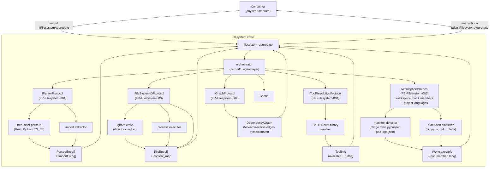

# FRD — filesystem

## Feature Overview

The filesystem crate produces filesystem data that every other feature crate consumes: parsed entries and import data, the dependency graph, file I/O results, tool availability, and workspace metadata with project language flags.

- **Architecture & Data Flow**

- **Data Production Map**

| FR | Output Data |
| --- | --- |
| FR-Filesystem-001 | Parsed entries + import data |
| FR-Filesystem-002 | Dependency graph + symbol maps |
| FR-Filesystem-003 | File paths, content, I/O operations |
| FR-Filesystem-004 | Tool availability + resolved paths |
| FR-Filesystem-005 | Workspace metadata + project language presence flags |

## Functional Requirements

### FR-Filesystem-001: Parse Source Files & Extract Imports

**Description:** The filesystem crate shall parse source files with language-specific grammars and extract imports, identifiers, and declared symbols for every file in a batch, producing structured entries that downstream rule crates can query.

#### Business Logic

- Shall parse a batch of file entries and return per-file parsed entries carrying imports, function/class/enum definitions, trait declarations, and identifiers.
- Shall use the grammar matching each file's language: Rust, Python, and TypeScript grammars are selected by extension or manifest context.
- Shall resolve grouped barrel-reexport symbols independently per declaration so that a re-export that names multiple symbols yields one edge per symbol.
- Shall return an empty import list for a file that contains no imports, treating that as a valid result rather than an error.

#### Edge Cases

- A file with no imports shall yield an empty import list, not a failure.
- A partially broken or unterminated fixture shall still parse to a partial result; whatever was extracted before the break is returned.
- A barrel re-export that resolves to multiple files shall resolve each symbol independently; one broken member does not discard the others.

#### Technical Specification

| Aspect | Detail |
|--------|--------|
| **Input** | Batch of `FileEntry` records, or a single path; source is the aggregated scan pipeline from the surface command. |
| **Output** | `ParsedEntries` carrying imports, definitions, and identifiers, returned through `FilesystemResponse::ParsedEntries` and related variants. |
| **Protocol** | `IParserProtocol` |
| **Method** | `ParseAll(entries)` → `ParsedEntries`; `ImportsFor(path)`; `UsedIdentifiers(path)`. |
| **Event** | None; parsing is synchronous. |
| **Error** | An unreadable file surfaces as a read failure on the response; a parse failure on a partial file still returns whatever was extracted. |

#### Test

| Context | When Action | Then Observable Result |
|---------|-------------|------------------------|
| A seeded fixture file with imports is parsed | The aggregate is asked to parse the batch | The response carries the expected import list and symbol counts for that file |
| A file with no imports is in the batch | The aggregate is asked to parse the batch | That file's import list in the response is empty, not an error |
| A barrel re-export names multiple symbols | The aggregate is asked to parse the batch | Each symbol resolves to its own source file, independently of the others |
| A partially broken fixture is parsed | The aggregate is asked to parse the batch | Whatever was extracted before the break is returned, with no crash |

#### Metric

| Target Metric | Value |
|---------------|-------|
| Parse-success rate over the seeded fixture suite | 100% of seeded fixtures yield their expected import and symbol counts |
| p95 parse latency for a single file | < 50ms |

### FR-Filesystem-002: Build the Project Dependency Graph

**Description:** The filesystem crate shall build a project-wide import graph from parsed entries so that downstream rule crates can query reachability between files and symbols.

#### Business Logic

- Shall build a file index and a resolved import list from a project root, optionally with an ignored-path list.
- Shall assemble the orphan-graph context using the ignored-path settings so downstream rules can see which edges are reachable.
- Shall match container-wiring identifiers to their defining files with substring patterns; self-references and unknown identifiers are skipped.
- Shall dedupe repeated identifiers in one container so that each identifier contributes exactly one wiring edge.
- Shall leave an existing forward entry untouched when an implementation is missing, so the graph never regresses.

#### Edge Cases

- A file without a container in its name adds no wiring edge.
- An empty project builds an empty graph without failure.
- An identifier with no defining file leaves the existing forward entry untouched; the graph does not grow a dangling edge.

#### Technical Specification

| Aspect | Detail |
|--------|--------|
| **Input** | Project root filepath plus optional ignored-path list; source is the filesystem aggregate request. |
| **Output** | File index, import-list snapshot, and orphan-graph context, returned through `FilesystemResponse::ImportListSnapshot` and `GraphContext`. |
| **Protocol** | `IGraphProtocol` |
| **Method** | `BuildFileIndex(root)`; `BuildFileIndexWithIgnored(root, ignored)`; `BuildOrphanGraphContext(root, ignored)`. |
| **Event** | None; the graph is built in memory. |
| **Error** | An unreadable directory skips its entries instead of failing the whole build; a root that does not exist yields an empty graph. |

#### Test

| Context | When Action | Then Observable Result |
|---------|-------------|------------------------|
| A seeded e2e import chain is built | The aggregate is asked to build the graph | The chain reaches the capabilities layer with zero missing edges |
| Two duplicate identifiers in one container | The aggregate is asked to build the graph | One wiring edge is kept per identifier, not two |
| A file without a container in its name | The aggregate is asked to build the graph | No wiring edge is added for that file |
| An empty project root | The aggregate is asked to build the graph | The result is an empty graph, not a failure |

#### Metric

| Target Metric | Value |
|---------------|-------|
| Seeded e2e import-chain reachability | 100% of seeded chains reach their target with zero missing edges |
| Wiring-edge dedup accuracy | 1 edge per unique identifier, 0 duplicates |

### FR-Filesystem-003: Read, Write, Discover & Mutate the File Tree

**Description:** The filesystem crate shall provide the file I/O primitives — read, write, discover, copy, remove, permissions — that every rule crate builds on.

#### Business Logic

- Shall discover and collect source files while respecting ignored paths.
- Shall return content for lint-eligible files and list directory entries.
- Shall write, copy, remove files, remove directories recursively, and set permissions as named.
- Shall canonicalize paths and report existence.
- Shall reject reads of a path outside the project as non-member.

#### Edge Cases

- A missing file reports existence as false and a read failure, not a panic.
- Discovery with an empty root returns an empty entry list.
- Discovery prefers `crates/` over `packages/` for source dirs and falls back to the root when neither exists.
- A read of a path outside the project is rejected as non-member.

#### Technical Specification

| Aspect | Detail |
|--------|--------|
| **Input** | File path or directory path plus content where required; source is caller requests through the aggregate. |
| **Output** | Operation results through `FilesystemResponse` variants `OpOk`, `Content`, `PathExists`, `Has`, `Files`, and `Paths`. |
| **Protocol** | `IFileSystemIOProtocol` |
| **Method** | `ReadFile`, `WriteFile`, `DiscoverSourceFiles`, `CollectSourceFiles`, `PathExists`, `Canonicalize`, `SetPermissions`, `CopyFile`, `RemoveFile`, `RemoveDirAll`, `ReadDirEntries`, `IsMemberPath`. |
| **Event** | None; I/O is synchronous. |
| **Error** | A missing or unreadable path yields a failed read or an `OpOk=false`-style error result; callers see the error on the response variant for that operation. |

#### Test

| Context | When Action | Then Observable Result |
|---------|-------------|------------------------|
| A seeded fixture tree is read | The aggregate is asked to read a file | The response carries the file's content |
| A missing file is read | The aggregate is asked to read it | The response reports the path does not exist, with no panic |
| Discovery is asked on an empty root | The aggregate is asked to discover | The response is an empty entry list |
| Discovery is asked on a tree that has `crates/` and `packages/` | The aggregate is asked to discover | Source dirs are taken from `crates/` first |
| A path outside the project is read | The aggregate is asked to read it | The response rejects it as non-member |

#### Metric

| Target Metric | Value |
|---------------|-------|
| I/O operation accuracy on the seeded fixture tree | 100% of seeded operations return their expected result |
| Discovery-order stability | `crates/` then `packages/` then root holds on every run |

### FR-Filesystem-004: Resolve External Tool Binaries

**Description:** The filesystem crate shall locate external tool binaries so that the CLI and adapter layers can invoke them without hard-coding paths.

#### Business Logic

- Shall probe the PATH for the named binary and report availability as a boolean.
- Shall not execute the binary when probing; a broken binary still reports available.
- Shall treat a missing binary as a non-fatal result, not an error.

#### Edge Cases

- A binary absent from PATH responds unavailable and the caller degrades gracefully (feature skipped, not fatal).
- An empty binary name resolves to unavailable without panicking.
- A malformed binary name resolves to unavailable without panicking.

#### Technical Specification

| Aspect | Detail |
|--------|--------|
| **Input** | Binary name string; source is adapters and collectors that need an external tool. |
| **Output** | `FilesystemResponse::BinaryAvailable { available }` carrying the availability boolean. |
| **Protocol** | `IToolResolutionProtocol` |
| **Method** | `BinaryAvailable(bin_name)` → availability boolean. |
| **Event** | None; resolution is a pure lookup. |
| **Error** | A missing binary is not an error; it is reported as unavailable. |

#### Test

| Context | When Action | Then Observable Result |
|---------|-------------|------------------------|
| A binary present in PATH is probed | The aggregate is asked for its availability | The response reports available=true |
| A binary absent from PATH is probed | The aggregate is asked for its availability | The response reports available=false, with no failure |
| An empty binary name is probed | The aggregate is asked for its availability | The response reports available=false without panicking |

#### Metric

| Target Metric | Value |
|---------------|-------|
| Tool-probe accuracy on the seeded probe list | 100% of present binaries report available=true and absent binaries available=false |
| Probe panic rate | 0 panics on empty or malformed names |

### FR-Filesystem-005: Detect Workspace Root & Project Languages

**Description:** The filesystem crate shall detect the workspace root and the language groups present in a project so downstream rules can specialize per language.

#### Business Logic

- Shall walk up from a start path to the nearest workspace manifest and return it; inner projects prefer their own root when distinct.
- Shall scan the tree and emit four language flags: has_rust, has_python, has_js, has_markdown.
- Shall classify files by extension, handling nested directories; an unknown extension defaults to the Rust grouping.
- Shall skip files under hidden or ignored directories when flipping language flags.

#### Edge Cases

- An empty project returns all four language flags false.
- A file under a hidden or ignored directory does not flip its language flag.
- A workspace root beyond the project start falls back to the start directory.
- Nested language fixtures detect each group independently.

#### Technical Specification

| Aspect | Detail |
|--------|--------|
| **Input** | Start path or project root file path; source is container and cross-crate callers such as the external-lint aggregate. |
| **Output** | Root path and the project-language flags, returned through `FilesystemResponse::Root` and `ProjectLanguages`. |
| **Protocol** | `IWorkspaceProtocol` |
| **Method** | `FindWorkspaceRoot(start)`; `DetectProjectLanguages(root)` → `ProjectLanguages`. |
| **Event** | None; detection is a one-shot query. |
| **Error** | No upward workspace found returns the start path rather than an error; unreadable subtrees are skipped. |

#### Test

| Context | When Action | Then Observable Result |
|---------|-------------|------------------------|
| A project with a workspace manifest is detected | The aggregate is asked for the root | The response carries the nearest manifest's directory |
| An empty project is scanned | The aggregate is asked for its languages | The response carries all four language flags false |
| A nested Rust file is detected | The aggregate is asked for its languages | The has_rust flag is true |
| A file under a hidden directory is scanned | The aggregate is asked for its languages | The hidden file does not flip its language flag |
| An unknown extension is classified | The aggregate is asked for its languages | It is grouped as Rust by default |

#### Metric

| Target Metric | Value |
|---------------|-------|
| Language-detection accuracy on the seeded fixtures | 100% of seeded fixtures report exactly their own language group |
| Empty-project flag accuracy | All four flags false, zero walk errors |

## Public Interface

| Aspect | Detail |
|--------|--------|
| Agent | `FilesystemOrchestrator` — the agent-layer orchestrator behind filesystem requests. |
| Aggregate | `IFilesystemAggregate` — the feature's single front door. |
| Method | `execute(&self, request: FilesystemRequest) -> FilesystemResponse` |
| Request | `FilesystemRequest` carrying the I/O, parse, graph, tool, and workspace variants. |
| Response | `FilesystemResponse` carrying the corresponding result variants. |

## Reference

| Artifact | Purpose | Link |
|----------|---------|------|
| PRD | Product requirements | [PRD.md](../../PRD.md) |
| Backlog | Backlog tracking | [BACKLOG.md](BACKLOG.md) |
| Roadmap | Roadmap status | [ROADMAP.md](../../ROADMAP.md) |
| Architecture | Layer contract | [ARCHITECTURE.md](../../ARCHITECTURE.md) |
