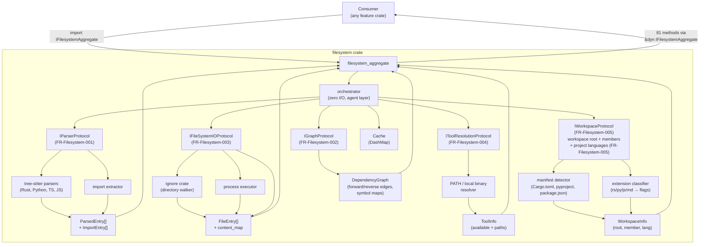

# FRD — filesystem

---

## Feature Overview

The filesystem crate produces filesystem data for all feature crates.

- **Architecture & Data Flow**

- **Data Production Map**

| FR | Output Data|
| --- | ---|
| FR-Filesystem-001 | Parsed entries + import data|
| FR-Filesystem-002 | Dependency graph + symbol maps|
| FR-Filesystem-003 | File paths, content, I/O operations|
| FR-Filesystem-004 | Tool availability + resolved paths|
| FR-Filesystem-005 | Workspace metadata + project language presence flags|

---

## Functional Requirements

### FR-Filesystem-001: AST Parsing & Import Extraction

#### Description

| No | Detail |
| --- | --- |
| 1 | Parse source files with tree-sitter grammars and extract imports, identifiers, and declared symbols. |
| 2 | — |

#### Business Rules

| No | Detail |
| --- | --- |
| 1 | ParseAll processes a batch of file entries and returns per-file ParsedEntries (imports, function/class/enum definitions, trait declarations, identifiers). |
| 2 | Rust, Python, and TypeScript grammars are used by language; grouped barrel-reexport symbols are resolved independently per declaration. |

#### Edge Cases

| No | Detail |
| --- | --- |
| 1 | A file with no imports yields an empty import list rather than an error. |
| 2 | A broken tree-sitter fixture still parses to a partial result; barrel re-exports that resolve to multiple files resolve each symbol independently. |

#### Capability

| No | Detail |
| --- | --- |
| 1 | ASTParser implements scanning (ParseAll, ImportsFor, UsedIdentifiers) over the tree-sitter utilities. |

#### Protocol

| No | Detail |
| --- | --- |
| 1 | IParserProtocol. |

#### Method

| No | Detail |
| --- | --- |
| 1 | ParseAll(entries) -> ParsedEntries; ImportsFor(path); UsedIdentifiers(path). |
| 2 | — |

#### Input

| No | Detail |
| --- | --- |
| 1 | Batch of FileEntry records or a single path; source is the aggregated scan pipeline from the surface check command. |
| 2 | — |

#### Output

| No | Detail |
| --- | --- |
| 1 | ParsedEntries carrying imports, definitions, and identifiers. |
| 2 | Returned through FilesystemResponse::ParsedEntries and related variants. |

#### Error

| No | Detail |
| --- | --- |
| 1 | Unreadable file surfaces as a read failure on the response. |
| 2 | Parse failure of a partial file still returns whatever was extracted. |

#### Event

| No | Detail |
| --- | --- |
| 1 | None; parsing is synchronous. |
| 2 | — |

#### Test

| No | Detail |
| --- | --- |
| 1 | ast_parser_implements_parser_protocol and ast_parser_resolves_each_grouped_barrel_symbol_independently assert object safety and barrel-resolution behavior. |
| 2 | — |

#### Metric

| No | Detail |
| --- | --- |
| 1 | Every seeded fixture file in the parse suite yields its expected import and symbol counts. |
| 2 | — |

### FR-Filesystem-002: Dependency Graph Construction

#### Description

| No | Detail |
| --- | --- |
| 1 | Build a project-wide import graph from parsed entries so downstream rule crates can query reachability. |
| 2 | — |

#### Business Rules

| No | Detail |
| --- | --- |
| 1 | BuildFileIndex and BuildFileIndexWithIgnored produce a file index and a resolved import list; BuildOrphanGraphContext assembles the graph context using ignored-path settings. |
| 2 | Container wiring identifiers are matched to their defining files with substring patterns; self-references and unknown identifiers are skipped. |

#### Edge Cases

| No | Detail |
| --- | --- |
| 1 | Repeated identifiers in one container dedupe their wiring edges. Files without a container in their name add no wiring edge. |
| 2 | Missing implementations leave an existing forward entry untouched (noop when a trait has no definition); an empty project builds an empty graph without failure. |

#### Capability

| No | Detail |
| --- | --- |
| 1 | DependencyGraph implements graph construction (BuildFileIndex, ExtendImportCache, GraphContext assembly). |

#### Protocol

| No | Detail |
| --- | --- |
| 1 | IGraphProtocol. |

#### Method

| No | Detail |
| --- | --- |
| 1 | BuildFileIndex(root), BuildFileIndexWithIgnored(root, ignored), and BuildOrphanGraphContext(root, ignored). |
| 2 | — |

#### Input

| No | Detail |
| --- | --- |
| 1 | Project root filepath plus optional ignored-path list; source is the filesystem aggregate request. |
| 2 | — |

#### Output

| No | Detail |
| --- | --- |
| 1 | File index, import list snapshot, and orphan-graph context. |
| 2 | Returned through FilesystemResponse::ImportListSnapshot and GraphContext. |

#### Error

| No | Detail |
| --- | --- |
| 1 | Unreadable directories skip their entries instead of failing the whole build; root that does not exist yields an empty graph. |
| 2 | — |

#### Event

| No | Detail |
| --- | --- |
| 1 | None; the graph is built in memory. |
| 2 | — |

#### Test

| No | Detail |
| --- | --- |
| 1 | dependency_graph_implements_graph_protocol, e2e_full_pipeline_with_graph_query, e2e_chained_python_import_graph_reaches_capabilities, and the add_container_wiring_edges_* family assert edge construction and dedup. |
| 2 | — |

#### Metric

| No | Detail |
| --- | --- |
| 1 | Seeded e2e import chain reaches the capabilities layer with zero missing edges; wiring-edge dedup keeps one edge per identifier. |
| 2 | — |

### FR-Filesystem-003: File I/O & Directory Operations

#### Description

| No | Detail |
| --- | --- |
| 1 | Provide the file I/O primitives (read, write, discover, copy, remove, permissions) every rule crate builds on. |
| 2 | — |

#### Business Rules

| No | Detail |
| --- | --- |
| 1 | DiscoverSourceFiles and CollectSourceFiles respect ignored paths; ReadLintableFile returns content for lint-eligible files. |
| 2 | WriteFile, CopyFile, RemoveFile, RemoveDirAll, and SetPermissions mutate the tree as named; Canonicalize resolves paths; PathExists reports existence; ReadDirEntries lists a directory. |

#### Edge Cases

| No | Detail |
| --- | --- |
| 1 | A missing file reports PathExists false and a read failure, not a panic; discover with an empty root returns an empty entry list. |
| 2 | Discovery prefers crates/ over packages/ for source dirs and falls back to the root when neither exists; a read of a path outside the project is rejected as non-member by IsMemberPath. |

#### Capability

| No | Detail |
| --- | --- |
| 1 | CapabilitiesFileSystemIO implements all directory and file operations. |

#### Protocol

| No | Detail |
| --- | --- |
| 1 | IFileSystemIOProtocol. |

#### Method

| No | Detail |
| --- | --- |
| 1 | ReadFile, WriteFile, DiscoverSourceFiles, CollectSourceFiles, PathExists, Canonicalize, SetPermissions, and the remaining I/O operations each map to one request variant. |
| 2 | — |

#### Input

| No | Detail |
| --- | --- |
| 1 | FilePath or directory path plus content where required; source is caller requests through IFilesystemAggregate::execute. |
| 2 | — |

#### Output

| No | Detail |
| --- | --- |
| 1 | Operation result through FilesystemResponse variants OpOk, Content, PathExists, Has, Files, and Paths. |
| 2 | — |

#### Error

| No | Detail |
| --- | --- |
| 1 | Missing or unreadable path yields a failed read or an OpOk=false style error result; callers see the error on the response variant for that operation. |
| 2 | — |

#### Event

| No | Detail |
| --- | --- |
| 1 | None; I/O is synchronous. |
| 2 | — |

#### Test

| No | Detail |
| --- | --- |
| 1 | capabilities_filesystem_io_implements_io_protocol, canonicalize_resolves_path, detect_source_dir_prefers_crates, and detect_source_dir_falls_back_to_root assert the I/O contract on seeded fixtures. |
| 2 | — |

#### Metric

| No | Detail |
| --- | --- |
| 1 | All I/O operations on the seeded fixture tree return their expected results; discovery order crates then packages then root holds on every run. |
| 2 | — |

### FR-Filesystem-004: Tool Resolution

#### Description

| No | Detail |
| --- | --- |
| 1 | Locate external tool binaries so CLI and adapter layers can invoke them without hard-coding paths. |
| 2 | — |

#### Business Rules

| No | Detail |
| --- | --- |
| 1 | BinaryAvailable(bin_name) probes PATH for the named binary; resolution uses the shared tool-resolution utility; the response reports availability as a boolean rather than failing when the tool is missing. |
| 2 | — |

#### Edge Cases

| No | Detail |
| --- | --- |
| 1 | A binary absent from PATH responds unavailable (false) and the caller degrades gracefully (feature skipped, not fatal). |
| 2 | Tool probes do not execute the binary, so a broken binary still reports available; empty bin name resolves unavailable. |

#### Capability

| No | Detail |
| --- | --- |
| 1 | CapabilitiesToolResolution implements tool lookup. |

#### Protocol

| No | Detail |
| --- | --- |
| 1 | IToolResolutionProtocol. |

#### Method

| No | Detail |
| --- | --- |
| 1 | BinaryAvailable(bin_name) -> availability boolean. |
| 2 | — |

#### Input

| No | Detail |
| --- | --- |
| 1 | Binary name string; source is adapters and collectors that need an external tool. |
| 2 | — |

#### Output

| No | Detail |
| --- | --- |
| 1 | FilesystemResponse::BinaryAvailable { available }. |
| 2 | — |

#### Error

| No | Detail |
| --- | --- |
| 1 | A missing binary is not an error; it is reported as unavailable. |
| 2 | Malformed names resolve unavailable without panicking. |

#### Event

| No | Detail |
| --- | --- |
| 1 | None; resolution is a pure lookup. |
| 2 | — |

#### Test

| No | Detail |
| --- | --- |
| 1 | capabilities_tool_resolution_implements_tool_resolution_protocol and filesystem_tool_resolution_responds assert the protocol contract and response shape. |
| 2 | — |

#### Metric

| No | Detail |
| --- | --- |
| 1 | Present binaries report available=true and absent binaries available=false on every seeded probe list. |
| 2 | — |

### FR-Filesystem-005: Workspace & Project Language Detection

#### Description

| No | Detail |
| --- | --- |
| 1 | Detect the workspace root and the language groups present in a project so downstream rules can specialize. |
| 2 | — |

#### Business Rules

| No | Detail |
| --- | --- |
| 1 | FindWorkspaceRoot walks up from a start path to the nearest workspace manifest and returns it; inner projects prefer their own root when distinct. |
| 2 | DetectProjectLanguages scans the tree and emits four flags: has_rust, has_python, has_js, has_markdown; path-based classification handles nested directories; an unknown extension defaults to Rust grouping. |

#### Edge Cases

| No | Detail |
| --- | --- |
| 1 | Empty project returns all four flags false; a file under a hidden or ignored directory does not flip its language flag. |
| 2 | Workspace root beyond the project start falls back to the start directory; nested language fixtures still detect each group independently. |

#### Capability

| No | Detail |
| --- | --- |
| 1 | CapabilitiesWorkspace implements root detection and language grouping; CapabilitiesFileSystemIO serves the same FR through DetectProjectLanguages. |

#### Protocol

| No | Detail |
| --- | --- |
| 1 | IWorkspaceProtocol. |

#### Method

| No | Detail |
| --- | --- |
| 1 | FindWorkspaceRoot(start) and DetectProjectLanguages(root) -> ProjectLanguages. |
| 2 | — |

#### Input

| No | Detail |
| --- | --- |
| 1 | Start path or project root FilePath; source is the container and cross-crate callers such as external-lint via FilesystemRequest::DetectProjectLanguages. |
| 2 | — |

#### Output

| No | Detail |
| --- | --- |
| 1 | Root path and ProjectLanguages flags through FilesystemResponse::Root and ProjectLanguages. |
| 2 | — |

#### Error

| No | Detail |
| --- | --- |
| 1 | No upward workspace found returns the start path rather than an error; unreadable subtrees are skipped. |
| 2 | — |

#### Event

| No | Detail |
| --- | --- |
| 1 | None; detection is a one-shot query. |
| 2 | — |

#### Test

| No | Detail |
| --- | --- |
| 1 | e2e_workspace_detection_in_pipeline, detects_each_language_group, detects_nested_files, empty_project_reports_no_languages, and detect_language_from_unknown_defaults_to_rust assert root and language detection. |
| 2 | — |

#### Metric

| No | Detail |
| --- | --- |
| 1 | Every seeded language fixture reports exactly its own group; empty project yields four false flags with zero walk errors. |
| 2 | — |

## Public Interface

| Aspect | Detail|
|--------|-------|
| Agent | FilesystemOrchestrator — the agent-layer orchestrator behind filesystem requests, with FilesystemPipelineOrchestrator driving the scan pipeline. |
| Aggregate | IFilesystemAggregate — the feature's single front door. |
| Method | execute(&self, request: FilesystemRequest) -> FilesystemResponse |
| Request | FilesystemRequest (ReadFile, WriteFile, DiscoverSourceFiles, DetectProjectLanguages, FindWorkspaceRoot, ParseAll, BuildFileIndex, BinaryAvailable, PathExists and the remaining I/O, parse, and graph variants) |
| Response | FilesystemResponse::{Files, Content, ContentOpt, Has, Entries, Paths, SourcePaths, Identifiers, TraitsMap, Root, Imports, GraphContext, ProjectLanguages, OpOk, PathExists, BinaryAvailable, IsMember, ParsedEntries} |

## Reference

| Artifact | Purpose | Link|
|----------|---------|------|
| BACKLOG.md | Backlog tracking | [BACKLOG.md](BACKLOG.md)|
| PRD.md | Product requirements | [PRD.md](../../PRD.md)|
| FRD.md | Feature requirements | [FRD.md](FRD.md)|
| ROADMAP.md | Roadmap status | [ROADMAP.md](../../ROADMAP.md)|
| ARCHITECTURE.md | Layer contract | [ARCHITECTURE.md](../../ARCHITECTURE.md)|
