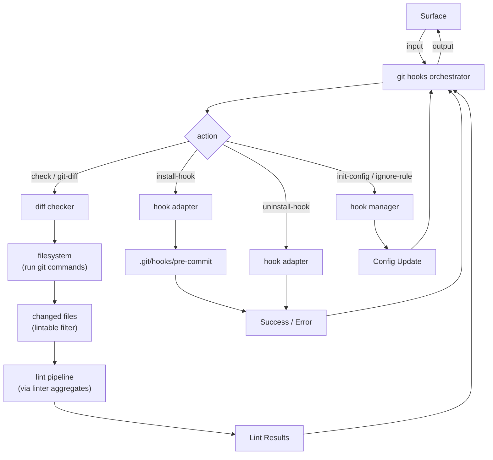

# FRD — git-hooks

---

## Feature Overview

---

## Functional Requirements

### FR-GitHooks-001: Git Diff Detection

| Aspect | Detail|
|--------|-------|
| Description | Detect changed files in the working tree and run lint checks over them before commit. |
| Business Rules | get_diff(path) computes the diff status VO (Unchanged, Modified, MissingFirst, MissingSecond, BothMissing, NotAFile); get_changed_files(path, base) lists changed files against the base branch; get_default_branch(path) resolves the repository default branch; run_git_diff_check(path) lints the changed set and returns violations. A clean changed file produces no violations; a changed file with an AES violation produces blocking results. |
| Edge Cases | NotAFile sides of the diff are tolerated; a missing feature branch falls back to the default branch lookup; a path that is not a git repository reports diff failure; empty diff yields an empty violation list. |
| Capability | DiffChecker implements diff detection and the pre-commit check. |
| Protocol | IDiffDetectionProtocol. |
| Method | get_diff, get_changed_files, get_default_branch, run_git_diff_check(path). |
| Input | FilePath of the repository plus base branch name; source is GitHooksRequest::RunCheck { path } from the pre-commit hook. |
| Output | GitDiffResultVO, FilePathList, GitBranchName, and LintResultList returned in GitHooksResponse::RunCheck. |
| Error | Not a repository or unreadable paths surface as a diff/detection error on the response; callers see an empty or partial LintResultList plus the error reason. |
| Event | None; results return synchronously to the hook process. |
| Test | changed_file_with_aes_violation_produces_blocking_results, clean_changed_file_produces_no_violations, e2e_orchestrator_delegates_to_diff_protocol, and assert_diff_detection_trait cover the contract. |
| Metric | Seeded violation file blocks with at least one violation; seeded clean file exits with an empty LintResultList. |

### FR-GitHooks-002: Pre-Commit Hook Installation

| Aspect | Detail|
|--------|-------|
| Description | Install the pre-commit hook into the repository so every commit runs the lint check. |
| Business Rules | install_pre_commit(executable_path) writes the hook script into .git/hooks pointing at the given binary path; the hooks directory is created when missing; get_hook_manager_identity returns the identity used in the config (git hook manager); identity is stable across runs. |
| Edge Cases | Existing hooks directory is reused; missing .git/hooks is created; reinstall over an existing hook overwrites cleanly; a repository without .git directory fails with a GitHookError rather than writing outside the repo. |
| Capability | HookInstaller implements hook installation. |
| Protocol | IHookInstallProtocol. |
| Method | install_pre_commit(executable_path); get_hook_manager_identity(). |
| Input | FilePath of the lint-arwaky binary; source is GitHooksRequest::Install { executable_path }. |
| Output | GitHooksResponse::Install carrying success status and identity. |
| Error | GitHookError when the repository lacks a .git directory or the write is denied; the caller sees the error variant on the response. |
| Event | None; installation is a filesystem write. |
| Test | e2e_install_creates_hooks_directory_when_missing, e2e_full_user_workflow_init_install_check, and config_init_identity_is_git_hook_manager assert install behavior and identity. |
| Metric | Install on a seeded hook-less repo creates .git/hooks/pre-commit in one call; reininstall is idempotent. |

### FR-GitHooks-003: Pre-Commit Hook Uninstallation

| Aspect | Detail|
|--------|-------|
| Description | Uninstall the pre-commit hook and restore the repository to its pre-install state. |
| Business Rules | uninstall_pre_commit removes the hook file it installed and returns SuccessStatus. Uninstalling when no hook exists still succeeds (idempotent). Round trip install then uninstall leaves the repository clean. |
| Edge Cases | A user-replaced hook that no longer points at the manager is left in place by safety check. A missing .git directory reports GitHookError. Repeated uninstall calls keep succeeding. |
| Capability | HookUninstaller implements hook removal. |
| Protocol | IHookUninstallProtocol::uninstall_pre_commit. |
| Method | uninstall_pre_commit() -> Result<SuccessStatus, GitHookError>. |
| Input | Repository path from context; source is GitHooksRequest::Uninstall. |
| Output | GitHooksResponse::Uninstall with success status. |
| Error | GitHookError when the repository is unusable or removal is denied. |
| Event | None; uninstallation is a filesystem delete. |
| Test | e2e_hook_install_then_uninstall_round_trip and assert_hook_uninstall_trait assert the round trip and protocol contract. |
| Metric | Round trip on a seeded repo restores the original hooks directory state exactly. |

### FR-GitHooks-004: Project Config Initialization

| Aspect | Detail|
|--------|-------|
| Description | Initialize the git-hooks project configuration and manage its ignore rules. |
| Business Rules | initialize_config(path) creates or reads the hook configuration and returns a description; update_ignore_rule(request) adds or removes an ignore rule via HookIgnoreUpdateVO; config must identify the manager as git hook manager; a missing config file is reported rather than silently created unless initializing. |
| Edge Cases | config file not found on read returns a not-found description; updating an ignored rule twice does not duplicate it; initialize on an existing config is idempotent; paths outside the repository are rejected early. |
| Capability | ConfigInit implements configuration bootstrap and ignore-rule updates. |
| Protocol | IConfigInitProtocol. |
| Method | initialize_config(path) -> DescriptionVO; update_ignore_rule(request: HookIgnoreUpdateVO) -> DescriptionVO. |
| Input | Path string plus HookIgnoreUpdateVO (rule, add or remove); source is GitHooksRequest::GetManagerIdentity and config-init flows through the orchestrator. |
| Output | GitHooksResponse::GetManagerIdentity and description text describing the operation result. |
| Error | Missing config on read yields config_file_not_found; malformed update requests are rejected with a description of the failure. |
| Event | None; configuration write is synchronous. |
| Test | config_file_not_found, config_init_identity_is_git_hook_manager, and e2e_full_user_workflow_init_install_check assert init, identity, and missing-config handling. |
| Metric | Initialize then update leaves the seeded config with exactly the requested ignore rules; identity readback matches git hook manager. |

## Public Interface

| Aspect | Detail|
|--------|-------|
| Agent | GitHooksOrchestrator — the agent-layer orchestrator behind install, uninstall, init, and pre-commit check flows. |
| Aggregate | IGitHooksAggregate — the feature's single front door. |
| Method | execute(&self, request: GitHooksRequest) -> GitHooksResponse |
| Request | GitHooksRequest::{RunCheck { path }, Install { executable_path }, Uninstall, GetManagerIdentity} |
| Response | GitHooksResponse::{RunCheck, Install, Uninstall, GetManagerIdentity} |

## Reference

| Artifact | Purpose | Link |
|----------|---------|------|
| PRD | Business goals, user stories, and scope | [PRD.md](../../PRD.md) |
| Backlog | Task tracking, epics, and implementation status | [BACKLOG.md](BACKLOG.md) |
| Roadmap | Timeline, phasing, and dependencies | [ROADMAP.md](../../ROADMAP.md) |
| Architecture | System boundaries, tech stack, and infra | [ARCHITECTURE.md](../../ARCHITECTURE.md) |
