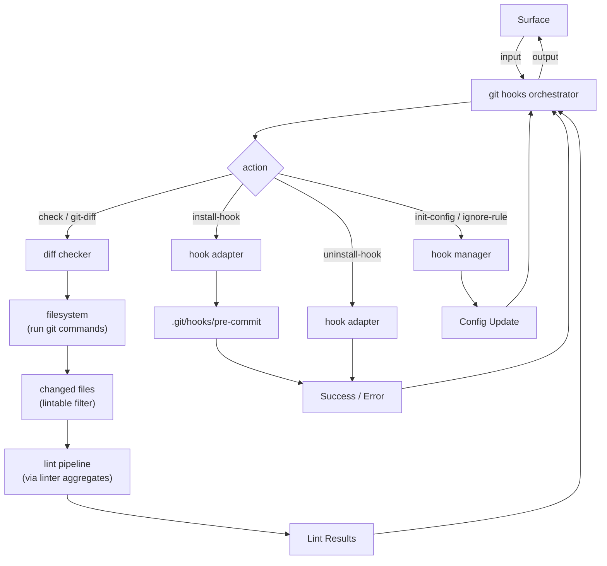

# FRD — git-hooks

---

## Feature Overview

The git-hooks crate implements a pre-commit hook system that enforces AES
compliance before code enters the repository. It detects changed files via
git diff, runs linting only on modified files, and blocks commits that
violate AES rules.

The crate follows the AES 7-layer architecture: the diff checker (capability)
implements the diff protocol, the git hook adapter (capability) implements
both the install and uninstall protocols, the hook manager (capability)
implements the config protocol, the git hooks orchestrator (agent) composes
the four protocols, and the git container (root) wires dependencies.

- **Architecture & Data Flow**

---

## Functional Requirements

### FR-GitHooks-001: Git Diff Detection

| Aspect | Detail|
|--------|-------|
| Description | |
| Business Rules | |
| Edge Cases | |
| Capability | |
| Protocol | |
| Method | |
| Input | |
| Output | |
| Error | |
| Event | |
| Test | |
| Metric | |

### FR-GitHooks-002: Pre-Commit Hook Installation

| Aspect | Detail|
|--------|-------|
| Description | |
| Business Rules | |
| Edge Cases | |
| Capability | |
| Protocol | |
| Method | |
| Input | |
| Output | |
| Error | |
| Event | |
| Test | |
| Metric | |

### FR-GitHooks-003: Pre-Commit Hook Uninstallation

| Aspect | Detail|
|--------|-------|
| Description | |
| Business Rules | |
| Edge Cases | |
| Capability | |
| Protocol | |
| Method | |
| Input | |
| Output | |
| Error | |
| Event | |
| Test | |
| Metric | |

### FR-GitHooks-004: Project Config Initialization

| Aspect | Detail|
|--------|-------|
| Description | |
| Business Rules | |
| Edge Cases | |
| Capability | |
| Protocol | |
| Method | |
| Input | |
| Output | |
| Error | |
| Event | |
| Test | |
| Metric | |

## Public Interface

| Aspect | Detail|
|--------|-------|
| — | — |

## Reference

| Artifact | Purpose | Link|
|----------|---------|------|
| BACKLOG.md | Backlog tracking | [BACKLOG.md](BACKLOG.md)|
| PRD.md | Product requirements | [PRD.md](../../PRD.md)|
| FRD.md | Feature requirements | [FRD.md](FRD.md)|
| ROADMAP.md | Roadmap status | [ROADMAP.md](../../ROADMAP.md)|
| ARCHITECTURE.md | Layer contract | [ARCHITECTURE.md](../../ARCHITECTURE.md)|
