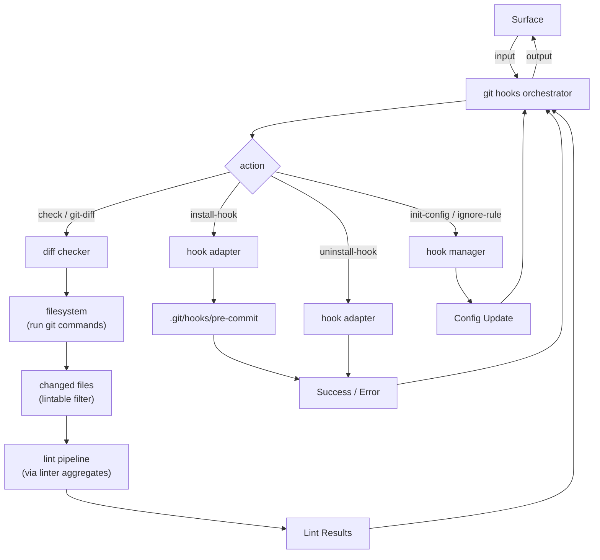

# FRD — git-hooks

---

## Feature Overview

The git-hooks crate implements a pre-commit hook system that enforces AES
compliance before code enters the repository. It detects changed files via
git diff, runs linting only on modified files, and blocks commits that
violate AES rules.

The crate follows the AES 7-layer architecture: the diff checker (capability)
implements the diff protocol, the git hook adapter (capability) implements
both the install and uninstall protocols, the hook manager (capability)
implements the config protocol, the git hooks orchestrator (agent) composes
the four protocols, and the git container (root) wires dependencies.

- **Architecture & Data Flow**



---

## Functional Requirements

### FR-GitHooks-001: Git Diff Detection

- **Description**: Identify files changed between the current HEAD and the
  default branch using git diff commands, then run the lint pipeline over
  the lintable subset.
- **Input**: `FilePath` (project root directory).
- **Output**: `GitDiffResultVO` (from `get_diff`) or `LintResultList` (from
  `run_git_diff_check`).
- **Business Rules**:

  - Default branch detection: runs
    `git symbolic-ref refs/remotes/origin/HEAD`, falls back to `"main"`.
  - Changed file collection tries multiple diff variants in order:
    1. `origin/<branch>...HEAD`
    2. `HEAD...origin/<branch>`
    3. `<branch>...HEAD`
    4. `master...HEAD`
  - Falls back to `git diff --name-only HEAD` if all variants return empty.
  - Final fallback: `git ls-files --modified --others --exclude-standard`.
  - The fallback chain exists here, and not in the external-lint adapters, by
    the Integration resilience decision in `PRD.md`: every strategy above
    queries the same trusted local repository, so a fallback still yields a
    correct — if broader — file list, whereas a retried external tool run can
    report against a changed tool state.
  - Classification via `--diff-filter`: added (A), modified (M), deleted (D),
    renamed (R with `R<score>\t<old>\t<new>` tab-separated parsing).
  - Lintable file filter (source code only):
    `.rs`, `.py`, `.ts`, `.js`, `.jsx`, `.tsx`.
  - Non-source files (`.md`, `.toml`, `.json`, `.yaml`, `.yml`, `.lock`,
    images, binaries) are excluded from lintable list.
- **Edge Cases**:

  - No git repository → diff commands fail silently, returns empty result.
  - No remote configured → `symbolic-ref` fails, defaults to `"main"`.
  - No changes between branches → returns empty lists with
    `total_changed: 0`.
  - Detached HEAD state → diff variants may all fail; falls back to `HEAD`
    diff.
  - Shallow clone → diff may not find base branch; fallback strategies
    handle this.
- **Error Handling**:

  - Git command failure (non-zero exit) → treated as no changes for that
    variant.
  - Invalid `FilePath` from git output → skipped silently.

---

### FR-GitHooks-002: Pre-Commit Hook Installation

- **Description**: Install a pre-commit hook script into `.git/hooks/` that
  runs `lint-arwaky check .` before each commit.
- **Input**: `FilePath` (path to the `lint-arwaky` executable).
- **Output**: `SuccessStatus` indicating whether the hook was installed.
- **Business Rules**:

  - Hook script content:

    ```bash
    #!/bin/bash
    # Lint Arwaky Pre-Commit Hook
    echo "Running Lint Arwaky check..."
    <executable> check .
    if [ $? -ne 0 ]; then
      echo "Linting failed. Please fix issues before committing."
      exit 1
    fi
    echo "Linting passed."
    exit 0
    ```

  - Creates `.git/hooks/` directory if it does not exist.
  - Sets hook file permissions to `0o755` on Unix systems.
  - If executable path is empty, defaults to `"lint-arwaky-cli"`.
  - If not a git repository (no `.git/` dir) → returns
    `SuccessStatus(false)` without error.
- **Edge Cases**:

  - `.git/hooks/` already exists → directory creation is idempotent.
  - Hook file already exists → overwritten.
  - Not a git repository → returns success with `false` (not an error).
  - Windows → permission setting is skipped (Unix-only feature).
- **Error Handling**:

  - Directory creation failure → returns `GitHookError` with message.
  - File write failure → returns `GitHookError` with message.
  - Permission set failure → returns `GitHookError` with message.

---

### FR-GitHooks-003: Pre-Commit Hook Uninstallation

- **Description**: Remove the pre-commit hook script from `.git/hooks/`.
- **Input**: None.
- **Output**: `SuccessStatus` indicating whether the hook was removed.
- **Business Rules**:

  - Removes `.git/hooks/pre-commit` if it exists.
  - If not a git repository → returns `SuccessStatus(false)` without error.
  - If hook file does not exist → returns `SuccessStatus(true)`
    (already clean).
- **Edge Cases**:

  - Hook file does not exist → returns success (idempotent).
  - Not a git repository → returns success with `false`.
- **Error Handling**: File removal failure → returns `GitHookError` with
  message.

---

### FR-GitHooks-004: Project Config Initialization

- **Description**: Create the default lint-arwaky config file and manage
  per-path ignore rules within it.
- **Input**: Path string (for init); `HookIgnoreUpdateVO` (for rule update).
- **Output**: `DescriptionVO` with status message.
- **Business Rules**:

  - Target file: `lint_arwaky.config.yaml` in the given path.
  - Default content includes `ignored_paths: []` structure.
  - If config file already exists → returns "ALREADY_EXISTS" status
    (no-op, idempotent).
  - Ignore rules are path patterns stored in `ignored_paths`.
  - Adding a rule that already exists → no-op, returns "already present".
  - Removing a rule that does not exist → no-op, returns "not found".
  - Config file not found on update → descriptive error suggesting
    `lint-arwaky-cli init`.
- **Edge Cases**:

  - Config file already present → no-op, descriptive status message.
  - File write failure → error description returned.
  - Config parse failure → error description returned.
- **Error Handling**: Write and parse failures return descriptive error
  messages.

---

## Public Interface

### Protocol API

| Method | Input | Output | Error | Event | Description |
|---|---|---|---|---|---|
| `get_diff` | &FilePath | `GitDiffResultVO` | — | — | Get diff result. |
| `get_changed_files` | &FilePath, &GitBranchName | `FilePathList` | — | — | Get changed files. |
| `get_default_branch` | &FilePath | `GitBranchName` | — | — | Get default branch. |
| `run_git_diff_check` | &FilePath | `LintResultList` | — | — | Run lint on changed files. |
| `install_pre_commit` | &FilePath | `SuccessStatus` | `GitHookError` | — | Install pre-commit hook. |
| `uninstall_pre_commit` | — | `SuccessStatus` | `GitHookError` | — | Uninstall pre-commit hook. |
| `initialize_config` | &str | `DescriptionVO` | — | — | Initialize config. |
| `update_ignore_rule` | HookIgnoreUpdateVO | `DescriptionVO` | — | — | Update ignore rule. |

### Aggregate API

| Method | Input | Output | Error | Event | Description |
|---|---|---|---|---|---|
| `execute` | GitHooksRequest | `GitHooksResponse` | — | — | Single composite entry point over the feature. |

## Reference

- Backlog: [BACKLOG.md](BACKLOG.md) — real condition for this feature; this file is specification only.
- PRD: [PRD.md](../../PRD.md)
- Architecture: [ARCHITECTURE.md](../../ARCHITECTURE.md)
- Config System FRD: `crates/config-system/FRD.md` (config resolution)
- Project Setup FRD: `crates/project-setup/FRD.md` (config initialization)

| Roadmap | {Link to ROADMAP.md} | [{link}](ROADMAP.md) |
