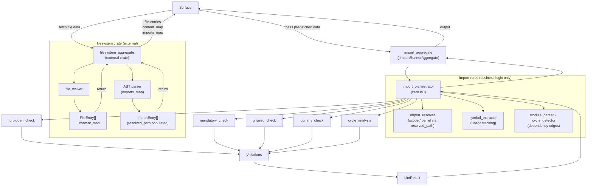

# FRD — import-rules (v1.13.0)

## Feature Overview

The import-rules crate enforces correct structural boundaries and dependency flows across the 7-layer AES architecture. It validates every import statement against a config-driven dependency, detects dummy/stub code created to circumvent unused-import warnings, and identifies circular dependencies at the layer level. File discovery, raw content reads, AST parsing (import extraction + identifier extraction), and barrel resolution are handled by the filesystem aggregate (`IFilesystemAggregate`). The Surface fetches file entries, import data, and `used_identifiers` (via `used_identifiers_for(path)`) from filesystem first, then passes pre-fetched data to the import orchestrator. The import-rules crate receives `&[FileEntry]`, `content_map`, `imports_map`, and `used_identifiers_map` — all pre-fetched by the caller. The import orchestrator does **zero I/O** — it only performs business logic analysis. All rule behavior is governed by YAML configuration. The crate makes no assumptions about allowed/forbidden dependencies beyond what is explicitly defined in config.

- **Architecture & Data Flow**



## Functional Requirements

### FR-ImportRules-001: Layer Dependency Violation (AES201)

- **Description**: Validates imports against the AES config-driven dependency matrix. Each layer/sub-layer has explicit `allowed`, `forbidden`, and `mandatory` rules defined in YAML configuration via a `conditions` array. All rules are per-scope, config-driven.
- **Input**: File data, raw file contents (from filesystem crate), architecture configuration (with `conditions` array), layer map.
- **Output**:

  - `allowed` match → pass (no diagnostic).
  - `forbidden` match → AES201 **CRITICAL** diagnostic with file path, line number, source scope, forbidden layer, and allowed layers.
- **Business Rules**:

  - Each layer/sub-layer has explicit `allowed`, `forbidden`, and `mandatory` rules defined in YAML configuration.
  - Rules are per-scope, config-driven via a `conditions` array.
  - Target in `allowed` → pass.
  - Target in `forbidden` → AES201 CRITICAL.
  - Target in neither → AES201 WARNING (grey area).
- **Dependency Model (AES-DI)**:

  AES uses **dependency injection** as the inter-layer wiring mechanism. Layers do not import each other directly; they import from **contract** (protocol/aggregate) and receive dependencies

  ```text
                      ┌──────────────────────────────────┐
                      │             root                  │
                      │  (composition root / DI wiring)   │
                      │  allowed: ALL layers              │
                      └──────┬───────────────────────────┘
                             │ wires
                ┌────────────┼─────────────┐
                ▼            ▼             ▼
           ┌────────┐  ┌─────────┐  ┌──────────────┐
           │surface │  │  agent  │  │ capabilities │
           └───┬────┘  └────┬────┘  └──────┬───────┘
               │            │              │
               │  imports   │  imports     │  imports
               ▼            ▼              ▼
          ┌──────────────────────────────────────────┐
          │      contract (protocol / aggregate)      │
          └──────────────────┬───────────────────────┘
                             │
                             ▼
                    ┌──────────────────┐
                    │    taxonomy       │
                    │ (vo / entity /   │
                    │  error / event / │
                    │  constant)       │
                    └──────────────────┘

           utility ←── flexible, imports taxonomy only
                       imported BY capabilities, agent, surface
  ```

  **Rationale**: Agent does not import capabilities because agent receives capabilities via DI (trait objects). Surface does not import agent because surface receives orchestrator via DI from contract aggregate. Utility does not require contract and remains flexible.
- **Per-Scope Rules**

  | Scope                                  | Allowed                                                    | Forbidden                                               | Mandatory                    |
  | ---------------------------------------- | ------------------------------------------------------------ | --------------------------------------------------------- | -------------------------------|
  | `taxonomy(vo)`                         | taxonomy                                                   | agent, surface, contract, utility, capabilities, root   | —                           |
  | `taxonomy(entity,error,event)`         | taxonomy                                                   | agent, surface, contract, utility, capabilities, root   | taxonomy(vo\|constant)       |
  | `taxonomy(constant)`                   | taxonomy                                                   | agent, surface, contract, utility, capabilities, root   | —                           |
  | `utility`                              | taxonomy,utility                                           | agent, surface, contract, capabilities, root            | taxonomy                     |
  | `contract(protocol)`                   | taxonomy, contract                                         | agent, surface, capabilities, contract(aggregate), root | taxonomy                     |
  | `contract(aggregate)`                  | taxonomy, contract                                         | agent, surface, capabilities, root                      | taxonomy                     |
  | `capabilities`                         | taxonomy, contract, utility                                | surface, agent, capabilities, root                      | taxonomy, contract(protocol) |
  | `agent(orchestrator)`                  | taxonomy, contract(aggregate), contract(protocol), utility | surface, capabilities, root                             | taxonomy, contract(aggregate)|
  | surface(command, controller, page)   | taxonomy,contract(aggregate)                               | capabilities, utility, agent                            | taxonomy                     |
  | surface(hook, store, action, screen) | taxonomy,contract(aggregate)                               | capabilities, utility, agent                            | taxonomy                     |
  | surface(component, view, layout)       | taxonomy                                                   | capabilities, utility, agent                            | taxonomy                     |
  | `root`                                 | taxonomy, contract, capabilities, agent, surface, utility  | —                                                      | —                           |

- **Enforcement model**: Whitelist + Blacklist hybrid.

  - Target layer in `allowed` → **pass**.
  - Target layer in `forbidden` → **AES201 CRITICAL**.
- **Import extraction**: Pre-fetched by Surface via filesystem crate's AST parser (`IParserProtocol` → `ImportEntry`). The `imports_map` (HashMap of file path to `Vec<ImportEntry>`) is passed to the import orchestrator. Each `ImportEntry` contains `raw_path`, `resolved_path` (populated by barrel resolution), `symbols`, `is_wildcard`, `is_reexport`, and `import_type`. Import-rules consumes `ImportEntry` fields directly — no text-based parsing.

  - Rust: `use_declaration` and `mod_item` nodes via tree-sitter.
  - Python: `import_statement` and `import_from_statement` nodes via tree-sitter.
  - TypeScript/JavaScript: `import_statement`, `export_statement`, and `require()` calls via tree-sitter.
- **Layer detection**: Detected from filename prefix of the importing file (`taxonomy_*` → taxonomy, `contract_*` → contract, etc.) and from the import target path segments. Whole-word segment matching (split on `:`, `.`, `/`, `\` — never substring `contains()`).
- **Barrel resolution**: When direct module-path matching fails (importing through a barrel hides the original file name), resolve each imported symbol through the barrel to detect the original source file and its layer prefix (see FR-007).
- **Scope matching**: Files are matched to `conditions` entries via filename prefix and suffix. Files matching multiple conditions are checked against **all** matched conditions.
- **Edge Cases**:

  - Circular imports across layers are detected by AES205, not AES201.
  - Conditional imports (`#[cfg(...)]` blocks) are skipped during import extraction.
  - Barrel files (module barrels, library roots, binary entries, package markers, and index barrels) are skipped for scope-level checks.
  - Imports inside comments or string literals are NOT extracted (AST guarantees this).
  - Files matching multiple scope conditions are checked against all matched conditions.
- **Error Handling**: Unreadable files are skipped silently. Files with unparseable content produce no violations (fail-safe). Parse failures produce empty import lists.

### FR-ImportRules-002: Mandatory Layer Imports (AES202)

- **Description**: Verifies that specific scopes contain required imports as defined in the `mandatory` field of each `conditions` entry.
- **Input**: File data, raw file contents (from filesystem crate), architecture configuration, layer map.
- **Output**: List of AES202 HIGH diagnostics with file path, source scope, and required import.
- **Business Rules**:

  - For each file, match against `conditions` entries. For each matched condition with a non-null `mandatory` list, check that at least one import targets each required layer/scope.
  - Direct match: check if any import line's module path segments match the required layer name.
  - Scope match: check if any import satisfies the required scope pattern (e.g., `contract(protocol)` requires an import matching `contract` layer with `_protocol` suffix).
  - Barrel resolution fallback: When direct module-path matching fails, resolve through barrel file (FR-007).
  - Files with empty or null `mandatory` config are skipped.
  - Python package-marker files are skipped for mandatory checks.
  - Rust module barrels, library roots, and binary entries are skipped for scope-level mandatory checks.
- **Edge Cases**: Files with multiple roles use the primary layer prefix. Files without a recognized prefix are skipped.
- **Error Handling**: Unreadable files are skipped. Missing config defaults to no mandatory requirements.

### FR-ImportRules-003: Unused Import Detection (AES203)

- **Description**: Detects and flags imported symbols that are never referenced within the file body. Uses AST-based usage tracking for all languages.
- **Input**: File data, raw file contents (from filesystem crate), `used_identifiers_map` (required, from filesystem's `used_identifiers_for(path)` via tree-sitter AST).
- **Output**: List of AES203 MEDIUM diagnostics with file path, line number, and unused symbol name.
- **Business Rules**:

  - **Import extraction**: Pre-fetched by Surface via filesystem crate. Import-rules consumes `ImportEntry` fields directly via `utility_import_symbol_extractor::extract_imported_aliases_from_entries`.

    - Import data comes from `imports_map` (tree-sitter parsed `ImportEntry` with `resolved_path`, `symbols`, `is_wildcard`, `is_reexport`).
    - **Usage detection (tree-sitter AST)**: `used_identifiers` from `ParseMetadata` are required — a pre-computed `HashSet<&str>` lookup per alias. All surfaces (`run_audit` and `run_audit_with_entries`) build `used_identifiers_map` from the filesystem aggregate's `used_identifiers_for(path)` method, which reads from the tree-sitter AST cache. No fallback to line-based parsing.
    - An imported symbol is "used" if its name appears as an identifier reference anywhere in the file body (excluding the import statement itself).
    - Usage inside `#[derive(...)]` attributes is detected via attribute parsing — no hardcoded whitelist.
    - Usage inside macro invocations (non-derive) is **NOT tracked** in v1.12. Imported symbols that appear ONLY inside macro bodies are **exempt from AES203** (skip, not flag). Full macro expansion is planned for v2.0 (see FR-009).
  - **Exemptions**:

    - Barrel files (package markers, module barrels, library roots, binary entries, and index barrels) are skipped — re-exports are intentional public API.
    - `pub use` / `export { X } from` re-exports are treated as used (they define public API).
    - `__future__` imports (Python) are skipped — they affect parsing behavior, not runtime usage.
    - Wildcard imports (`use foo::*`, `export * from`) are flagged as unused (cannot verify individual symbol usage).
    - `#[cfg(...)]` conditional blocks are skipped during import extraction.
    - Symbols appearing only inside macro bodies (non-derive) are exempt.
  - **Exported symbol detection**: Symbols exported via `__all__` (Python), `export { X }` (TS), or `pub use` (Rust) are treated as used.
- **Edge Cases**:

  - Multi-line imports are handled natively by AST.
  - Aliased imports (`use foo::Bar as Baz`) track the alias `Baz`, not the original `Bar`.
  - Imports used only in type annotations are counted as used.
  - Imports used only in doc comments (`/// [`FilePath`]`) are NOT counted as used.
- **Error Handling**: Files that fail parsing produce no violations. Unreadable files produce no violations.

### FR-ImportRules-004: Dummy Import Detection (AES204)

- **Description**: Detects imports, functions, and trait implementations that are dummy/stub code existing only to suppress unused-import warnings. This rule specifically targets **AI-generated cheating patterns** where AI creates dummy functions to make imports appear "used" and circumvent AES203.
- **Input**: File data, raw file contents (from filesystem crate), layer map.
- **Output**: List of AES204 HIGH diagnostics with file path, line number, dummy symbol name, and intent description.
- **Business Rules**:

  - **Dummy function detection**:

    - Rust: Line-based scanning (`utility_dummy_detector::dummy_function_ranges`). Functions named `_use_*` or `dummy_*` are flagged.
    - Python: Detect `def _use_*` and `def dummy_*` via line-based scanning.
    - TypeScript: Detect `function _use*`, `function dummy*`, `const _use*`, `const dummy*` via line-based scanning.
  - **Dummy trait implementation detection**:

    - Rust: Line-based body analysis (`utility_dummy_detector::dummy_impl_traits_with_lines` / `trait_impl_is_dummy`). Trait impls where ALL method bodies are empty, `todo!()`, `unimpl!()`, `panic!()`, or `unreachable!()` are flagged.
    - Detection uses line-by-line body analysis, not `syn` AST.
  - **Dummy import detection**:

    - Imported symbols that appear ONLY inside dummy function ranges (not in real logic) are flagged.
    - Symbol usage checking skips: import lines, comment lines, dummy function ranges, dummy trait impl ranges, `PhantomData` lines.
    - Whole-word matching is used (manual character boundary check, not regex `\b`).
    - String-literal-only usage is detected and excluded.
  - **Taxonomy intent checking**:

    - If a file has dummy functions AND imports taxonomy VOs (`taxonomy_*`), but those VOs are used only inside dummy functions (not in real logic), flag as intent violation.
  - **Barrel file exemption**: Barrel files are skipped for all dummy checks.
  - **`__future__` import exemption**: Python `from __future__ import ...` is skipped.
- **Relationship with AES203**: AES203 and AES204 are **independent rules without deduplication**.

  - AES203 detects imports that are truly never referenced.
  - AES204 detects imports that *appear* referenced but only inside dummy functions created to circumvent AES203.
  - A single import may trigger **both** AES203 and AES204 if it is unused in real code AND its only "usage" is inside a dummy function. This is intentional — it signals that both the import and the dummy function should be removed.
- **Edge Cases**:

  - Re-exports (`pub use`, `export { X } from`) are not flagged as dummy.
  - Trait implementations with at least one non-dummy method are not flagged.
  - Multi-line function bodies are handled by AST.
- **Error Handling**: Files that fail parsing produce no violations. Unreadable files produce no violations.

### FR-ImportRules-005: Circular Dependency Detection (AES205)

- **Description**: Builds a dependency graph of imports across all workspace files and detects cycles using 3-color DFS.
- **Input**: File data, raw file contents (from filesystem crate), architecture configuration, layer map.
- **Output**: List of AES205 CRITICAL diagnostics with cycle path description.
- **Business Rules**:

  - **Module extraction**: Pre-fetched by Surface via filesystem crate. Import-rules uses `ImportEntry.resolved_path` (populated by barrel resolution) and `ImportEntry.raw_path` to build dependency edges. Uses `utility_import_module_parser::extract_import_modules_from_entries_resolved`.

    - Import data comes from `imports_map` (tree-sitter parsed `ImportEntry` with `resolved_path`, `symbols`).
    - Barrel resolution is handled by filesystem — `resolved_path` points to the actual source file, not the barrel re-export.
  - **Layer-level graph**: Import edges are normalized to layer-level edges (e.g., `capabilities → contract`). Cycle detection operates on the layer graph, not the file graph.
  - **Cycle detection algorithm**: 3-color DFS (White → Gray → Black). A Gray → Gray edge indicates a back edge (cycle). Cycle nodes are extracted via parent-chain traversal.
  - **Deduplication**: Cycles are deduplicated by sorted node set to avoid reporting the same cycle multiple times.
  - **Direct cycles** (A → B → A) and **indirect cycles** (A → B → C → A) are both flagged.
  - **Cross-layer crate imports**: `crate::` and `lint_arwaky::` prefixed imports are resolved to their target layer. Non-cross-layer crate imports (e.g., `crate::common::FilePath` within the same crate) are skipped.
- **Edge Cases**:

  - **Self-imports are silently ignored** (a file importing itself does not create a cycle and produces no diagnostic).
  - Conditional cycles (imports inside `#[cfg(...)]` blocks) are not detected (conditional blocks are skipped).
  - Files without a recognized layer prefix are excluded from the layer graph.
- **Error Handling**: Unreadable files are skipped. Files with unparseable content contribute no edges. The cycle detection algorithm itself is pure graph theory — no parsing errors possible.

## Public Interface

### Protocol API

| Method | Input | Output | Error | Event | Description|
|---|---|---|---|---|---|
| `scan` | &ArchitectureConfig, &LayerMapVO, &[FilePath], &FilePath, &HashMap<String, String>, &HashMap<String, Vec<ImportEntry>> | `Vec<LintResult>` | — | — | Scan.|
| `check_cycles` | &ArchitectureConfig, &LayerMapVO, &crate::common::taxonomy_paths_vo::FilePathList, &FilePath, &HashMap<String, String>, &HashMap<String, Vec<ImportEntry>> | `Vec<LintResult>` | `ImportError` | — | Check cycles.|
| `detect_cycle_edges` | &[DependencyEdge] | `Vec<SymbolName>` | — | — | Detect cycle edges.|
| `normalize_to_layer` | &str | `LayerNameVO` | — | — | Normalize to layer.|
| `rule_name` | — | `Identity` | — | — | Rule name.|
| `check_dummy_imports` | &FilePath, &ContentString, &FilePath, &LayerMapVO, &[ImportEntry] | `Vec<LintResult>` | `ImportError` | — | Check dummy imports.|
| `check_dummy_functions` | &FilePath, &ContentString, &FilePath, &LayerMapVO | `Vec<LintResult>` | `ImportError` | — | Check dummy functions.|
| `check_dummy_impls` | &FilePath, &ContentString, &FilePath, &LayerMapVO | `Vec<LintResult>` | `ImportError` | — | Check dummy impls.|
| `check_taxonomy_intent` | &FilePath, &ContentString, &FilePath, &LayerMapVO, &[ImportEntry] | `Vec<LintResult>` | `ImportError` | — | Check taxonomy intent.|
| `check_all_dummy` | &FilePath, &ContentString, &FilePath, &LayerMapVO, &HashMap<String, Vec<ImportEntry>> | `Result<Vec<LintResult>, ImportError> { let import_entries = imports_map .get(file.value()) .map(\|v\| v.as_slice()) .unwrap_or(&[])` | — | — | Check all dummy.|
| `check_forbidden_imports` | &ArchitectureConfig, &LayerMapVO, &FilePathList, &FilePath, &HashMap<String, String>, &HashMap<String, Vec<ImportEntry>> | `LintResultList` | `ImportError` | — | Check forbidden imports.|
| `run_mandatory_imports` | &ArchitectureConfig, &LayerMapVO, &FilePathList, &FilePath, &HashMap<String, String>, &HashMap<String, Vec<ImportEntry>> | `LintResultList` | `ImportError` | — | Run mandatory imports.|
| `find_unused_imports` | &FilePath, &str, &[ImportEntry], &[String] | `Vec<LintMessage>` | `ImportError` | — | Find unused imports.|
| `check_unused_imports` | &str, &str, &[ImportEntry], &[String], &HashMap<String, Vec<String>> | `Vec<LintResult>` | `ImportError` | — | Check unused imports.|

### Aggregate API

| Method | Input | Output | Error | Event | Description|
|---|---|---|---|---|---|
| `execute` | ImportRequest | `ImportResponse` | — | — | Single composite entry point over the feature.|

## Reference

- Backlog: [BACKLOG.md](BACKLOG.md) — real condition for this feature; this file is specification only.
- PRD: [PRD.md](../../PRD.md)
- Architecture: [ARCHITECTURE.md](../../ARCHITECTURE.md)
- Filesystem crate
- Shared crate

| Roadmap | {Link to ROADMAP.md} | [{link}](ROADMAP.md)|
