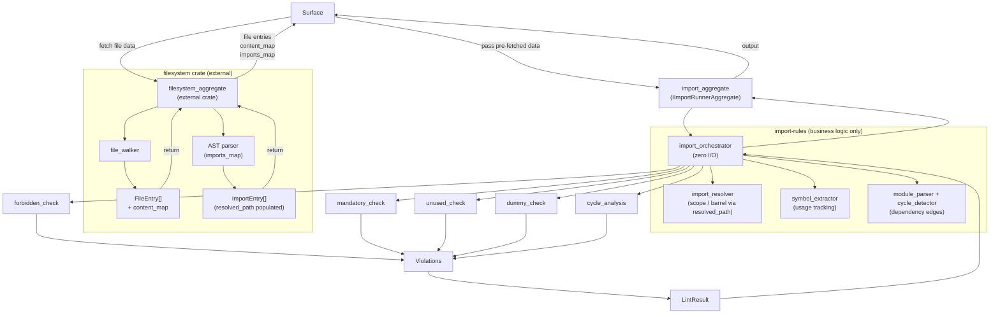

# FRD — import-rules (v1.13.0)

## Feature Overview

The import-rules crate enforces correct structural boundaries and dependency flows across the 7-layer AES architecture. It validates every import statement against a config-driven dependency, detects dummy/stub code created to circumvent unused-import warnings, and identifies circular dependencies at the layer level. File discovery, raw content reads, AST parsing (import extraction + identifier extraction), and barrel resolution are handled by the filesystem aggregate (`IFilesystemAggregate`). The Surface fetches file entries, import data, and `used_identifiers` (via `used_identifiers_for(path)`) from filesystem first, then passes pre-fetched data to the import orchestrator. The import-rules crate receives `&[FileEntry]`, `content_map`, `imports_map`, and `used_identifiers_map` — all pre-fetched by the caller. The import orchestrator does **zero I/O** — it only performs business logic analysis. All rule behavior is governed by YAML configuration. The crate makes no assumptions about allowed/forbidden dependencies beyond what is explicitly defined in config.

- **Architecture & Data Flow**

## Functional Requirements

### FR-ImportRules-001: Layer Dependency Violation (AES201)

| Aspect | Detail|
|--------|-------|
| Description | |
| Business Rules | |
| Edge Cases | |
| Capability | |
| Protocol | |
| Method | |
| Input | |
| Output | |
| Error | |
| Event | |
| Test | |
| Metric | |

### FR-ImportRules-002: Mandatory Layer Imports (AES202)

| Aspect | Detail|
|--------|-------|
| Description | |
| Business Rules | |
| Edge Cases | |
| Capability | |
| Protocol | |
| Method | |
| Input | |
| Output | |
| Error | |
| Event | |
| Test | |
| Metric | |

### FR-ImportRules-003: Unused Import Detection (AES203)

| Aspect | Detail|
|--------|-------|
| Description | |
| Business Rules | |
| Edge Cases | |
| Capability | |
| Protocol | |
| Method | |
| Input | |
| Output | |
| Error | |
| Event | |
| Test | |
| Metric | |

### FR-ImportRules-004: Dummy Import Detection (AES204)

| Aspect | Detail|
|--------|-------|
| Description | |
| Business Rules | |
| Edge Cases | |
| Capability | |
| Protocol | |
| Method | |
| Input | |
| Output | |
| Error | |
| Event | |
| Test | |
| Metric | |

### FR-ImportRules-005: Circular Dependency Detection (AES205)

| Aspect | Detail|
|--------|-------|
| Description | |
| Business Rules | |
| Edge Cases | |
| Capability | |
| Protocol | |
| Method | |
| Input | |
| Output | |
| Error | |
| Event | |
| Test | |
| Metric | |

## Public Interface

| Aspect | Detail|
|--------|-------|
| — | — |

## Reference

| Artifact | Purpose | Link|
|----------|---------|------|
| BACKLOG.md | Backlog tracking | [BACKLOG.md](BACKLOG.md)|
| PRD.md | Product requirements | [PRD.md](../../PRD.md)|
| FRD.md | Feature requirements | [FRD.md](FRD.md)|
| ROADMAP.md | Roadmap status | [ROADMAP.md](../../ROADMAP.md)|
| ARCHITECTURE.md | Layer contract | [ARCHITECTURE.md](../../ARCHITECTURE.md)|
