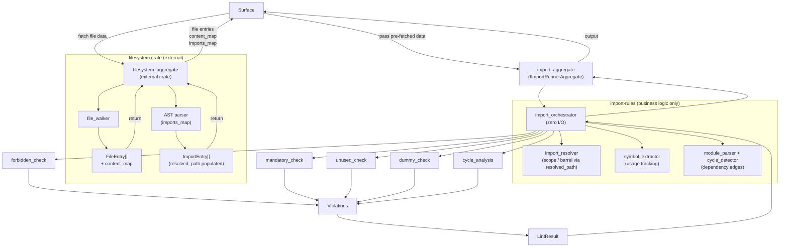

# FRD — import-rules (v1.13.0)

## Feature Overview

The import-rules crate enforces correct structural boundaries and dependency flows across the 7-layer AES architecture. It validates every import statement against a config-driven dependency, detects dummy/stub code created to circumvent unused-import warnings, and identifies circular dependencies at the layer level. File discovery, raw content reads, AST parsing (import extraction + identifier extraction), and barrel resolution are handled by the filesystem aggregate (`IFilesystemAggregate`). The Surface fetches file entries, import data, and `used_identifiers` (via `used_identifiers_for(path)`) from filesystem first, then passes pre-fetched data to the import orchestrator. The import-rules crate receives `&[FileEntry]`, `content_map`, `imports_map`, and `used_identifiers_map` — all pre-fetched by the caller. The import orchestrator does **zero I/O** — it only performs business logic analysis. All rule behavior is governed by YAML configuration. The crate makes no assumptions about allowed/forbidden dependencies beyond what is explicitly defined in config.

- **Architecture & Data Flow**

## Functional Requirements

### FR-ImportRules-001: Layer Dependency Violation (AES201)

| Aspect | Detail|
|--------|-------|
| Description | Flag imports that cross architectural layers against the forbidden-layer matrix. |
| Business Rules | AES201 rejects a lower layer importing a higher one (agent, surface, capabilities, taxonomy are each forbidden from specific importers; utility remains allowed from taxonomy/capabilities). Entry is matched by its first segment; index fallback applies when the entry line is zero. Python and Rust import sources both report the source line, not the import index. |
| Edge Cases | A forbidden Python import with entry line zero falls back to index; allowed pairs (taxonomy importing utility, capabilities importing taxonomy/utility) stay silent; multiple forbidden imports in one file each produce a violation; line-number extraction prefers the reported source line and degrades to entry index only when line info is absent. |
| Capability | ArchImportForbiddenChecker enforces the layer matrix; ScopeMatcher utility resolves layer from import segment. |
| Protocol | IImportForbiddenProtocol. |
| Method | check on the forbidden-import protocol (see contract for exact method name) returning lint messages per violating import. |
| Input | File path plus parsed imports (and optional entries); source is ImportRequest::RunAudit variants from the aggregate. |
| Output | Lint results inside ImportResponse::Audit with AES201 rule codes and source line numbers. |
| Error | Unreadable file contributes no findings rather than failing the audit; a zero entry line still yields a locatable violation. |
| Event | None; audit is synchronous. |
| Test | aes201_agent_importing_surface_is_forbidden, aes201_taxonomy_importing_utility_is_allowed, aes201_falls_back_to_index_when_entry_line_is_zero, aes201_reports_source_line_not_import_index, and e2e_capabilities_importing_agent_detected assert the matrix and line reporting. |
| Metric | All seeded forbidden pairs report violations with correct source lines; all seeded allowed pairs report zero AES201 findings. |

### FR-ImportRules-002: Mandatory Layer Imports (AES202)

| Aspect | Detail|
|--------|-------|
| Description | Require mandatory imports for layers that cannot function without them. |
| Business Rules | AES202 fires when a file in a layer that must import a mandated dependency does not (for example a feature orchestrator lacking its contract import). Check operates per file classification; files outside the mandated scope are skipped. |
| Edge Cases | A file already importing the dependency yields no violation; unclassified files are ignored; clean fixture exits with zero AES202 findings. |
| Capability | ArchImportMandatoryChecker enforces mandatory-import requirements. |
| Protocol | IImportMandatoryProtocol. |
| Method | Mandatory-import check on parsed file imports returning lint messages when the required import is absent. |
| Input | File path plus its import list; source is the import audit pipeline through IImportRunnerAggregate::execute. |
| Output | Lint results with AES202 codes inside ImportResponse::Audit. |
| Error | Missing or empty input file yields no findings for that file rather than failing the run. |
| Event | None. |
| Test | mandatory_checker_implements_import_mandatory_protocol asserts object safety; smoke_import_rules exercises the checker on a clean fixture expecting zero AES202 findings. |
| Metric | Seeded missing-mandate fixture produces exactly one AES202 finding; clean fixture produces zero. |

### FR-ImportRules-003: Unused Import Detection (AES203)

| Aspect | Detail|
|--------|-------|
| Description | Detect imports that are never referenced in the file body. |
| Business Rules | AES203 flags imports whose symbol never appears outside the import statement; Python plain imports use the first-segment binding, aliased imports must be used via their alias (alias used via alias name is NOT flagged, truly unused alias is flagged). Ignored files: mod_rs, lib_rs, and index_ts are skipped. Future-dated imports (future imports) are never flagged. Empty content or files with no imports yield no violation. |
| Edge Cases | Actual unused import flags exactly once; multiple unused imports each flag; empty file/content no violation; aliased Python import used only via alias not flagged; aliased and truly unused flagged; barrel/mod/lib index files skipped. |
| Capability | UnusedImportRuleChecker computes usage sets from parsed identifiers. |
| Protocol | IUnusedImportProtocol. |
| Method | Unused-import check over parse entries returning lint messages per unused binding. |
| Input | File path plus parsed imports and used identifiers; source is ImportRequest::RunAudit variants. |
| Output | Lint results with AES203 codes inside ImportResponse::Audit. |
| Error | Parse failure of the body yields no findings for that file instead of false positives. |
| Event | None. |
| Test | aes203_actual_unused_still_flagged, aes203_python_aliased_import_used_via_alias_not_flagged, aes203_future_import_not_flagged, aes203_mod_rs_skipped, aes203_multiple_unused_imports, and aes203_no_imports_no_violation cover the rules. |
| Metric | Seeded unused fixtures produce one finding per unused import; skipped-file family (mod, lib, index) always yields zero AES203 findings. |

### FR-ImportRules-004: Dummy Import Detection (AES204)

| Aspect | Detail|
|--------|-------|
| Description | Catch dummy imports, dummy functions, and dummy trait impls that exist only to satisfy a checker. |
| Business Rules | AES204 flags imports pointing at symbols that are never callably used, functions whose bodies are empty stubs, and trait impls with no real method bodies beyond placeholders. Clean files pass. |
| Edge Cases | A clean fixture yields zero findings; a file with a stub function still yields a finding for the stub; unreadable file yields no findings; classification of a mixed file reports each dummy independently. |
| Capability | DummyImportChecker detects dummy constructs. |
| Protocol | IDummyImportCheckerProtocol. |
| Method | Dummy-import/function/impl check over parsed file content returning lint messages. |
| Input | File path plus parsed content; source is the import audit pipeline. |
| Output | Lint results with AES204 codes inside ImportResponse::Audit. |
| Error | Parse failure skips the file's dummy analysis rather than failing the audit. |
| Event | None. |
| Test | dummy_checker_implements_dummy_import_checker_protocol (object safety) and smoke_dummy_checker_with_clean_file (clean file has zero findings) assert the contract. |
| Metric | Clean fixture produces zero AES204 findings; seeded dummy fixture produces at least one per seeded dummy construct. |

### FR-ImportRules-005: Circular Dependency Detection (AES205)

| Aspect | Detail|
|--------|-------|
| Description | Detect circular cross-layer dependencies among parsed import edges. |
| Business Rules | AES205 normalizes module paths to layer segments (strip crate prefix when present), builds a directed graph of edges, and reports strongly connected components. Cycle detection covers two-node, three-node, and cross-layer mutual cycles; acyclic graphs report none. Disabled-by-config audit returns an empty result. |
| Edge Cases | Empty edge set yields no cycles; mutual cross-layer cycles detected; normalize with and without crate prefix both resolve to the same layer; disabled configuration returns an empty audit; missing entry in graph does not panic. |
| Capability | DependencyCycleAnalyzer builds the layer graph and finds cycles. |
| Protocol | ICycleImportProtocol. |
| Method | Cycle scan over edge list returning detected cycles as lint messages. |
| Input | Import edge list (or file discovery then edges); source is ImportRequest::RunAudit variants. |
| Output | Lint results with AES205 codes inside ImportResponse::Audit; empty list when acyclic or disabled. |
| Error | Unparseable edge entries are dropped; the scan still completes on remaining edges. |
| Event | None. |
| Test | aes205_detects_simple_cycle_two_nodes, aes205_detects_three_node_cycle, aes205_no_cycle_with_acyclic_edges, aes205_scan_disabled_config_returns_empty, and aes205_normalize_to_layer_strips_prefix cover cycle logic. |
| Metric | Every seeded cycle fixture reports at least one cycle; acyclic fixtures report zero; disabled config yields an empty result. |

## Public Interface

| Aspect | Detail|
|--------|-------|
| Agent | ImportOrchestrator — the agent-layer orchestrator behind the check command's import-rule stage. |
| Aggregate | IImportRunnerAggregate — the feature's single front door. |
| Method | execute(&self, request: ImportRequest) -> ImportResponse |
| Request | ImportRequest::{RunAudit, RunAuditWithEntries, RunAuditWithEntriesAndImports, Name} |
| Response | ImportResponse::{Audit, AuditEntries, Name} |

## Reference

| Artifact | Purpose | Link|
|----------|---------|------|
| BACKLOG.md | Backlog tracking | [BACKLOG.md](BACKLOG.md)|
| PRD.md | Product requirements | [PRD.md](../../PRD.md)|
| FRD.md | Feature requirements | [FRD.md](FRD.md)|
| ROADMAP.md | Roadmap status | [ROADMAP.md](../../ROADMAP.md)|
| ARCHITECTURE.md | Layer contract | [ARCHITECTURE.md](../../ARCHITECTURE.md)|
