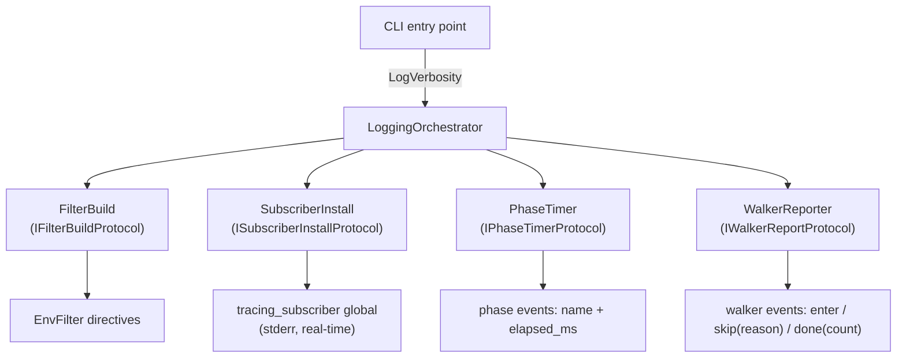

# FRD — logging

---

## Feature Overview

The logging crate gives a developer running `lint-arwaky scan -v` a
real-time feed on stderr of what the scan is doing: which directories
it walks, which directories it skips and why, how long each linter
phase takes, and what the final result is.

It provides:

- `LogVerbosity` — the value type the `-v` / `--verbose` flag selects.
  One density level: the flag is always the full per-file trace.
- Four capabilities: filter construction, subscriber installation,
  phase timing, and walker reporting.
- An orchestrator that composes the four capabilities; a root
  container that wires them together.

Output goes to stderr so stdout stays clean for piping.

- **Architecture & Data Flow**

---

## Functional Requirements

### FR-Logging-001: Build the Filter Directives

| Aspect | Detail|
|--------|-------|
| Description | |
| Business Rules | |
| Edge Cases | |
| Capability | |
| Protocol | |
| Method | |
| Input | |
| Output | |
| Error | |
| Event | |
| Test | |
| Metric | |

### FR-Logging-002: Install the Global Subscriber

| Aspect | Detail|
|--------|-------|
| Description | |
| Business Rules | |
| Edge Cases | |
| Capability | |
| Protocol | |
| Method | |
| Input | |
| Output | |
| Error | |
| Event | |
| Test | |
| Metric | |

### FR-Logging-003: Time a Scan Phase

| Aspect | Detail|
|--------|-------|
| Description | |
| Business Rules | |
| Edge Cases | |
| Capability | |
| Protocol | |
| Method | |
| Input | |
| Output | |
| Error | |
| Event | |
| Test | |
| Metric | |

### FR-Logging-004: Report Walker Progress

| Aspect | Detail|
|--------|-------|
| Description | |
| Business Rules | |
| Edge Cases | |
| Capability | |
| Protocol | |
| Method | |
| Input | |
| Output | |
| Error | |
| Event | |
| Test | |
| Metric | |

## Public Interface

| Aspect | Detail|
|--------|-------|
| — | — |

## Reference

| Artifact | Purpose | Link|
|----------|---------|------|
| BACKLOG.md | Backlog tracking | [BACKLOG.md](BACKLOG.md)|
| PRD.md | Product requirements | [PRD.md](../../PRD.md)|
| FRD.md | Feature requirements | [FRD.md](FRD.md)|
| ROADMAP.md | Roadmap status | [ROADMAP.md](../../ROADMAP.md)|
| ARCHITECTURE.md | Layer contract | [ARCHITECTURE.md](../../ARCHITECTURE.md)|
