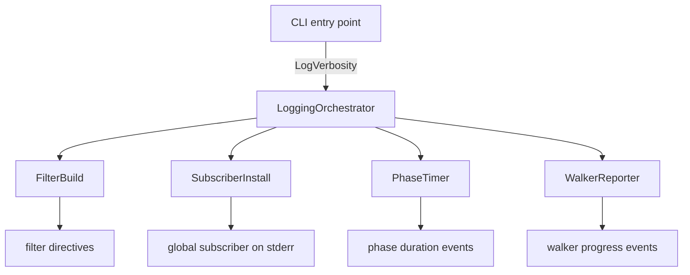

# FRD — logging

## Feature Overview

The logging feature sits between the CLI entry points and the observability kernel: CLI commands call it to configure log density and install the global subscriber, and the scan pipeline calls it for phase timing and directory-walker progress reporting. It emits all output on stderr so stdout remains clean for piping machine-readable results.

## Functional Requirements

### FR-Logging-001: Build the Filter Directives

**Description:** The feature shall map the verbosity level selected by the CLI onto a fixed set of filter directives for the root and audit log targets, and shall return that filter as the installable configuration for the global subscriber.

#### Business Logic

- The verbosity levels shall map to fixed directives: default shall yield `warn` on the root target plus `info` on the audit target; info shall yield `info` on both targets; debug shall yield `debug` on both targets.
- An unknown verbosity level shall fall back to the default mapping.
- The feature shall build the directives only; installation of the filter belongs to FR-Logging-002.
- Repeated builds at the same level shall return identical directives.
- The audit target shall never sit below `info` at any verbosity level.

#### Edge Cases

- An unknown verbosity level shall degrade to the default mapping instead of failing.
- A build with an identical input level shall return byte-identical directives.
- Building directives at every verbosity level shall never panic.

#### Technical Specification

| Aspect | Detail |
|--------|--------|
| **Input** | Verbosity level selected by the CLI flags (default, info, debug, or unknown); source is the `-v`/`--verbose` CLI flags. |
| **Output** | Filter directives for the root and audit targets, returned to the caller and carried into the subscriber installation of FR-Logging-002. |
| **Protocol** | `IFilterBuildProtocol` |
| **Method** | `buildFilter` |
| **Event** | None — pure mapping with no emitted event. |
| **Error** | None — an invalid or unknown level falls back to the default directives and never fails. |

#### Test

| Context | When Action | Then Observable Result |
|---------|-------------|------------------------|
| Default verbosity selected | The CLI builds the filter directives | The directives are `warn` on the root target plus `info` on the audit target |
| Info verbosity selected | The CLI builds the filter directives | The directives are `info` on the root target plus `info` on the audit target |
| Debug verbosity selected | The CLI builds the filter directives | The directives are `debug` on the root target plus `debug` on the audit target |
| Unknown verbosity level | The CLI builds the filter directives | The directives equal the default mapping (`warn` + audit `info`) and no error is raised |

#### Metric

| Target Metric | Value |
|---------------|-------|
| Verbose/level mapping exactness | 3 of 3 verbosity levels map to their documented directive pairs |
| Unknown-level fallback accuracy | 100% |
| Directive mismatch rate | 0% |

### FR-Logging-002: Install the Global Subscriber

**Description:** The feature shall install the process-global tracing subscriber exactly once with the filter from FR-Logging-001 and the requested ANSI setting, and shall treat every later installation request as a no-op.

#### Business Logic

- The feature shall install a tracing subscriber registry with the filter built by FR-Logging-001.
- The first installation request shall win; every later request shall be a no-op that leaves the installed subscriber unchanged.
- The requested ANSI on/off setting shall be honored by the installed subscriber.
- Installation shall never panic for any verbosity level.
- Installation shall complete successfully even when a subscriber is already installed in the process.

#### Edge Cases

- A second installation request with a different filter shall not replace the first installation.
- Installation with ANSI disabled shall behave identically to ANSI enabled.
- Installation at debug verbosity and at default verbosity shall both succeed without panic.

#### Technical Specification

| Aspect | Detail |
|--------|--------|
| **Input** | The filter from FR-Logging-001 plus the ANSI on/off setting; source is the CLI verbosity flags delivered through the install-subscriber request. |
| **Output** | Success status plus the filter that is active in the process; destination is the process-global subscriber. |
| **Protocol** | `ISubscriberInstallProtocol` |
| **Method** | `installSubscriber` |
| **Event** | None — process-global setup emits no domain event. |
| **Error** | None — an already-installed subscriber makes the call a no-op with success status; no error propagates. |

#### Test

| Context | When Action | Then Observable Result |
|---------|-------------|------------------------|
| No subscriber installed in the process | The feature installs the subscriber with a built filter | The filter becomes active process-wide and the call reports success |
| A subscriber is already installed | The feature installs the subscriber a second time | The call is a no-op: the first filter stays active and no panic or error occurs |
| The request disables ANSI | The feature installs the subscriber with ANSI off | The subscriber renders without ANSI sequences and the call reports success |

#### Metric

| Target Metric | Value |
|---------------|-------|
| Repeat-install state stability | 100% |
| Install success rate across verbosity levels | 100% |
| Install panic rate | 0% |

### FR-Logging-003: Time a Scan Phase

**Description:** The feature shall measure each scan phase from its start signal to its finish signal and shall emit a structured duration event carrying the phase name and elapsed milliseconds when the phase completes.

#### Business Logic

- Phase timing shall start on the phase-start signal and stop on the matching phase-finish signal.
- The measured duration shall come from a monotonic clock.
- The completion event shall carry the phase name and elapsed milliseconds.
- Nested phases shall be timed independently.
- Sequential phases shall each get their own measurement.

#### Edge Cases

- A phase finish without a matching start shall yield a zero-duration result instead of failing.
- Dropping a timer without finishing shall not panic; the call still returns a response.
- Two sequential phases shall be timed separately with no shared baseline.

#### Technical Specification

| Aspect | Detail |
|--------|--------|
| **Input** | Phase name plus start and finish signals; source is the per-phase timing calls in the scan pipeline. |
| **Output** | Measured duration plus a structured phase-completion event; destination is the trace event stream on stderr. |
| **Protocol** | `IPhaseTimerProtocol` |
| **Method** | `startPhase`, `finishPhase` |
| **Event** | `PhaseCompleted` — structured event carrying the phase name and elapsed milliseconds. |
| **Error** | None — an unmatched finish yields a zero-duration result rather than an error. |

#### Test

| Context | When Action | Then Observable Result |
|---------|-------------|------------------------|
| A phase start and matching finish are recorded | The feature times the phase | A phase-completion event is emitted with the phase name and a duration greater than zero |
| A finish signal arrives without a matching start | The feature records the finish | A zero-duration result is returned and no panic occurs |
| Two phases run sequentially | Each phase is timed | Each phase emits its own duration event and the measurements do not interfere |

#### Metric

| Target Metric | Value |
|---------------|-------|
| Measured-phase duration | > 0 ms and within a bounded factor of wall-clock elapsed time |
| Unmatched-finish tolerance | 0 panics |
| Nested-phase independence | 100% |

### FR-Logging-004: Report Walker Progress

**Description:** The feature shall emit real-time progress events for the directory walker: an enter event for each path considered, a skip event for each path rejected by ignore rules together with the reason, and a discovered-count event that aggregates the files found in the batch.

#### Business Logic

- Enter signals shall report a path being considered by the walker.
- Skip signals shall report a path rejected by ignore rules together with the rejection reason.
- Discovered-count signals shall aggregate the number of files found in the batch.
- Emission density shall follow the verbosity tier selected by FR-Logging-001.
- Reporting shall never fail the walk; emission is best-effort.

#### Edge Cases

- A skipped file shall appear as a skip event with its reason, never as an enter event.
- An empty batch shall emit nothing.
- Disabled verbosity shall suppress event emission while counts remain recorded.
- A reporting failure shall not affect walker continuation.

#### Technical Specification

| Aspect | Detail |
|--------|--------|
| **Input** | Path, optional skip reason, and batch counts; source is the enter, skip, and discovered-count signals from the scan walk. |
| **Output** | Walker progress trace events visible at the requested verbosity tier; destination is the trace event stream on stderr. |
| **Protocol** | `IWalkerReportProtocol` |
| **Method** | `reportWalkerProgress` |
| **Event** | `WalkerEnter`, `WalkerSkip` (with reason), `FilesDiscovered` (with count). |
| **Error** | None — reporting never fails the walk; emission failures are absorbed. |

#### Test

| Context | When Action | Then Observable Result |
|---------|-------------|------------------------|
| The walker enters a path | An enter signal is reported | An enter trace event is emitted carrying the path |
| The walker skips a path by an ignore rule | A skip signal is reported | A skip trace event is emitted carrying the path and the rejection reason |
| A batch of files is discovered | A discovered-count signal is reported | A discovered-count event is emitted carrying the batch total |
| Verbosity is disabled | Walker signals are reported | No trace events are emitted and the walk continues without failure |

#### Metric

| Target Metric | Value |
|---------------|-------|
| Event-accounting accuracy | reported enter plus skip events equal the seeded file count on a seeded tree |
| Disabled-verbosity suppression | zero emitted events with unchanged counts |
| Reporting-induced walk failures | 0 |

## Public Interface

| Aspect     | Detail            |
|------------|-------------------|
| Agent      | `LoggingOrchestrator` |
| Aggregate  | `ILoggingAggregate` |
| Method     | `execute` |
| Request    | `LoggingRequest` (install-subscriber, phase-start, phase-finish, walker-enter, walker-skip, files-discovered) |
| Response   | `LoggingResponse` (done, phase-timer) |

## Reference

| Artifact | Purpose | Link |
|----------|---------|------|
| PRD | Business goals, user stories, and scope | [PRD.md](../../PRD.md) |
| Backlog | Task tracking, epics, and implementation status | [BACKLOG.md](BACKLOG.md) |
| Roadmap | Timeline, phasing, and dependencies | [ROADMAP.md](../../ROADMAP.md) |
| Architecture | System boundaries, tech stack, and infra | [ARCHITECTURE.md](../../ARCHITECTURE.md) |
