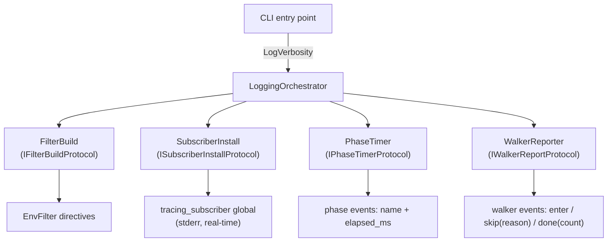

# FRD — logging

---

## Feature Overview

The logging crate gives a developer running `lint-arwaky scan -v` a
real-time feed on stderr of what the scan is doing: which directories
it walks, which directories it skips and why, how long each linter
phase takes, and what the final result is.

It provides:

- `LogVerbosity` — the value type the `-v` / `--verbose` flag selects.
  One density level: the flag is always the full per-file trace.
- Four capabilities: filter construction, subscriber installation,
  phase timing, and walker reporting.
- An orchestrator that composes the four capabilities; a root
  container that wires them together.

Output goes to stderr so stdout stays clean for piping.

- **Architecture & Data Flow**

---

## Functional Requirements

### FR-Logging-001: Build the Filter Directives

| Aspect | Detail|
|--------|-------|
| Description | Map a verbosity level to tracing EnvFilter directives for the root and audit targets. |
| Business Rules | Verbosity levels (default, info, debug) map to fixed directives: default yields warn on root plus info on the audit target; info yields info on root plus info on audit; debug yields debug on root plus debug on audit. Unknown verbosity falls back to default. Directives are returned as an EnvFilter, never installed here. |
| Edge Cases | Unknown verbosity level falls back to the default mapping rather than panicking; repeated builds with the same level yield identical directives; audit target is always at least info. |
| Capability | FilterBuilder maps verbosity to filter directives. |
| Protocol | IFilterBuildProtocol. |
| Method | Build the EnvFilter string/directives for a given verbosity level. |
| Input | Verbosity enum from LoggingRequest (InstallSubscriber carries it); source is CLI verbosity flags. |
| Output | EnvFilter passed to subscriber installation in FR-Logging-002; returned in LoggingResponse::Done. |
| Error | Invalid level input falls back to default directives; never fails. |
| Event | None; pure mapping. |
| Test | fr_001_default_filter_directive, fr_001_info_filter_directive, fr_001_debug_filter_directive, filter_directive_default_returns_warn_and_audit_info, and filter_directive_debug_returns_debug_and_audit_debug assert exact directive strings. |
| Metric | Each of the three verbosity levels maps to its documented directive pair with zero mismatch on the filter_directive_* suite. |

### FR-Logging-002: Install the Global Subscriber

| Aspect | Detail|
|--------|-------|
| Description | Install the global tracing subscriber exactly once with the requested filter and ANSI setting. |
| Business Rules | SubscriberInit installs a tracing-subscriber registry with the EnvFilter from FR-Logging-001. First call wins: a second init call is a noop. ANSI on/off is honored by the request. Installation never panics for any verbosity level. |
| Edge Cases | Second init call is a noop (no panic, no double subscriber); init with ANSI disabled works; init with debug verbosity works; default verbosity works; container init delegates to the orchestrator. |
| Capability | SubscriberInit performs global subscriber installation. |
| Protocol | ISubscriberInstallProtocol. |
| Method | Install the subscriber with the given filter and ansi flag; returns the EnvFilter used. |
| Input | Verbosity level plus ansi boolean; source is LoggingRequestKind::InstallSubscriber via ILoggingAggregate::execute. |
| Output | LoggingResponseKind::Done carrying install status and the EnvFilter. |
| Error | Already-installed global subscriber makes the call a noop with success status; no error propagates. |
| Event | None; subscriber installation is process-global setup. |
| Test | fr_002_init_does_not_panic, second_init_call_is_noop, init_debug_with_ansi_does_not_panic, install_via_protocol_returns_env_filter_for_each_level, and container_init_delegates_to_orchestrator assert idempotence and delegation. |
| Metric | Three verbosity levels each return their EnvFilter from one protocol install call; repeat install leaves process state unchanged. |

### FR-Logging-003: Time a Scan Phase

| Aspect | Detail|
|--------|-------|
| Description | Time a scan phase and emit a structured duration event when it finishes. |
| Business Rules | PhaseTimer starts when PhaseStarted arrives and records the elapsed time on PhaseFinished, emitting a structured tracing event with the phase name and duration. Measurements use a monotonic clock; nested phases are timed independently. |
| Edge Cases | PhaseFinished without a matching PhaseStarted tolerates a zero/unknown duration rather than panicking; two sequential phases each get their own timing; dropping a timer without finishing still returns a response without panic. |
| Capability | PhaseTimerCapability records phase durations. |
| Protocol | IPhaseTimerProtocol. |
| Method | Start phase timing, stop it, and return the measured duration. |
| Input | Phase name from LoggingRequestKind::PhaseStarted and PhaseFinished; source is per-phase calls in the scan pipeline. |
| Output | Timing data through LoggingResponseKind::PhaseTimer plus a structured trace event. |
| Error | Unmatched finish (no start) yields a zero-duration result instead of an error. |
| Event | Structured trace event on phase completion with phase name and elapsed milliseconds. |
| Test | PhaseTimer contract tests in the logging suite assert start/stop pairing and response shape (LoggingResponseKind::PhaseTimer). |
| Metric | Measured duration for a seeded busy phase is greater than zero and within a sane bound of wall clock; unmatched finish returns zero without panic. |

### FR-Logging-004: Report Walker Progress

| Aspect | Detail|
|--------|-------|
| Description | Emit real-time progress events for files the directory walker enters and skips. |
| Business Rules | WalkerEnter reports a path being considered; WalkerSkip reports a path rejected by ignore rules with a reason; FilesDiscovered aggregates the count found in the batch. Events map to tracing at the verbosity tier from FR-Logging-001 so they appear only when enabled. |
| Edge Cases | Skipped files still appear as skip events with reason, not as enter events; empty batch emits nothing; disabled verbosity suppresses emission without dropping counts; walker continuation is unaffected by reporting failures. |
| Capability | WalkerReporter emits walker progress events. |
| Protocol | IWalkerReportProtocol. |
| Method | Report enter, skip, and discovered-count signals to the tracing backend. |
| Input | Path plus optional reason and counts; source is LoggingRequestKind::WalkerEnter, WalkerSkip, and FilesDiscovered inside the scan walk. |
| Output | LoggingResponseKind::Done plus trace events visible at info/debug. |
| Error | Reporting never fails the walk; emission is best-effort. |
| Event | Trace events for enter, skip, and discovered counts. |
| Test | Walker-report contract coverage in the logging tests asserts enter/skip event emission and count reporting through the aggregate. |
| Metric | On a seeded tree, reported enter plus skip events equal the seeded file count; disabled verbosity produces zero emitted events yet identical counts. |

## Public Interface

| Aspect | Detail|
|--------|-------|
| Agent | LoggingOrchestrator — the agent-layer orchestrator behind logger setup and observability requests. |
| Aggregate | ILoggingAggregate — the feature's single front door. |
| Method | execute(&self, request: LoggingRequest) -> LoggingResponse |
| Request | LoggingRequest { kind: LoggingRequestKind::{InstallSubscriber, PhaseStarted, PhaseFinished, WalkerEnter, WalkerSkip, FilesDiscovered} } |
| Response | LoggingResponse { kind: LoggingResponseKind::{Done, PhaseTimer} } |

## Reference

| Artifact | Purpose | Link|
|----------|---------|------|
| BACKLOG.md | Backlog tracking | [BACKLOG.md](BACKLOG.md)|
| PRD.md | Product requirements | [PRD.md](../../PRD.md)|
| FRD.md | Feature requirements | [FRD.md](FRD.md)|
| ROADMAP.md | Roadmap status | [ROADMAP.md](../../ROADMAP.md)|
| ARCHITECTURE.md | Layer contract | [ARCHITECTURE.md](../../ARCHITECTURE.md)|
