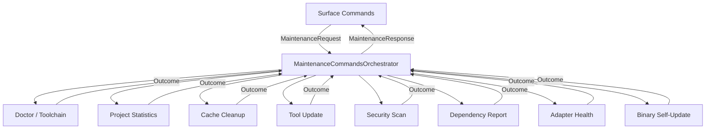

# FRD — maintenance

## Feature Overview

The **maintenance** feature provides operational health, diagnostics, and upkeep capabilities for the system, sitting in the infrastructure layer between surface commands and system tools. It is invoked by surface commands through `IMaintenanceAggregate` to diagnose environments, inspect dependencies, verify adapter availability, reclaim disk space, and update tools and binaries. In turn, it coordinates per-capability protocol implementations that interact with the underlying execution environment and filesystem.

## Functional Requirements

### FR-Maintenance-001: Environment Health Check

**Description:**
The system shall aggregate environment diagnostics, toolchain readiness, and execution health into a unified diagnostic report, and shall support graceful cancellation of in-flight diagnostic runs upon request.

#### Business Logic

- The system shall aggregate binary availability, toolchain diagnosis, and overall health status into a single response.
- The toolchain diagnosis shall report the active binary path alongside categorized ok and missing tool lists.
- Unavailable tools shall be categorized in the missing list without causing the overall diagnostic operation to fail.
- A cancel request shall terminate an in-flight operation gracefully and return a cancelled outcome.

#### Edge Cases

- When external tool binaries are absent from the environment, the system shall record them in the missing list and return a successful diagnostic outcome.
- When the execution environment is completely empty, the system shall report all probed tools as missing without raising a panic.
- When an operation is cancelled in flight, the system shall return a cancelled response rather than a partial error.

#### Technical Specification

| Aspect | Detail |
|--------|--------|
| **Input** | `MaintenanceRequest::Doctor`, `MaintenanceRequest::DiagnoseToolchain`, or `MaintenanceRequest::Cancel` from surface commands. |
| **Output** | `MaintenanceResponse::Doctor`, `MaintenanceResponse::Toolchain`, or `MaintenanceResponse::Cancelled`. |
| **Protocol** | `IDoctorProtocol` |
| **Method** | `doctor`, `diagnose_toolchain` |
| **Event** | `EnvironmentHealthDiagnosed` |
| **Error** | `TOOLCHAIN_PROBE_FAILED`, `DIAGNOSTIC_CANCELLED` |

#### Test

| Context | When Action | Then Observable Result |
|---------|-------------|------------------------|
| Seeded environment with healthy toolchain | Surface command requests environment health diagnosis | Returns doctor result reflecting health status with binary path and non-empty tool lists |
| External tools are absent from PATH | Surface command requests toolchain diagnosis | Returns toolchain diagnostic with missing tools recorded in missing list and no panic |
| Diagnostic operation is running | Surface command issues cancel request | In-flight execution aborts gracefully and returns cancelled response |

#### Metric

| Target Metric | Value |
|---------------|-------|
| Doctor Diagnostic Accuracy | 100% |
| Cancellation Response Latency | < 50ms |

### FR-Maintenance-002: Project Statistics

**Description:**
The system shall compute aggregate project statistics, language breakdowns, and file counts across a specified target directory without hard-coded path constraints.

#### Business Logic

- The system shall count source files by language and compute total counts across the provided target directory.
- The sum of individual per-language file counts shall strictly equal the reported total count.
- The system shall operate dynamically over any provided directory path rather than hard-coded locations.
- Unreadable or inaccessible subtrees shall be skipped gracefully while processing readable paths.

#### Edge Cases

- When executed against an empty directory, the system shall return zero counts without reporting an error.
- When unreadable subtrees or permission errors are encountered, the system shall report partial counts for readable entries rather than failing.
- When directory structures contain deeply nested subdirectories, the system shall traverse all readable levels without stack overflow or panic.

#### Technical Specification

| Aspect | Detail |
|--------|--------|
| **Input** | `MaintenanceRequest::Stats` containing target directory path. |
| **Output** | `MaintenanceResponse::Stats` containing total count and per-language metrics. |
| **Protocol** | `IProjectStatsProtocol` |
| **Method** | `stats` |
| **Event** | `ProjectStatsCalculated` |
| **Error** | `DIRECTORY_UNREADABLE`, `STATS_CALCULATION_FAILED` |

#### Test

| Context | When Action | Then Observable Result |
|---------|-------------|------------------------|
| Seeded multi-language project directory | Surface command requests project statistics | Total count matches the exact sum of per-language file counts |
| Empty directory path | Surface command requests project statistics | Returns zero counts with successful status and no error |
| Directory tree containing unreadable subdirectories | Surface command requests project statistics | Processes readable subtrees, skips unreadable subtrees, and returns partial counts |

#### Metric

| Target Metric | Value |
|---------------|-------|
| Count Internal Consistency | 100% |
| Processing Throughput | > 1000 files/s |

### FR-Maintenance-003: Cache Cleanup

**Description:**
The system shall remove application-owned cache directories and temporary reporting artifacts to reclaim disk space without modifying user configurations or source code.

#### Business Logic

- The system shall remove only managed cache directories, including AST caches and report caches.
- The system shall never alter or remove source files, workspace configuration, or user settings.
- Cache cleanup operations shall be idempotent; consecutive clean executions shall succeed safely.
- Inaccessible or read-only cache entries shall be reported with warnings without aborting the remaining cleanup.

#### Edge Cases

- When targeted cache directories do not exist, the system shall complete cleanly as a successful no-op.
- When specific cache entries have restrictive permissions, the system shall report a warning and proceed with deleting remaining artifacts.
- When run consecutively multiple times, each execution shall succeed without error.

#### Technical Specification

| Aspect | Detail |
|--------|--------|
| **Input** | `MaintenanceRequest::Clean` with configured or default cache roots. |
| **Output** | `MaintenanceResponse::Clean` reporting cache cleanup status. |
| **Protocol** | `ICacheCleanupProtocol` |
| **Method** | `clean` |
| **Event** | `CacheCleaned` |
| **Error** | `CACHE_DIR_INACCESSIBLE`, `CACHE_ENTRY_LOCKED` |

#### Test

| Context | When Action | Then Observable Result |
|---------|-------------|------------------------|
| Seeded cache directory with AST and report artifacts | Surface command requests cache cleanup | Owned cache files are deleted while source files remain byte-identical |
| Cache directory has already been cleared | Surface command requests cache cleanup | Command completes safely as an idempotent no-op |
| Cache contains read-only entry alongside removable entries | Surface command requests cache cleanup | Removable entries are purged, permission issue is reported, and command completes |

#### Metric

| Target Metric | Value |
|---------------|-------|
| Non-Cache File Invariance | 100% |
| Owned Cache Reclamation Rate | 100% |

### FR-Maintenance-004: Tool Update

**Description:**
The system shall inspect configured bundled linter tools for available updates, install applicable updates, and report outcome status per tool without mutating unmanaged tools.

#### Business Logic

- The system shall probe configured bundled tools for newer compatible versions.
- The system shall apply updates only to managed tools that have an available newer version.
- The system shall never modify tools outside the managed configuration set.
- Probing or update failures for an individual tool shall be recorded without blocking the update cycle of other tools.

#### Edge Cases

- When all tools are currently up to date, the system shall report unchanged status for each tool without modifying files.
- When network access fails or times out during probing, the system shall report unavailable status without hanging.
- When an individual tool update fails, remaining tools shall continue their update check uninterrupted.

#### Technical Specification

| Aspect | Detail |
|--------|--------|
| **Input** | `MaintenanceRequest::Update` containing target tool configuration. |
| **Output** | `MaintenanceResponse::Update` with per-tool status outcomes. |
| **Protocol** | `IToolUpdateProtocol` |
| **Method** | `update` |
| **Event** | `ToolsUpdated` |
| **Error** | `TOOL_PROBE_FAILED`, `TOOL_DOWNLOAD_FAILED`, `TOOL_INSTALL_FAILED` |

#### Test

| Context | When Action | Then Observable Result |
|---------|-------------|------------------------|
| Managed tools have newer versions available | Surface command requests tool update | Tools are updated and per-tool success outcomes are returned |
| All managed tools are already current | Surface command requests tool update | Returns current status for all tools with no modifications |
| Network probe for one tool times out | Surface command requests tool update | Probing error is recorded for timed-out tool while others complete |

#### Metric

| Target Metric | Value |
|---------------|-------|
| Update Status Determinism | 100% |
| Probe Timeout Enforcement | < 5000ms |

### FR-Maintenance-005: Security Scan

**Description:**
The system shall scan the project dependency graph and manifest artifacts for known security advisories, vulnerability alerts, and unsafe configurations.

#### Business Logic

- The system shall inspect declared dependencies against security advisories and emit severity ratings for discovered vulnerabilities.
- When the dependency set is empty, the system shall emit zero findings and report a clean security state.
- Manifest and dependency lock files shall be parsed without executing unverified build scripts.
- Unreadable manifests or lock files shall produce scoped diagnostic errors rather than panics.

#### Edge Cases

- When no security advisories exist for dependencies, the system shall return an empty findings list with clean status.
- When remote advisory feeds are unreachable, the system shall fall back to local advisory databases and record a degraded scan warning.
- When manifest files are corrupted or unparseable, the system shall return a scoped error in the response without crashing.

#### Technical Specification

| Aspect | Detail |
|--------|--------|
| **Input** | `MaintenanceRequest::SecurityScan` with target project path. |
| **Output** | `MaintenanceResponse::Security` containing list of security findings. |
| **Protocol** | `ISecurityScanProtocol` |
| **Method** | `run_security_scan` |
| **Event** | `SecurityScanCompleted` |
| **Error** | `MANIFEST_UNREADABLE`, `ADVISORY_FEED_UNAVAILABLE` |

#### Test

| Context | When Action | Then Observable Result |
|---------|-------------|------------------------|
| Project fixture containing a known vulnerable dependency | Surface command requests security scan | Returns findings list with at least one security alert and severity |
| Clean project fixture with zero known vulnerabilities | Surface command requests security scan | Returns zero findings with clean scan status |
| Unreadable or corrupt dependency lock file | Surface command requests security scan | Returns response with scoped unreadable manifest error and no panic |

#### Metric

| Target Metric | Value |
|---------------|-------|
| Known Vulnerability Detection Rate | 100% |
| False Positive Finding Rate | 0% |

### FR-Maintenance-006: Dependency Report

**Description:**
The system shall generate a structured dependency report from parsed manifest and lock artifacts, enumerating dependencies, versions, and origin sources.

#### Business Logic

- The system shall enumerate declared dependencies, versions, and resolution sources from project manifests.
- Missing dependency manifests shall yield an empty dependency report rather than raising an unhandled failure.
- When dependency resolution data is partial, the report shall include all successfully parsed entries alongside diagnostic notes.
- The dependency data source shall remain consistent with the input data used by the security scan capability.

#### Edge Cases

- When a project carries no dependencies, the system shall return an empty dependency list.
- When manifest syntax contains errors in certain dependency blocks, the system shall report all valid entries and append a parse error note.
- When project manifests are completely missing, the system shall return an empty listing with an informative status.

#### Technical Specification

| Aspect | Detail |
|--------|--------|
| **Input** | `MaintenanceRequest::DependencyReport` with project path. |
| **Output** | `MaintenanceResponse::Dependencies` with dependency listing or scoped error. |
| **Protocol** | `IDependencyReportProtocol` |
| **Method** | `run_dependency_report` |
| **Event** | `DependencyReportGenerated` |
| **Error** | `MANIFEST_NOT_FOUND`, `DEPENDENCY_PARSE_FAILED` |

#### Test

| Context | When Action | Then Observable Result |
|---------|-------------|------------------------|
| Seeded project fixture with manifest and lock file | Surface command requests dependency report | Returns dependency listing matching the fixture's dependency count |
| Project with no declared dependencies | Surface command requests dependency report | Returns empty dependency listing with successful status |
| Unreadable or missing manifest file | Surface command requests dependency report | Returns empty listing with scoped error note and no panic |

#### Metric

| Target Metric | Value |
|---------------|-------|
| Dependency Enumeration Completeness | 100% |
| Manifest Parsing Accuracy | 100% |

### FR-Maintenance-007: Adapter Health Check

**Description:**
The system shall verify the installation and operational readiness of all configured linter adapters across all supported language groups and report per-adapter availability.

#### Business Logic

- The system shall check availability across all configured adapters spanning Rust, Python, JavaScript, and Markdown language groups.
- The health check shall probe each adapter independently, ensuring missing binaries do not halt execution.
- Missing or non-executable adapter binaries shall be flagged as unhealthy in the status report without failing the overall command.
- The returned health report shall explicitly categorize health status for each probed adapter.

#### Edge Cases

- When an adapter binary is missing from the environment, that adapter shall be marked unhealthy while probing of other adapters continues.
- When adapter configurations are empty, the system shall return an empty health map without error.
- When an adapter binary crashes during execution probe, the failure shall be isolated to that adapter's health entry.

#### Technical Specification

| Aspect | Detail |
|--------|--------|
| **Input** | `MaintenanceRequest::HealthCheck` with adapter configurations. |
| **Output** | `MaintenanceResponse::Health` with per-adapter availability results. |
| **Protocol** | `IAdapterHealthProtocol` |
| **Method** | `health_check` |
| **Event** | `AdapterHealthChecked` |
| **Error** | `ADAPTER_PROBE_FAILED`, `ADAPTER_BINARY_MISSING` |

#### Test

| Context | When Action | Then Observable Result |
|---------|-------------|------------------------|
| Standard environment with installed adapters | Surface command requests adapter health check | Returns health entries covering all configured adapters across all four language groups |
| Specific adapter binary is missing from PATH | Surface command requests adapter health check | Missing adapter is marked unhealthy while remaining adapters report valid status |
| Configuration with zero adapters defined | Surface command requests adapter health check | Returns empty health mapping with successful status |

#### Metric

| Target Metric | Value |
|---------------|-------|
| Language Group Coverage | 100% |
| Adapter Probe Isolation | 100% |

### FR-Maintenance-008: Self-Update

**Description:**
The system shall download release artifacts from authorized release distribution endpoints, verify artifact integrity and checksums, and atomically replace the active binary.

#### Business Logic

- The system shall fetch release metadata and download candidate binaries from the configured distribution source.
- Checksum and signature verification shall be enforced for all downloads prior to installation.
- Corrupted, truncated, or unverified download payloads shall be rejected immediately, even if filename patterns match.
- Binary replacement shall execute atomically so that interrupted updates leave the existing binary unharmed.
- When the currently running binary is already at the latest release version, the system shall report success with an up-to-date notice.

#### Edge Cases

- When an update payload fails checksum verification, the update process shall abort and retain the original binary unmodified.
- When the active binary is already at the latest version, the system shall complete cleanly without initiating a download.
- When download streams disconnect mid-transfer, all partial files shall be discarded and the active binary left untouched.

#### Technical Specification

| Aspect | Detail |
|--------|--------|
| **Input** | `MaintenanceRequest::SelfUpdate` specifying release source and check-only flag. |
| **Output** | `MaintenanceResponse::SelfUpdate` with operation outcome. |
| **Protocol** | `ISelfUpdateProtocol` |
| **Method** | `self_update` |
| **Event** | `BinarySelfUpdated` |
| **Error** | `RELEASE_NOT_FOUND`, `INTEGRITY_CHECK_FAILED`, `ATOMIC_REPLACE_FAILED` |

#### Test

| Context | When Action | Then Observable Result |
|---------|-------------|------------------------|
| Active binary is older than published release | Surface command requests binary self-update | Downloads release, validates checksum, atomically replaces binary, and reports success |
| Downloaded payload is corrupted or tampered | Surface command requests binary self-update | Integrity verification fails, binary remains untouched, and error is returned |
| Active binary already matches latest release | Surface command requests binary self-update | Returns up-to-date status without modifying active binary |

#### Metric

| Target Metric | Value |
|---------------|-------|
| Integrity Verification Enforcement | 100% |
| Atomic Replacement Failure Rate | 0% |

## Public Interface

| Aspect | Detail |
|--------|--------|
| Agent | `MaintenanceCommandsOrchestrator` |
| Aggregate | `IMaintenanceAggregate` |
| Method | `execute` |
| Request | `MaintenanceRequest` |
| Response | `MaintenanceResponse` |

## Reference

| Artifact | Purpose | Link |
|----------|---------|------|
| PRD | Business goals, user stories, and scope | [PRD.md](../../PRD.md) |
| Backlog | Task tracking, epics, and implementation status | [BACKLOG.md](./BACKLOG.md) |
| Roadmap | Timeline, phasing, and dependencies | [ROADMAP.md](../../ROADMAP.md) |
| Architecture | System boundaries, tech stack, and infra | [ARCHITECTURE.md](../../ARCHITECTURE.md) |
