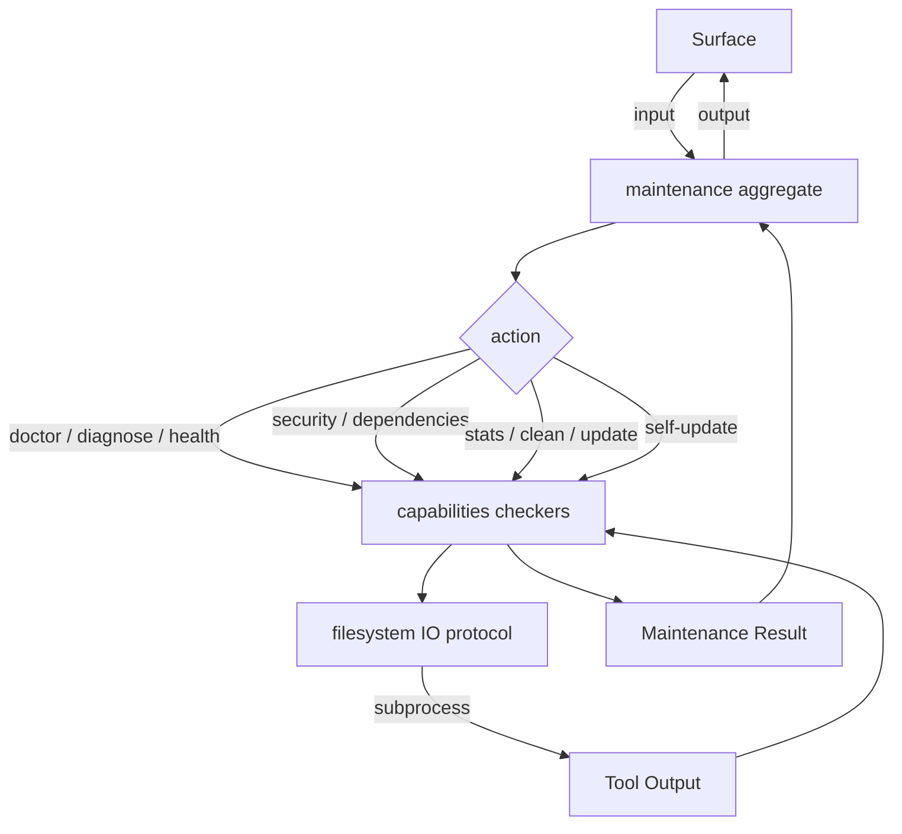

# FRD — maintenance

---

## Feature Overview

---

## Functional Requirements

### FR-Maintenance-001: Environment Health Check (doctor + toolchain)

| Aspect | Detail|
|--------|-------|
| Description | Report overall environment health including toolchain state for the doctor command. |
| Business Rules | Doctor aggregates binary availability, toolchain diagnosis, and health status into one result; DiagnoseToolchain returns binary path plus non-empty ok/missing lists; doctor result includes health status; Cancel request aborts an in-flight operation gracefully. |
| Edge Cases | Missing tools produce entries in the missing list while the overall doctor call still succeeds; cancel returns Cancelled rather than a partial error; empty environment yields a doctor result with all entries missing and no panic. |
| Capability | DoctorChecker implements doctor and toolchain diagnosis. |
| Protocol | IDoctorProtocol. |
| Method | doctor(&self) -> DoctorResultVO; diagnose_toolchain(&self) -> ToolchainDiagnostics |
| Input | MaintenanceRequest::{Doctor, DiagnoseToolchain, Cancel}; source is the doctor surface command. |
| Output | MaintenanceResponse::{Doctor, Toolchain, Cancelled} carrying status and tool lists. |
| Error | Unavailable tools are reported in lists, not as top-level failures; cancellation surfaces as Cancelled. |
| Event | None; doctor runs synchronously. |
| Test | maintenance_doctor_reports_health_status, diagnose_toolchain_has_binary_path, diagnose_toolchain_returns_non_empty_lists, and doctor_checker_serves_doctor_and_toolchain assert doctor output. |
| Metric | Diagnosis lists are non-empty on a seeded environment; doctor exit status reflects health on every run. |

### FR-Maintenance-002: Project Statistics (stats)

| Aspect | Detail|
|--------|-------|
| Description | Compute project statistics (counts and language breakdown) for the stats command. |
| Business Rules | Stats counts source files by language and totals for the current directory; counts are internally consistent (sum of per-language equals total); stats operate on the provided directory, not hard-coded paths. |
| Edge Cases | Empty directory yields zero counts without error; nested directories counted; unreadable subtrees skipped; stats on current dir runs without panic. |
| Capability | ProjectStatsChecker computes project statistics. |
| Protocol | IProjectStatsProtocol. |
| Method | stats() over the target directory returning counts and breakdown. |
| Input | Directory path; source is MaintenanceRequest::Stats. |
| Output | MaintenanceResponse::Stats with count fields. |
| Error | Unreadable path reports zero/partial counts rather than failing. |
| Event | None. |
| Test | maintenance_stats_counts_are_consistent and orchestrator_stats_on_current_dir assert count consistency and current-dir routing. |
| Metric | Sum of per-language counts equals the total on every seeded fixture run. |

### FR-Maintenance-003: Cache Cleanup (clean)

| Aspect | Detail|
|--------|-------|
| Description | Remove cache artifacts to reclaim disk space for the clean command. |
| Business Rules | Clean removes cache directories the tool owns (AST cache, report cache); it never touches source files or user configuration; repeat cleans are safe. |
| Edge Cases | Missing cache directory is a successful no-op; clean does not panic on any seeded state (orchestrator_clean_does_not_panic); read-only cache entries are skipped with a reported warning rather than aborting the rest. |
| Capability | CacheCleanupChecker removes owned cache artifacts. |
| Protocol | ICacheCleanupProtocol. |
| Method | clean() removing known cache roots and returning cleanup status. |
| Input | Cache root locations (default: configured cache dir); source is MaintenanceRequest::Clean. |
| Output | MaintenanceResponse::Clean with removal status. |
| Error | Permission failures on individual entries are reported; overall call still completes. |
| Event | None. |
| Test | orchestrator_clean_does_not_panic and cache_cleanup_checker_implements_cache_cleanup_protocol assert safety and contract. |
| Metric | Clean leaves zero owned cache files on the seeded fixture; source files remain untouched (byte-identical). |

### FR-Maintenance-004: Tool Update (update)

| Aspect | Detail|
|--------|-------|
| Description | Check for and apply updates to bundled linter tools for the update command. |
| Business Rules | ToolUpdateChecker probes each bundled tool for newer versions and reports/updates per tool; no-op when already current; update does not touch tools the app does not own. |
| Edge Cases | Already-current tool yields no change; a tool that fails to probe is reported but does not block others; offline probe reports unavailable rather than hanging (timeout honored). |
| Capability | ToolUpdateChecker performs tool update checks and installs. |
| Protocol | IToolUpdateProtocol. |
| Method | update() probing and updating managed tools returning per-tool status. |
| Input | Tool list from configuration; source is MaintenanceRequest::Update. |
| Output | MaintenanceResponse::Update with per-tool update outcomes. |
| Error | Per-tool probe or install failure is reported on that entry; overall response still returns. |
| Event | None. |
| Test | tool_update_checker_implements_tool_update_protocol asserts the protocol contract. |
| Metric | Each probed tool returns a definite status (current, updated, or failed) on a seeded run. |

### FR-Maintenance-005: Security Scan

| Aspect | Detail|
|--------|-------|
| Description | Scan the project for known security issues for the security scan command. |
| Business Rules | SecurityScan runs advisory/security checks over the dependency set and reports findings with severity; scan complements cargo-audit results surfaced through external-lint; empty dependency set yields zero findings. |
| Edge Cases | No advisories found yields an empty clean result; unreadable manifest is reported as a scan error; network-dependent advisory fetch failing degrades to local-only results. |
| Capability | SecurityScanChecker performs the security scan. |
| Protocol | ISecurityScanProtocol. |
| Method | run_security_scan(&self, project_path: &FilePath) -> SecurityScanReport |
| Input | Project path; source is MaintenanceRequest::SecurityScan. |
| Output | MaintenanceResponse::Security with findings. |
| Error | Manifest/lock unreadable yields a scoped error in the response; never panics. |
| Event | None. |
| Test | e2e_security_scan_and_dependency_report and orchestrator_security_scan assert scan flow on seeded fixtures. |
| Metric | Seeded vulnerable fixture reports at least one finding; clean fixture reports zero. |

### FR-Maintenance-006: Dependency Report

| Aspect | Detail|
|--------|-------|
| Description | Produce a dependency report for the project's dependency graph. |
| Business Rules | DependencyReport lists dependencies and their sources; works off the parsed manifest/lock data; consistent with the security scan's data source. |
| Edge Cases | Missing dependency data yields an empty report rather than failure; partial graphs report what was parsed; report works even when security scan finds nothing. |
| Capability | DependencyReportChecker aggregates dependency information. |
| Protocol | IDependencyReportProtocol. |
| Method | run_dependency_report(&self, project_path: &FilePath) -> Result<DependencyReport, String> |
| Input | Project path; source is MaintenanceRequest::DependencyReport. |
| Output | MaintenanceResponse::Dependencies with the dependency listing. |
| Error | Unreadable input yields empty listing plus error note. |
| Event | None. |
| Test | orchestrator_dependency_report, dependency_report_checker_implements_dependency_report_protocol, and e2e_security_scan_and_dependency_report assert reporting. |
| Metric | Seeded manifest fixtures produce a listing matching their dependency count. |

### FR-Maintenance-007: Adapter Health Check

| Aspect | Detail|
|--------|-------|
| Description | Check that every configured linter adapter is installed and runnable. |
| Business Rules | HealthCheck probes all ten default adapters across the four language groups and reports per-adapter availability; all languages are covered; missing adapters are reported, not fatal. |
| Edge Cases | Missing adapter binary reports unavailable for that adapter while others still probe; empty adapter config yields an empty health map; probing continues after a failing adapter. |
| Capability | AdapterHealthChecker probes adapter availability. |
| Protocol | IAdapterHealthProtocol. |
| Method | health_check() returning per-adapter availability (ten adapters, all four languages). |
| Input | Adapter configuration; source is MaintenanceRequest::HealthCheck. |
| Output | MaintenanceResponse::Health with availability per adapter. |
| Error | Individual probe failure marks that adapter unhealthy; overall response completes. |
| Event | None. |
| Test | health_check_returns_10_adapters, health_check_has_all_languages, maintenance_health_check_covers_all_languages, and orchestrator_health_check assert coverage. |
| Metric | Health check returns exactly ten adapter entries covering Rust, Python, JS, and Markdown groups. |

### FR-Maintenance-008: Self-Update (binary)

| Aspect | Detail|
|--------|-------|
| Description | Update the lint-arwaky binary itself with integrity verification for the self-update command. |
| Business Rules | SelfUpdate downloads the target release artifact, verifies the checksum/signature when a target exists and always when no target exists, and replaces the binary atomically; corrupt downloads are rejected even when the filename matches; success or already-up-to-date is reported as success. |
| Edge Cases | Already-up-to-date reports success; corrupt download rejected even when target name matches; no existing target triggers full verification; target exists skips redundant re-verify per policy but never skips replace-time check; interrupted download leaves the current binary intact. |
| Capability | SelfUpdateChecker performs download, verify, and replace. |
| Protocol | ISelfUpdateProtocol. |
| Method | self_update() downloading, verifying, and replacing the binary. |
| Input | Release source and current binary path; source is MaintenanceRequest::SelfUpdate. |
| Output | MaintenanceResponse::SelfUpdate with update outcome. |
| Error | Corrupt or unverifiable download aborts before replace; caller sees failure with the current binary untouched. |
| Event | None. |
| Test | self_update_checker_implements_self_update_protocol, self_update_rejects_corrupt_download_even_when_target_matches, self_update_verifies_download_when_no_target_exists, and self_update_success_or_already_up_to_date assert integrity and outcomes. |
| Metric | Corrupt payload never replaces the binary on a seeded run; valid payload updates atomically in one call. |

## Public Interface

| Aspect | Detail|
|--------|-------|
| Agent | MaintenanceCommandsOrchestrator — the agent-layer orchestrator behind doctor, stats, clean, update, security, dependencies, health, and self-update commands. |
| Aggregate | IMaintenanceAggregate — the feature's single front door. |
| Method | execute(&self, request: MaintenanceRequest) -> MaintenanceResponse |
| Request | MaintenanceRequest::{Stats, Clean, Update, SelfUpdate, Doctor, Cancel, DiagnoseToolchain, HealthCheck, SecurityScan, DependencyReport} |
| Response | MaintenanceResponse::{Stats, Clean, Update, SelfUpdate, Doctor, Cancelled, Toolchain, Health, Security, Dependencies} |

## Reference

| Artifact | Purpose | Link |
|----------|---------|------|
| PRD | Business goals, user stories, and scope | [PRD.md](../../PRD.md) |
| Backlog | Task tracking, epics, and implementation status | [BACKLOG.md](BACKLOG.md) |
| Roadmap | Timeline, phasing, and dependencies | [ROADMAP.md](../../ROADMAP.md) |
| Architecture | System boundaries, tech stack, and infra | [ARCHITECTURE.md](../../ARCHITECTURE.md) |
