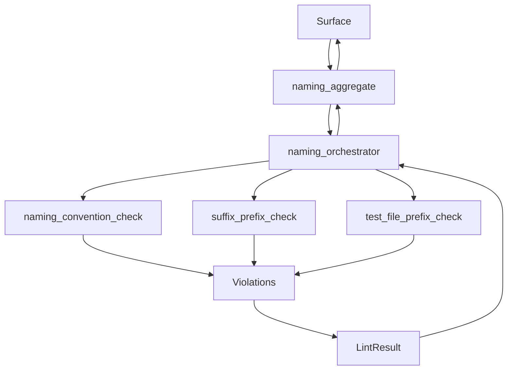

# FRD — naming-rules

## Feature Overview

The naming-rules feature sits in the capabilities and agent layer, called by the surface layer via the naming runner aggregate. The orchestrator coordinates naming convention validation, suffix/prefix policy checks, and test file prefix discipline. Zero disk I/O is performed directly by checkers; pre-parsed file entries are supplied by the caller and lint results return upstream to surface commands.

## Functional Requirements

### FR-NamingRules-001: Naming Convention (AES101)

**Description:** The naming-rules orchestrator shall check every file stem against the AES naming convention for each source language. File stems shall adhere to standard shape constraints without uppercase characters, and support-directory files or barrel files shall be handled in accordance with flat classification rules across both slash separator styles.

#### Business Logic

- File stem shape shall be checked for legal casing according to language rules.
- Stems consisting entirely of uppercase characters shall produce a violation.
- Files under support directories shall be treated as flat scope.
- Windows-style backslash separators shall be normalized identically to forward slashes.
- Barrel files located in support directories shall be skipped.

#### Edge Cases

- All-uppercase file stem produces an AES101 violation.
- Windows-style separator paths are classified identically to POSIX paths.
- Unreadable files yield no findings rather than causing audit failure.
- Files outside configured scan roots are excluded from evaluation.

#### Technical Specification

| Aspect | Detail |
|--------|--------|
| **Input** | `NamingRequest::RunAuditWithEntries` or `NamingRequest::RunAuditWithTestEntries` containing `FileEntry` slices |
| **Output** | `NamingResponse::Audit` containing `Vec<ViolationItem>` with AES101 violation codes |
| **Protocol** | `INamingConventionProtocol` |
| **Method** | `check_file_naming` |
| **Event** | `NamingConventionAudited` |
| **Error** | `AES101` on invalid stem shape, or silent pass on unreadable file path |

#### Test

| No | Detail |
| --- | --- |
| 1 | A file stem containing all-uppercase characters, a Windows-style backslash separator path, and a support-directory barrel file each produce the documented AES101 outcome |

#### Metric

| No | Detail |
| --- | --- |
| 1 | Stem Shape Audit Accuracy is 100% and Path Separator Consistency is 100% |

### FR-NamingRules-002: Suffix/Prefix Validation (AES102)

**Description:** The naming-rules orchestrator shall enforce layer suffix and prefix policies for special file roles including barrels, registries, and regression guards. Every file shall carry an allowed prefix or suffix descriptor matching its designated architectural layer role, skipping exempted files without raising false positives.

#### Business Logic

- Every file within scoped layer directories shall carry an allowed prefix or suffix descriptor.
- Files lacking a legal prefix or suffix descriptor for their assigned role shall produce an AES102 violation.
- Barrel files matching layer conventions shall be skipped from suffix requirements.
- Regression guard names shall be permitted even when not matching general category prefixes.
- Files residing in support directories shall evaluate under flat scope rules.

#### Edge Cases

- File with no legal prefix produces an AES102 violation detailing the missing descriptor.
- Barrel files within scope are skipped without generating violations.
- Regression guard files pass validation despite category prefix discrepancies.
- Empty content files produce no panic and evaluate against path descriptors only.

#### Technical Specification

| Aspect | Detail |
|--------|--------|
| **Input** | `NamingRequest::RunAuditWithEntries` or `NamingRequest::RunAuditWithTestEntries` containing `FileEntry` slices |
| **Output** | `NamingResponse::Audit` containing `Vec<ViolationItem>` with AES102 violation codes |
| **Protocol** | `ISuffixPolicyProtocol` |
| **Method** | `check_domain_suffixes` |
| **Event** | `SuffixPolicyAudited` |
| **Error** | `AES102` on missing or invalid layer prefix or suffix descriptor |

#### Test

| No | Detail |
| --- | --- |
| 1 | A file with an allowed layer suffix descriptor, a file lacking any legal layer prefix or suffix, and a regression guard file each produce the documented AES102 outcome |

#### Metric

| No | Detail |
| --- | --- |
| 1 | Suffix Policy Audit Accuracy is 100% and False Positive Rate on Exempt Roles is 0% |

### FR-NamingRules-003: Test File Prefix Discipline (AES103)

**Description:** The naming-rules orchestrator shall enforce prefix and placement discipline for test and benchmark files located in test directories. Files placed in tests or benches directories shall conform to registered virtual prefix naming standards, providing relocation and renaming guidance whenever misplaced files or mismatched prefixes are discovered.

#### Business Logic

- Benchmark files discovered under tests directories shall be flagged with guidance to move them to benches directories.
- Test files discovered under benches directories shall be flagged with guidance to move them to tests directories.
- Test files lacking registered prefix prefixes shall produce an AES103 violation listing legal prefixes.
- Nested subdirectories under tests directories shall be evaluated with flattening guidance, preserving shared helper directories.
- Unclassified file paths shall report classification requirements rather than making ambiguous assumptions.

#### Edge Cases

- Benchmark file placed inside a tests directory produces guidance to move the file.
- Test file placed inside a benches directory produces guidance to move the file.
- Nested test files report the observed directory depth alongside flattening guidance.
- Accepted support directories under test roots pass without raising misplacement violations.

#### Technical Specification

| Aspect | Detail |
|--------|--------|
| **Input** | `NamingRequest::RunAuditWithTestEntries` containing source and test `FileEntry` collections |
| **Output** | `NamingResponse::Audit` containing `Vec<ViolationItem>` with AES103 violation codes |
| **Protocol** | `ITestFilePrefixProtocol` |
| **Method** | `check_test_file_prefixes` |
| **Event** | `TestFilePrefixAudited` |
| **Error** | `AES103` on misplaced test file or unapproved test prefix |

#### Test

| No | Detail |
| --- | --- |
| 1 | A benchmark file inside a tests directory, an unprefixed test file inside a test directory, and a shared support directory helper each produce the documented AES103 outcome |

#### Metric

| No | Detail |
| --- | --- |
| 1 | Test Prefix Enforcement Accuracy is 100% and Misplacement Detection Rate is 100% |

## Public Interface

| Aspect | Detail |
|--------|--------|
| Agent | NamingOrchestrator |
| Aggregate | INamingRunnerAggregate |
| Method | execute |
| Request | NamingRequest |
| Response | NamingResponse |

## Reference

| Artifact | Purpose | Link |
|----------|---------|------|
| PRD | Business goals, user stories, and scope | [PRD.md](../../PRD.md) |
| Backlog | Task tracking, epics, and implementation status | [BACKLOG.md](./BACKLOG.md) |
| Roadmap | Timeline, phasing, and dependencies | [ROADMAP.md](../../ROADMAP.md) |
| Architecture | System boundaries, tech stack, and infra | [ARCHITECTURE.md](../../ARCHITECTURE.md) |
