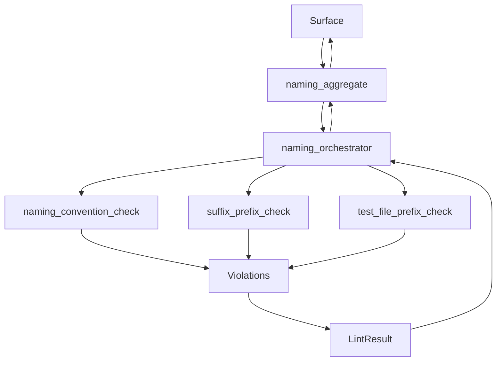

# FRD — naming-rules

## Feature Overview



The naming-rules feature sits in the capabilities and agent layer, called by the surface layer via the naming runner aggregate. The orchestrator coordinates naming convention validation, suffix/prefix policy checks, and test file prefix discipline. Zero disk I/O is performed directly by checkers; pre-parsed file entries are supplied by the caller and lint results return upstream to surface commands.

## Developer Journey

**Persona.** A developer who has just added a file to a Rust workspace and wants to know whether the name will survive the repository's own gates. They are not an architect: they do not know that a "layer" exists, and they do not want to learn. They know the file they wrote, and they want to know what to rename it to.

**Entry command.**

```bash
lint-arwaky-cli check . --group naming
```

`check` is the authoritative surface for an audit; `--group naming` restricts the run to AES101, AES102 and AES103. The `fix` and `watch` commands are not naming-audit entry points: `fix` applies the auto-fix rules, and `watch` re-runs the whole scan on a file change.

| Step | Developer does | Sees |
|------|----------------|------|
| 1 | Runs `lint-arwaky-cli check . --group naming` | One block per finding, then the naming summary: the files each rule read, the findings per rule, and the total per severity level |
| 2 | Reads one finding | The file, the rule the finding comes from, and the one required action |
| 3 | Applies the rename or the move | Nothing yet: the audit changes no file |
| 4 | Updates the references that name the file | Nothing yet |
| 5 | Re-runs the same command | The finding is gone; the summary line shows the rule was read again and reports zero findings |

**First run.** The standard scan report comes first, because the naming group prints the same report every other group prints. The naming summary follows it:

```text
Naming audit:
  AES101  stem shape              342 files checked  clean
  AES102  layer suffix/prefix     342 files checked  clean
  AES103  test/bench prefix        28 files checked  clean

0 findings. Nothing was renamed or moved.
```

The counts are the files each rule read, not the files that produced a finding. A run that read 342 files and found nothing says so, which is what separates "your names are clean" from "the rule never ran".

**Fix loop.** A finding names the file to rename to and the references to update. The developer renames the file, updates the imports that name it, and re-runs the same command. The summary then reports the rule as clean again. If the name is deliberate, the finding names the exemption list to add the file to instead (§Suppression).

**Rules reachable from one run.** AES101 (stem shape), AES102 (folder suffix), and AES103 (test and bench file prefix and placement) all run in the same command, and the summary lists each of them with the number of files it read.

## Output Contract

### The finding template

Every AES101, AES102 and AES103 finding carries the same three fields, in this order. The three never restate one another, so a surface that prints all three shows the defect exactly once.

| Field | Carries | Never carries |
|-------|---------|---------------|
| `message` | The problem: one clause naming the one constraint that broke | The remedy, or a list of possible causes |
| `fix` | The action: what to do, then the reference update, then the re-run, then the exemption list | The problem restated, or the rule |
| `why` | The rule: the policy the finding comes from | The problem restated, or the action |

The template in full:

```text
<problem clause>
<action clause>
Then update the imports that name it.
Re-run the check to confirm the finding is gone.
If this name is intentional, add '<file name>' to
  architecture.rules.AES10x.exceptions in lint_arwaky.config.yaml.
<rule clause>
```

One clause per line. A clause longer than the width budget wraps onto continuation lines indented by two spaces. A clause never offers a disjunction: a stem that breaks two shape rules produces one finding, naming the first rule it breaks, so the reader fixes that one, re-runs, and meets the next.

### The column budget

| Aspect | Value |
|--------|-------|
| Width budget | 72 visible characters per line, of an 80-column terminal |
| Reason for the eight spare columns | The surface prints the finding under an indent of up to eight columns, so a finding never wraps in the reader's terminal |
| Clause order | The problem clause comes before the action clause |
| Continuation indent | Two spaces |
| A word longer than the budget | It keeps its own line rather than being cut in half: a path that cannot be split stays readable |

The budget is a property of the finding text, so it holds on every surface: the terminal, the JSON report, the SARIF result and the JUnit failure.

### The character repertoire

The emitted text is ASCII only: the letters, digits, spaces and the punctuation `' " . , : ; _ - / ( )` and the newline. The rules write no em dash and no other Unicode punctuation, so the text survives a terminal that cannot render it. A file name is reproduced exactly as the developer typed it, including any non-ASCII character it holds.

The internal vocabulary of this document says "layer" where the emitted text says "folder": the developer sees the group their file name places them in, not the architecture term. A file's folder is read from its own name, so every repair the naming rules ask for is a rename of that name.

### Which field each surface renders

| Surface | Renders |
|---------|---------|
| CLI text (`check . --group naming`) | The rule (`why`) on the `WHY:` line and the action (`fix`) on the `FIX:` line |
| CLI JSON, SARIF and JUnit | The problem (`message`), the rule (`why`) and the action (`fix`) |
| Report text | The problem (`message`), with the rule and the action |
| Naming summary (CLI text) | The files each rule read, the findings per rule, and the total per severity level |

## Severity Model

The three rules carry more than one severity level, so a reader can triage: a file in the wrong folder is a different weight from a file with a capital letter in its name.

| Rule | Finding | Severity | Why |
|------|---------|----------|-----|
| AES101 | The stem names no known folder prefix | HIGH | Without the prefix the file cannot be placed in the architecture at all |
| AES101 | The stem breaks a shape rule (casing, separator, word count) | MEDIUM | The file is placed; only its spelling is wrong |
| AES102 | The suffix is forbidden in the folder | HIGH | The suffix names a role the folder does not play, so the file claims a role it does not fill |
| AES102 | The suffix belongs to another folder | HIGH | The file claims a role its folder does not own |
| AES102 | The suffix is not in the folder's list | MEDIUM | The file sits in the right folder; only the name is wrong |
| AES103 | The file sits below `tests/` or `benches/` | MEDIUM | The name prefix cannot record the type while the file is nested |
| AES103 | The stem starts with a prefix belonging to the other directory | MEDIUM | The file needs a move, not a rename |
| AES103 | The stem starts with no legal prefix | MEDIUM | The file needs a rename |

## Suppression

A name that is deliberate is exempted by file name, per rule, in `lint_arwaky.config.yaml`:

```yaml
architecture:
  rules:
    AES101:
      enabled: true
      exceptions:
        - "capabilities_generated_codes.rs"
```

Every finding names this list in its action clause, with the config key and the file-name form, because neither is guessable. The exemption is matched on the bare file name, so the same file name in another folder is not exempted by accident. The list is the only suppression mechanism in scope: there is no inline suppression comment.

## The empty-file policy

A file with no content still has a name, and the name is what these rules judge. Every file the walk finds is evaluated by its path, whatever its size: a zero-byte file with a broken name produces a finding, exactly as a full file with the same name would.

This policy is pinned here because the two behaviours look identical from the outside - both produce no finding - and only one of them is correct. A rule that skipped empty files would let a placeholder file with a broken name pass as clean.

## Functional Requirements

### FR-NamingRules-001: Naming Convention (AES101)

**Description:** The naming-rules orchestrator shall check every file stem against the AES naming convention for each source language. File stems shall adhere to standard shape constraints without uppercase characters, and support-directory files or barrel files shall be handled in accordance with flat classification rules across both slash separator styles.

#### Business Logic

- File stem shape shall be checked for legal casing according to language rules.
- A stem that breaks the casing rule, the separator rule or the word-count rule produces one finding, naming the first rule that broke.
- A stem that names no known folder prefix produces one finding, naming the legal prefixes.
- Windows-style backslash separators shall be normalized identically to forward slashes.
- Barrel files shall be skipped: a barrel re-exports the modules beside it and names no role of its own.
- A file with no content shall be evaluated like any other file.

#### Edge Cases

- All-uppercase file stem produces an AES101 violation.
- Windows-style separator paths are classified identically to POSIX paths.
- A zero-byte file with a broken name produces the same finding as a full file with that name.
- Files outside configured scan roots are excluded from evaluation.

#### Technical Specification

| Aspect | Detail |
|--------|--------|
| **Input** | `NamingRequest::RunAuditWithEntries` or `NamingRequest::RunAuditWithTestEntries` containing `FileEntry` slices |
| **Output** | `NamingResponse::Audit` containing `Vec<ViolationItem>` with AES101 violation codes and the per-rule inspected count |
| **Protocol** | `INamingConventionProtocol` |
| **Method** | `check_file_naming` |
| **Event** | `NamingConventionAudited` |
| **Error** | `AES101` on invalid stem shape, or silent pass on a path the path type rejects |

#### Test

| No | Detail |
| --- | --- |
| 1 | A file stem containing all-uppercase characters, a Windows-style backslash separator path, and a barrel file each produce the documented AES101 outcome |
| 2 | A zero-byte file with a broken name produces the documented AES101 outcome |

#### Metric

| No | Detail |
| --- | --- |
| 1 | Stem Shape Audit Accuracy is 100% and Path Separator Consistency is 100% |

### FR-NamingRules-002: Suffix/Prefix Validation (AES102)

**Description:** The naming-rules orchestrator shall enforce layer suffix and prefix policies for special file roles including barrels, registries, and regression guards. Every file shall carry an allowed prefix or suffix descriptor matching its designated architectural layer role, skipping exempted files without raising false positives.

#### Business Logic

- Every file within scoped layer directories shall carry an allowed prefix or suffix descriptor.
- A suffix the folder forbids produces one finding; the action names the file to rename to, and where the suffix belongs.
- A suffix that belongs to another folder produces one finding; the action names the file to rename to.
- A suffix the folder does not list produces one finding, in a folder whose policy is strict; the action lists the suffixes the folder accepts.
- Each finding names one action: the remedy is never a list of alternatives.
- Barrel files matching layer conventions shall be skipped from suffix requirements.
- Regression guard names shall be permitted even when not matching general category prefixes.
- The action shall name the reference update and the re-run that confirms the finding is gone.

#### Edge Cases

- File with no legal prefix produces an AES102 violation detailing the missing descriptor.
- Barrel files within scope are skipped without generating violations.
- Regression guard files pass validation despite category prefix discrepancies.
- A file with no content is evaluated by its path alone, and produces no panic.

#### Technical Specification

| Aspect | Detail |
|--------|--------|
| **Input** | `NamingRequest::RunAuditWithEntries` or `NamingRequest::RunAuditWithTestEntries` containing `FileEntry` slices |
| **Output** | `NamingResponse::Audit` containing `Vec<ViolationItem>` with AES102 violation codes and the per-rule inspected count |
| **Protocol** | `ISuffixPolicyProtocol` |
| **Method** | `check_domain_suffixes` |
| **Event** | `SuffixPolicyAudited` |
| **Error** | `AES102` on missing or invalid layer prefix or suffix descriptor |

#### Test

| No | Detail |
| --- | --- |
| 1 | A file with an allowed layer suffix descriptor, a file lacking any legal layer prefix or suffix, and a regression guard file each produce the documented AES102 outcome |
| 2 | A zero-byte file with a forbidden suffix produces the documented AES102 outcome |

#### Metric

| No | Detail |
| --- | --- |
| 1 | Suffix Policy Audit Accuracy is 100% and False Positive Rate on Exempt Roles is 0% |

### FR-NamingRules-003: Test File Prefix Discipline (AES103)

**Description:** The naming-rules orchestrator shall enforce prefix and placement discipline for test and benchmark files located in test directories. Files placed in tests or benches directories shall conform to registered virtual prefix naming standards, providing relocation and renaming guidance whenever misplaced files or mismatched prefixes are discovered.

#### Business Logic

- Every file in `tests/` shall sit directly in that directory and start with a legal test prefix.
- Every file in `benches/` shall sit directly in that directory and start with the benchmark prefix.
- A file that sits below `tests/` or `benches/` produces one nesting finding, whose worked example comes from the directory the finding reports: a benchmark name under `benches/`, a test name under `tests/`.
- A file that starts with a prefix belonging to the other directory produces one finding that names the directory the prefix belongs in.
- A file that starts with no legal prefix produces one finding that lists the legal prefixes of its directory.
- No support directory under `tests/` is sanctioned: every file under `tests/` must sit directly in it and carry a legal prefix. The support prefixes (`regression_`, `behavioral_`, `mock_`, `fixture_`) name files, not directories.
- Unclassified file paths shall report classification requirements rather than making ambiguous assumptions.

#### Edge Cases

- Benchmark file placed inside a tests directory produces guidance to move the file.
- Test file placed inside a benches directory produces guidance to move the file.
- Nested test files report the observed directory depth as "1 level" or "2 levels", never as "level(s)".
- A nested file is reported by the nesting rule alone, so one defect never produces two findings.
- A zero-byte test file without a legal prefix produces the documented AES103 outcome.

#### Technical Specification

| Aspect | Detail |
|--------|--------|
| **Input** | `NamingRequest::RunAuditWithTestEntries` containing source and test `FileEntry` collections |
| **Output** | `NamingResponse::Audit` containing `Vec<ViolationItem>` with AES103 violation codes and the per-rule inspected count |
| **Protocol** | `ITestFilePrefixProtocol` |
| **Method** | `check_test_file_prefixes` |
| **Event** | `TestFilePrefixAudited` |
| **Error** | `AES103` on misplaced test file or unapproved test prefix |

#### Test

| No | Detail |
| --- | --- |
| 1 | A benchmark file inside a tests directory, an unprefixed test file inside a test directory, and a nested test file each produce the documented AES103 outcome |
| 2 | The nesting finding under `benches/` names a benchmark name, never a test name |

#### Metric

| No | Detail |
| --- | --- |
| 1 | Test Prefix Enforcement Accuracy is 100% and Misplacement Detection Rate is 100% |

## Output Samples

The samples below are the finding text as the rules render it: the rule code, then the problem clause, then the action clauses, then the rule clause. Each line stays inside the 72-character budget.

### AES101 - stem shape

```text
AES101
Stem 'capabilities_UserChecker' contains uppercase characters.
Rename the file to 'capabilities_user_checker.rs'.
Then update the imports that name it.
Re-run the check to confirm the finding is gone.
If this name is intentional, add 'capabilities_UserChecker.rs' to
  architecture.rules.AES101.exceptions in lint_arwaky.config.yaml.
File names are lowercase words joined by underscores, so the same name
  reads the same everywhere.
```

### AES102 - folder suffix

```text
AES102
Suffix 'vo' is not allowed in the 'capabilities' folder.
Rename the file to 'taxonomy_user_vo.rs'.
Then update the imports that name it.
Re-run the check to confirm the finding is gone.
If this name is intentional, add 'capabilities_user_vo.rs' to
  architecture.rules.AES102.exceptions in lint_arwaky.config.yaml.
A suffix names the role a file plays, and each folder lists only the
  roles it owns.
```

### AES103 - test file prefix

```text
AES103
Test file 'helpers.rs' does not start with a legal test prefix.
Rename the file to '<type>_<subject>.rs'. Legal 'tests/' prefixes:
  contract_, unit_, integration_, dogfood_, smoke_, e2e_, acceptance_,
  regression_, behavioral_, mock_, fixture_.
Then update the imports that name it.
Re-run the check to confirm the finding is gone.
If this name is intentional, add 'helpers.rs' to
  architecture.rules.AES103.exceptions in lint_arwaky.config.yaml.
The name prefix records the test type, so a runner finds the file and
  knows what it is.
```

### The two-defect case

One file can break two rules. The file below breaks AES101 (its stem carries uppercase characters) and AES102 (its suffix names a role the 'capabilities' folder does not play), so one run reports two findings against the same path:

```text
AES101
Stem 'capabilities_User_entity' contains uppercase characters.
Rename the file to 'capabilities_user_entity.rs'.
Then update the imports that name it.
Re-run the check to confirm the finding is gone.
If this name is intentional, add 'capabilities_User_entity.rs' to
  architecture.rules.AES101.exceptions in lint_arwaky.config.yaml.
File names are lowercase words joined by underscores, so the same name
  reads the same everywhere.

AES102
Suffix 'entity' is not allowed in the 'capabilities' folder.
Rename the file to 'taxonomy_user_entity.rs'.
Then update the imports that name it.
Re-run the check to confirm the finding is gone.
If this name is intentional, add 'capabilities_User_entity.rs' to
  architecture.rules.AES102.exceptions in lint_arwaky.config.yaml.
A suffix names the role a file plays, and each folder lists only the
  roles it owns.
```

The two repairs differ because the two defects differ: the AES101 repair fixes the spelling of the name, the AES102 repair moves the role to the folder that plays it. Applying the AES102 repair settles the AES101 finding as well, because the new name is spelled correctly too.

The summary of that run names both findings and their levels:

```text
Naming audit:
  AES101  stem shape              342 files checked  1 finding
  AES102  layer suffix/prefix     342 files checked  1 finding
  AES103  test/bench prefix        28 files checked  clean

2 findings: 1 high, 1 medium. Nothing was renamed or moved.
```

## Public Interface

| Aspect | Detail |
|--------|--------|
| Agent | NamingOrchestrator |
| Aggregate | INamingRunnerAggregate |
| Method | execute |
| Request | NamingRequest |
| Response | NamingResponse |

## Reference

| Artifact | Purpose | Link |
|----------|---------|------|
| PRD | Business goals, user stories, and scope | [PRD.md](../../PRD.md) |
| Backlog | Task tracking, epics, and implementation status | [BACKLOG.md](./BACKLOG.md) |
| Roadmap | Timeline, phasing, and dependencies | [ROADMAP.md](../../ROADMAP.md) |
| Architecture | System boundaries, tech stack, and infra | [ARCHITECTURE.md](../../ARCHITECTURE.md) |
