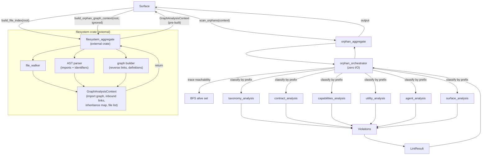

# FRD — orphan-rules (v2.0.0)

## Feature Overview

The orphan-rules crate identifies dead, unused, or unreachable code components across the 7-layer AES architecture. It receives a pre-built `GraphAnalysisContext` from the external `filesystem` crate and performs layer-specific orphan analysis starting from valid entry points (containers, binary entries, main files).

Graph construction is delegated to the external `filesystem` aggregate via `build_orphan_graph_context(root, ignored)`, which discovers workspace files, parses each file via tree-sitter AST, resolves imports to file edges, and returns a `GraphAnalysisContext`. The orphan-rules crate receives pre-built graph data and performs zero I/O — it only performs business logic analysis on pre-fetched data.

The orchestrator internally performs BFS reachability tracing over the import graph to determine which files are "alive" (reachable from entry points), then dispatches to 6 layer-specific orphan analyzers (AES501–AES506).

- **Architecture & Data Flow**

## Functional Requirements

### FR-OrphanRules-001: Graph Context, Entry Points, and Reachability

#### Description

| No | Detail |
| --- | --- |
| 1 | Build the graph context and entry-point set that reachability checks run against. |
| 2 | — |

#### Business Rules

| No | Detail |
| --- | --- |
| 1 | BuildGraphContext sources the file graph from the filesystem aggregate (BuildOrphanGraphContext); IdentifyEntryPoints computes alive entry points (containers, mains, surfaces calling aggregates). |
| 2 | fr001 asserts orchestration steps are inherent agent methods; reachability flows entry point through DI implementation bridges to capabilities. |

#### Edge Cases

| No | Detail |
| --- | --- |
| 1 | Empty graph yields empty entry points without error; entry points computed from any subset still reach consistently; paths compared by absolute-path suffix so case/nesting differences still match. |
| 2 | — |

#### Capability

| No | Detail |
| --- | --- |
| 1 | ArchOrphanAnalyzer coordinates context building; shared filesystem serves graph data. |

#### Protocol

| No | Detail |
| --- | --- |
| 1 | IOrphanParserProtocol |

#### Method

| No | Detail |
| --- | --- |
| 1 | BuildGraphContext and IdentifyEntryPoints as OrphanRequest variants resolved through IOrphanAggregate::execute. |
| 2 | — |

#### Input

| No | Detail |
| --- | --- |
| 1 | Root path plus optional entries; source is OrphanRequest::{BuildGraphContext, IdentifyEntryPoints}. |
| 2 | — |

#### Output

| No | Detail |
| --- | --- |
| 1 | OrphanResponse::{GraphContext, EntryPoints} used by FR-OrphanRules-002..007. |
| 2 | — |

#### Error

| No | Detail |
| --- | --- |
| 1 | Unreadable trees skip nodes; missing entry points yield an empty alive set, causing downstream orphans (correct behavior). |
| 2 | — |

#### Event

| No | Detail |
| --- | --- |
| 1 | None; context build is synchronous. |
| 2 | — |

#### Test

| No | Detail |
| --- | --- |
| 1 | fr001_orchestration_steps_are_inherent_agent_methods and graph-context coverage in the orphan suite assert entry-point derivation. |
| 2 | — |

#### Metric

| No | Detail |
| --- | --- |
| 1 | Seeded container entry points identify the expected alive set; empty graphs produce empty context with zero errors. |
| 2 | — |

### FR-OrphanRules-002: Taxonomy Orphan Detection (AES501)

#### Description

| No | Detail |
| --- | --- |
| 1 | Flag taxonomy files that no other layer imports (AES501). |
| 2 | — |

#### Business Rules

| No | Detail |
| --- | --- |
| 1 | A taxonomy file is alive only when imported by agent, capabilities, or surface layers; imports from other taxonomy files do not count (self-import only is still an orphan). |
| 2 | Helper/utility-suffix taxonomy files are categorized as utility and checked under utility rules, and utility-suffix files are flagged under taxonomy rules as well. |

#### Edge Cases

| No | Detail |
| --- | --- |
| 1 | Taxonomy imported by agent/capabilities/surface is not an orphan; imported only by other taxonomy is an orphan; self-import only is an orphan; helper suffix categorized as utility; utility suffix also flagged under taxonomy rules. |
| 2 | — |

#### Capability

| No | Detail |
| --- | --- |
| 1 | TaxonomyOrphanAnalyzer computes taxonomy reachability. |

#### Protocol

| No | Detail |
| --- | --- |
| 1 | ITaxonomyOrphanProtocol |

#### Method

| No | Detail |
| --- | --- |
| 1 | Taxonomy orphan check over graph context returning AES501 violations. |
| 2 | — |

#### Input

| No | Detail |
| --- | --- |
| 1 | Graph context and entry points; source is OrphanRequest::{Check, CheckWithContext, CheckWithEntries}. |
| 2 | — |

#### Output

| No | Detail |
| --- | --- |
| 1 | OrphanResponse::Violations with AES501 codes. |
| 2 | — |

#### Error

| No | Detail |
| --- | --- |
| 1 | Missing context causes a pre-check build rather than a crash; unreadable files are skipped. |
| 2 | — |

#### Event

| No | Detail |
| --- | --- |
| 1 | None. |
| 2 | — |

#### Test

| No | Detail |
| --- | --- |
| 1 | aes501_taxonomy_file_imported_by_surface_is_not_orphan, aes501_taxonomy_file_only_imported_by_other_taxonomy_is_orphan, aes501_taxonomy_file_with_self_import_only_is_orphan, and aes501_taxonomy_helper_suffix_categorized_as_utility assert rules. |
| 2 | — |

#### Metric

| No | Detail |
| --- | --- |
| 1 | Each seeded taxonomy orphan fires exactly one AES501 finding; cross-layer-imported taxonomy fixtures fire zero. |
| 2 | — |

### FR-OrphanRules-003: Contract Orphan Detection (AES502)

#### Description

| No | Detail |
| --- | --- |
| 1 | Flag contract files whose traits have no alive implementor wired into the app (AES502). |
| 2 | — |

#### Business Rules

| No | Detail |
| --- | --- |
| 1 | A contract is alive when at least one implementor is reachable (DI bridge or direct wiring) from entry points; matching uses absolute-path suffix so same-basename files at different paths stay distinct. |
| 2 | Multiple traits in one file each evaluated independently; an implementor that is itself unreachable does not save the contract (still orphan); surface not calling an aggregate marks the aggregate contract orphan. |

#### Edge Cases

| No | Detail |
| --- | --- |
| 1 | Aggregate not called by surface is an orphan; implementor matched by absolute-path suffix is alive; same basename at different path stays orphan; implementor not alive remains orphan; multi-trait file with only one alive implementor keeps only that trait alive. |
| 2 | — |

#### Capability

| No | Detail |
| --- | --- |
| 1 | ContractOrphanAnalyzer resolves implementors per contract. |

#### Protocol

| No | Detail |
| --- | --- |
| 1 | IContractOrphanProtocol |

#### Method

| No | Detail |
| --- | --- |
| 1 | Contract orphan check mapping contracts to alive implementors returning AES502 violations. |
| 2 | — |

#### Input

| No | Detail |
| --- | --- |
| 1 | Graph context, entry points, and parsed entries; source is OrphanRequest check variants (also OrphanRequest::Scan for full runs). |
| 2 | — |

#### Output

| No | Detail |
| --- | --- |
| 1 | OrphanResponse::Violations with AES502 codes; ScanOutcome for full scans. |
| 2 | — |

#### Error

| No | Detail |
| --- | --- |
| 1 | Unmatched references report orphan rather than erroring; unreadable files skipped. |
| 2 | — |

#### Event

| No | Detail |
| --- | --- |
| 1 | None. |
| 2 | — |

#### Test

| No | Detail |
| --- | --- |
| 1 | aes502_contract_wired_through_implementation, aes502_contract_implementor_same_basename_different_path_is_orphan, aes502_contract_implementor_not_alive_is_still_orphan, and aes502_aggregate_not_called_by_surface_is_orphan assert matching rules. |
| 2 | — |

#### Metric

| No | Detail |
| --- | --- |
| 1 | Seeded wired contract fires zero findings; each seeded unwired contract fires exactly one AES502 finding. |
| 2 | — |

### FR-OrphanRules-004: Capabilities Orphan Detection (AES503)

#### Description

| No | Detail |
| --- | --- |
| 1 | Flag capability files unreachable from entry points through the DI wiring (AES503). |
| 2 | — |

#### Business Rules

| No | Detail |
| --- | --- |
| 1 | Reachability flows entry point to contract to implementation to capability; DI implementation bridges extend reachability (impl bridge edges wire implementor to capability); broken chains detect unreachable files. |
| 2 | One reachable file satisfies it while sibling unwired files remain orphans; Python class bases register bridges for multiple inheritance; class without bases registers no bridge; reachability wraps implementation bridge edges. |

#### Edge Cases

| No | Detail |
| --- | --- |
| 1 | Reachable file not an orphan; broken chain detects unreachable; DI bridge reaches capabilities; unwired reachable file reports a DI bridge gap message; python chained imports reachable; multiple impls on one contract all examined. |
| 2 | — |

#### Capability

| No | Detail |
| --- | --- |
| 1 | CapabilitiesOrphanAnalyzer walks DI chains to capabilities. |

#### Protocol

| No | Detail |
| --- | --- |
| 1 | ICapabilitiesOrphanProtocol |

#### Method

| No | Detail |
| --- | --- |
| 1 | Capabilities orphan check over graph plus bridge edges returning AES503 violations. |
| 2 | — |

#### Input

| No | Detail |
| --- | --- |
| 1 | Graph context with implementation bridges; source is OrphanRequest check variants. |
| 2 | — |

#### Output

| No | Detail |
| --- | --- |
| 1 | OrphanResponse::Violations with AES503 codes including violation display messages. |
| 2 | — |

#### Error

| No | Detail |
| --- | --- |
| 1 | Gap in wiring is reported as the violation itself (message mentions DI bridge gap), not a tool error. |
| 2 | — |

#### Event

| No | Detail |
| --- | --- |
| 1 | None. |
| 2 | — |

#### Test

| No | Detail |
| --- | --- |
| 1 | aes503_reachable_file_is_not_orphan, aes503_di_impl_bridge_reaches_capabilities, aes503_broken_chain_detects_unreachable, and aes503_reachable_unwired_message_mentions_di_bridge_gap assert reachability and messaging. |
| 2 | — |

#### Metric

| No | Detail |
| --- | --- |
| 1 | Seeded reachable capability fires zero; each seeded unwired capability fires one AES503 finding with the documented message. |
| 2 | — |

### FR-OrphanRules-005: Utility Orphan Detection (AES504)

#### Description

| No | Detail |
| --- | --- |
| 1 | Flag utility files that nothing references (AES504). |
| 2 | — |

#### Business Rules

| No | Detail |
| --- | --- |
| 1 | A utility file is alive when any alive file imports or references it; pure helpers with no importers are orphans. |
| 2 | Suffix categorization routes helper-suffix files here (fr005 protocol). |

#### Edge Cases

| No | Detail |
| --- | --- |
| 1 | Utility imported by any alive file is not an orphan; unimported utility is an orphan; self-references do not count; empty content is handled without panic. |
| 2 | Categorization of utility suffix files verified by test_utility_suffix_categorization and aes501_taxonomy_helper_suffix_categorized_as_utility. |

#### Capability

| No | Detail |
| --- | --- |
| 1 | UtilityOrphanAnalyzer computes utility reachability. |

#### Protocol

| No | Detail |
| --- | --- |
| 1 | IUtilityOrphanProtocol |

#### Method

| No | Detail |
| --- | --- |
| 1 | Utility orphan check returning AES504 violations. |
| 2 | — |

#### Input

| No | Detail |
| --- | --- |
| 1 | Graph context and entry points; source is OrphanRequest check variants. |
| 2 | — |

#### Output

| No | Detail |
| --- | --- |
| 1 | OrphanResponse::Violations with AES504 codes. |
| 2 | — |

#### Error

| No | Detail |
| --- | --- |
| 1 | Missing references produce a violation (the orphan), not an error. |
| 2 | — |

#### Event

| No | Detail |
| --- | --- |
| 1 | None. |
| 2 | — |

#### Test

| No | Detail |
| --- | --- |
| 1 | fr005_utility_orphan_analyzer_implements_protocol, utility_analyzer_is_object_safe, and test_utility_suffix_categorization assert contract and categorization. |
| 2 | — |

#### Metric

| No | Detail |
| --- | --- |
| 1 | Seeded unimported utility fires one AES504 finding; referenced utility fires zero. |
| 2 | — |

### FR-OrphanRules-006: Agent Orphan Detection (AES505)

#### Description

| No | Detail |
| --- | --- |
| 1 | Flag agent orchestrator files whose aggregate is never used by surface, container, or main (AES505). |
| 2 | — |

#### Business Rules

| No | Detail |
| --- | --- |
| 1 | An agent is alive when its aggregate trait appears in the alive set via surface, container, or main usage; agent without aggregate traits in alive set is an orphan; an agent with aggregate traits not in the alive set is an orphan. |
| 2 | Agent even with no aggregate traits but reachable is not judged harshly (empty-alive-set rule: no orphan). |

#### Edge Cases

| No | Detail |
| --- | --- |
| 1 | Agent aggregate used by surface/container/main is not an orphan; aggregate trait never in alive set is an orphan; empty alive set yields no agent orphans; empty file not an orphan. |
| 2 | Display message contract covered by aes505_agent_violation_display_message. |

#### Capability

| No | Detail |
| --- | --- |
| 1 | AgentOrphanAnalyzer checks agent aggregate usage. |

#### Protocol

| No | Detail |
| --- | --- |
| 1 | IAgentOrphanProtocol |

#### Method

| No | Detail |
| --- | --- |
| 1 | Agent orphan check against the alive set returning AES505 violations. |
| 2 | — |

#### Input

| No | Detail |
| --- | --- |
| 1 | Graph context, entry points, alive aggregate set; source is OrphanRequest check variants. |
| 2 | — |

#### Output

| No | Detail |
| --- | --- |
| 1 | OrphanResponse::Violations with AES505 codes. |
| 2 | — |

#### Error

| No | Detail |
| --- | --- |
| 1 | Unreachable aggregate registers as orphan rather than failing. |
| 2 | — |

#### Event

| No | Detail |
| --- | --- |
| 1 | None. |
| 2 | — |

#### Test

| No | Detail |
| --- | --- |
| 1 | aes505_agent_with_aggregate_used_by_surface_is_not_orphan, aes505_no_aggregate_traits_not_in_alive_set_is_orphan, aes505_no_aggregate_traits_in_alive_set_is_not_orphan, and aes505_empty_content_is_not_orphan assert rules. |
| 2 | — |

#### Metric

| No | Detail |
| --- | --- |
| 1 | Seeded used agent fires zero; seeded unused agent fires exactly one AES505 finding. |
| 2 | — |

### FR-OrphanRules-007: Surface Orphan Detection (AES506)

#### Description

| No | Detail |
| --- | --- |
| 1 | Flag surface files (render trees) that never get invoked (AES506). |
| 2 | — |

#### Business Rules

| No | Detail |
| --- | --- |
| 1 | A surface file is alive when invoked from entry flows (container/main wiring); uninvoled render trees are orphans. |
| 2 | Object-safety of the surfaces analyzer asserted by fr007; protocol surface normalizes display. |

#### Edge Cases

| No | Detail |
| --- | --- |
| 1 | Surface used from wiring is not an orphan; unused surface file is orphaned with its own violation kind; unchanged inputs classify deterministically; parse of surface tree with no entries yields no finding. |
| 2 | — |

#### Capability

| No | Detail |
| --- | --- |
| 1 | SurfacesOrphanAnalyzer checks surface reachability. |

#### Protocol

| No | Detail |
| --- | --- |
| 1 | ISurfacesOrphanProtocol |

#### Method

| No | Detail |
| --- | --- |
| 1 | Surfaces orphan check returning AES506 violations. |
| 2 | — |

#### Input

| No | Detail |
| --- | --- |
| 1 | Graph context and registration data; source is OrphanRequest check variants. |
| 2 | — |

#### Output

| No | Detail |
| --- | --- |
| 1 | OrphanResponse::Violations with AES506 codes. |
| 2 | — |

#### Error

| No | Detail |
| --- | --- |
| 1 | No registration entry maps to an orphan finding; parse errors skip entries. |
| 2 | — |

#### Event

| No | Detail |
| --- | --- |
| 1 | None. |
| 2 | — |

#### Test

| No | Detail |
| --- | --- |
| 1 | fr007_surfaces_orphan_analyzer_implements_protocol and surfaces_analyzer_is_object_safe assert the analyzer contract. |
| 2 | — |

#### Metric

| No | Detail |
| --- | --- |
| 1 | Seeded wired surface fires zero; seeded unwired surface fires exactly one AES506 finding. |
| 2 | — |

## Public Interface

| Aspect | Detail|
|--------|-------|
| Agent | ArchOrphanAnalyzer — the agent-layer orchestrator behind the orphan-rule stage of the check command. |
| Aggregate | IOrphanAggregate — the feature's single front door. |
| Method | execute(&self, request: OrphanRequest) -> OrphanResponse |
| Request | OrphanRequest::{BuildGraphContext, IdentifyEntryPoints, Check, CheckWithContext, CheckWithEntries, Scan} |
| Response | OrphanResponse::{GraphContext, EntryPoints, Violations, ScanOutcome} |

## Reference

| Artifact | Purpose | Link|
|----------|---------|------|
| BACKLOG.md | Backlog tracking | [BACKLOG.md](BACKLOG.md)|
| PRD.md | Product requirements | [PRD.md](../../PRD.md)|
| FRD.md | Feature requirements | [FRD.md](FRD.md)|
| ROADMAP.md | Roadmap status | [ROADMAP.md](../../ROADMAP.md)|
| ARCHITECTURE.md | Layer contract | [ARCHITECTURE.md](../../ARCHITECTURE.md)|
