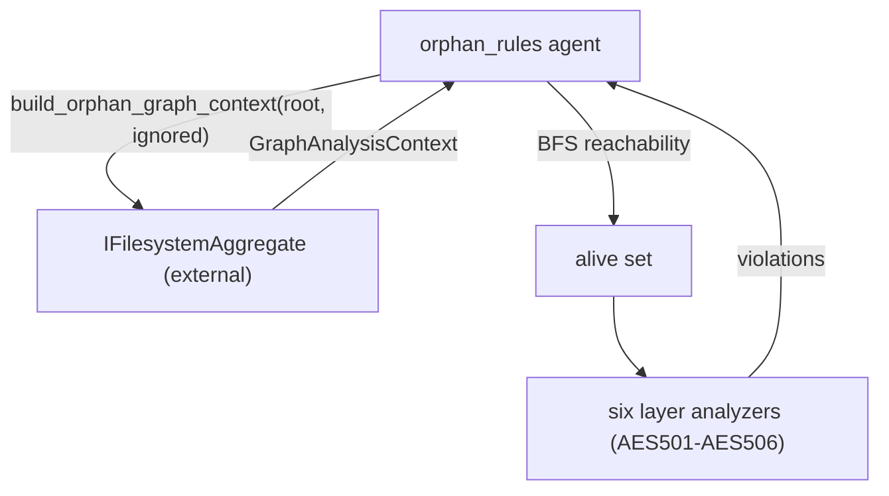

# FRD — Orphan Rules

## Feature Overview

The **Orphan Rules** feature is the orphan stage of the `check` command: it receives a pre-built `GraphAnalysisContext` (import graph, inbound links, inheritance map, file list) from the external `filesystem` aggregate, traces reachability from valid entry points, and classifies files into six layer-specific orphan analyzers.

The `orphan_rules` agent coordinates the stages: it receives pre-built graph data from `IFilesystemAggregate::build_orphan_graph_context(root, ignored)`, performs zero I/O, and returns orphan violations to the caller.

## Functional Requirements

### FR-OrphanRules-001: Build Graph Context, Entry Points, and Reachability

**Description:** This requirement shall build the pre-built graph context, compute entry points, and perform BFS reachability tracing so that downstream layer analyzers (FR-OrphanRules-002..007) can determine which files are alive.

#### Business Logic

- The graph context shall be built from the `GraphAnalysisContext` returned by `IFilesystemAggregate::build_orphan_graph_context(root, ignored)`.
- Entry points shall be computed from container files, main entry points, and surface files that call aggregates.
- BFS reachability shall trace forward from entry points through the import graph.
- The alive set shall be computed before dispatching to any layer analyzer.

#### Edge Cases

- An empty graph shall yield an empty entry-point set and an empty alive set, with no error.
- Unreadable tree nodes shall be skipped without crashing.
- Missing entry points shall yield an empty alive set, causing all files to be classified as orphans downstream.

#### Technical Specification

| Aspect | Detail |
|--------|--------|
| **Input** | `GraphAnalysisContext` (import graph, inbound links, inheritance map, file list) plus an optional entry-point subset. Source: `IFilesystemAggregate::build_orphan_graph_context(root, ignored)`. |
| **Output** | `OrphanResponse::GraphContext` (context) and `OrphanResponse::EntryPoints` (entry points); both feed downstream analyzers. |
| **Protocol** | `IOrphanParserProtocol` |
| **Method** | `build_orphan_graph_context`, `identify_entry_points`, `trace_reachability` |
| **Event** | None — context build is synchronous. |
| **Error** | Unreadable tree nodes are skipped; missing entry points yield an empty alive set (correct behaviour, no error). |

#### Test

| Context | When Action | Then Observable Result |
|---------|-------------|------------------------|
| Seeded graph with entry points | Context is built and reachability traced | The expected alive set is returned |
| Empty graph | Context is built | An empty graph context is returned with zero errors |
| Entry points computed from a partial subset | Reachability traced | Alive set is consistent with the subset |

#### Metric

| Target Metric | Value |
|---------------|-------|
| Empty graph produces zero errors | 100% |
| Alive set matches expected | 100% |

### FR-OrphanRules-002: Taxonomy Orphan Detection (AES501)

**Description:** This requirement shall flag taxonomy-layer files that no other layer imports (AES501 violation).

#### Business Logic

- A taxonomy file shall be considered alive only when it is imported by an agent, capabilities, or surface layer file.
- Imports from other taxonomy files do not count as a rescue; self-import only shall still be classified as an orphan.
- Helper- or utility-suffixed taxonomy files shall be categorised as utility files and checked under utility rules; they shall also be flagged under taxonomy rules.

#### Edge Cases

- A taxonomy file imported by an agent, capabilities, or surface file is not an orphan.
- A taxonomy file imported only by other taxonomy files is an orphan.
- A taxonomy file whose only inbound link is a self-import is an orphan.
- A helper-suffixed taxonomy file is categorised as utility and also checked under taxonomy rules.

#### Technical Specification

| Aspect | Detail |
|--------|--------|
| **Input** | `GraphAnalysisContext`, entry points, and parsed entries. Source: `OrphanRequest::{Check, CheckWithContext, CheckWithEntries}`. |
| **Output** | `OrphanResponse::Violations` with AES501 codes. |
| **Protocol** | `ITaxonomyOrphanProtocol` |
| **Method** | `is_taxonomy_orphan` |
| **Event** | None. |
| **Error** | A missing context triggers a pre-check build rather than a crash; unreadable files are skipped. |

#### Test

| Context | When Action | Then Observable Result |
|---------|-------------|------------------------|
| Taxonomy file imported by a surface layer | Taxonomy orphan check runs | No AES501 violation is emitted |
| Taxonomy file imported only by another taxonomy file | Taxonomy orphan check runs | Exactly one AES501 violation is emitted |
| Taxonomy file with self-import only | Taxonomy orphan check runs | Exactly one AES501 violation is emitted |
| Helper-suffixed taxonomy file | Taxonomy orphan check runs | The file is categorised as utility; an AES501 violation is also emitted |

#### Metric

| Target Metric | Value |
|---------------|-------|
| Seeded taxonomy orphan fires exactly one AES501 finding | 100% |
| Cross-layer-imported taxonomy fixtures fire zero findings | 100% |

### FR-OrphanRules-003: Contract Orphan Detection (AES502)

**Description:** This requirement shall flag contract-layer files whose traits have no alive implementor wired into the application (AES502 violation).

#### Business Logic

- A contract is alive when at least one implementor is reachable from entry points via a DI bridge or direct wiring.
- Matching shall use absolute-path suffix comparison so that same-basename files at different paths stay distinct.
- Multiple traits in one file shall each be evaluated independently; an implementor that is itself unreachable does not rescue the contract.
- A surface file that does not call an aggregate marks that aggregate's contract as an orphan.

#### Edge Cases

- An aggregate not called by any surface file is an orphan.
- An implementor matched by absolute-path suffix is alive even if a same-basename file at a different path is unreachable.
- A file with the same basename but a different path is not considered a match.
- An implementor that is not itself in the alive set remains an orphan.
- A multi-trait file with only one alive implementor keeps only that trait alive.

#### Technical Specification

| Aspect | Detail |
|--------|--------|
| **Input** | `GraphAnalysisContext`, entry points, and parsed entries. Source: `OrphanRequest::{Check, CheckWithContext, CheckWithEntries, Scan}`. |
| **Output** | `OrphanResponse::Violations` with AES502 codes; `ScanOutcome` for full scans. |
| **Protocol** | `IContractOrphanProtocol` |
| **Method** | `is_contract_orphan` |
| **Event** | None. |
| **Error** | An unmatched reference reports an orphan rather than an error; unreadable files are skipped. |

#### Test

| Context | When Action | Then Observable Result |
|---------|-------------|------------------------|
| A contract trait has an implementor reachable from entry points | Contract orphan check runs | No AES502 violation is emitted |
| An implementor is not alive | Contract orphan check runs | Exactly one AES502 violation is emitted |
| A surface file does not call an aggregate | Contract orphan check runs | Exactly one AES502 violation is emitted |
| Same-basename implementor at a different path | Contract orphan check runs | The implementor is not matched; one AES502 violation is emitted |

#### Metric

| Target Metric | Value |
|---------------|-------|
| Wired contract fires zero AES502 findings | 100% |
| Each unwired contract fires exactly one AES502 finding | 100% |

### FR-OrphanRules-004: Capabilities Orphan Detection (AES503)

**Description:** This requirement shall flag capability-layer files that are unreachable from entry points through the DI wiring (AES503 violation).

#### Business Logic

- Reachability shall flow entry point to contract to implementation to capability.
- DI implementation-bridge edges shall extend reachability, wiring implementors to capabilities.
- A broken chain shall detect unreachable capability files.
- One reachable file satisfies the requirement while sibling unwired files remain orphans.
- Python class bases shall register bridges for multiple inheritance; a class without bases registers no bridge.

#### Edge Cases

- A reachable capability file is not an orphan.
- A broken DI chain detects the unreachable capability file.
- An unwired reachable file reports a DI bridge gap in its message.
- Python chained imports shall be reachable.
- Multiple implementations on one contract shall all be examined.

#### Technical Specification

| Aspect | Detail |
|--------|--------|
| **Input** | `GraphAnalysisContext` with implementation-bridge edges. Source: `OrphanRequest::{Check, CheckWithContext, CheckWithEntries}`. |
| **Output** | `OrphanResponse::Violations` with AES503 codes, including violation display messages. |
| **Protocol** | `ICapabilitiesOrphanProtocol` |
| **Method** | `is_capabilities_orphan` |
| **Event** | None. |
| **Error** | A gap in DI wiring is reported as the violation itself (the message mentions the DI bridge gap), not as a tool error. |

#### Test

| Context | When Action | Then Observable Result |
|---------|-------------|------------------------|
| A capability is reachable from entry points | Capabilities orphan check runs | No AES503 violation is emitted |
| A capability is unreachable (broken DI chain) | Capabilities orphan check runs | Exactly one AES503 violation is emitted |
| A reachable file has a DI bridge gap | Capabilities orphan check runs | One AES503 violation with a DI-bridge-gap message is emitted |
| A Python file uses chained imports | Capabilities orphan check runs | The reachable capability is not flagged |

#### Metric

| Target Metric | Value |
|---------------|-------|
| Seeded reachable capability fires zero findings | 100% |
| Each seeded unwired capability fires exactly one AES503 finding | 100% |

### FR-OrphanRules-005: Utility Orphan Detection (AES504)

**Description:** This requirement shall flag utility-layer files that no other alive file references (AES504 violation).

#### Business Logic

- A utility file shall be considered alive when any alive file imports or references it.
- Pure helpers with no importers shall be classified as orphans.
- Files with helper or utility suffixes shall be routed to this requirement for checking.

#### Edge Cases

- A utility file imported by any alive file is not an orphan.
- An unimported utility file is an orphan.
- Self-references do not count as a rescue.
- An empty-content file shall be handled without panic.

#### Technical Specification

| Aspect | Detail |
|--------|--------|
| **Input** | `GraphAnalysisContext` and entry points. Source: `OrphanRequest::{Check, CheckWithContext, CheckWithEntries}`. |
| **Output** | `OrphanResponse::Violations` with AES504 codes. |
| **Protocol** | `IUtilityOrphanProtocol` |
| **Method** | `is_utility_orphan` |
| **Event** | None. |
| **Error** | Missing references produce a violation (the orphan), not a tool error. |

#### Test

| Context | When Action | Then Observable Result |
|---------|-------------|------------------------|
| A utility file is imported by an alive file | Utility orphan check runs | No AES504 violation is emitted |
| A utility file has no importers | Utility orphan check runs | Exactly one AES504 violation is emitted |
| A utility file only self-references | Utility orphan check runs | Exactly one AES504 violation is emitted |
| An empty-content utility file | Utility orphan check runs | No panic; the file is classified as an orphan |

#### Metric

| Target Metric | Value |
|---------------|-------|
| Seeded unimported utility fires exactly one AES504 finding | 100% |
| Referenced utility fires zero findings | 100% |

### FR-OrphanRules-006: Agent Orphan Detection (AES505)

**Description:** This requirement shall flag agent orchestrator files whose aggregate is never used by any surface, container, or main entry point (AES505 violation).

#### Business Logic

- An agent file shall be considered alive when its aggregate trait appears in the alive set via usage by a surface, container, or main file.
- An agent file with no aggregate traits in the alive set is an orphan.
- An agent file with aggregate traits not in the alive set is an orphan.
- An agent file that is reachable but has no aggregate traits shall not be judged harshly: with an empty alive set, no orphan finding is emitted.

#### Edge Cases

- An agent aggregate used by a surface, container, or main file is not an orphan.
- An aggregate trait never in the alive set is an orphan.
- An empty alive set yields no agent orphan findings.
- An empty file is not an orphan.

#### Technical Specification

| Aspect | Detail |
|--------|--------|
| **Input** | `GraphAnalysisContext`, entry points, and the alive aggregate set. Source: `OrphanRequest::{Check, CheckWithContext, CheckWithEntries}`. |
| **Output** | `OrphanResponse::Violations` with AES505 codes. |
| **Protocol** | `IAgentOrphanProtocol` |
| **Method** | `is_agent_orphan` |
| **Event** | None. |
| **Error** | An unreachable aggregate registers as an orphan rather than a tool failure. |

#### Test

| Context | When Action | Then Observable Result |
|---------|-------------|------------------------|
| An agent aggregate is used by a surface file | Agent orphan check runs | No AES505 violation is emitted |
| An agent has aggregate traits not in the alive set | Agent orphan check runs | Exactly one AES505 violation is emitted |
| An agent has no aggregate traits in the alive set | Agent orphan check runs | No AES505 violation is emitted (empty-alive-set rule) |
| An empty agent file | Agent orphan check runs | No AES505 violation is emitted |

#### Metric

| Target Metric | Value |
|---------------|-------|
| Seeded used agent fires zero findings | 100% |
| Seeded unused agent fires exactly one AES505 finding | 100% |

### FR-OrphanRules-007: Surface Orphan Detection (AES506)

**Description:** This requirement shall flag surface files (render trees) that never get invoked from any entry point (AES506 violation).

#### Business Logic

- A surface file shall be considered alive when it is invoked from an entry-point flow, such as container or main wiring.
- An uninvoked render tree is an orphan.
- Classification shall be deterministic: unchanged inputs produce the same classification.

#### Edge Cases

- A surface file used from container or main wiring is not an orphan.
- An unused surface file is an orphan.
- Parsing a surface tree with no entries yields no finding.
- A parse error in a surface file skips the entry without crashing.

#### Technical Specification

| Aspect | Detail |
|--------|--------|
| **Input** | `GraphAnalysisContext` and registration data. Source: `OrphanRequest::{Check, CheckWithContext, CheckWithEntries}`. |
| **Output** | `OrphanResponse::Violations` with AES506 codes. |
| **Protocol** | `ISurfacesOrphanProtocol` |
| **Method** | `is_surface_orphan` |
| **Event** | None. |
| **Error** | A missing registration entry maps to an orphan finding; parse errors skip the entry. |

#### Test

| Context | When Action | Then Observable Result |
|---------|-------------|------------------------|
| A surface file is wired from container/main | Surface orphan check runs | No AES506 violation is emitted |
| A surface file is not invoked from any entry point | Surface orphan check runs | Exactly one AES506 violation is emitted |
| A surface tree has no parseable entries | Surface orphan check runs | No AES506 violation is emitted |
| Two surface files with unchanged inputs | Surface orphan check runs | Classification is deterministic |

#### Metric

| Target Metric | Value |
|---------------|-------|
| Seeded wired surface fires zero findings | 100% |
| Seeded unwired surface fires exactly one AES506 finding | 100% |

## Public Interface

| Aspect | Detail |
|--------|--------|
| Agent | `ArchOrphanAnalyzer` |
| Aggregate | `IOrphanAggregate` |
| Method | `execute` |
| Request | `OrphanRequest::{BuildGraphContext, IdentifyEntryPoints, Check, CheckWithContext, CheckWithEntries, Scan}` |
| Response | `OrphanResponse::{GraphContext, EntryPoints, Violations, ScanOutcome}` |

## Reference

| Artifact | Purpose | Link |
|----------|---------|------|
| PRD | Business goals, user stories, and scope | [PRD.md](../../PRD.md) |
| Backlog | Task tracking, epics, and implementation status | [BACKLOG.md](./BACKLOG.md) |
| Roadmap | Timeline, phasing, and dependencies | [ROADMAP.md](../../ROADMAP.md) |
| Architecture | System boundaries, tech stack, and infra | [ARCHITECTURE.md](../../ARCHITECTURE.md) |
