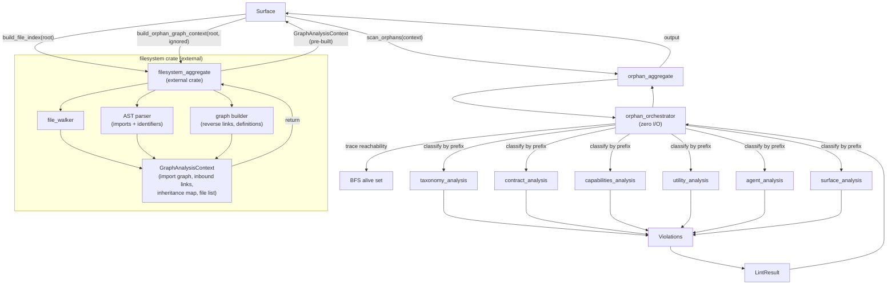

# FRD — orphan-rules (v2.0.0)

## Feature Overview

The orphan-rules crate identifies dead, unused, or unreachable code components across the 7-layer AES architecture. It receives a pre-built `GraphAnalysisContext` from the external `filesystem` crate and performs layer-specific orphan analysis starting from valid entry points (containers, binary entries, main files).

Graph construction is delegated to the external `filesystem` aggregate via `build_orphan_graph_context(root, ignored)`, which discovers workspace files, parses each file via tree-sitter AST, resolves imports to file edges, and returns a `GraphAnalysisContext`. The orphan-rules crate receives pre-built graph data and performs zero I/O — it only performs business logic analysis on pre-fetched data.

The orchestrator internally performs BFS reachability tracing over the import graph to determine which files are "alive" (reachable from entry points), then dispatches to 6 layer-specific orphan analyzers (AES501–AES506).

- **Architecture & Data Flow**

## Functional Requirements

### FR-OrphanRules-001: Graph Context, Entry Points, and Reachability

| Aspect | Detail|
|--------|-------|
| Description | |
| Business Rules | |
| Edge Cases | |
| Capability | |
| Protocol | |
| Method | |
| Input | |
| Output | |
| Error | |
| Event | |
| Test | |
| Metric | |

### FR-OrphanRules-002: Taxonomy Orphan Detection (AES501)

| Aspect | Detail|
|--------|-------|
| Description | |
| Business Rules | |
| Edge Cases | |
| Capability | |
| Protocol | |
| Method | |
| Input | |
| Output | |
| Error | |
| Event | |
| Test | |
| Metric | |

### FR-OrphanRules-003: Contract Orphan Detection (AES502)

| Aspect | Detail|
|--------|-------|
| Description | |
| Business Rules | |
| Edge Cases | |
| Capability | |
| Protocol | |
| Method | |
| Input | |
| Output | |
| Error | |
| Event | |
| Test | |
| Metric | |

### FR-OrphanRules-004: Capabilities Orphan Detection (AES503)

| Aspect | Detail|
|--------|-------|
| Description | |
| Business Rules | |
| Edge Cases | |
| Capability | |
| Protocol | |
| Method | |
| Input | |
| Output | |
| Error | |
| Event | |
| Test | |
| Metric | |

### FR-OrphanRules-005: Utility Orphan Detection (AES504)

| Aspect | Detail|
|--------|-------|
| Description | |
| Business Rules | |
| Edge Cases | |
| Capability | |
| Protocol | |
| Method | |
| Input | |
| Output | |
| Error | |
| Event | |
| Test | |
| Metric | |

### FR-OrphanRules-006: Agent Orphan Detection (AES505)

| Aspect | Detail|
|--------|-------|
| Description | |
| Business Rules | |
| Edge Cases | |
| Capability | |
| Protocol | |
| Method | |
| Input | |
| Output | |
| Error | |
| Event | |
| Test | |
| Metric | |

### FR-OrphanRules-007: Surface Orphan Detection (AES506)

| Aspect | Detail|
|--------|-------|
| Description | |
| Business Rules | |
| Edge Cases | |
| Capability | |
| Protocol | |
| Method | |
| Input | |
| Output | |
| Error | |
| Event | |
| Test | |
| Metric | |

## Public Interface

| Aspect | Detail|
|--------|-------|
| — | — |

## Reference

| Artifact | Purpose | Link|
|----------|---------|------|
| BACKLOG.md | Backlog tracking | [BACKLOG.md](BACKLOG.md)|
| PRD.md | Product requirements | [PRD.md](../../PRD.md)|
| FRD.md | Feature requirements | [FRD.md](FRD.md)|
| ROADMAP.md | Roadmap status | [ROADMAP.md](../../ROADMAP.md)|
| ARCHITECTURE.md | Layer contract | [ARCHITECTURE.md](../../ARCHITECTURE.md)|
