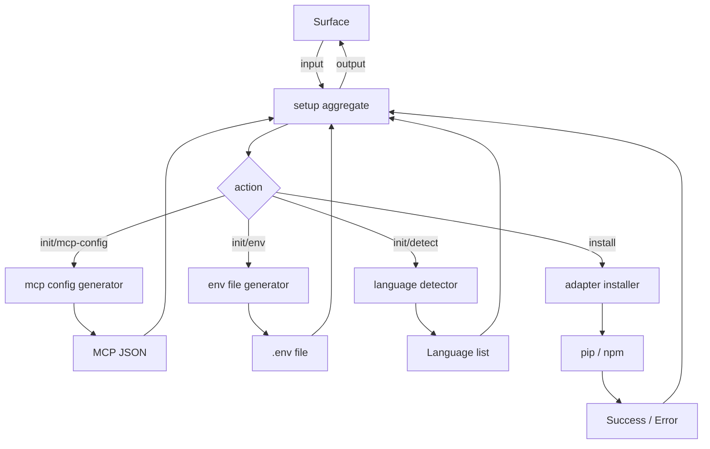

# FRD — project-setup

---

## Feature Overview

---

## Functional Requirements

### FR-ProjectSetup-001: MCP Configuration Generation

| Aspect | Detail|
|--------|-------|
| Description | Generate MCP client configuration files for supported editors and agents. |
| Business Rules | One request variant per target (Claude, Cursor, Windsurf, Copilot, Hermes, VSCode) plus McpConfigAll; each output wraps servers in the right key (mcp_servers vs mcpServers per client conventions); generated config parses as valid JSON/TOML for the target; Claude/Copilot/Cursor/VSCode/Windsurf wrappers asserted by fr001 tests. |
| Edge Cases | McpConfigAll generates every target in one call; an unknown target does not silently pick a default; generated servers block omits empty command lists; header/comment lines preserved where the target format allows comments. |
| Capability | SetupMcpConfigGenerator builds per-client MCP configuration. |
| Protocol | IMcpConfigGenerationProtocol. |
| Method | generate_mcp_config and the per-target constructors mcp_config_claude, mcp_config_cursor, mcp_config_windsurf, mcp_config_copilot, mcp_config_hermes, mcp_config_vscode, mcp_config_all, plus which_mcp_binary |
| Input | Target client identifier; source is SetupRequest::{GenerateMcpConfig, McpConfigClaude, McpConfigCursor, McpConfigWindsurf, McpConfigCopilot, McpConfigHermes, McpConfigVscode, McpConfigAll}. |
| Output | SetupResponse::Mcp with per-target config content ready to write. |
| Error | Unknown target returns an error description rather than writing a wrong-shaped file. |
| Event | None. |
| Test | fr001_claude_config_wraps_in_mcp_servers, fr001_cursor_config_wraps_in_mcp_servers, fr001_vscode_config_wraps_in_mcp_servers, e2e_generate_mcp_config_claude_and_write, and e2e_generate_mcp_config_vscode_and_write assert wrapping and round trip. |
| Metric | All seven target variants produce parseable wrapper output; McpConfigAll yields seven files' worth of content in one response. |

### FR-ProjectSetup-002: Environment File Generation

| Aspect | Detail|
|--------|-------|
| Description | Generate the project environment file with a documented header and required roots. |
| Business Rules | Generated env contains a header comment explaining the file and a phantom-root entry (HOME-style variable) for hermetic runs; env generation is deterministic; output round-trips through write (e2e_generate_and_write_env). |
| Edge Cases | Existing env is not clobbered silently (WriteConfigFile governs overwrite); generated content identical on repeat calls; empty project path still produces a well-formed env body. |
| Capability | SetupEnvGenerator renders the environment file content. |
| Protocol | IEnvGenerationProtocol. |
| Method | generate_env(&self, home: &DirectoryPath) -> EnvContentVO |
| Input | Project path/context; source is SetupRequest::GenerateEnv. |
| Output | SetupResponse::Env with content for .env-style file. |
| Error | Generation itself never fails; write failures fall to FR-ProjectSetup-006. |
| Event | None. |
| Test | fr002_env_contains_header, fr002_env_contains_phantom_root, and e2e_generate_and_write_env assert content and round trip. |
| Metric | Generated env contains header and root lines on every run; e2e write matches the generated bytes. |

### FR-ProjectSetup-003: Language Detection

| Aspect | Detail|
|--------|-------|
| Description | Detect the project's primary and all present programming languages. |
| Business Rules | detect_language returns the primary language (or None); detect_languages returns every present language group; detection scans project layout (manifests, source extensions); result feeds template selection in FR-ProjectSetup-005. |
| Edge Cases | Unknown/empty project returns none; manifests of several languages present returns all in detect_languages while primary is deterministic; unreadable tree yields empty; fr003 asserts valid-language-or-none. |
| Capability | SetupLanguageDetector detects project languages. |
| Protocol | ILanguageDetectionProtocol. |
| Method | detect_language returning the primary language or none; detect_languages returning every present language group |
| Input | Project root path; source is SetupRequest::{DetectLanguage, DetectLanguages}. |
| Output | SetupResponse::{Language, Languages}. |
| Error | No signal yields None/empty rather than an error. |
| Event | None. |
| Test | fr003_detect_language_returns_valid_language_or_none, fr003_detect_languages_returns_list, detect_language_returns_non_empty, e2e_detect_language_and_write_config assert detection. |
| Metric | Seeded fixtures of each language report that language; mixed fixture reports all present groups. |

### FR-ProjectSetup-004: Adapter Installation

| Aspect | Detail|
|--------|-------|
| Description | Install linter adapters for the detected languages via npm or pip. |
| Business Rules | InstallPythonAdapters runs pip install of the Python adapter set; InstallJavascriptAdapters runs npm install of the JS adapter set; empty package list returns Ok without invoking a package manager; sudo variants prepend privilege escalation; installers are idempotent. |
| Edge Cases | Empty list returns Ok with no subprocess; failed package manager exit reported as failure; already-installed packages reinstall cleanly; sudo variants behave like plain variants otherwise. |
| Capability | SetupInstallerAdapter shells out to pip/npm install. |
| Protocol | IAdapterInstallationProtocol. |
| Method | install_python_packages(list), install_npm_packages(list) with optional sudo, returning install status. |
| Input | Package list plus sudo flag; source is SetupRequest::{InstallPythonAdapters, InstallJavascriptAdapters}. |
| Output | SetupResponse::Installed with per-run status. |
| Error | Non-zero package-manager exit returns failure status with captured output; caller sees failed install, not a panic. |
| Event | None. |
| Test | install_python_packages_empty_returns_ok, install_python_packages_empty_with_sudo, install_npm_packages_empty_returns_ok, and install_npm_packages_empty_with_sudo assert empty-list and sudo behavior. |
| Metric | Empty-list invocations never spawn a package manager; seeded install runs return truthful status matching the process exit. |

### FR-ProjectSetup-005: Config Template Loading

| Aspect | Detail|
|--------|-------|
| Description | Load the embedded config template for a target file or project type. |
| Business Rules | GetConfigTemplate returns the embedded template for the requested key; templates are bundled (get embedded skills listed as GetEmbeddedSkills); template content is byte-stable across runs; container exposes aggregate_get_config_template. |
| Edge Cases | Unknown template key returns not-found description; empty key returns not-found; template exists but project is non-empty still returns template (write policy decides merge). |
| Capability | The setup aggregate routes GetConfigTemplate and GetEmbeddedSkills to the shared project-setup utility helpers; no separate capability struct serves them. |
| Protocol | IConfigTemplateProtocol. |
| Method | get_config_template(&self, language: &str) -> Result<&'static str, SetupError> |
| Input | Template key; source is SetupRequest::{GetConfigTemplate, GetEmbeddedSkills}. |
| Output | SetupResponse::{Template, Skills}. |
| Error | Unknown key yields a not-found-style description instead of empty filler. |
| Event | None. |
| Test | aggregate_get_config_template asserts template retrieval through the aggregate. |
| Metric | Known keys return non-empty byte-stable templates; unknown keys report not found. |

### FR-ProjectSetup-006: Config File Writing

| Aspect | Detail|
|--------|-------|
| Description | Write configuration files to disk from generated or templated content. |
| Business Rules | WriteConfigFile writes content to the target path creating parent dirs as needed; CreateGlobalConfigDir ensures the user-level config directory exists; write is atomic enough to avoid partial files on normal error paths; existing files overwritten only when the request implies it. |
| Edge Cases | Missing parent directories created; read-only target fails with error description; same content written twice leaves file byte-identical; CreateGlobalConfigDir on existing dir is a no-op success. |
| Capability | Config writing flows through the setup aggregate to the shared project-setup utility helpers (write_config_file, create_global_config_dir); no separate capability struct serves them. |
| Protocol | IConfigWritingProtocol. |
| Method | write_config_file(&self, filename, content) -> WriteConfigResult and create_global_config_dir(&self) -> CreateConfigDirResult |
| Input | Target path plus content; source is SetupRequest::{WriteConfigFile, CreateGlobalConfigDir}. |
| Output | SetupResponse::{ConfigWritten, ConfigDir}. |
| Error | Permission or path errors return failure description; no partial file left behind. |
| Event | None. |
| Test | e2e_detect_language_and_write_config, e2e_generate_and_write_env, and e2e_generate_mcp_config_claude_and_write exercise write round trips. |
| Metric | Written files parse as their intended format; e2e round trips assert written bytes match generated content. |

### FR-ProjectSetup-007: Pre-flight Check

| Aspect | Detail|
|--------|-------|
| Description | Run pre-project setup checks before any generation or installation proceeds. |
| Business Rules | PreFlightCheck verifies prerequisites (working directory usable, required tools discovered, no blocking conflicts) and returns a pass/fail report with reasons; the caller decides whether to consult it — generation flows never run it automatically. |
| Edge Cases | Missing prerequisite reports failing item without performing generation; clean environment passes; the CheckHttp variant performs no network probe and answers with a fixed success status; partial failures list each failed item. |
| Capability | Pre-flight gate served by the setup aggregate's helpers. |
| Protocol | IPreFlightProtocol. |
| Method | pre_flight_check(&self) -> PreFlightResult; the CheckHttp request variant answers with a fixed success status without probing |
| Input | Project path and optional HTTP target; source is SetupRequest::{PreFlightCheck, CheckHttp}. |
| Output | SetupResponse::{PreFlight, CheckHttp} with per-item status. |
| Error | Failing check returns failure report (not an exception); caller decides whether to proceed. |
| Event | None. |
| Test | fr005_pre_flight_check asserts pre-flight reporting on seeded pass and fail scenarios. |
| Metric | Passing environment yields all-green report; seeded missing-tool environment yields a failing report naming the missing item. |

### FR-ProjectSetup-008: File Existence Probe

| Aspect | Detail|
|--------|-------|
| Description | Probe whether a config file already exists before writing. |
| Business Rules | FileExists returns a boolean existence check for the given path; callers use it to avoid clobbering user files; e2e file-exists round trip asserts create-then-detect. |
| Edge Cases | Non-existent path returns Exists=false without error; existing file returns Exists=true; path inside unreadable parent returns false rather than panicking; round trip after create returns true. |
| Capability | File path existence probe. |
| Protocol | IFilePathExistenceProtocol. |
| Method | file_exists(path) -> bool. |
| Input | File path; source is SetupRequest::FileExists. |
| Output | SetupResponse::Exists. |
| Error | Unreadable parents resolve to false, not an error. |
| Event | None. |
| Test | e2e_file_exists_round_trip asserts create-then-exists detection. |
| Metric | Existence probe agrees with on-disk state on every seeded fixture path. |

## Public Interface

| Aspect | Detail|
|--------|-------|
| Agent | SetupManagementOrchestrator — the agent-layer orchestrator behind the init/setup surface command. |
| Aggregate | ISetupAggregate — the feature's single front door. |
| Method | execute(&self, request: SetupRequest) -> SetupResponse |
| Request | SetupRequest::{CheckHttp, GenerateEnv, GenerateMcpConfig, McpConfigClaude, McpConfigCursor, McpConfigWindsurf, McpConfigCopilot, McpConfigHermes, McpConfigVscode, McpConfigAll, InstallPythonAdapters, InstallJavascriptAdapters, DetectLanguage, DetectLanguages, GetConfigTemplate, PreFlightCheck, GetEmbeddedSkills, WriteConfigFile, CreateGlobalConfigDir, FileExists} |
| Response | SetupResponse::{CheckHttp, Env, Mcp, Installed, Language, Languages, Template, PreFlight, Skills, ConfigWritten, ConfigDir, Exists} |

## Reference

| Artifact | Purpose | Link |
|----------|---------|------|
| PRD | Business goals, user stories, and scope | [PRD.md](../../PRD.md) |
| Backlog | Task tracking, epics, and implementation status | [BACKLOG.md](BACKLOG.md) |
| Roadmap | Timeline, phasing, and dependencies | [ROADMAP.md](../../ROADMAP.md) |
| Architecture | System boundaries, tech stack, and infra | [ARCHITECTURE.md](../../ARCHITECTURE.md) |
