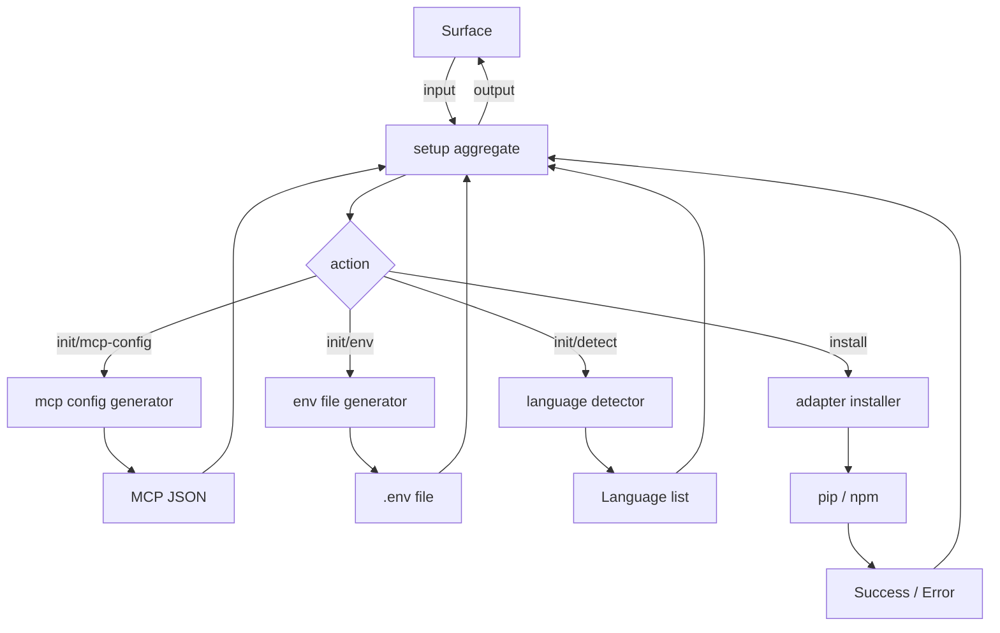

# FRD — project-setup (v3.0.0)

---

## Feature Overview

The project-setup crate provides scaffolding facilities and adapter installation
for new and existing projects. It detects project languages (Rust, Python,
JavaScript/TypeScript), generates MCP configuration for different AI clients,
generates `.env` files, installs linter adapters via pip/npm, and manages XDG
config directories.

The crate follows the AES 7-layer architecture. Four capability seams provide
MCP config generation, environment file creation, language detection, and adapter
installation. Auxiliary technical operations are delegated through the aggregate
contract and the injected utility protocols.

> **Note**: Environment diagnostics (`doctor`, `diagnose`) are handled by the
> **maintenance** crate, not project-setup. This crate focuses on scaffolding
> and installation only.

- **Architecture & Data Flow**

---

## Functional Requirements

### FR-ProjectSetup-001: MCP Configuration Generation

#### Description

| No | Detail |
| --- | --- |
| 1 | Generate MCP client configuration files for supported editors and agents. |
| 2 | — |
| ∞ | — |

#### Business Rules

| No | Detail |
| --- | --- |
| 1 | One request variant per target (Claude, Claude, Cursor, Windsurf, Copilot, Hermes, VSCode) plus McpConfigAll; each output wraps servers in the right key (mcp_servers vs mcpServers per client conventions). |
| 2 | Generated config parses as valid JSON/TOML for the target; Claude/Copilot/Cursor/VSCode/Windsurf wrappers asserted by fr001 tests. |
| ∞ | — |

#### Edge Cases

| No | Detail |
| --- | --- |
| 1 | McpConfigAll generates every target in one call; an unknown target does not silently pick a default; generated servers block omits empty command lists. |
| 2 | Header/comment lines preserved where the target format allows comments. |
| ∞ | — |

#### Capability

| No | Detail |
| --- | --- |
| 1 | SetupMcpConfigGenerator builds per-client MCP configuration. |

#### Protocol

| No | Detail |
| --- | --- |
| 1 | IMcpConfigGenerationProtocol |

#### Method

| No | Detail |
| --- | --- |
| 1 | Generate MCP config for a named target returning the config content. |
| 2 | — |
| ∞ | — |

#### Input

| No | Detail |
| --- | --- |
| 1 | Target client identifier; source is SetupRequest::{GenerateMcpConfig, McpConfigClaude, McpConfigCursor, McpConfigWindsurf, McpConfigCopilot, McpConfigHermes, McpConfigVscode, McpConfigAll}. |
| 2 | — |

#### Output

| No | Detail |
| --- | --- |
| 1 | SetupResponse::Mcp with per-target config content ready to write. |
| 2 | — |
| ∞ | — |

#### Error

| No | Detail |
| --- | --- |
| 1 | Unknown target returns an error description rather than writing a wrong-shaped file. |
| 2 | — |

#### Event

| No | Detail |
| --- | --- |
| 1 | None. |
| 2 | — |
| ∞ | — |

#### Test

| No | Detail |
| --- | --- |
| 1 | fr001_claude_config_wraps_in_mcp_servers, fr001_cursor_config_wraps_in_mcp_servers, fr001_vscode_config_wraps_in_mcp_servers, e2e_generate_mcp_config_claude_and_write, and e2e_generate_mcp_config_vscode_and_write assert wrapping and round trip. |
| 2 | — |
| ∞ | — |

#### Metric

| No | Detail |
| --- | --- |
| 1 | All seven target variants produce parseable wrapper output; McpConfigAll yields seven files' worth of content in one response. |
| 2 | — |
| ∞ | — |

### FR-ProjectSetup-002: Environment File Generation

#### Description

| No | Detail |
| --- | --- |
| 1 | Generate the project environment file with a documented header and required roots. |
| 2 | — |
| ∞ | — |

#### Business Rules

| No | Detail |
| --- | --- |
| 1 | Generated env contains a header comment explaining the file and a phantom-root entry (HOME-style variable) for hermetic runs; env generation is deterministic. |
| 2 | Output round-trips through write (e2e_generate_and_write_env). |
| ∞ | — |

#### Edge Cases

| No | Detail |
| --- | --- |
| 1 | Existing env is not clobbered silently (WriteConfigFile governs overwrite); generated content identical on repeat calls; empty project path still produces a well-formed env body. |
| 2 | — |
| ∞ | — |

#### Capability

| No | Detail |
| --- | --- |
| 1 | SetupEnvGenerator renders the environment file content. |

#### Protocol

| No | Detail |
| --- | --- |
| 1 | IEnvGenerationProtocol |

#### Method

| No | Detail |
| --- | --- |
| 1 | `generate_env()` -> env file content. |
| 2 | — |
| ∞ | — |

#### Input

| No | Detail |
| --- | --- |
| 1 | Project path/context; source is SetupRequest::GenerateEnv. |
| 2 | — |

#### Output

| No | Detail |
| --- | --- |
| 1 | SetupResponse::Env with content for .env-style file. |
| 2 | — |
| ∞ | — |

#### Error

| No | Detail |
| --- | --- |
| 1 | Generation itself never fails; write failures fall to FR-ProjectSetup-006. |
| 2 | — |

#### Event

| No | Detail |
| --- | --- |
| 1 | None. |
| 2 | — |
| ∞ | — |

#### Test

| No | Detail |
| --- | --- |
| 1 | fr002_env_contains_header, fr002_env_contains_phantom_root, and e2e_generate_and_write_env assert content and round trip. |
| 2 | — |
| ∞ | — |

#### Metric

| No | Detail |
| --- | --- |
| 1 | Generated env contains header and root lines on every run; e2e write matches the generated bytes. |
| 2 | — |
| ∞ | — |

### FR-ProjectSetup-003: Language Detection

#### Description

| No | Detail |
| --- | --- |
| 1 | Detect the project's primary and all present programming languages. |
| 2 | — |
| ∞ | — |

#### Business Rules

| No | Detail |
| --- | --- |
| 1 | detect_language returns the primary language (or None); detect_languages returns every present language group. |
| 2 | Detection scans project layout (manifests, source extensions); result feeds template selection in FR-ProjectSetup-005. |
| ∞ | — |

#### Edge Cases

| No | Detail |
| --- | --- |
| 1 | Unknown/empty project returns none; manifests of several languages present returns all in detect_languages while primary is deterministic; unreadable tree yields empty; fr003 asserts valid-language-or-none. |
| 2 | — |
| ∞ | — |

#### Capability

| No | Detail |
| --- | --- |
| 1 | SetupLanguageDetector detects project languages. |

#### Protocol

| No | Detail |
| --- | --- |
| 1 | ILanguageDetectionProtocol |

#### Method

| No | Detail |
| --- | --- |
| 1 | `detect_language()` -> Language or none; `detect_languages()` -> list. |
| 2 | — |
| ∞ | — |

#### Input

| No | Detail |
| --- | --- |
| 1 | Project root path; source is SetupRequest::{DetectLanguage, DetectLanguages}. |
| 2 | — |

#### Output

| No | Detail |
| --- | --- |
| 1 | SetupResponse::{Language, Languages}. |
| 2 | — |
| ∞ | — |

#### Error

| No | Detail |
| --- | --- |
| 1 | No signal yields None/empty rather than an error. |
| 2 | — |

#### Event

| No | Detail |
| --- | --- |
| 1 | None. |
| 2 | — |
| ∞ | — |

#### Test

| No | Detail |
| --- | --- |
| 1 | fr003_detect_language_returns_valid_language_or_none, fr003_detect_languages_returns_list, detect_language_returns_non_empty, e2e_detect_language_and_write_config assert detection. |
| 2 | — |
| ∞ | — |

#### Metric

| No | Detail |
| --- | --- |
| 1 | Seeded fixtures of each language report that language; mixed fixture reports all present groups. |
| 2 | — |
| ∞ | — |

### FR-ProjectSetup-004: Adapter Installation

#### Description

| No | Detail |
| --- | --- |
| 1 | Install linter adapters for the detected languages via npm or pip. |
| 2 | — |
| ∞ | — |

#### Business Rules

| No | Detail |
| --- | --- |
| 1 | InstallPythonAdapters runs pip install of the Python adapter set; InstallJavascriptAdapters runs npm install of the JS adapter set; empty package list returns Ok without invoking a package manager. |
| 2 | Sudo variants prepend privilege escalation; installers are idempotent. |
| ∞ | — |

#### Edge Cases

| No | Detail |
| --- | --- |
| 1 | Empty list returns Ok with no subprocess; failed package manager exit reported as failure; already-installed packages reinstall cleanly; sudo variants behave like plain variants otherwise. |
| 2 | — |
| ∞ | — |

#### Capability

| No | Detail |
| --- | --- |
| 1 | SetupInstallerAdapter shells out to pip/npm install. |

#### Protocol

| No | Detail |
| --- | --- |
| 1 | IAdapterInstallationProtocol |

#### Method

| No | Detail |
| --- | --- |
| 1 | `install_python_packages(list)`, `install_npm_packages(list)` with optional sudo, returning install status. |
| 2 | — |
| ∞ | — |

#### Input

| No | Detail |
| --- | --- |
| 1 | Package list plus sudo flag; source is SetupRequest::{InstallPythonAdapters, InstallJavascriptAdapters}. |
| 2 | — |

#### Output

| No | Detail |
| --- | --- |
| 1 | SetupResponse::Installed with per-run status. |
| 2 | — |
| ∞ | — |

#### Error

| No | Detail |
| --- | --- |
| 1 | Non-zero package-manager exit returns failure status with captured output; caller sees failed install, not a panic. |
| 2 | — |

#### Event

| No | Detail |
| --- | --- |
| 1 | None. |
| 2 | — |
| ∞ | — |

#### Test

| No | Detail |
| --- | --- |
| 1 | install_python_packages_empty_returns_ok, install_python_packages_empty_with_sudo, install_npm_packages_empty_returns_ok, and install_npm_packages_empty_with_sudo assert empty-list and sudo behavior. |
| 2 | — |
| ∞ | — |

#### Metric

| No | Detail |
| --- | --- |
| 1 | Empty-list invocations never spawn a package manager; seeded install runs return truthful status matching the process exit. |
| 2 | — |
| ∞ | — |

### FR-ProjectSetup-005: Config Template Loading

#### Description

| No | Detail |
| --- | --- |
| 1 | Load the embedded config template for a target file or project type. |
| 2 | — |
| ∞ | — |

#### Business Rules

| No | Detail |
| --- | --- |
| 1 | GetConfigTemplate returns the embedded template for the requested key; templates are bundled (get embedded skills listed as GetEmbeddedSkills); template content is byte-stable across runs. |
| 2 | Container exposes aggregate_get_config_template. |
| ∞ | — |

#### Edge Cases

| No | Detail |
| --- | --- |
| 1 | Unknown template key returns not-found description; empty key returns not-found; template exists but project is non-empty still returns template (write policy decides merge). |
| 2 | — |
| ∞ | — |

#### Capability

| No | Detail |
| --- | --- |
| 1 | Config template loading via the setup aggregate's template protocol. |

#### Protocol

| No | Detail |
| --- | --- |
| 1 | IConfigTemplateProtocol |

#### Method

| No | Detail |
| --- | --- |
| 1 | `get_config_template(key)` -> template content. |
| 2 | — |
| ∞ | — |

#### Input

| No | Detail |
| --- | --- |
| 1 | Template key; source is SetupRequest::{GetConfigTemplate, GetEmbeddedSkills}. |
| 2 | — |

#### Output

| No | Detail |
| --- | --- |
| 1 | SetupResponse::{Template, Skills}. |
| 2 | — |
| ∞ | — |

#### Error

| No | Detail |
| --- | --- |
| 1 | Unknown key yields a not-found-style description instead of empty filler. |
| 2 | — |

#### Event

| No | Detail |
| --- | --- |
| 1 | None. |
| 2 | — |
| ∞ | — |

#### Test

| No | Detail |
| --- | --- |
| 1 | aggregate_get_config_template asserts template retrieval through the aggregate. |
| 2 | — |
| ∞ | — |

#### Metric

| No | Detail |
| --- | --- |
| 1 | Known keys return non-empty byte-stable templates; unknown keys report not found. |
| 2 | — |
| ∞ | — |

### FR-ProjectSetup-006: Config File Writing

#### Description

| No | Detail |
| --- | --- |
| 1 | Write configuration files to disk from generated or templated content. |
| 2 | — |
| ∞ | — |

#### Business Rules

| No | Detail |
| --- | --- |
| 1 | WriteConfigFile writes content to the target path creating parent dirs as needed; CreateGlobalConfigDir ensures the user-level config directory exists. |
| 2 | Write is atomic enough to avoid partial files on normal error paths; existing files overwritten only when the request implies it. |
| ∞ | — |

#### Edge Cases

| No | Detail |
| --- | --- |
| 1 | Missing parent directories created; read-only target fails with error description; same content written twice leaves file byte-identical. |
| 2 | CreateGlobalConfigDir on existing dir is a no-op success. |
| ∞ | — |

#### Capability

| No | Detail |
| --- | --- |
| 1 | Config writing through the setup aggregate. |

#### Protocol

| No | Detail |
| --- | --- |
| 1 | IConfigWritingProtocol |

#### Method

| No | Detail |
| --- | --- |
| 1 | `write_config(path, content)` and `create_global_config_dir()`. |
| 2 | — |
| ∞ | — |

#### Input

| No | Detail |
| --- | --- |
| 1 | Target path plus content; source is SetupRequest::{WriteConfigFile, CreateGlobalConfigDir}. |
| 2 | — |

#### Output

| No | Detail |
| --- | --- |
| 1 | SetupResponse::{ConfigWritten, ConfigDir}. |
| 2 | — |
| ∞ | — |

#### Error

| No | Detail |
| --- | --- |
| 1 | Permission or path errors return failure description; no partial file left behind. |
| 2 | — |

#### Event

| No | Detail |
| --- | --- |
| 1 | None. |
| 2 | — |
| ∞ | — |

#### Test

| No | Detail |
| --- | --- |
| 1 | e2e_detect_language_and_write_config, e2e_generate_and_write_env, and e2e_generate_mcp_config_claude_and_write exercise write round trips. |
| 2 | — |
| ∞ | — |

#### Metric

| No | Detail |
| --- | --- |
| 1 | Written files parse as their intended format; e2e round trips assert written bytes match generated content. |
| 2 | — |
| ∞ | — |

### FR-ProjectSetup-007: Pre-flight Check

#### Description

| No | Detail |
| --- | --- |
| 1 | Run pre-project setup checks before any generation or installation proceeds. |
| 2 | — |
| ∞ | — |

#### Business Rules

| No | Detail |
| --- | --- |
| 1 | PreFlightCheck verifies prerequisites (working directory usable, required tools discovered, no blocking conflicts) and returns a pass/fail report with reasons; generation flows consult it first. |
| 2 | Missing prerequisite reports failing item without performing generation; clean environment passes. |
| ∞ | — |

#### Edge Cases

| No | Detail |
| --- | --- |
| 1 | CheckHttp variant probes a URL and reports reachability; partial failures list each failed item. |
| 2 | — |
| ∞ | — |

#### Capability

| No | Detail |
| --- | --- |
| 1 | Pre-flight gate inside the setup aggregate. |

#### Protocol

| No | Detail |
| --- | --- |
| 1 | IPreFlightProtocol |

#### Method

| No | Detail |
| --- | --- |
| 1 | `pre_flight_check()` -> pass/fail report; `check_http` for reachability probes. |
| 2 | — |
| ∞ | — |

#### Input

| No | Detail |
| --- | --- |
| 1 | Project path and optional HTTP target; source is SetupRequest::{PreFlightCheck, CheckHttp}. |
| 2 | — |

#### Output

| No | Detail |
| --- | --- |
| 1 | SetupResponse::{PreFlight, CheckHttp} with per-item status. |
| 2 | — |
| ∞ | — |

#### Error

| No | Detail |
| --- | --- |
| 1 | Failing check returns failure report (not an exception); caller decides whether to proceed. |
| 2 | — |

#### Event

| No | Detail |
| --- | --- |
| 1 | None. |
| 2 | — |
| ∞ | — |

#### Test

| No | Detail |
| --- | --- |
| 1 | fr005_pre_flight_check asserts pre-flight reporting on seeded pass and fail scenarios. |
| 2 | — |
| ∞ | — |

#### Metric

| No | Detail |
| --- | --- |
| 1 | Passing environment yields all-green report; seeded missing-tool environment yields a failing report naming the missing item. |
| 2 | — |
| ∞ | — |

### FR-ProjectSetup-008: File Existence Probe

#### Description

| No | Detail |
| --- | --- |
| 1 | Probe whether a config file already exists before writing. |
| 2 | — |
| ∞ | — |

#### Business Rules

| No | Detail |
| --- | --- |
| 1 | FileExists returns a boolean existence check for the given path; callers use it to avoid clobbering user files. |
| 2 | e2e file-exists round trip asserts create-then-detect. |
| ∞ | — |

#### Edge Cases

| No | Detail |
| --- | --- |
| 1 | Non-existent path returns Exists=false without error; existing file returns Exists=true; path inside unreadable parent returns false rather than panicking. |
| 2 | Round trip after create returns true. |
| ∞ | — |

#### Capability

| No | Detail |
| --- | --- |
| 1 | File path existence probe. |

#### Protocol

| No | Detail |
| --- | --- |
| 1 | IFilePathExistenceProtocol |

#### Method

| No | Detail |
| --- | --- |
| 1 | `file_exists(path)` -> bool. |
| 2 | — |
| ∞ | — |

#### Input

| No | Detail |
| --- | --- |
| 1 | File path; source is SetupRequest::FileExists. |
| 2 | — |

#### Output

| No | Detail |
| --- | --- |
| 1 | SetupResponse::Exists. |
| 2 | — |
| ∞ | — |

#### Error

| No | Detail |
| --- | --- |
| 1 | Unreadable parents resolve to false, not an error. |
| 2 | — |

#### Event

| No | Detail |
| --- | --- |
| 1 | None. |
| 2 | — |
| ∞ | — |

#### Test

| No | Detail |
| --- | --- |
| 1 | e2e_file_exists_round_trip asserts create-then-exists detection. |
| 2 | — |
| ∞ | — |

#### Metric

| No | Detail |
| --- | --- |
| 1 | Existence probe agrees with on-disk state on every seeded fixture path. |
| 2 | — |
| ∞ | — |

## Public Interface

| Aspect | Detail|
|--------|-------|
| Agent | SetupManagementOrchestrator — the agent-layer orchestrator behind the init/setup surface command. |
| Aggregate | ISetupAggregate — the feature's single front door. |
| Method | execute(&self, request: SetupRequest) -> SetupResponse |
| Request | SetupRequest::{CheckHttp, GenerateEnv, GenerateMcpConfig, McpConfigClaude, McpConfigCursor, McpConfigWindsurf, McpConfigCopilot, McpConfigHermes, McpConfigVscode, McpConfigAll, InstallPythonAdapters, InstallJavascriptAdapters, DetectLanguage, DetectLanguages, GetConfigTemplate, PreFlightCheck, GetEmbeddedSkills, WriteConfigFile, CreateGlobalConfigDir, FileExists} |
| Response | SetupResponse::{CheckHttp, Env, Mcp, Installed, Language, Languages, Template, PreFlight, Skills, ConfigWritten, ConfigDir, Exists} |

## Reference

| Artifact | Purpose | Link|
|----------|---------|------|
| BACKLOG.md | Backlog tracking | [BACKLOG.md](BACKLOG.md)|
| PRD.md | Product requirements | [PRD.md](../../PRD.md)|
| FRD.md | Feature requirements | [FRD.md](FRD.md)|
| ROADMAP.md | Roadmap status | [ROADMAP.md](../../ROADMAP.md)|
| ARCHITECTURE.md | Layer contract | [ARCHITECTURE.md](../../ARCHITECTURE.md)|
