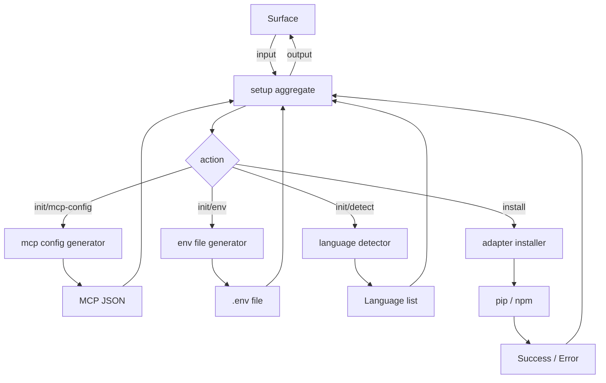

# FRD — project-setup (v3.0.0)

---

## Feature Overview

The project-setup crate provides scaffolding facilities and adapter installation
for new and existing projects. It detects project languages (Rust, Python,
JavaScript/TypeScript), generates MCP configuration for different AI clients,
generates `.env` files, installs linter adapters via pip/npm, and manages XDG
config directories.

The crate follows the AES 7-layer architecture. Four capability seams provide
MCP config generation, environment file creation, language detection, and adapter
installation. Auxiliary technical operations are delegated through the aggregate
contract and the injected utility protocols.

> **Note**: Environment diagnostics (`doctor`, `diagnose`) are handled by the
> **maintenance** crate, not project-setup. This crate focuses on scaffolding
> and installation only.

- **Architecture & Data Flow**



---

## Functional Requirements

### FR-ProjectSetup-001: MCP Configuration Generation

- **Description**: Generate MCP server configuration files in formats compatible
  with different AI clients. Resolve the lint-arwaky-mcp binary path using a
  prioritized lookup strategy.
- **Input**: None (binary path resolved automatically via priority lookup).
- **Output**: `McpConfigVO` containing a JSON-compatible configuration map.
- **Business Rules**:

  - Base config:

    ```json
    {
      "lint-arwaky": {
        "command": "<resolved-binary-path>",
        "args": [],
        "alwaysAllow": ["execute_command", "list_commands", "read_skill",
                        "health_check", "get_config"]
      }
    }
    ```

  - Client-specific wrappers:

    | Client     | Format                                 |
    | ---------- | ---------------------------------------|
    | claude-code| `{"mcpServers": { ...base }}`         |
    | cursor     | `{"mcpServers": { ...base }}`         |
    | windsurf   | `{"mcpServers": { ...base }}`         |
    | copilot    | `{"mcpServers": { ...base }}`         |
    | hermes     | base config directly (no wrapper)     |
    | vscode     | `{"mcp": {"servers": { ...base }}}`  |
    | all        | JSON object with all client formats   |

  - Binary resolution priority (aligned with cli-commands binary lookup):

    1. `LINT_ARWAKY_MCP_BIN` environment variable (must point to existing file).
    2. `CARGO_HOME/bin/lint-arwaky-mcp` (`CARGO_HOME` defaults to `~/.cargo`).
    3. Bare name `lint-arwaky-mcp` (relies on OS PATH resolution at runtime).

- **Edge Cases**:

  - `LINT_ARWAKY_MCP_BIN` points to non-file → falls through to priority 2.
  - `CARGO_HOME` not set → defaults to `~/.cargo`.
  - Binary not found in any candidate → uses bare name `lint-arwaky-mcp`.
  - Unknown client → uses claude-code format as default.

- **Error Handling**:

  - `CARGO_HOME` env read failure → falls back to `~/.cargo`.

---

### FR-ProjectSetup-002: Environment File Generation

- **Description**: Generate `.env` configuration file content for the lint-arwaky
  project environment.
- **Input**: `DirectoryPath` (home directory for the project).
- **Output**: `EnvContentVO` with environment variable content including
  `PHANTOM_ROOT`.
- **Business Rules**:

  - Content format:

    ```text
    # Lint Arwaky Environment Configuration
    # Generated by: lint-arwaky init

    # Phantom root (for JS/TS linters):
    PHANTOM_ROOT=<home>/
    ```

  - Home directory is created if it does not exist (best-effort; non-fatal).

- **Edge Cases**:

  - Home path is empty → `PHANTOM_ROOT=/`.

- **Error Handling**: Directory creation failure is non-fatal; generation
  continues and returns the content regardless.

---

### FR-ProjectSetup-003: Language Detection

- **Description**: Detect programming languages present in a project directory.
- **Input**: None (scans current working directory).
- **Output**: `ProjectLanguagesVO` containing a list of detected
  `ProjectLanguageVO` items; the primary language is returned as a convenience
  accessor when exactly one language is found.
- **Business Rules**:

  - Phase 1 (marker-based): checks for `crates/`, `Cargo.toml` (Rust),
    `packages/`, `modules/`, `pyproject.toml`, `requirements.txt` (Python),
    `package.json`, `tsconfig.json` (JavaScript/TypeScript).
  - Phase 2 (file-extension scan): recursively scans directory tree
    (depth ≤ 4) for `.rs`, `.py`, `.ts`, `.tsx`, `.mts`, `.cts`, `.js`,
    `.jsx`, `.mjs`, `.cjs` extensions.
  - Skips hidden dirs and default ignored paths (`target/`, `node_modules/`,
    `vendor/`, `dist/`, `build/`, `__pycache__/`).
  - **No default language** — if no languages detected, returns empty list.
    The caller decides how to handle (prompt user, skip config generation, or
    use explicit `--language` flag).

- **Edge Cases**:

  - All three languages found in Phase 1 → skips Phase 2.
  - Empty directory → returns empty list.
  - Permission denied on subdirectory → skipped silently.
  - Symlinks → followed if target is within workspace root, skipped otherwise.

- **Error Handling**: `read_dir` failure on a directory → skipped, scan
  continues.

---

### FR-ProjectSetup-004: Adapter Installation

- **Description**: Install linter adapters for Python and JavaScript projects.
- **Input**: `sudo: bool` (for npm global installs requiring elevated
  permissions).
- **Output**: `SuccessStatus` indicating success or failure.
- **Business Rules**:

  - Python adapters: `ruff`, `mypy`, `bandit` installed via
    `pip install --user`.
  - JavaScript adapters: `eslint`, `prettier`, `typescript` installed via
    `npm install -g`.
  - Rust adapters (clippy, rustfmt, cargo-audit): **not installed by
    project-setup** — managed via `rustup`. Print suggestion:
    "Rust tools are managed via rustup. Run `rustup component add clippy
    rustfmt` and `cargo install cargo-audit`."
  - Python installer retries with `--break-system-packages` on failure
    (PEP 668 compatibility with externally-managed environments).
  - JavaScript installer supports `sudo` prefix for global installations that
    need elevated permissions.
  - Empty package list → returns `Ok(())` immediately without spawning.

- **Edge Cases**:

  - `pip` not installed → returns error with spawn failure message.
  - `npm` not installed → returns error with spawn failure message.
  - `pip install --user` fails but `--break-system-packages` succeeds →
    returns `Ok(())`.
  - Network failure during install → returns error with process exit status.

- **Error Handling**:

  - Command spawn failure → returns an IO setup error.
  - Command exits with non-zero status → returns an other setup error.

---

### FR-ProjectSetup-005: Config Template Loading

- **Description**: Load the embedded YAML config template for a language and the embedded skill files compiled into the binary.
- **Input**: Language name.
- **Output**: The template source text, or an error when the language has no embedded template.
- **Business Rules**:

  - Templates are compiled in at build time — nothing is downloaded at run time.
  - The skill file set is fixed at build time; a skill is present or absent by language match.
  - An unsupported language is reported as an error, not a silent default.
- **Edge Cases**:

  - Unsupported language → `UnknownLanguage` error.
  - No skills match the language → empty skill list, no error.
- **Error Handling**: `SetupError::UnknownLanguage` for unsupported languages; read failures are reported as setup errors.

---

### FR-ProjectSetup-006: Config File Writing

- **Description**: Write a configuration file to disk and create the global config directory when it does not exist.
- **Input**: Filename, file content, or no argument for directory creation.
- **Output**: A structured result describing the write outcome, or a `SetupError`.
- **Business Rules**:

  - Writes are atomic — the file is written to a temp path and renamed into place.
  - The global config directory is created with owner read/write/execute permissions when absent.
  - The target path is never created by the installer unless it is the config directory itself.
- **Edge Cases**:

  - Target path already exists with different content → overwritten only on explicit caller intent.
  - Parent directory does not exist → creation failure is reported as a setup error.
- **Error Handling**: I/O failures surface as `SetupError` with the underlying OS error.

---

### FR-ProjectSetup-007: Pre-flight Check

- **Description**: Verify the package managers required by adapter installation are available before any install attempt.
- **Input**: None.
- **Output**: A status report naming each manager and whether it is available.
- **Business Rules**:

  - Python installation requires `pip` to be reachable via `python3 -m pip`.
  - JavaScript installation requires `npm` to be on the PATH.
  - A missing manager is reported as unavailable — the install is not attempted.
  - The check is read-only: it never installs or modifies anything.
- **Edge Cases**:

  - Both managers present → the check reports all available.
  - Both managers absent → the check reports both unavailable; the caller decides next step.
- **Error Handling**: None — the check is a pure probe.

---

### FR-ProjectSetup-008: File Existence Probe

- **Description**: Probe whether a file path exists so callers can short-circuit before writing.
- **Input**: A file path.
- **Output**: A boolean existence flag.
- **Business Rules**:

  - The probe is a single filesystem `stat` — no directory walk.
  - A broken symlink is reported as absent.
  - The probe never follows a symlink target outside the workspace root.
- **Edge Cases**:

  - Path does not exist → false.
  - Path is a directory → false (the probe is for files).
- **Error Handling**: None — a `stat` failure is reported as false.

---

## Public Interface

### Protocol API

| Method | Input | Output | Error | Event | Description|
|---|---|---|---|---|---|
| `install_python_packages` | &PatternList | `InstallPackagesResult` | — | — | Install python packages.|
| `install_npm_packages` | &PatternList, bool | `InstallPackagesResult` | — | — | Install npm packages.|
| `generate_env` | &DirectoryPath | `EnvContentVO` | — | — | Generate env.|
| `generate_mcp_config` | — | `McpConfigVO` | — | — | Generate mcp config.|
| `mcp_config_claude` | — | `McpConfigVO` | — | — | Mcp config claude.|
| `mcp_config_cursor` | — | `McpConfigVO` | — | — | Mcp config cursor.|
| `mcp_config_windsurf` | — | `McpConfigVO` | — | — | Mcp config windsurf.|
| `mcp_config_copilot` | — | `McpConfigVO` | — | — | Mcp config copilot.|
| `mcp_config_hermes` | — | `McpConfigVO` | — | — | Mcp config hermes.|
| `mcp_config_vscode` | — | `McpConfigVO` | — | — | Mcp config vscode.|
| `mcp_config_all` | — | `McpConfigVO` | — | — | Mcp config all.|
| `which_mcp_binary` | — | `McpBinaryNameVO` | — | — | Which mcp binary.|
| `install_python_adapters` | — | `SuccessStatus` | — | — | Install python adapters.|
| `install_javascript_adapters` | bool | `SuccessStatus` | — | — | Install javascript adapters.|
| `detect_language` | — | `Option<ProjectLanguageVO>` | — | — | Detect language.|
| `detect_languages` | — | `ProjectLanguagesVO` | — | — | Detect languages.|

### Aggregate API

| Method | Input | Output | Error | Event | Description|
|---|---|---|---|---|---|
| `execute` | SetupRequest | `SetupResponse` | — | — | Single composite entry point over the feature.|

## Reference

- Backlog: [BACKLOG.md](BACKLOG.md) — real condition for this feature; this file is specification only.
- PRD: [PRD.md](../../PRD.md)
- Architecture: [ARCHITECTURE.md](../../ARCHITECTURE.md)
- Maintenance FRD: `crates/maintenance/FRD.md` (doctor, diagnose)

| Roadmap | {Link to ROADMAP.md} | [{link}](ROADMAP.md)|
