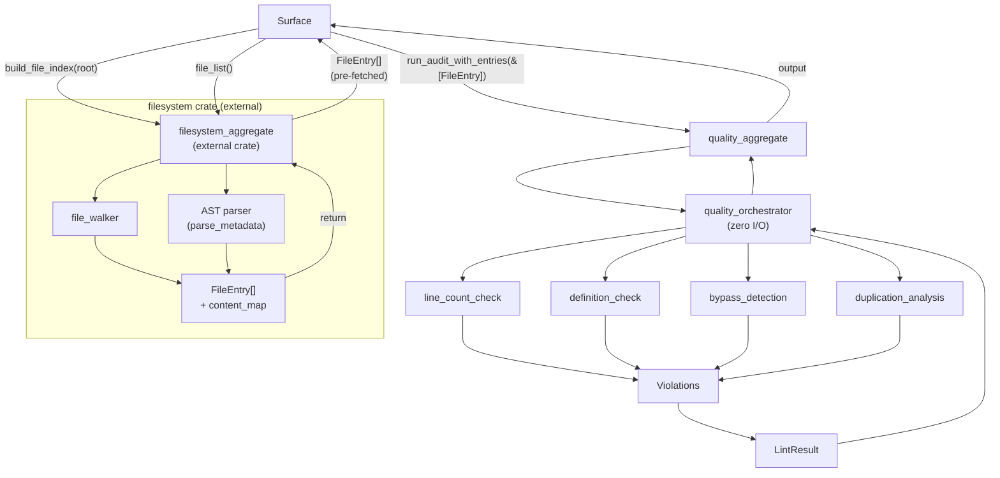

# FRD — quality-rules (v2.0.0)

---

## Feature Overview

The quality-rules crate enforces general code quality, formatting limits, and clean-coding policies. It protects the codebase from bloated files, empty structures, duplicate blocks, and bypass annotations while guaranteeing zero tolerance for warning/error suppressions.

File discovery, raw content reads, and AST parsing are handled by the external `filesystem` aggregate (`IFilesystemAggregate`). The Surface calls `filesystem.build_file_index(root)` to populate caches, then passes pre-fetched `&[FileEntry]` to the quality-rules orchestrator via `run_audit_with_entries`. The quality-rules crate does zero I/O — it only performs business logic analysis on pre-fetched data.

- **Architecture & Data Flow**

---

## Functional Requirements

### FR-QualityRules-001: Maximum File Line Count (AES301)

| Aspect | Detail|
|--------|-------|
| Description | |
| Business Rules | |
| Edge Cases | |
| Capability | |
| Protocol | |
| Method | |
| Input | |
| Output | |
| Error | |
| Event | |
| Test | |
| Metric | |

### FR-QualityRules-002: Minimum File Line Count (AES302)

| Aspect | Detail|
|--------|-------|
| Description | |
| Business Rules | |
| Edge Cases | |
| Capability | |
| Protocol | |
| Method | |
| Input | |
| Output | |
| Error | |
| Event | |
| Test | |
| Metric | |

### FR-QualityRules-003: Mandatory Definitions & Dead Inheritance (AES303)

| Aspect | Detail|
|--------|-------|
| Description | |
| Business Rules | |
| Edge Cases | |
| Capability | |
| Protocol | |
| Method | |
| Input | |
| Output | |
| Error | |
| Event | |
| Test | |
| Metric | |

### FR-QualityRules-004: Bypass Detection (AES304)

| Aspect | Detail|
|--------|-------|
| Description | |
| Business Rules | |
| Edge Cases | |
| Capability | |
| Protocol | |
| Method | |
| Input | |
| Output | |
| Error | |
| Event | |
| Test | |
| Metric | |

### FR-QualityRules-005: Duplicate Code Detection (AES305)

| Aspect | Detail|
|--------|-------|
| Description | |
| Business Rules | |
| Edge Cases | |
| Capability | |
| Protocol | |
| Method | |
| Input | |
| Output | |
| Error | |
| Event | |
| Test | |
| Metric | |

## Public Interface

| Aspect | Detail|
|--------|-------|
| — | — |

## Reference

| Artifact | Purpose | Link|
|----------|---------|------|
| BACKLOG.md | Backlog tracking | [BACKLOG.md](BACKLOG.md)|
| PRD.md | Product requirements | [PRD.md](../../PRD.md)|
| FRD.md | Feature requirements | [FRD.md](FRD.md)|
| ROADMAP.md | Roadmap status | [ROADMAP.md](../../ROADMAP.md)|
| ARCHITECTURE.md | Layer contract | [ARCHITECTURE.md](../../ARCHITECTURE.md)|
