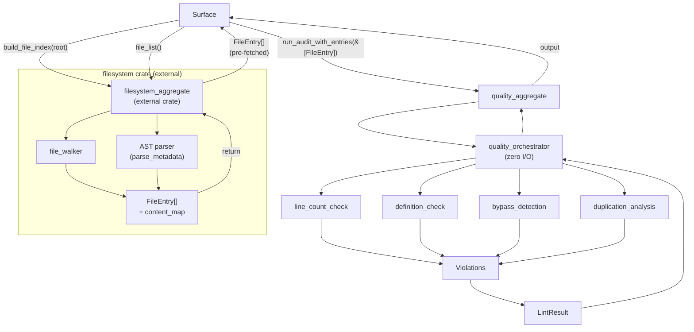

# FRD — quality-rules (v2.0.0)

---

## Feature Overview

The quality-rules crate enforces general code quality, formatting limits, and clean-coding policies. It protects the codebase from bloated files, empty structures, duplicate blocks, and bypass annotations while guaranteeing zero tolerance for warning/error suppressions.

File discovery, raw content reads, and AST parsing are handled by the external `filesystem` aggregate (`IFilesystemAggregate`). The Surface calls `filesystem.build_file_index(root)` to populate caches, then passes pre-fetched `&[FileEntry]` to the quality-rules orchestrator via `run_audit_with_entries`. The quality-rules crate does zero I/O — it only performs business logic analysis on pre-fetched data.

- **Architecture & Data Flow**

---

## Functional Requirements

### FR-QualityRules-001: Maximum File Line Count (AES301)

- **Description**: Source files must not exceed the maximum allowed line count to prevent bloated, unmaintainable files.
- **Input**: File data from filesystem crate (path + content), architecture configuration.
- **Output**: AES301 diagnostic if line count exceeds maximum.
- **Business Rules**:

  - Max line count is read from the rule's YAML configuration (`max_lines`).
  - Default max: 1000 lines.
  - Applies to: Rust, Python, TypeScript, JavaScript source files with AES-compliant naming (layer prefix detected by `detect_layer_from_prefix`). Files without a recognized layer prefix are silently skipped.
  - Barrel files (module barrels, library roots, package markers, and index barrels) are skipped.
  - Files in the rule's `exceptions` list are skipped.
  - All lines are counted, including blank lines, comments, and docstrings.
  - Files at exactly `max_lines` → passes (comparison is strict `>`).
- **Edge Cases**:

  - Files with long comments or docstrings → all lines counted uniformly.
  - Generated code → no special exclusion; the rule applies uniformly.
  - Empty files → 0 lines, passes.
- **Error Handling**: Emit AES301 with actual line count and the configured maximum. Files that could not be read by the filesystem crate are excluded from the file list and not checked.

---

### FR-QualityRules-002: Minimum File Line Count (AES302)

- **Description**: Source files must have minimum length to avoid empty placeholders and stub files.
- **Input**: File data from filesystem crate (path + content), architecture configuration.
- **Output**: AES302 diagnostic if line count is below minimum.
- **Business Rules**:

  - Min line count is read from the rule's YAML configuration (`min_lines`).
  - Default min: 10 lines.
  - Applies to: Rust, Python, TypeScript, JavaScript source files with AES-compliant naming (layer prefix detected by `detect_layer_from_prefix`). Files without a recognized layer prefix are silently skipped.
  - Barrel files and exception files are skipped.
  - Files at exactly `min_lines` → passes (comparison is strict `<`).
- **Edge Cases**:

  - Config files or entry points → skipped via exception list.
  - Files with only comments and no code → still counted by line number.
- **Error Handling**: Emit AES302 with actual line count and the configured minimum.

---

### FR-QualityRules-003: Mandatory Definitions & Dead Inheritance (AES303)

- **Description**: Source files must declare at least one primary symbol (struct, enum, trait, class, interface, type) to prevent empty placeholder files. Additionally, declarations that exist but contain no real implementation (dead inheritance) are flagged.
- **Input**: File data from filesystem crate (path + content), architecture configuration.
- **Output**: AES303 diagnostic if no definition found, or if dead inheritance detected.
- **Business Rules**:

  - **Mandatory definition check**:

    - Rust: `struct`, `enum`, `trait`, `type` declarations (including visibility modifiers `pub`, `pub(crate)`, etc.).
    - Python: `class` declarations.
    - TypeScript/JavaScript: `class`, `interface`, `type` declarations (including `export`, `export default`, `abstract`, `declare` prefixes).
    - Detection via token matching on file content (no AST parsing in this crate).
    - If no primary symbol is found → AES303 (`MissingDefinition`).
  - Applies to files with AES-compliant naming (layer prefix detected by `detect_layer_from_prefix`). Files without a recognized layer prefix are silently skipped.
  - **Dead inheritance check**:

    - Unit structs (`struct Foo;`) without a following `impl` block in the same file → AES303 (`DeadInheritance`).
    - Empty Python classes (`class Foo: pass` or `class Foo: ...`) → AES303 (`DeadInheritance`).
    - Empty JS/TS classes (`class Foo {}`) → AES303 (`DeadInheritance`).
    - `#[cfg(test)]` blocks are skipped during dead inheritance scanning.
  - **Skipped files**: package markers, module barrels, library roots, binary entries, type-stub markers, and taxonomy constant files.
  - If `mandatory_class_definition` is disabled in the rule config, skip entirely.
  - Files in the rule's `exceptions` list are skipped.
- **Edge Cases**:

  - Empty `impl` blocks → not a primary symbol, does not satisfy the mandatory definition requirement.
  - Unit structs followed by `impl` block in the same file → not flagged (intentional placeholder with implementation).
  - Tuple structs (`struct Foo(i32)`) → not flagged as unit struct (has fields).
  - `#[cfg(test)]` modules → skipped for dead inheritance scanning.
- **Error Handling**: Emit AES303 with the expected symbol types for the language and the violation kind (`MissingDefinition` or `DeadInheritance`).

---

### FR-QualityRules-004: Bypass Detection (AES304)

- **Description**: Detects and flags any attempt to suppress warnings/errors, panic, or use unsafe fallbacks in production code. All patterns are flagged regardless of whether they appear in code or comments. Patterns inside string literals are NOT flagged.
- **Input**: File data from filesystem crate (path + content), architecture configuration with forbidden bypass patterns.
- **Output**: AES304 diagnostic for each bypass found (may emit multiple per file).
- **Business Rules**:

  - **Forbidden patterns** (configurable via YAML, defaults below):

    | Category                    | Patterns                                                                                                                             | Language  |
    | --------------------------- | ------------------------------------------------------------------------------------------------------------------------------------ | ----------|
    | Rust forbidden tokens       | `unwrap()`, `expect()`, `panic!`, `todo!`, `unimpl!`, `unreachable!`                                              | Rust      |
    | Rust attribute bypasses     | `#[allow(`, `#[warn(`, `#[deny(`                                                                                               | Rust      |
    | Python bypasses             | `raise NotImplementedError`, `assert false`                                                                                      | Python    |
    | Comment/annotation bypasses | `type: ignore`, `noqa`, `@ts-ignore`, `@ts-expect-error`, `eslint-disable`, `lint-disable`, `FIXME`, `HACK`, `XXX` | All       |
    | Cargo.toml bypass           | `level = "allow"` under `[workspace.lints.clippy]` or `[lints.clippy]`                                                         | Cargo.toml|

  - **Matching rules**:

    - All patterns are matched as **substrings** against each line.
    - All patterns are flagged in **both code and comments**. No word/non-word distinction.
    - Patterns inside **string literals** (`"..."`, `'...'`, `` `...` ``) are **NOT flagged** (byte-level position check to exclude string interior).
    - Patterns inside **char literals** (`'x'`) are **NOT flagged**.
  - **Safe variants NOT flagged**: `unwrap_or(`, `unwrap_or_else(`, `unwrap_or_default(` — verified by byte-level suffix parsing. If `unwrap()` is detected but immediately followed by `_or`, `_or_else`, or `_or_default`, it is a safe variant and NOT flagged.
  - **`#[cfg(test)]` blocks**: Fully skipped. Bypass tokens inside `#[cfg(test)]` modules are not flagged (unwrap/panic is normal in tests).
  - **`static Lazy<Regex>` multiline initializations**: Skipped (regex patterns may contain bypass-like tokens as match targets).
  - **Configuration**: Patterns are read from the architecture configuration's forbidden bypass settings (YAML-configurable). Fallback default pattern list applied if config is empty.
- **Edge Cases**:

  - `unwrap()` inside a string literal (`let s = "unwrap()"`) → NOT flagged.
  - `FIXME` inside a comment (`// FIXME: refactor`) → FLAGGED.
  - `noqa` inside a string (`print("noqa")`) → NOT flagged.
  - `#[allow(unused)]` inside `#[cfg(test)]` module → NOT flagged.
  - `unwrap_or_default()` → NOT flagged (safe variant).
  - `panic!("unreachable")` → FLAGGED (both `panic!` and `unreachable!` may trigger, one violation per line).
- **Error Handling**: Emit AES304 with the matched pattern, line number, and the violation category.

---

### FR-QualityRules-005: Duplicate Code Detection (AES305)

- **Description**: Compares code blocks across all workspace files and flags files with excessive content overlap.
- **Input**: File data from filesystem crate (path + content), architecture configuration.
- **Output**: AES305 diagnostic for files exceeding duplication threshold.
- **Business Rules**:

  - **Pre-processing** (before window comparison):

    1. Normalize each line: trim whitespace, keep only alphanumeric and whitespace characters (strip punctuation, operators, etc.).
  - **Algorithm**: Sliding window hash-based comparison on normalized lines.

    - Window size (`min_lines`): read from AES305 rule config, default 10 lines.
    - Threshold: read from AES305 rule config `duplication_threshold`, default 50%.
    - A file's shared-window percentage is calculated against all other files.
    - One violation per file that exceeds the threshold (not per duplicate block).
  - Ignored paths from config are excluded from scanning.
  - Pre-read entries avoid double I/O (file content provided by filesystem crate).
- **Edge Cases**:

  - Files shorter than `min_lines` → skipped (no windows to compare).
  - All files identical → each file gets one violation.
  - Generated code or boilerplate → no special exclusion.
  - Single file in workspace → no violations (no other files to compare).
- **Error Handling**: Emit AES305 with the shared percentage, total windows, and list of similar files (up to 5).

---

## Public Interface

### Protocol API

| Method | Input | Output | Error | Event | Description|
|---|---|---|---|---|---|
| `check_bypass_comments` | &str, &str, &mut Vec<LintResult> | `` | — | — | Check bypass comments.|
| `check_cargo_toml` | &str, &mut Vec<LintResult> | `` | — | — | Check cargo toml.|
| `check_mandatory_class_definition` | &str, Option<&LayerDefinition>, &str, &mut Vec<LintResult> | `` | — | — | Check mandatory class definition.|
| `handle_duplicates_entries` | &[(PathBuf, String)] | `Vec<(String, AesCodeAnalysisViolation)>` | — | — | Handle duplicates entries.|
| `check_dead_inheritance` | &str, &str, &mut Vec<LintResult> | `` | — | — | Check dead inheritance.|
| `check_line_counts` | &str, Option<&LayerDefinition>, &str, &mut Vec<LintResult> | `` | — | — | Check line counts.|

### Aggregate API

| Method | Input | Output | Error | Event | Description|
|---|---|---|---|---|---|
| `execute` | CodeAnalysisRequest | `CodeAnalysisResponse` | — | — | Single composite entry point over the feature.|

## Reference

- Backlog: [BACKLOG.md](BACKLOG.md) — real condition for this feature; this file is specification only.
- PRD: [PRD.md](../../PRD.md)
- Architecture: [ARCHITECTURE.md](../../ARCHITECTURE.md)
- **Filesystem crate** (external): filesystem aggregate and file walker
- `utility_bypass_detector` (this crate): bypass pattern matching helpers
- `utility_code_duplication_detector` (this crate): duplication analysis functions
- `utility_language_mapper` (this crate): language detection from file extension
- `utility_column_index` (this crate): column position computation
- `utility_mandatory_checker` (this crate): symbol detection helpers
- Shared compliance score utility

| Roadmap | {Link to ROADMAP.md} | [{link}](ROADMAP.md)|
