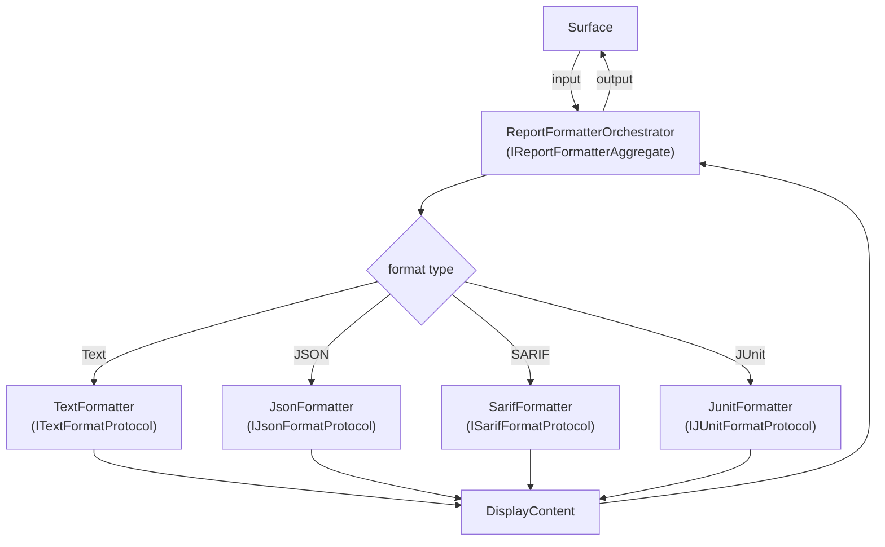

# FRD — report-formatter (v1.14.0)

---

## Feature Overview

The report-formatter crate provides formatting capabilities for scan report output. It has exactly four capabilities, one per output format (text, JSON, SARIF, JUnit), each implementing a dedicated protocol trait. The agent orchestrator routes requests through the aggregate by matching on `Format` and calling the specific protocol method directly — no delegation seam exists.

All formatters are **self-contained** — they operate solely on `ScanReport` data and do not depend on other rule crates.

- **Architecture & Data Flow**

- **ScanReport Content**

`ScanReport` contains two categories of findings:

| Category                  | Source                   | Rule codes        | Example                                                    |
| --------------------------- | -------------------------- | ------------------- | ------------------------------------------------------------ |
| **AES violations**        | Internal rule crates     | AES101–AES506    | `AES201 CRITICAL surface → capabilities import forbidden` |
| **External lint results** | External linter adapters | Tool-native codes | `clippy::needless_return`, `ruff::E501`                    |
| **PARSE_WARN**            | Report input or diagnostics | `PARSE_WARN` | `File skipped: parse failure — syntax error` |

> **PARSE_WARN dual representation**: PARSE_WARN entries may arrive via
> `report.results` (as `LintResult` with code starting with `PARSE_`) or
> via `report.diagnostics` (as `PipelineDiagnostic`). All formatters
> handle both paths and render them consistently.
>
> **Dedup invariant**: a single parse failure must be recorded exactly
> once per `ScanReport`. `ScanReport::new` enforces this at the producer
> boundary: a parser-sourced `PipelineDiagnostic` whose file matches a
> `PARSE_`-prefixed `LintResult` in `results` is dropped from
> `diagnostics`, so no formatter double-counts the same failure. Dedup is
> per file: parser diagnostics for other files, and non-parser
> diagnostics, survive.

---

## Functional Requirements

### FR-ReportFormatter-001: Text Format Output

- **Description**: Produce human-readable text output with severity badges and violation details.
- **Input**: `ScanReport`.
- **Output**: `DisplayContent` containing formatted text string.
- **Business Rules**:

  - Output includes:
    - Per-violation detail: severity badge (`[!!!]` CRITICAL, `[!! ]` HIGH, `[! ]` MEDIUM, `[. ]` LOW, `[ ]` INFO), rule code, file:line, message.
    - Violation counts grouped by rule code, sorted by count (descending).
    - Severity breakdown: CRITICAL / HIGH / MEDIUM / LOW / INFO counts.
    - External lint results section (tool-native codes, grouped by tool).
    - Parse warnings section (PARSE_WARN entries).
    - Diagnostics section (PipelineDiagnostic entries).
    - Total violation count and compliance score (if available).
  - AES violations and external lint results are displayed in separate sections.
- **Edge Cases**:

  - Empty results list → produces clean report with 0 violations.
  - Report with only PARSE_WARN diagnostics → shows warnings, 0 violations.
  - Report with only external lint results → shows external section, 0 AES violations.
- **Error Handling**: None — formatting is infallible.

---

### FR-ReportFormatter-002: JSON Format Output

- **Description**: Produce pretty-printed JSON output for CI/CD integration.
- **Input**: `ScanReport`.
- **Output**: `DisplayContent` containing pretty-printed JSON string.
- **Business Rules**:

  - Serializes report using shared JSON DTO value objects (`JsonReportDto`).
  - Separates results into `violations` (AES + PARSE_ codes) and `external_results` (tool-native codes).
  - Summary includes total violations, per-severity counts, and optional compliance score.
  - Diagnostics rendered as `JsonDiagnostic` entries with source, severity, and message.
- **Edge Cases**:

  - Empty results → valid JSON with empty arrays and zero summary.
  - Serialization failure → an explicitly marked error document, never a bare `{}`: `{"formatter_error": true, "format": "json", "reason": "<cause>"}`. A consumer reading `.summary.total` finds no summary at all, so a formatting failure can never be read as "0 violations".
- **Error Handling**: Serialization error caught and reported in the output document; the formatter still returns display content rather than raising.

---

### FR-ReportFormatter-003: SARIF 2.1.0 Format Output

- **Description**: Produce SARIF 2.1.0 JSON format for IDE integration and GitHub Code Scanning.
- **Input**: `ScanReport`.
- **Output**: `DisplayContent` containing SARIF 2.1.0 JSON string.
- **Business Rules**:

  - Includes tool metadata: name `lint-arwaky`, version, information URI.
  - Severity mapping:

    | lint-arwaky Severity | SARIF Level |
    | ---------------------- | ------------- |
    | CRITICAL             | error       |
    | HIGH                 | error       |
    | MEDIUM               | warning     |
    | LOW                  | note        |
    | INFO                 | note        |
    | PARSE_WARN           | note        |

  - Each result includes: rule ID, level, message text, physical location (artifact URI + start line clamped to minimum 1).
  - Rules array includes metadata for all rule codes present in results.
  - Diagnostics from `report.diagnostics` included as additional SARIF results with rule ID `PARSE_WARN` and level `note`.
  - Uses shared SARIF value objects (`SarifLog`, `SarifRun`, `SarifResult`, etc.).
- **Edge Cases**:

  - Empty results → valid SARIF with empty results array.
  - Line number 0 or negative → clamped to 1.
  - Serialization failure → an explicitly marked error document, never a bare `{}` and never something shaped like a valid-but-empty SARIF log: `{"formatter_error": true, "format": "sarif", "reason": "<cause>"}`. The payload carries no `$schema`, no `version`, and no `runs`, so a SARIF consumer rejects it as malformed instead of reading it as a clean run with zero results.
- **Error Handling**: Serialization error caught and reported in the output document; the formatter still returns display content rather than raising.

---

### FR-ReportFormatter-004: JUnit XML Format Output

- **Description**: Produce JUnit XML format for CI/CD test report integration.
- **Input**: `ScanReport`.
- **Output**: `DisplayContent` containing JUnit XML string.
- **Business Rules**:

  - Each violation becomes a test case with classname (rule code) and name (file:line).
  - Non-INFO violations include `<failure>` element with message and type attributes.
  - INFO severity violations produce clean `<testcase>` without `<failure>`.
  - PARSE_WARN diagnostics produce `<testcase>` with `<skipped>` element.
  - External lint results included as test cases with tool-native classname.
  - XML is properly escaped: `&`, `<`, `>`, `"`, `'` → named entities.
  - Root element: `<testsuites>` with tests and failure counts.
  - Pre-allocated string capacity based on result count.
- **Edge Cases**:

  - Empty results → valid XML with 0 tests, 0 failures.
  - All violations INFO severity → no failure elements.
  - Special characters in messages → properly XML-escaped.
- **Error Handling**: None — XML generation is infallible.

---

## Public Interface

### Protocol API

| Method | Input | Output | Error | Event | Description |
|---|---|---|---|---|---|
| `format_text` | &ScanReport | `DisplayContent` | — | — | FR-001: Text output. |
| `format_json` | &ScanReport | `DisplayContent` | — | — | FR-002: JSON output. |
| `format_sarif` | &ScanReport | `DisplayContent` | — | — | FR-003: SARIF output. |
| `format_junit` | &ScanReport | `DisplayContent` | — | — | FR-004: JUnit output. |
| `supported_format` | — | `Format` | — | — | The single format each formatter serves. |

### Aggregate API

| Method | Input | Output | Error | Event | Description |
|---|---|---|---|---|---|
| `format` | &ScanReport, Format | `DisplayContent` | — | — | Single composite entry point over the feature. |

## Reference

- Backlog: [BACKLOG.md](BACKLOG.md) — real condition for this feature; this file is specification only.
- PRD: [PRD.md](../../PRD.md)
- Architecture: [ARCHITECTURE.md](../../ARCHITECTURE.md)
- External Lint FRD: `crates/external-lint/FRD.md` (tool-native codes)

| Roadmap | {Link to ROADMAP.md} | [{link}](ROADMAP.md) |
