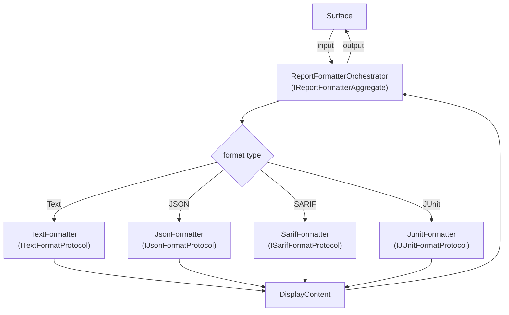

# FRD — report-formatter (v1.14.0)

---

## Feature Overview

The report-formatter crate provides formatting capabilities for scan report output. It has exactly four capabilities, one per output format (text, JSON, SARIF, JUnit), each implementing a dedicated protocol trait. The agent orchestrator routes requests through the aggregate by matching on `Format` and calling the specific protocol method directly — no delegation seam exists.

All formatters are **self-contained** — they operate solely on `ScanReport` data and do not depend on other rule crates.

- **Architecture & Data Flow**

- **ScanReport Content**

`ScanReport` contains two categories of findings:

| Category                  | Source                   | Rule codes        | Example                                                   |
| --------------------------- | -------------------------- | ------------------- | ------------------------------------------------------------|
| **AES violations**        | Internal rule crates     | AES101–AES506    | `AES201 CRITICAL surface → capabilities import forbidden`|
| **External lint results** | External linter adapters | Tool-native codes | `clippy::needless_return`, `ruff::E501`                   |
| **PARSE_WARN**            | Report input or diagnostics | `PARSE_WARN` | `File skipped: parse failure — syntax error`|

> **PARSE_WARN dual representation**: PARSE_WARN entries may arrive via
> `report.results` (as `LintResult` with code starting with `PARSE_`) or
> via `report.diagnostics` (as `PipelineDiagnostic`). All formatters
> handle both paths and render them consistently.
>
> **Dedup invariant**: a single parse failure must be recorded exactly
> once per `ScanReport`. `ScanReport::new` enforces this at the producer
> boundary: a parser-sourced `PipelineDiagnostic` whose file matches a
> `PARSE_`-prefixed `LintResult` in `results` is dropped from
> `diagnostics`, so no formatter double-counts the same failure. Dedup is
> per file: parser diagnostics for other files, and non-parser
> diagnostics, survive.

---

## Functional Requirements

### FR-ReportFormatter-001: Text Format Output

#### Description

| No | Detail |
| --- | --- |
| 1 | Render a scan report as human-readable console text. |
| 2 | — |

#### Business Rules

| No | Detail |
| --- | --- |
| 1 | format_text converts a ScanReport into DisplayContent with findings grouped per file and a summary line; output is infallible (all_four_formats_are_reachable_and_infallible); empty report renders as a zero-finding message. |
| 2 | — |

#### Edge Cases

| No | Detail |
| --- | --- |
| 1 | Empty report yields a valid empty text body (round-trips through all formats to disk). |
| 2 | A report with findings lists each finding once. |
| 3 | Formatting never panics or errors; width/failures in data do not fail formatting. |

#### Capability

| No | Detail |
| --- | --- |
| 1 | TextFormatter renders console text. |

#### Protocol

| No | Detail |
| --- | --- |
| 1 | ITextFormatProtocol. |

#### Method

| No | Detail |
| --- | --- |
| 1 | format_text(report) -> DisplayContent; supported_format() -> Format::Text. |
| 2 | — |

#### Input

| No | Detail |
| --- | --- |
| 1 | ScanReport from the scan pipeline. |
| 2 | Source is Format::Text through the aggregate format entry. |

#### Output

| No | Detail |
| --- | --- |
| 1 | DisplayContent (rendered text) written to stdout or returned to the caller. |
| 2 | — |

#### Error

| No | Detail |
| --- | --- |
| 1 | Formatting is infallible; no error variant exists on the path. |
| 2 | — |

#### Event

| No | Detail |
| --- | --- |
| 1 | None; formatting is pure rendering. |
| 2 | — |

#### Test

| No | Detail |
| --- | --- |
| 1 | assert_text_format, all_four_formats_are_reachable_and_infallible, and empty_report_round_trips_through_all_formats_to_disk assert reachability and empty handling. |
| 2 | — |

#### Metric

| No | Detail |
| --- | --- |
| 1 | Text path returns content for empty and full reports on every seeded run with zero formatting failures. |
| 2 | — |

### FR-ReportFormatter-002: JSON Format Output

#### Description

| No | Detail |
| --- | --- |
| 1 | Render a scan report as canonical JSON with a summary block. |
| 2 | — |

#### Business Rules

| No | Detail |
| --- | --- |
| 1 | format_json emits valid JSON serializing findings and the summary counters; empty report is valid JSON with a zero summary; JSON content parses without error after formatting; external results carry their tool-native rule ids. |
| 2 | — |

#### Edge Cases

| No | Detail |
| --- | --- |
| 1 | Empty report parses with zero summary. |
| 2 | Full report round-trips to disk and back. |
| 3 | A report with external-lint findings keeps tool-native rule ids in the JSON. |
| 4 | Non-UTF8 corner in data still serializes escaped. |

#### Capability

| No | Detail |
| --- | --- |
| 1 | JsonFormatter serializes the report. |

#### Protocol

| No | Detail |
| --- | --- |
| 1 | IJsonFormatProtocol. |

#### Method

| No | Detail |
| --- | --- |
| 1 | format_json(report) -> DisplayContent; supported_format() -> Format::Json. |
| 2 | — |

#### Input

| No | Detail |
| --- | --- |
| 1 | ScanReport. |
| 2 | Source is Format::Json through the aggregate. |

#### Output

| No | Detail |
| --- | --- |
| 1 | DisplayContent containing JSON text (parsed by downstream consumers and CI gates). |
| 2 | — |

#### Error

| No | Detail |
| --- | --- |
| 1 | Formatting path is infallible; serialization problems would surface as consumer parse failure, not as a formatter error. |
| 2 | — |

#### Event

| No | Detail |
| --- | --- |
| 1 | None. |
| 2 | — |

#### Test

| No | Detail |
| --- | --- |
| 1 | json_formatter_returns_valid_json, empty_report_is_valid_json_with_zero_summary, json_formatter_implements_json_format_protocol, and external_results_included_with_tool_native_rule_id assert validity and code preservation. |
| 2 | — |

#### Metric

| No | Detail |
| --- | --- |
| 1 | 100 percent of formatted outputs parse as JSON. |
| 2 | Summary counters match the input report on every seeded case. |

### FR-ReportFormatter-003: SARIF 2.1.0 Format Output

#### Description

| No | Detail |
| --- | --- |
| 1 | Render a scan report as SARIF 2.1.0 for code-scanning uploaders. |
| 2 | — |

#### Business Rules

| No | Detail |
| --- | --- |
| 1 | format_sarif produces SARIF 2.1.0 XML/JSON document (runs, tool driver, results); empty report is valid SARIF with zero results; findings map to results with level and rule id; tool-native rule ids are retained for external findings. |
| 2 | — |

#### Edge Cases

| No | Detail |
| --- | --- |
| 1 | Empty report validates as SARIF with zero results. |
| 2 | Full report round-trips to disk. |
| 3 | Direct slice formatting works outside the orchestrator routing. |
| 4 | Unknown severity maps to a default SARIF level rather than failing validation. |

#### Capability

| No | Detail |
| --- | --- |
| 1 | SarifFormatter builds the SARIF document. |

#### Protocol

| No | Detail |
| --- | --- |
| 1 | ISarifFormatProtocol. |

#### Method

| No | Detail |
| --- | --- |
| 1 | format_sarif(report) -> DisplayContent; supported_format() -> Format::Sarif. |
| 2 | — |

#### Input

| No | Detail |
| --- | --- |
| 1 | ScanReport. |
| 2 | Source is Format::Sarif through the aggregate (orchestrator_routes_sarif_format). |

#### Output

| No | Detail |
| --- | --- |
| 1 | DisplayContent containing SARIF 2.1.0 document for upload tooling. |
| 2 | — |

#### Error

| No | Detail |
| --- | --- |
| 1 | Formatter path is infallible; schema violations would be caught by consumer-side validation. |
| 2 | — |

#### Event

| No | Detail |
| --- | --- |
| 1 | None. |
| 2 | — |

#### Test

| No | Detail |
| --- | --- |
| 1 | assert_sarif_format, empty_report_is_valid_sarif, direct_format_sarif_slice_works, and orchestrator_routes_sarif_format assert validity and routing. |
| 2 | — |

#### Metric

| No | Detail |
| --- | --- |
| 1 | Every seeded formatted report validates as SARIF 2.1.0. |
| 2 | Empty report yields a parseable document with zero results. |

### FR-ReportFormatter-004: JUnit XML Format Output

#### Description

| No | Detail |
| --- | --- |
| 1 | Render a scan report as JUnit XML for CI test-report ingestion. |
| 2 | — |

#### Business Rules

| No | Detail |
| --- | --- |
| 1 | format_junit emits valid JUnit XML (testsuite wrapping testcases); each finding appears as one testcase failure; testcase names carry the rule id; empty report yields a valid empty suite; direct slice formatting works. |
| 2 | — |

#### Edge Cases

| No | Detail |
| --- | --- |
| 1 | Empty report parses as valid XML with zero failing testcases. |
| 2 | Full report round-trips to disk. |
| 3 | Per-finding testcase naming includes rule id. |
| 4 | Formatter invoked via orchestrator routing returns the same content as direct calls. |

#### Capability

| No | Detail |
| --- | --- |
| 1 | JunitFormatter builds the JUnit XML. |

#### Protocol

| No | Detail |
| --- | --- |
| 1 | IJUnitFormatProtocol. |

#### Method

| No | Detail |
| --- | --- |
| 1 | format_junit(report) -> DisplayContent; supported_format() -> Format::JUnit. |
| 2 | — |

#### Input

| No | Detail |
| --- | --- |
| 1 | ScanReport. |
| 2 | Source is Format::JUnit through the aggregate (orchestrator_routes_junit_format). |

#### Output

| No | Detail |
| --- | --- |
| 1 | DisplayContent containing JUnit XML consumed by CI reporters. |
| 2 | — |

#### Error

| No | Detail |
| --- | --- |
| 1 | Formatter path is infallible; malformed output would surface on the CI parse side. |
| 2 | — |

#### Event

| No | Detail |
| --- | --- |
| 1 | None. |
| 2 | — |

#### Test

| No | Detail |
| --- | --- |
| 1 | assert_junit_format, junit_formatter_returns_valid_xml, direct_format_junit_slice_works, junit_formatter_implements_junit_format_protocol, and orchestrator_routes_junit_format assert validity and routing. |
| 2 | — |

#### Metric

| No | Detail |
| --- | --- |
| 1 | Every seeded formatted report parses as JUnit XML. |
| 2 | Empty report yields a suite with zero failures. |

## Public Interface

| Aspect | Detail|
|--------|-------|
| Agent | ReportFormatterOrchestrator — the agent-layer orchestrator that routes Format variants to the right formatter. |
| Aggregate | IReportFormatterAggregate — the feature's single front door. |
| Method | format(&self, report: &ScanReport, format: Format) -> DisplayContent |
| Request | ScanReport plus Format::{Text, Json, Sarif, JUnit} |
| Response | DisplayContent rendered in the requested format |

## Reference

| Artifact | Purpose | Link|
|----------|---------|------|
| BACKLOG.md | Backlog tracking | [BACKLOG.md](BACKLOG.md)|
| PRD.md | Product requirements | [PRD.md](../../PRD.md)|
| FRD.md | Feature requirements | [FRD.md](FRD.md)|
| ROADMAP.md | Roadmap status | [ROADMAP.md](../../ROADMAP.md)|
| ARCHITECTURE.md | Layer contract | [ARCHITECTURE.md](../../ARCHITECTURE.md)|
