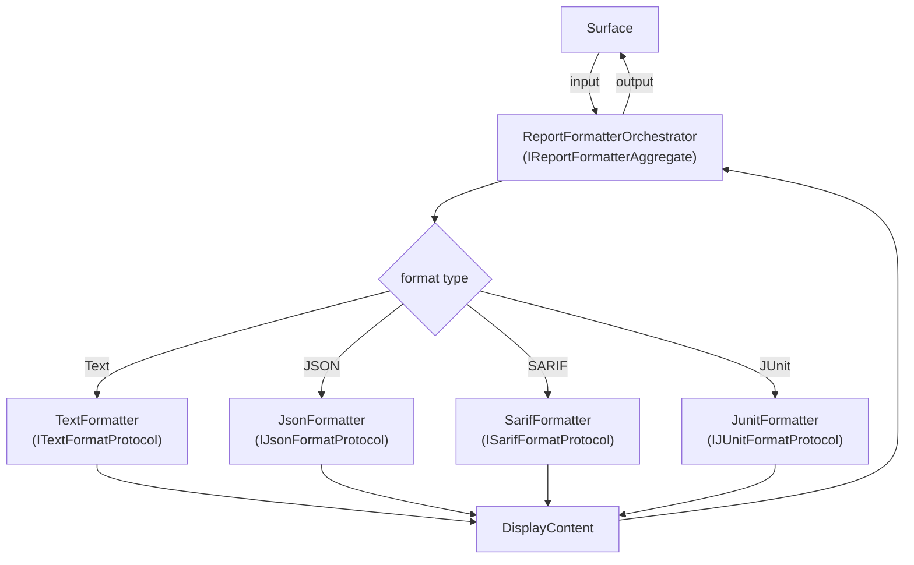

# FRD — report-formatter (v1.14.0)

---

## Feature Overview

The report-formatter crate provides formatting capabilities for scan report output. It has exactly four capabilities, one per output format (text, JSON, SARIF, JUnit), each implementing a dedicated protocol trait. The agent orchestrator routes requests through the aggregate by matching on `Format` and calling the specific protocol method directly — no delegation seam exists.

All formatters are **self-contained** — they operate solely on `ScanReport` data and do not depend on other rule crates.

- **Architecture & Data Flow**

- **ScanReport Content**

`ScanReport` contains two categories of findings:

| Category                  | Source                   | Rule codes        | Example                                                   |
| --------------------------- | -------------------------- | ------------------- | ------------------------------------------------------------|
| **AES violations**        | Internal rule crates     | AES101–AES506    | `AES201 CRITICAL surface → capabilities import forbidden`|
| **External lint results** | External linter adapters | Tool-native codes | `clippy::needless_return`, `ruff::E501`                   |
| **PARSE_WARN**            | Report input or diagnostics | `PARSE_WARN` | `File skipped: parse failure — syntax error`|

> **PARSE_WARN dual representation**: PARSE_WARN entries may arrive via
> `report.results` (as `LintResult` with code starting with `PARSE_`) or
> via `report.diagnostics` (as `PipelineDiagnostic`). All formatters
> handle both paths and render them consistently.
>
> **Dedup invariant**: a single parse failure must be recorded exactly
> once per `ScanReport`. `ScanReport::new` enforces this at the producer
> boundary: a parser-sourced `PipelineDiagnostic` whose file matches a
> `PARSE_`-prefixed `LintResult` in `results` is dropped from
> `diagnostics`, so no formatter double-counts the same failure. Dedup is
> per file: parser diagnostics for other files, and non-parser
> diagnostics, survive.

---

## Functional Requirements

### FR-ReportFormatter-001: Text Format Output

| Aspect | Detail|
|--------|-------|
| Description | |
| Business Rules | |
| Edge Cases | |
| Capability | |
| Protocol | |
| Method | |
| Input | |
| Output | |
| Error | |
| Event | |
| Test | |
| Metric | |

### FR-ReportFormatter-002: JSON Format Output

| Aspect | Detail|
|--------|-------|
| Description | |
| Business Rules | |
| Edge Cases | |
| Capability | |
| Protocol | |
| Method | |
| Input | |
| Output | |
| Error | |
| Event | |
| Test | |
| Metric | |

### FR-ReportFormatter-003: SARIF 2.1.0 Format Output

| Aspect | Detail|
|--------|-------|
| Description | |
| Business Rules | |
| Edge Cases | |
| Capability | |
| Protocol | |
| Method | |
| Input | |
| Output | |
| Error | |
| Event | |
| Test | |
| Metric | |

### FR-ReportFormatter-004: JUnit XML Format Output

| Aspect | Detail|
|--------|-------|
| Description | |
| Business Rules | |
| Edge Cases | |
| Capability | |
| Protocol | |
| Method | |
| Input | |
| Output | |
| Error | |
| Event | |
| Test | |
| Metric | |

## Public Interface

| Aspect | Detail|
|--------|-------|
| — | — |

## Reference

| Artifact | Purpose | Link|
|----------|---------|------|
| BACKLOG.md | Backlog tracking | [BACKLOG.md](BACKLOG.md)|
| PRD.md | Product requirements | [PRD.md](../../PRD.md)|
| FRD.md | Feature requirements | [FRD.md](FRD.md)|
| ROADMAP.md | Roadmap status | [ROADMAP.md](../../ROADMAP.md)|
| ARCHITECTURE.md | Layer contract | [ARCHITECTURE.md](../../ARCHITECTURE.md)|
