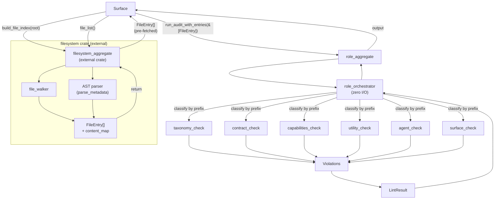

# FRD — role-rules

---

## Feature Overview

## Functional Requirements

### FR-RoleRules-001: File Classification and Dispatch

| Aspect | Detail|
|--------|-------|
| Description | Classify each file into its AES layer role so the right role checker runs on it. |
| Business Rules | RoleClassifier maps file path prefixes to layer roles (agent, capabilities, contract, taxonomy, utility, surface); every layer prefix maps (role_classifier_maps_every_layer_prefix); capability prefix classifies by file prefix; non-classified files are ignored by role checkers; classification is language-neutral (same rule for Rust, Python, TS). |
| Edge Cases | Windows separator paths classify the same as posix; file outside all layer dirs unclassified (no checker runs, no violation); bucketed subdirectories (capabilities subfolders) classify to capabilities; a file never classified against two roles at once. |
| Capability | RoleClassifier performs layer classification. |
| Protocol | IClassificationProtocol. |
| Method | classify_layer(&self, file: &FileEntry) -> Option<LayerNameVO> |
| Input | File path; source is RoleRequest::RunAuditWithEntries via IRoleRunnerAggregate::execute entries. |
| Output | Role tag consumed by FR-RoleRules-002..007; audit result in RoleResponse::Audit. |
| Error | Unclassified path yields no role and therefore no finding for that file. |
| Event | None; classification is pure. |
| Test | role_classifier_maps_every_layer_prefix and role_classifier_capability_classifies_file_prefix assert prefix mapping. |
| Metric | Every seeded layer prefix classifies to its documented role; unclassified fixtures produce zero downstream findings. |

### FR-RoleRules-002: Taxonomy Purity and Primitive Restriction (AES401)

| Aspect | Detail|
|--------|-------|
| Description | Enforce taxonomy files use only taxonomy primitives and remain constant-pure (AES401). |
| Business Rules | Taxonomy files may declare values, enums, and error/runtime/event markers using taxonomy primitives; primitive entities (struct, error, event) with non-taxonomy primitives are flagged; constant-only files must hold no impl blocks; non-taxonomy files are ignored entirely. |
| Edge Cases | Clean constant file no violation; constant file with struct detected; entity/error/event with primitive detected; non-taxonomy file ignored; metadata cases per language handled by same protocol. |
| Capability | TaxonomyRoleChecker audits taxonomy role compliance. |
| Protocol | ITaxonomyRoleProtocol. |
| Method | Taxonomy role audit over classified taxonomy files returning AES401 violations. |
| Input | Classified taxonomy file entries (path plus content); source is RoleRequest::RunAuditWithEntries. |
| Output | Violations with AES401 codes inside RoleResponse::Audit. |
| Error | Unparseable file yields no finding; non-taxonomy file skipped by classification. |
| Event | None. |
| Test | aes401_clean_constant_file_no_violation, aes401_constant_file_with_struct_detected, aes401_entity_with_primitive_detected, and aes401_non_taxonomy_file_ignored assert Firing and silence. |
| Metric | Seeded impurity fixtures each produce one AES401 finding; clean constant fixture and ignored files produce zero. |

### FR-RoleRules-003: Contract Primitive Restriction (AES402)

| Aspect | Detail|
|--------|-------|
| Description | Restrict contract files to declarations: no builtin primitives, no dispatch bags, no default bodies (AES402). |
| Business Rules | Contract files declare traits/interfaces only; default method bodies (Python default body, Python dispatch bag, Python docstring-then-stub patterns handled: docstring-then-stub is clean) are flagged; builtin primitive usage inside contracts is flagged; non-contract files ignored; multi-method aggregates on Python contracts detected. |
| Edge Cases | Clean protocol no violation; python docstring-then-stub clean (single and multi-line); python aggregate with multiple methods detected; python default body detected; python dispatch bag detected; non-contract file ignored. |
| Capability | ContractRustRoleAuditor, ContractPythonRoleAuditor, and ContractTypeScriptRoleAuditor audit contract purity per language. |
| Protocol | IContractRoleProtocol. |
| Method | Contract role audit per language returning AES402 violations. |
| Input | Classified contract file entries; source is RoleRequest::RunAuditWithEntries. |
| Output | Violations with AES402 codes inside RoleResponse::Audit. |
| Error | Unparseable contract yields no finding rather than failing the audit. |
| Event | None. |
| Test | aes402_clean_protocol_no_violation, aes402_python_docstring_then_stub_is_clean, aes402_python_dispatch_bag_detected, aes402_python_contract_default_body_detected, and aes402_non_contract_file_ignored assert rules. |
| Metric | Seeded contract-violation fixtures each produce one AES402 finding; clean protocol fixtures produce zero. |

### FR-RoleRules-004: Capability Protocol Implementation (AES403)

| Aspect | Detail|
|--------|-------|
| Description | Require capability files to implement their protocol with banner and block discipline (AES403). |
| Business Rules | Capability files must carry the three banners (missing middle/first over three detected); inherent impl must precede protocol impl (block order); no embedded tests, no local constants outside constants blocks; exactly one protocol unless explicitly multi-protocol (multi-protocol rust single-no-violation, multi-protocol detected when applicable per language); capability without implementor detected; banner count over three detected; non-capability files ignored; python multi-protocol allowed. |
| Edge Cases | All three banners exact => no violation; banner above three detected; block order correct=>clean, inherent-before-protocol =>violation; embedded test detected; local constant detected; missing banner detected; missing implementor detected; multi-protocol rust single clean; multi-protocol python detected; non-capability file ignored. |
| Capability | CapabilitiesRustRoleAuditor, CapabilitiesPythonRoleAuditor, and CapabilitiesTypeScriptRoleAuditor audit capability discipline per language. |
| Protocol | ICapabilitiesRoleProtocol. |
| Method | Capability role audit returning AES403 violations per finding kind. |
| Input | Classified capability file entries; source is RoleRequest::RunAuditWithEntries. |
| Output | Violations with AES403 codes inside RoleResponse::Audit. |
| Error | Unparseable file yields no finding. |
| Event | None. |
| Test | aes403_all_three_banners_no_violation, aes403_banner_above_three_detected, aes403_block_order_inherent_before_protocol_detected, and aes403_embedded_test_detected assert the banner and block discipline. |
| Metric | Each seeded discipline break fires its own AES403 finding; pristine capability fixture fires zero. |

### FR-RoleRules-005: Utility Purity (AES404)

| Aspect | Detail|
|--------|-------|
| Description | Keep utility files pure: no inherent impls, types, or side-effect structures beyond allowed forms (AES404). |
| Business Rules | Utility files may hold free functions (Python functions-only NOT flagged); inherent impls, structs, enums, metadata/impl traits, TS enums/interfaces/type aliases are flagged; Rust macro-body impl not flagged; Python class inutility flagged; non-utility files ignored; clean metadata no violation. |
| Edge Cases | Clean utility no violation; python utility with only functions not flagged; python utility with class detected; rust utility with struct/enum/impl detected; rust macro-body impl not flagged; metadata inherent impl/trait/enum/interface/type reported; non-utility file ignored. |
| Capability | UtilityRustRoleAuditor, UtilityPythonRoleAuditor, and UtilityTypeScriptRoleAuditor audit utility purity per language. |
| Protocol | IUtilityRoleProtocol. |
| Method | Utility role audit returning AES404 violations. |
| Input | Classified utility file entries; source is RoleRequest::RunAuditWithEntries. |
| Output | Violations with AES404 codes inside RoleResponse::Audit. |
| Error | Unparseable file yields no finding. |
| Event | None. |
| Test | aes404_clean_utility_no_violation, aes404_python_utility_with_only_functions_not_flagged, aes404_rust_utility_with_macro_body_impl_not_flagged, and aes404_non_utility_file_ignored assert purity rules. |
| Metric | Seeded impure utility fixtures fire one AES404 finding each; functions-only Python utility and macro-body Rust impl fire zero. |

### FR-RoleRules-006: Agent Orchestrator Composition (AES405)

| Aspect | Detail|
|--------|-------|
| Description | Validate agent orchestrator composition: proper agent structure per language (AES405). |
| Business Rules | Agent files must follow orchestrator composition rules (aggregate trait, capability wiring, no stray primitives); per-language auditors (Python, Rust, TypeScript) check the structure; files not classified as agent are ignored. |
| Edge Cases | Well-formed agent files pass; structural gaps (missing aggregate usage, misplaced capability calls) detected per language; non-agent files ignored by classification; clean fixtures produce zero findings. |
| Capability | AgentRustRoleAuditor, AgentPythonRoleAuditor, and AgentTsRoleAuditor audit agent composition per language. |
| Protocol | IAgentRoleProtocol. |
| Method | Agent composition audit returning AES405 violations. |
| Input | Classified agent file entries; source is RoleRequest::RunAuditWithEntries. |
| Output | Violations with AES405 codes inside RoleResponse::Audit. |
| Error | Unparseable agent yields no finding. |
| Event | None. |
| Test | acceptance_AES405 — aes405_valid_agent_no_violation, aes405_no_implementor_detected, aes405_non_agent_file_ignored, aes405_contract_protocol_impl_detected, aes405_too_many_types_detected, and aes405_exactly_three_blocks_allowed — plus contract_role_rules::agent_rust_auditor_implements_protocol assert composition rules. |
| Metric | Seeded broken composition fixtures produce one AES405 finding each; well-formed agent fixtures produce zero. |

### FR-RoleRules-007: Surface Passive Role (AES406)

| Aspect | Detail|
|--------|-------|
| Description | Keep surface files passive: tier-aware limits on logic, no bypass shortcuts (AES406). |
| Business Rules | Surface tier (smart vs passive) is aware; passive surfaces have a function-count limit and control-flow budget; smart surfaces exempt from the passive limits; utility calls from surface are allowed (not flagged); logic bypass flagged; fallback path flags passive control flow with fallback message; non-surface files ignored. |
| Edge Cases | Clean surface no violation; passive fn count under limit clean; many functions flagged; passive excess control flow detected (fallback message variant); smart surface exempt; surface utility calls not flagged; surface logic bypass flagged; non-surface file ignored. |
| Capability | SurfaceRoleChecker audits surface passivity. |
| Protocol | ISurfaceRoleProtocol. |
| Method | Surface role audit returning AES406 violations with tier awareness. |
| Input | Classified surface file entries; source is RoleRequest::RunAuditWithEntries. |
| Output | Violations with AES406 codes inside RoleResponse::Audit. |
| Error | Unclassified tier treats file as passive (conservative); unparseable file yields no finding. |
| Event | None. |
| Test | aes406_clean_surface_no_violation, aes406_passive_surface_excess_control_flow_detected, aes406_smart_surface_exempt, aes406_surface_utility_calls_not_flagged, and e2e_surface_violation_detected assert tier rules. |
| Metric | Passive fixtures over budget fire exactly one AES406 finding; smart-tier and utility-call fixtures fire zero. |

## Public Interface

| Aspect | Detail|
|--------|-------|
| Agent | RoleOrchestrator — the agent-layer orchestrator behind the role-rule stage of the check command. |
| Aggregate | IRoleRunnerAggregate — the feature's single front door. |
| Method | execute(&self, request: RoleRequest) -> RoleResponse |
| Request | RoleRequest::{RunAuditWithEntries, Name} |
| Response | RoleResponse::{Audit, Name} |

## Reference

| Artifact | Purpose | Link |
|----------|---------|------|
| PRD | Business goals, user stories, and scope | [PRD.md](../../PRD.md) |
| Backlog | Task tracking, epics, and implementation status | [BACKLOG.md](BACKLOG.md) |
| Roadmap | Timeline, phasing, and dependencies | [ROADMAP.md](../../ROADMAP.md) |
| Architecture | System boundaries, tech stack, and infra | [ARCHITECTURE.md](../../ARCHITECTURE.md) |
