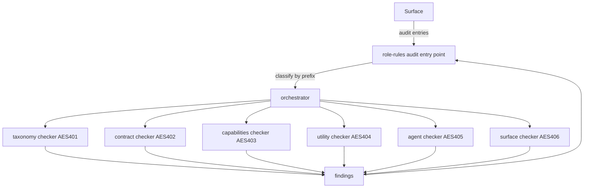

# FRD — role-rules

## Feature Overview

The role-rules crate enforces architectural boundaries and responsibility rules per AES layer (Taxonomy, Contract, Capabilities, Agent, Surface, Utility). It sits in the audit stage of the check command: the Surface calls its audit entry point with pre-fetched file data, and the crate runs zero-I/O business logic that dispatches to six layer-specific role checkers (AES401–AES406) and returns findings to the caller.

## Functional Requirements

### FR-RoleRules-001: File Classification and Dispatch

**Description:** The role-rules crate shall classify every audited file into one AES layer role (agent, capabilities, contract, taxonomy, utility, surface, or root) so the correct layer checker runs on it, and shall ignore files that fall outside every layer directory.

#### Business Logic

- Every file path prefix maps to exactly one layer role; a file never resolves to two roles at once.
- Classification is language-neutral: the same prefix rules apply to Rust, Python, and TypeScript files.
- Windows and POSIX path separators classify identically.
- Bucketed subdirectories under the capabilities layer classify to the capabilities role.
- Root-layer files (DI wiring only) are skipped, not flagged.
- Files outside every layer directory are left unclassified and produce no finding.

#### Edge Cases

- An unclassified path yields no role and therefore no downstream finding.
- A file matching a layer prefix but sitting in a nested bucket still classifies to that layer.
- A file with an unknown prefix is unclassified and ignored.

#### Technical Specification

| Aspect | Detail |
|--------|--------|
| **Input** | Pre-fetched file entries with paths; provided by the Surface through the audit aggregate's execute entry point. |
| **Output** | A single layer role tag per classified file, consumed by AES401–AES406 checkers; audit result returned to the caller. |
| **Protocol** | IClassificationProtocol |
| **Method** | classify(path) |
| **Event** | None; classification is pure and emits no domain event. |
| **Error** | Unclassified path: no role, no finding; parse failure: no finding, audit continues. |

#### Test

| Context | When Action | Then Observable Result |
|---------|-------------|------------------------|
| A fixtures directory holds one file per layer prefix | The classifier runs on each path | Each file resolves to its documented layer role exactly once |
| A file sits outside every layer directory | The classifier runs on that path | No role is assigned and no checker runs on the file |
| Windows and POSIX separators name the same layer file | Both path forms are classified | Both classify to the same layer role |
| A nested capabilities bucket file is classified | The classifier runs on it | It resolves to the capabilities role |

#### Metric

| Target Metric | Value |
|---------------|-------|
| Seeded layer-prefix fixtures classified to their documented role | 100% |
| Unclassified fixtures producing downstream findings | 0 |

### FR-RoleRules-002: Taxonomy Purity and Primitive Restriction (AES401)

**Description:** The role-rules crate shall audit taxonomy files so they use only taxonomy primitives and stay constant-pure, and shall flag any primitive entity (struct, error, or event) declared with a non-taxonomy primitive as an AES401 violation.

#### Business Logic

- Taxonomy files may declare values, enums, and error/runtime/event markers using taxonomy primitives only.
- Constant-only taxonomy files must hold no impl blocks.
- A primitive entity declared with a non-taxonomy primitive is flagged as AES401.
- Files not classified as taxonomy are ignored entirely.

#### Edge Cases

- A clean constant taxonomy file produces no violation.
- A constant taxonomy file containing a struct is flagged.
- An entity, error, or event carrying a primitive is flagged.
- A non-taxonomy file is ignored by classification and produces no finding.

#### Technical Specification

| Aspect | Detail |
|--------|--------|
| **Input** | Classified taxonomy file entries (path plus content). |
| **Output** | AES401 violations inside the audit response returned to the caller. |
| **Protocol** | ITaxonomyRoleProtocol |
| **Method** | taxonomy role audit |
| **Event** | None. |
| **Error** | An unparseable taxonomy file yields no finding rather than failing the audit. |

#### Test

| Context | When Action | Then Observable Result |
|---------|-------------|------------------------|
| A clean constant taxonomy file is audited | The taxonomy checker runs | No AES401 violation is reported |
| A taxonomy file declares a primitive-typed struct | The taxonomy checker runs | One AES401 violation is reported |
| A non-taxonomy file is audited | Classification runs first | The file is ignored and no violation is reported |

#### Metric

| Target Metric | Value |
|---------------|-------|
| Seeded impurity fixtures each producing one AES401 finding | 100% |
| Clean constant and ignored fixtures producing findings | 0 |

### FR-RoleRules-003: Contract Primitive Restriction (AES402)

**Description:** The role-rules crate shall restrict contract files to declarations only, flagging builtin primitives, dispatch bags, and default method bodies, while accepting clean protocol declarations and docstring-then-stub patterns.

#### Business Logic

- Contract files declare traits/interfaces only; no builtin primitives and no dispatch bags are permitted.
- Default method bodies are flagged; a docstring-then-stub (single or multi-line) is accepted as clean.
- Multi-method aggregates on Python contracts are detected.
- Non-contract files are ignored.

#### Edge Cases

- A clean protocol declaration produces no violation.
- A Python docstring-then-stub (single and multi-line) is clean.
- A Python aggregate with multiple methods is detected.
- A Python default body, dispatch bag, or builtin primitive usage is flagged.
- A non-contract file is ignored.

#### Technical Specification

| Aspect | Detail |
|--------|--------|
| **Input** | Classified contract file entries. |
| **Output** | AES402 violations inside the audit response. |
| **Protocol** | IContractRoleProtocol |
| **Method** | contract role audit |
| **Event** | None. |
| **Error** | An unparseable contract yields no finding rather than failing the audit. |

#### Test

| Context | When Action | Then Observable Result |
|---------|-------------|------------------------|
| A clean protocol declaration is audited | The contract auditor runs | No AES402 violation is reported |
| A Python contract carries a default body | The contract auditor runs | One AES402 violation is reported |
| A Python dispatch bag is present | The contract auditor runs | One AES402 violation is reported |
| A non-contract file is audited | Classification runs first | The file is ignored and no violation is reported |

#### Metric

| Target Metric | Value |
|---------------|-------|
| Seeded contract-violation fixtures each producing one AES402 finding | 100% |
| Clean protocol fixtures producing findings | 0 |

### FR-RoleRules-004: Capability Protocol Implementation (AES403)

**Description:** The role-rules crate shall require capability files to implement their protocol with banner and block discipline, flagging missing banners, wrong block order, embedded tests, and local constants outside constants blocks.

#### Business Logic

- Capability files must carry the three banners; a missing middle or first banner over three is flagged.
- The inherent impl must precede the protocol impl (block order); inherent-before-protocol is flagged.
- No embedded tests and no local constants outside constants blocks are permitted.
- Exactly one protocol per capability unless explicitly multi-protocol; multi-protocol Rust is clean single, multi-protocol Python is detected.
- A capability without an implementor is detected; non-capability files are ignored.

#### Edge Cases

- All three banners exact produces no violation.
- Banner count over three is flagged.
- Correct block order is clean; inherent-before-protocol is flagged.
- Embedded test and local constant are flagged.
- Missing banner and missing implementor are flagged.
- Multi-protocol Rust single is clean; multi-protocol Python is detected.
- Non-capability files are ignored.

#### Technical Specification

| Aspect | Detail |
|--------|--------|
| **Input** | Classified capability file entries. |
| **Output** | AES403 violations inside the audit response. |
| **Protocol** | ICapabilitiesRoleProtocol |
| **Method** | capability role audit |
| **Event** | None. |
| **Error** | An unparseable file yields no finding rather than failing the audit. |

#### Test

| Context | When Action | Then Observable Result |
|---------|-------------|------------------------|
| A capability file carries all three exact banners | The capability auditor runs | No AES403 violation is reported |
| A capability file exceeds three banners | The capability auditor runs | One AES403 violation is reported |
| A capability file places the protocol impl before the inherent impl | The capability auditor runs | One AES403 violation is reported |
| A capability file embeds a test | The capability auditor runs | One AES403 violation is reported |

#### Metric

| Target Metric | Value |
|---------------|-------|
| Seeded discipline-break fixtures each firing its own AES403 finding | 100% |
| Pristine capability fixture firing findings | 0 |

### FR-RoleRules-005: Utility Purity (AES404)

**Description:** The role-rules crate shall keep utility files pure, flagging inherent impls, types, and side-effect structures beyond allowed forms, while accepting free functions and macro-body impls.

#### Business Logic

- Utility files may hold free functions only; functions-only Python utilities are not flagged.
- Inherent impls, structs, enums, metadata/impl traits, TS enums/interfaces/type aliases are flagged.
- Rust macro-body impl is not flagged; a Python class in a utility file is flagged.
- Clean metadata produces no violation; non-utility files ignored.

#### Edge Cases

- A clean utility file produces no violation.
- A Python utility with only functions is not flagged.
- A Python utility with a class is flagged.
- A Rust utility with struct/enum/impl is flagged; macro-body impl is not flagged.
- Metadata inherent impl/trait/enum/interface/type alias is reported.
- A non-utility file is ignored.

#### Technical Specification

| Aspect | Detail |
|--------|--------|
| **Input** | Classified utility file entries. |
| **Output** | AES404 violations inside the audit response. |
| **Protocol** | IUtilityRoleProtocol |
| **Method** | utility role audit |
| **Event** | None. |
| **Error** | An unparseable file yields no finding rather than failing the audit. |

#### Test

| Context | When Action | Then Observable Result |
|---------|-------------|------------------------|
| A clean utility file is audited | The utility auditor runs | No AES404 violation is reported |
| A Python utility holds only free functions | The utility auditor runs | No violation is reported |
| A Python utility holds a class | The utility auditor runs | One AES404 violation is reported |
| A Rust utility holds struct/enum/impl | The utility auditor runs | One AES404 violation is reported |
| A non-utility file is audited | Classification runs first | The file is ignored and no violation is reported |

#### Metric

| Target Metric | Value |
|---------------|-------|
| Seeded impure-utility fixtures each firing one AES404 finding | 100% |
| Functions-only Python and macro-body Rust fixtures firing findings | 0 |

### FR-RoleRules-006: Agent Orchestrator Composition (AES405)

**Description:** The role-rules crate shall validate agent orchestrator composition per language, checking aggregate trait usage, capability wiring, and absence of stray primitives, and shall ignore files not classified as agent.

#### Business Logic

- Agent files must follow orchestrator composition rules: aggregate trait, capability wiring, no stray primitives.
- Per-language auditors (Python, Rust, TypeScript) check the structure.
- Files not classified as agent are ignored by classification.
- Well-formed agent files pass; structural gaps (missing aggregate usage, misplaced capability calls) are detected per language.

#### Edge Cases

- A well-formed agent file produces no violation.
- Structural gaps such as missing aggregate usage or misplaced capability calls are detected per language.
- A non-agent file is ignored and produces no finding.
- Clean fixtures produce zero findings.

#### Technical Specification

| Aspect | Detail |
|--------|--------|
| **Input** | Classified agent file entries. |
| **Output** | AES405 violations inside the audit response. |
| **Protocol** | IAgentRoleProtocol |
| **Method** | agent composition audit |
| **Event** | None. |
| **Error** | An unparseable agent yields no finding rather than failing the audit. |

#### Test

| Context | When Action | Then Observable Result |
|---------|-------------|------------------------|
| A well-formed agent file is audited | The agent auditor runs | No AES405 violation is reported |
| An agent file lacks aggregate usage | The agent auditor runs | One AES405 violation is reported |
| An agent file misplaces capability calls | The agent auditor runs | One AES405 violation is reported |
| A non-agent file is audited | Classification runs first | The file is ignored and no violation is reported |

#### Metric

| Target Metric | Value |
|---------------|-------|
| Seeded broken-composition fixtures each firing one AES405 finding | 100% |
| Well-formed agent fixtures firing findings | 0 |

### FR-RoleRules-007: Surface Passive Role (AES406)

**Description:** The role-rules crate shall keep surface files passive, enforcing tier-aware limits on function count and control-flow budget for passive surfaces while exempting smart surfaces, and shall flag logic bypasses while allowing surface utility calls.

#### Business Logic

- Surface tier (smart vs passive) is tier-aware; passive surfaces have a function-count limit and control-flow budget; smart surfaces are exempt from passive limits.
- Utility calls from surface are allowed and not flagged.
- Logic bypass is flagged.
- Fallback path flags passive control flow with a fallback message.
- Non-surface files ignored.

#### Edge Cases

- A clean surface produces no violation.
- A passive surface under the function-count limit is clean.
- Too many functions in a passive surface is flagged.
- Excess passive control flow is flagged with the fallback message variant.
- A smart surface is exempt from passive limits.
- Surface utility calls are not flagged; surface logic bypass is flagged.
- A non-surface file is ignored.

#### Technical Specification

| Aspect | Detail |
|--------|--------|
| **Input** | Classified surface file entries. |
| **Output** | AES406 violations inside the audit response. |
| **Protocol** | ISurfaceRoleProtocol |
| **Method** | surface role audit |
| **Event** | None. |
| **Error** | An unclassified tier treats the file as passive (conservative); an unparseable file yields no finding. |

#### Test

| Context | When Action | Then Observable Result |
|---------|-------------|------------------------|
| A clean surface file is audited | The surface auditor runs | No AES406 violation is reported |
| A passive surface exceeds the control-flow budget | The surface auditor runs | One AES406 violation is reported |
| A smart surface exceeds the passive budget | The surface auditor runs | No violation is reported (exempt) |
| A surface calls only utilities | The surface auditor runs | No violation is reported |
| A non-surface file is audited | Classification runs first | The file is ignored and no violation is reported |

#### Metric

| Target Metric | Value |
|---------------|-------|
| Passive fixtures over budget each firing exactly one AES406 finding | 100% |
| Smart-tier and utility-call fixtures firing findings | 0 |

## Public Interface

| Aspect | Detail |
|--------|--------|
| Agent | RoleOrchestrator |
| Aggregate | IRoleRunnerAggregate |
| Method | execute(&self, request: RoleRequest) -> RoleResponse |
| Request | RoleRequest::{RunAuditWithEntries, Name} |
| Response | RoleResponse::{Audit, Name} |

## Reference

| Artifact | Purpose | Link |
|----------|---------|------|
| PRD | Business goals, user stories, and scope | [PRD.md](../../PRD.md) |
| Backlog | Task tracking, epics, and implementation status | [BACKLOG.md](./BACKLOG.md) |
| Roadmap | Timeline, phasing, and dependencies | [ROADMAP.md](../../ROADMAP.md) |
| Architecture | System boundaries, tech stack, and infra | [ARCHITECTURE.md](../../ARCHITECTURE.md) |
