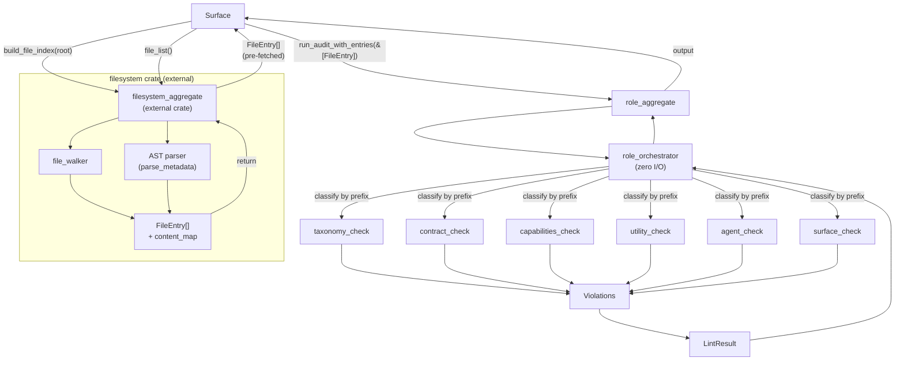

# FRD — role-rules (v2.0.0)

---

## Feature Overview

The role-rules crate enforces architectural boundaries and responsibility rules for each layer (Taxonomy, Contract, Capabilities, Agent, Surface, Utility) as defined by the 7-layer AES architecture. It receives pre-parsed file data from the external filesystem crate, classifies files by their filename prefix, and dispatches to 6 layer-specific role checkers (AES401–AES406). Root layer files are skipped (pure DI wiring only).

File discovery, raw content reads, and AST parsing are handled by the external `filesystem` crate. The Surface calls `filesystem.build_file_index(root)` to populate caches, then passes pre-fetched `&[FileEntry]` (with parse_metadata) to the role-rules orchestrator via `run_audit_with_entries`. The role-rules crate does zero I/O — it only performs business logic analysis on pre-fetched data.

Import checking is NOT performed by role-rules. All import validation (forbidden imports, mandatory imports, unused imports) is the responsibility of the import-rules crate (AES201–AES205). Role-rules only validates structural and responsibility constraints within each file.

- **Architecture & Data Flow**

## Functional Requirements

### FR-RoleRules-001: File Classification and Dispatch

| Aspect | Detail|
|--------|-------|
| Description | |
| Business Rules | |
| Edge Cases | |
| Capability | |
| Protocol | |
| Method | |
| Input | |
| Output | |
| Error | |
| Event | |
| Test | |
| Metric | |

### FR-RoleRules-002: Taxonomy Purity and Primitive Restriction (AES401)

| Aspect | Detail|
|--------|-------|
| Description | |
| Business Rules | |
| Edge Cases | |
| Capability | |
| Protocol | |
| Method | |
| Input | |
| Output | |
| Error | |
| Event | |
| Test | |
| Metric | |

### FR-RoleRules-003: Contract Primitive Restriction (AES402)

| Aspect | Detail|
|--------|-------|
| Description | |
| Business Rules | |
| Edge Cases | |
| Capability | |
| Protocol | |
| Method | |
| Input | |
| Output | |
| Error | |
| Event | |
| Test | |
| Metric | |

### FR-RoleRules-004: Capability Protocol Implementation (AES403)

| Aspect | Detail|
|--------|-------|
| Description | |
| Business Rules | |
| Edge Cases | |
| Capability | |
| Protocol | |
| Method | |
| Input | |
| Output | |
| Error | |
| Event | |
| Test | |
| Metric | |

### FR-RoleRules-005: Utility Purity (AES404)

| Aspect | Detail|
|--------|-------|
| Description | |
| Business Rules | |
| Edge Cases | |
| Capability | |
| Protocol | |
| Method | |
| Input | |
| Output | |
| Error | |
| Event | |
| Test | |
| Metric | |

### FR-RoleRules-006: Agent Orchestrator Composition (AES405)

| Aspect | Detail|
|--------|-------|
| Description | |
| Business Rules | |
| Edge Cases | |
| Capability | |
| Protocol | |
| Method | |
| Input | |
| Output | |
| Error | |
| Event | |
| Test | |
| Metric | |

### FR-RoleRules-007: Surface Passive Role (AES406)

| Aspect | Detail|
|--------|-------|
| Description | |
| Business Rules | |
| Edge Cases | |
| Capability | |
| Protocol | |
| Method | |
| Input | |
| Output | |
| Error | |
| Event | |
| Test | |
| Metric | |

## Public Interface

| Aspect | Detail|
|--------|-------|
| — | — |

## Reference

| Artifact | Purpose | Link|
|----------|---------|------|
| BACKLOG.md | Backlog tracking | [BACKLOG.md](BACKLOG.md)|
| PRD.md | Product requirements | [PRD.md](../../PRD.md)|
| FRD.md | Feature requirements | [FRD.md](FRD.md)|
| ROADMAP.md | Roadmap status | [ROADMAP.md](../../ROADMAP.md)|
| ARCHITECTURE.md | Layer contract | [ARCHITECTURE.md](../../ARCHITECTURE.md)|
