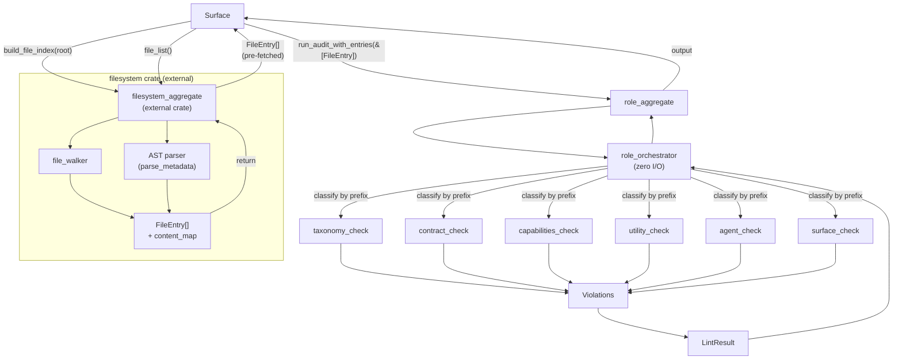

# FRD — role-rules (v2.0.0)

---

## Feature Overview

The role-rules crate enforces architectural boundaries and responsibility rules for each layer (Taxonomy, Contract, Capabilities, Agent, Surface, Utility) as defined by the 7-layer AES architecture. It receives pre-parsed file data from the external filesystem crate, classifies files by their filename prefix, and dispatches to 6 layer-specific role checkers (AES401–AES406). Root layer files are skipped (pure DI wiring only).

File discovery, raw content reads, and AST parsing are handled by the external `filesystem` crate. The Surface calls `filesystem.build_file_index(root)` to populate caches, then passes pre-fetched `&[FileEntry]` (with parse_metadata) to the role-rules orchestrator via `run_audit_with_entries`. The role-rules crate does zero I/O — it only performs business logic analysis on pre-fetched data.

Import checking is NOT performed by role-rules. All import validation (forbidden imports, mandatory imports, unused imports) is the responsibility of the import-rules crate (AES201–AES205). Role-rules only validates structural and responsibility constraints within each file.

- **Architecture & Data Flow**

---

## Functional Requirements

### FR-RoleRules-001: File Classification and Dispatch

#### Description

| No | Detail |
| --- | --- |
| 1 | Classify each file into its AES layer role so the right role checker runs on it. |
| 2 | — |

#### Business Rules

| No | Detail |
| --- | --- |
| 1 | RoleClassifier maps file path prefixes to layer roles (agent, capabilities, contract, taxonomy, utility, surface); every layer prefix maps (role_classifier_maps_every_layer_prefix); capability prefix classifies by file prefix; non-classified files are ignored by role checkers; classification is language-neutral (same rule for Rust, Python, TS). |
| 2 | — |

#### Edge Cases

| No | Detail |
| --- | --- |
| 1 | Windows separator paths classify the same as posix; file outside all layer dirs unclassified (no checker runs, no violation); bucketed subdirectories (capabilities subfolders) classify to capabilities; a file never classified against two roles at once. |
| 2 | — |

#### Capability

| No | Detail |
| --- | --- |
| 1 | RoleClassifier performs layer classification. |

#### Protocol

| No | Detail |
| --- | --- |
| 1 | IClassificationProtocol |

#### Method

| No | Detail |
| --- | --- |
| 1 | `classify(path)` -> layer role for routing to AES401-AES406 checkers. |
| 2 | — |

#### Input

| No | Detail |
| --- | --- |
| 1 | File path; source is RoleRequest::RunAuditWithEntries via IRoleRunnerAggregate::execute entries. |
| 2 | — |

#### Output

| No | Detail |
| --- | --- |
| 1 | Role tag consumed by FR-RoleRules-002..007; audit result in RoleResponse::Audit. |
| 2 | — |

#### Error

| No | Detail |
| --- | --- |
| 1 | Unclassified path yields no role and therefore no finding for that file. |
| 2 | — |

#### Event

| No | Detail |
| --- | --- |
| 1 | None; classification is pure. |
| 2 | — |

#### Test

| No | Detail |
| --- | --- |
| 1 | role_classifier_maps_every_layer_prefix and role_classifier_capability_classifies_file_prefix assert prefix mapping. |
| 2 | — |

#### Metric

| No | Detail |
| --- | --- |
| 1 | Every seeded layer prefix classifies to its documented role; unclassified fixtures produce zero downstream findings. |
| 2 | — |

### FR-RoleRules-002: Taxonomy Purity and Primitive Restriction (AES401)

#### Description

| No | Detail |
| --- | --- |
| 1 | Enforce taxonomy files use only taxonomy primitives and remain constant-pure (AES401). |
| 2 | — |

#### Business Rules

| No | Detail |
| --- | --- |
| 1 | Taxonomy files may declare values, enums, and error/runtime/event markers using taxonomy primitives; primitive entities (struct, error, event) with non-taxonomy primitives are flagged. |
| 2 | Constant-only files must hold no impl blocks; non-taxonomy files are ignored entirely. |

#### Edge Cases

| No | Detail |
| --- | --- |
| 1 | Clean constant file no violation; constant file with struct detected; entity/error/event with primitive detected; non-taxonomy file ignored; metadata cases per language handled by same protocol. |
| 2 | — |

#### Capability

| No | Detail |
| --- | --- |
| 1 | TaxonomyRoleChecker audits taxonomy role compliance. |

#### Protocol

| No | Detail |
| --- | --- |
| 1 | ITaxonomyRoleProtocol |

#### Method

| No | Detail |
| --- | --- |
| 1 | Taxonomy role audit over classified taxonomy files returning AES401 violations. |
| 2 | — |

#### Input

| No | Detail |
| --- | --- |
| 1 | Classified taxonomy file entries (path plus content); source is RoleRequest::RunAuditWithEntries. |
| 2 | — |

#### Output

| No | Detail |
| --- | --- |
| 1 | Violations with AES401 codes inside RoleResponse::Audit. |
| 2 | — |

#### Error

| No | Detail |
| --- | --- |
| 1 | Unparseable file yields no finding; non-taxonomy file skipped by classification. |
| 2 | — |

#### Event

| No | Detail |
| --- | --- |
| 1 | None. |
| 2 | — |

#### Test

| No | Detail |
| --- | --- |
| 1 | aes401_clean_constant_file_no_violation, aes401_constant_file_with_struct_detected, aes401_entity_with_primitive_detected, and aes401_non_taxonomy_file_ignored assert firing and silence. |
| 2 | — |

#### Metric

| No | Detail |
| --- | --- |
| 1 | Seeded impurity fixtures each produce one AES401 finding; clean constant fixture and ignored files produce zero. |
| 2 | — |

### FR-RoleRules-003: Contract Primitive Restriction (AES402)

#### Description

| No | Detail |
| --- | --- |
| 1 | Restrict contract files to declarations: no builtin primitives, no dispatch bags, no default bodies (AES402). |
| 2 | — |

#### Business Rules

| No | Detail |
| --- | --- |
| 1 | Contract files declare traits/interfaces only; default method bodies (Python default body, Python dispatch bag, Python docstring-then-stub patterns handled: docstring-then-stub is clean) are flagged. |
| 2 | Builtin primitive usage inside contracts is flagged; non-contract files ignored; multi-method aggregates on Python contracts detected. |

#### Edge Cases

| No | Detail |
| --- | --- |
| 1 | Clean protocol no violation; python docstring-then-stub clean (single and multi-line); python aggregate with multiple methods detected; python default body detected; python dispatch bag detected; non-contract file ignored. |
| 2 | — |

#### Capability

| No | Detail |
| --- | --- |
| 1 | ContractRoleAuditors (Python, Rust, TypeScript variants) audit contract purity. |

#### Protocol

| No | Detail |
| --- | --- |
| 1 | IContractRoleProtocol |

#### Method

| No | Detail |
| --- | --- |
| 1 | Contract role audit per language returning AES402 violations. |
| 2 | — |

#### Input

| No | Detail |
| --- | --- |
| 1 | Classified contract file entries; source is RoleRequest::RunAuditWithEntries. |
| 2 | — |

#### Output

| No | Detail |
| --- | --- |
| 1 | Violations with AES402 codes inside RoleResponse::Audit. |
| 2 | — |

#### Error

| No | Detail |
| --- | --- |
| 1 | Unparseable contract yields no finding rather than failing the audit. |
| 2 | — |

#### Event

| No | Detail |
| --- | --- |
| 1 | None. |
| 2 | — |

#### Test

| No | Detail |
| --- | --- |
| 1 | aes402_clean_protocol_no_violation, aes402_python_docstring_then_stub_is_clean, aes402_python_dispatch_bag_detected, aes402_python_contract_default_body_detected, and aes402_non_contract_file_ignored assert rules. |
| 2 | — |

#### Metric

| No | Detail |
| --- | --- |
| 1 | Seeded contract-violation fixtures each produce one AES402 finding; clean protocol fixtures produce zero. |
| 2 | — |

### FR-RoleRules-004: Capability Protocol Implementation (AES403)

#### Description

| No | Detail |
| --- | --- |
| 1 | Require capability files to implement their protocol with banner and block discipline (AES403). |
| 2 | — |

#### Business Rules

| No | Detail |
| --- | --- |
| 1 | Capability files must carry the three banners (missing middle/first over three detected); inherent impl must precede protocol impl (block order); no embedded tests, no local constants outside constants blocks. |
| 2 | Exactly one protocol unless explicitly multi-protocol (multi-protocol rust single-no-violation, multi-protocol detected when applicable per language); capability without implementor detected; banner count over three detected; non-capability files ignored; python multi-protocol allowed. |

#### Edge Cases

| No | Detail |
| --- | --- |
| 1 | All three banners exact => no violation; banner above three detected; block order correct=>clean, inherent-before-protocol =>violation; embedded test detected; local constant detected; missing banner detected; missing implementor detected; multi-protocol rust single clean; multi-protocol python detected; non-capability file ignored. |
| 2 | — |

#### Capability

| No | Detail |
| --- | --- |
| 1 | CapabilitiesRoleAuditors (Rust, Python, TypeScript) audit capability discipline. |

#### Protocol

| No | Detail |
| --- | --- |
| 1 | ICapabilitiesRoleProtocol |

#### Method

| No | Detail |
| --- | --- |
| 1 | Capability role audit returning AES403 violations per finding kind. |
| 2 | — |

#### Input

| No | Detail |
| --- | --- |
| 1 | Classified capability file entries; source is RoleRequest::RunAuditWithEntries. |
| 2 | — |

#### Output

| No | Detail |
| --- | --- |
| 1 | Violations with AES403 codes inside RoleResponse::Audit. |
| 2 | — |

#### Error

| No | Detail |
| --- | --- |
| 1 | Unparseable file yields no finding. |
| 2 | — |

#### Event

| No | Detail |
| --- | --- |
| 1 | None. |
| 2 | — |

#### Test

| No | Detail |
| --- | --- |
| 1 | aes403_all_three_banners_no_violation, aes403_banner_above_three_detected, aes403_block_order_inherent_before_protocol_detected, and aes403_embedded_test_detected assert discipline. |
| 2 | — |

#### Metric

| No | Detail |
| --- | --- |
| 1 | Each seeded discipline break fires its own AES403 finding; pristine capability fixture fires zero. |
| 2 | — |

### FR-RoleRules-005: Utility Purity (AES404)

#### Description

| No | Detail |
| --- | --- |
| 1 | Keep utility files pure: no inherent impls, types, or side-effect structures beyond allowed forms (AES404). |
| 2 | — |

#### Business Rules

| No | Detail |
| --- | --- |
| 1 | Utility files may hold free functions (Python functions-only NOT flagged); inherent impls, structs, enums, metadata/impl traits, TS enums/interfaces/type aliases are flagged. |
| 2 | Rust macro-body impl not flagged; Python class inutility flagged; non-utility files ignored; clean metadata no violation. |

#### Edge Cases

| No | Detail |
| --- | --- |
| 1 | Clean utility no violation; python utility with only functions not flagged; python utility with class detected; rust utility with struct/enum/impl detected; rust macro-body impl not flagged; metadata inherent impl/trait/enum/interface/type reported; non-utility file ignored. |
| 2 | — |

#### Capability

| No | Detail |
| --- | --- |
| 1 | UtilityRoleAuditors (Python, Rust, TypeScript) audit utility purity. |

#### Protocol

| No | Detail |
| --- | --- |
| 1 | IUtilityRoleProtocol |

#### Method

| No | Detail |
| --- | --- |
| 1 | Utility role audit returning AES404 violations. |
| 2 | — |

#### Input

| No | Detail |
| --- | --- |
| 1 | Classified utility file entries; source is RoleRequest::RunAuditWithEntries. |
| 2 | — |

#### Output

| No | Detail |
| --- | --- |
| 1 | Violations with AES404 codes inside RoleResponse::Audit. |
| 2 | — |

#### Error

| No | Detail |
| --- | --- |
| 1 | Unparseable file yields no finding. |
| 2 | — |

#### Event

| No | Detail |
| --- | --- |
| 1 | None. |
| 2 | — |

#### Test

| No | Detail |
| --- | --- |
| 1 | aes404_clean_utility_no_violation, aes404_python_utility_with_only_functions_not_flagged, aes404_rust_utility_with_macro_body_impl_not_flagged, and aes404_non_utility_file_ignored assert purity rules. |
| 2 | — |

#### Metric

| No | Detail |
| --- | --- |
| 1 | Seeded impure utility fixtures fire one AES404 finding each; functions-only Python utility and macro-body Rust impl fire zero. |
| 2 | — |

### FR-RoleRules-006: Agent Orchestrator Composition (AES405)

#### Description

| No | Detail |
| --- | --- |
| 1 | Validate agent orchestrator composition: proper agent structure per language (AES405). |
| 2 | — |

#### Business Rules

| No | Detail |
| --- | --- |
| 1 | Agent files must follow orchestrator composition rules (aggregate trait, capability wiring, no stray primitives); per-language auditors (Python, Rust, TypeScript) check the structure; files not classified as agent are ignored. |
| 2 | — |

#### Edge Cases

| No | Detail |
| --- | --- |
| 1 | Well-formed agent files pass; structural gaps (missing aggregate usage, misplaced capability calls) detected per language; non-agent files ignored by classification; clean fixtures produce zero findings. |
| 2 | — |

#### Capability

| No | Detail |
| --- | --- |
| 1 | AgentRoleAuditors (Python, Rust, TypeScript) audit agent composition. |

#### Protocol

| No | Detail |
| --- | --- |
| 1 | IAgentRoleProtocol |

#### Method

| No | Detail |
| --- | --- |
| 1 | Agent composition audit returning AES405 violations. |
| 2 | — |

#### Input

| No | Detail |
| --- | --- |
| 1 | Classified agent file entries; source is RoleRequest::RunAuditWithEntries. |
| 2 | — |

#### Output

| No | Detail |
| --- | --- |
| 1 | Violations with AES405 codes inside RoleResponse::Audit. |
| 2 | — |

#### Error

| No | Detail |
| --- | --- |
| 1 | Unparseable agent yields no finding. |
| 2 | — |

#### Event

| No | Detail |
| --- | --- |
| 1 | None. |
| 2 | — |

#### Test

| No | Detail |
| --- | --- |
| 1 | Agent-role suite coverage in the role rust tests asserts AES405 detection on seeded composition breaks and silence on well-formed agents. |
| 2 | — |

#### Metric

| No | Detail |
| --- | --- |
| 1 | Seeded broken composition fixtures produce one AES405 finding each; well-formed agent fixtures produce zero. |
| 2 | — |

### FR-RoleRules-007: Surface Passive Role (AES406)

#### Description

| No | Detail |
| --- | --- |
| 1 | Keep surface files passive: tier-aware limits on logic, no bypass shortcuts (AES406). |
| 2 | — |

#### Business Rules

| No | Detail |
| --- | --- |
| 1 | Surface tier (smart vs passive) is aware; passive surfaces have a function-count limit and control-flow budget; smart surfaces exempt from the passive limits. |
| 2 | Utility calls from surface are allowed (not flagged); logic bypass flagged; fallback path flags passive control flow with fallback message; non-surface files ignored. |

#### Edge Cases

| No | Detail |
| --- | --- |
| 1 | Clean surface no violation; passive fn count under limit clean; many functions flagged; passive excess control flow detected (fallback message variant); smart surface exempt; surface utility calls not flagged; surface logic bypass flagged; non-surface file ignored. |
| 2 | — |

#### Capability

| No | Detail |
| --- | --- |
| 1 | SurfaceRoleChecker audits surface passivity. |

#### Protocol

| No | Detail |
| --- | --- |
| 1 | ISurfaceRoleProtocol |

#### Method

| No | Detail |
| --- | --- |
| 1 | Surface role audit returning AES406 violations with tier awareness. |
| 2 | — |

#### Input

| No | Detail |
| --- | --- |
| 1 | Classified surface file entries; source is RoleRequest::RunAuditWithEntries. |
| 2 | — |

#### Output

| No | Detail |
| --- | --- |
| 1 | Violations with AES406 codes inside RoleResponse::Audit. |
| 2 | — |

#### Error

| No | Detail |
| --- | --- |
| 1 | Unclassified tier treats file as passive (conservative); unparseable file yields no finding. |
| 2 | — |

#### Event

| No | Detail |
| --- | --- |
| 1 | None. |
| 2 | — |

#### Test

| No | Detail |
| --- | --- |
| 1 | aes406_clean_surface_no_violation, aes406_passive_surface_excess_control_flow_detected, aes406_smart_surface_exempt, aes406_surface_utility_calls_not_flagged, and e2e_surface_violation_detected assert tier rules. |
| 2 | — |

#### Metric

| No | Detail |
| --- | --- |
| 1 | Passive fixtures over budget fire exactly one AES406 finding; smart-tier and utility-call fixtures fire zero. |
| 2 | — |

## Public Interface

| Aspect | Detail|
|--------|-------|
| Agent | RoleOrchestrator — the agent-layer orchestrator behind the role-rule stage of the check command. |
| Aggregate | IRoleRunnerAggregate — the feature's single front door. |
| Method | execute(&self, request: RoleRequest) -> RoleResponse |
| Request | RoleRequest::{RunAuditWithEntries, Name} |
| Response | RoleResponse::{Audit, Name} |

## Reference

| Artifact | Purpose | Link|
|----------|---------|------|
| BACKLOG.md | Backlog tracking | [BACKLOG.md](BACKLOG.md)|
| PRD.md | Product requirements | [PRD.md](../../PRD.md)|
| FRD.md | Feature requirements | [FRD.md](FRD.md)|
| ROADMAP.md | Roadmap status | [ROADMAP.md](../../ROADMAP.md)|
| ARCHITECTURE.md | Layer contract | [ARCHITECTURE.md](../../ARCHITECTURE.md)|
