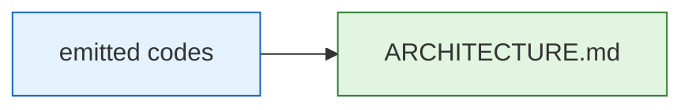

# ARCHITECTURE Exemplar

```markdown
# Agentic Engineering System Architecture

## 1. Purpose

The Agentic Engineering System is a layered, AI-native architecture pattern. It keeps domain models stable, business logic readable, technical detail isolated, and layer boundaries explicit enough for both humans and AI agents to modify the system safely.

### Overview

| Aspect           | Detail                                 |
| ---------------- | -------------------------------------- |
| Pattern type     | Layered, AI-native architecture        |
| Domain models    | Stable, free from technical concerns   |
| Business logic   | Readable, isolated from infrastructure |
| Layer boundaries | Explicit for humans and AI agents      |

---

## 2. Workspace Organization

The architecture supports multi-language workspaces with clear separation of concerns.

### Terms


| Term               | Meaning                                                           |
| ------------------ | ----------------------------------------------------------------- |
| Project Workspaces | Project root containing all configuration and language members    |
| Workspace Member   | One self-contained crate, package, or module inside the workspace |
| Crates directory   | Rust workspace members                                            |
| Packages directory | TypeScript or JavaScript packages                                 |
| Modules directory  | Python modules                                                    |

---

## 3. Naming Convention

File names must communicate three parts: layer as prefix, concern as middle name, role as suffix.

### Format


| Component | Position | Example               |
| --------- | -------- | --------------------- |
| Layer     | Prefix   | `capabilities`        |
| Concern   | Middle   | `user`                |
| Role      | Suffix   | `checker`             |
| Extension | End      | `.rs` / `.py` / `.ts` |


**Pattern:** `layer_concern_role.rs|py|ts`

---

## 4. Vertical Slicing Layout

AI agents frequently make this mistake: do NOT create `surface/`, `taxonomy/`, `contract/`, `capabilities/`, `utility/`, `agent/` folders. The correct structure groups files by feature, with layers as filenames, not directories.

### Member Types


| Member Type | Example Path              | Carries                                   | Documents                  |
| ----------- | ------------------------- | ----------------------------------------- | -------------------------- |
| Features    | `crates/<name-features>/` | `capabilities_*` + `agent_*_orchestrator` | `FRD.md` + `BACKLOG.md`    |
| Surface     | `crates/<name-surfaces>/` | `surface_*`                               | `DESIGN.md` + `BACKLOG.md` |
| Shared      | `crates/shared/<domain>/` | `contract_*` + `taxonomy_*` + `utility_*` | `DATA.md` + `BACKLOG.md`   |


### General Layout

```text
project-root/
├── crates|packages|modules/
│   ├── shared/                          # taxonomy + contract + utility
│   ├── <feature-a>/                     # agent + capabilities + root
│   ├── <feature-b>/
│   ├── <surface-a>/                     # surface
│   └── <surface-b>/
├── Cargo.toml / package.json / pyproject.toml
```

---

## 5. Taxonomy Layer

Taxonomy is the domain foundation layer. It defines the stable language of the domain and must remain free from technical or behavioral concerns.

### Overview


| Aspect       | Detail                                                                             |
| ------------ | ---------------------------------------------------------------------------------- |
| Purpose      | Domain foundation; stable domain language; free from technical/behavioral concerns |
| Dependencies | None                                                                               |


### Components


| Role         | Meaning                               | Allowed Dependencies | Forbidden Dependencies |
| ------------ | ------------------------------------- | -------------------- | ---------------------- |
| Value object | Immutable data concept                | None                 | All other layers       |
| Entity       | Stateful domain concept with identity | None                 | All other layers       |
| Event        | Immutable domain fact                 | None                 | All other layers       |
| Error        | Domain-level error                    | None                 | All other layers       |
| Constant     | Compile-time literal value            | None                 | All other layers       |
| Request      | Domain request message                | None                 | All other layers       |
| Response     | Domain response message               | None                 | All other layers       |


### Rules


| Rule                   | Detail                                                                                                        |
| ---------------------- | ------------------------------------------------------------------------------------------------------------- |
| Primitive usage        | Value objects and Constants may use all primitive types                                                       |
| No raw primitives      | Entities, Events, and Errors must use Value objects/Constants instead of primitive types (bool/str exception) |
| Compile-time constants | Constants must be compile-time values                                                                         |
| Purity                 | Taxonomy must not contain business rules, infrastructure, or imports from other layers                        |


---

## 6. Contract Layer

Contract defines the public behavior of the system without exposing implementation. It allows callers to depend on stable interfaces instead of concrete logic.

### Overview


| Aspect       | Detail                                                                    |
| ------------ | ------------------------------------------------------------------------- |
| Purpose      | Define public behavior without exposing implementation; stable interfaces |
| Dependencies | Taxonomy only                                                             |


### Components


| Role      | Meaning                                                                             | Allowed Dependencies | Forbidden Dependencies                      |
| --------- | ----------------------------------------------------------------------------------- | -------------------- | ------------------------------------------- |
| Protocol  | Interface defining inbound behavior; implemented by Capabilities, consumed by Agent | Taxonomy             | Utility, Capabilities, Agent, Surface, Root |
| Aggregate | Facade definition implemented by Agent, used by Surface to access feature behavior  | Taxonomy             | Utility, Capabilities, Agent, Surface, Root |


### Rules


| Rule              | Detail                                                 |
| ----------------- | ------------------------------------------------------ |
| Behavior only     | Protocol defines behavior only, without implementation |
| Capability hiding | Aggregate hides Capabilities from Surface              |


---

## 7. Utility Layer

Utility contains reusable low-level mechanics that can be shared across capabilities. It exists so that Capabilities can remain clean.

### Overview


| Aspect       | Detail                                                                 |
| ------------ | ---------------------------------------------------------------------- |
| Purpose      | Reusable low-level mechanics shared across capabilities                |
| Role Naming  | Unlimited; chosen based on demand to describe technical responsibility |
| Dependencies | Taxonomy only                                                          |
| Location     | Only in `shared/` layer folder (AES701)                               |


### Components


| Concern                 | Responsibility                                      | Allowed Dependencies | Forbidden Dependencies                       |
| ----------------------- | --------------------------------------------------- | -------------------- | -------------------------------------------- |
| File discovery          | Walk directories, detect files, apply ignore        | Taxonomy             | Contract, Capabilities, Agent, Surface, Root |
| External tool execution | Run linters, compilers, formatters, analyzers       | Taxonomy             | Contract, Capabilities, Agent, Surface, Root |
| Parsing and matching    | Parse text, match patterns, extract structured data | Taxonomy             | Contract, Capabilities, Agent, Surface, Root |
| Path normalization      | Normalize paths across platforms                    | Taxonomy             | Contract, Capabilities, Agent, Surface, Root |
| System operations       | Handle process or environment mechanics             | Taxonomy             | Contract, Capabilities, Agent, Surface, Root |


### Rules


| Rule                    | Detail                                                                                             |
| ----------------------- | -------------------------------------------------------------------------------------------------- |
| Stateless functions     | Utility must use stateless standalone functions only                                               |
| No objects or contracts | Utility must not contain stateful objects, behavior definitions, or contract implementations       |
| No business decisions   | Utility must not make business decisions; may perform technical operations                         |
| Technical scope         | Utility role names may expand freely, but layer must remain technical and standalone               |
| Kernel-only location    | Feature and surface crates consume utility functions via import; they do not own `utility_*` files |
| Misplacement            | `utility_*` in feature folder → AES702; in surface folder → AES703                                 |


---

## 8. Capabilities Layer

Capabilities contain the concrete implementation of the system's behavior. This layer encapsulates both pure business logic and external adaptations. By hiding these behind Contracts, behavior stays modular, swappable, and isolated from orchestration.

### Overview


| Aspect       | Detail                                                                          |
| ------------ | ------------------------------------------------------------------------------- |
| Purpose      | Concrete implementation of behavior; pure business logic + external adaptations |
| Role Naming  | Unlimited; chosen based on demand to describe technical responsibility          |
| Dependencies | Taxonomy, Contract, Utility; must NOT depend on other Capabilities              |


### Components — Business Logic


| Concern        | Responsibility                                | Allowed Dependencies        | Forbidden Dependencies                   |
| -------------- | --------------------------------------------- | --------------------------- | ---------------------------------------- |
| Validation     | Check domain conditions or input correctness  | Taxonomy, Contract, Utility | Other Capabilities, Agent, Surface, Root |
| Computation    | Calculate scores, totals, or derived values   | Taxonomy, Contract, Utility | Other Capabilities, Agent, Surface, Root |
| Transformation | Map, filter, reduce, or reshape data          | Taxonomy, Contract, Utility | Other Capabilities, Agent, Surface, Root |
| Resolution     | Apply rules and decide outcomes               | Taxonomy, Contract, Utility | Other Capabilities, Agent, Surface, Root |
| Assessment     | Judge severity, compliance, grade, or quality | Taxonomy, Contract, Utility | Other Capabilities, Agent, Surface, Root |


### Components — External Adaptation


| Concern     | Responsibility                                 | Allowed Dependencies        | Forbidden Dependencies                   |
| ----------- | ---------------------------------------------- | --------------------------- | ---------------------------------------- |
| Repository  | Fetch or persist domain entities to a database | Taxonomy, Contract, Utility | Other Capabilities, Agent, Surface, Root |
| Integration | Communicate with third-party services or APIs  | Taxonomy, Contract, Utility | Other Capabilities, Agent, Surface, Root |
| Provider    | Generate data from external systems            | Taxonomy, Contract, Utility | Other Capabilities, Agent, Surface, Root |


### Rules


| Rule                           | Detail                                                                                         |
| ------------------------------ | ---------------------------------------------------------------------------------------------- |
| No inter-capability dependency | Capabilities must never import or call other Capabilities directly; standalone execution units |
| Pipeline aggregation           | Multiple Capabilities composed into sequential pipeline by Agent, not by themselves            |
| Shared logic extraction (DRY)  | If multiple Capabilities need same technical mechanics, extract to Utility                     |
| Contract implementation        | Capabilities must implement `protocol_` defined in Contract Layer                              |
| State ownership                | Capabilities own business and technical state within their execution scope                     |
| No domain definition           | Capabilities must not define domain models (Entities, Value Objects); only consume Taxonomy    |


---

## 9. Agent Layer

Agent coordinates multiple capabilities into executable flows. It controls sequence and movement, not business calculation.

### Overview


| Aspect       | Detail                                                                                |
| ------------ | ------------------------------------------------------------------------------------- |
| Purpose      | Coordinate multiple capabilities into executable flows; control sequence and movement |
| Allowed Role | orchestrator only                                                                     |
| Dependencies | Taxonomy, Contract, Utility                                                           |


### Components


| Flow Type               | Purpose                                | Allowed Dependencies        | Forbidden Dependencies      |
| ----------------------- | -------------------------------------- | --------------------------- | --------------------------- |
| Sequential execution    | Run steps in order                     | Taxonomy, Contract, Utility | Capabilities, Surface, Root |
| Looping                 | Process multiple items or events       | Taxonomy, Contract, Utility | Capabilities, Surface, Root |
| Branching               | Choose path based on result            | Taxonomy, Contract, Utility | Capabilities, Surface, Root |
| Error handling          | Recover, abort, continue, or escalate  | Taxonomy, Contract, Utility | Capabilities, Surface, Root |
| Timeout or cancellation | Stop long-running or asynchronous work | Taxonomy, Contract, Utility | Capabilities, Surface, Root |


### Rules


| Rule                    | Detail                                                                             |
| ----------------------- | ---------------------------------------------------------------------------------- |
| Contract dependency     | Agent must depend on Contract, not concrete implementations                        |
| Capability ignorance    | Agent must not use and must be completely ignorant of Capabilities implementations |
| No business calculation | Agent must not calculate business results                                          |
| No domain definition    | Agent must not define domain models                                                |


---

## 10. Surface Layer

Surface is the outer boundary of the system. It handles user-facing or external-facing interaction and translates it into architectural actions.

### Overview


| Aspect        | Detail                                                                                          |
| ------------- | ----------------------------------------------------------------------------------------------- |
| Purpose       | Outer boundary; handles user/external-facing interaction; translates into architectural actions |
| Allowed Roles | command, controller, page, view, component, router, layout, hook, store, action, screen         |


### Components


| Group            | Roles                             | Allowed Dependencies                  | Forbidden Dependencies                                       | Detail                                          |
| ---------------- | --------------------------------- | ------------------------------------- | ------------------------------------------------------------ | ----------------------------------------------- |
| Smart surfaces   | command, controller, page, router | Taxonomy, Contract Aggregate, Utility | Agent, Capabilities, Contract Protocol, Root                 | May initiate feature behavior through aggregate |
| Utility surfaces | hook, store, action, screen       | Taxonomy                              | Agent, Capabilities, Contract, Utility, Other surfaces, Root | Support smart surfaces, data/state only         |
| Passive surfaces | component, view, layout           | Taxonomy                              | Agent, Contract, Capabilities, Other surfaces, Root          | Presentation-only, no logic or orchestration    |


### Rules


| Rule                          | Detail                                                                                 |
| ----------------------------- | -------------------------------------------------------------------------------------- |
| Aggregate consumption         | Smart surfaces must consume Contract Aggregates to reach capabilities/agent            |
| Utility import restriction    | Only smart surfaces may import Utility layer files                                     |
| Direct dependency restriction | Utility and passive surfaces must not import Capabilities, Contract, or Agent directly |
| Business logic restriction    | Surfaces must not contain business calculation or orchestration                        |


---

## 11. Root Layer

Root is the composition layer. It assembles the system by connecting concrete implementations to contracts and starting the application.

### Overview


| Aspect       | Detail                                                                                         |
| ------------ | ---------------------------------------------------------------------------------------------- |
| Purpose      | Composition layer; assembles system by connecting concrete impls to contracts and starting app |
| Dependencies | All layers                                                                                     |


### Components


| Role      | Allowed Dependencies | Forbidden Dependencies | Detail                                                                            |
| --------- | -------------------- | ---------------------- | --------------------------------------------------------------------------------- |
| Container | All layers           | None                   | Wires one feature by connecting Capabilities to Contract protocols and aggregates |
| Entry     | All layers           | None                   | Bootstraps the application and composes feature containers                        |


### Rules


| Rule                     | Detail                                                             |
| ------------------------ | ------------------------------------------------------------------ |
| Wiring                   | Root may instantiate and wire components                           |
| No business logic        | Root must not contain business logic                               |
| No orchestration         | Root must not contain orchestration policy                         |
| No technical/UI behavior | Root must not contain technical parsing or user interface behavior |


---

## 12. Finding Rendering Notes

Group 6 (Document Invariants) and Group 7 (Folder Structure) findings carry a `violation_type` field (snake_case) that appears in the JSON report.

### Details


| Aspect                     | Detail                                                                   |
| -------------------------- | ------------------------------------------------------------------------ |
| Authoritative explanations | Per-finding `why` and `fix` strings in `DocFinding` / `StructureFinding` |
| Linter behavior            | Sets `why` and `fix` at emission time                                    |
| Rule detail reference      | §13 Rule Inventory Overview and per-group sections §14–20                |
| Remediation guidance       | Use JSON `why` and `fix` fields in scan output                           |


---

## 13. Rule Inventory Overview

38 rules across 7 groups. 

### Group Coverage and Counts


| Group       | Code range    | Count | Command scope         |
| ----------- | ------------- | ----- | --------------------- |
| 1 Naming    | AES101–AES103 | 3     | check/scan, `naming`  |
| 2 Import    | AES201–AES205 | 5     | check/scan, `import`  |
| 3 Quality   | AES301–AES305 | 5     | check/scan, `quality` |
| 4 Role      | AES401–AES406 | 6     | check/scan, `role`    |
| 5 Orphan    | AES501–AES506 | 6     | check/scan, `orphan`  |
| 6 Doc       | AES601–AES607 | 7     | check/scan, `docs`    |
| 7 Structure | AES701–AES706 | 6     | check/scan            |
| Total | AES101–AES706 | 38 | — |


### Rule inventory


| Code | Group | Name | Severity | Ran by |
|------|-------|------|----------|--------|
| AES101 | Naming | Naming Convention | HIGH | check/scan, naming |
| AES102 | Naming    | Suffix/Prefix Rules      | HIGH            | check/scan, naming  |
| AES103 | Naming    | Test File Prefix         | HIGH            | check/scan, naming  |
| AES201 | Import    | Forbidden Import         | CRITICAL        | check/scan, import  |
| AES202 | Import    | Mandatory Import         | HIGH            | check/scan, import  |
| AES203 | Import    | Unused Import            | MEDIUM          | check/scan, import  |
| AES204 | Import    | Dummy Import             | HIGH            | check/scan, import  |
| AES205 | Import    | Circular Import          | CRITICAL        | check/scan, import  |
| AES301 | Quality   | File Maximum Limit       | HIGH            | check/scan, quality |
| AES302 | Quality   | File Minimum Limit       | HIGH            | check/scan, quality |
| AES303 | Quality   | Mandatory Definition     | HIGH/MEDIUM     | check/scan, quality |
| AES304 | Quality   | Bypass Comment           | CRITICAL        | check/scan, quality |
| AES305 | Quality   | Duplication Code         | MEDIUM          | check/scan, quality |
| AES401 | Role      | Taxonomy Role            | HIGH            | check/scan, role    |
| AES402 | Role      | Contract Role            | HIGH            | check/scan, role    |
| AES403 | Role      | Capabilities Role        | HIGH/MEDIUM/LOW | check/scan, role    |
| AES404 | Role      | Utility Role             | MEDIUM          | check/scan, role    |
| AES405 | Role      | Agent Role               | HIGH/MEDIUM/LOW | check/scan, role    |
| AES406 | Role      | Surface Role             | HIGH            | check/scan, role    |
| AES501 | Orphan    | Taxonomy Orphan          | LOW             | check/scan, orphan  |
| AES502 | Orphan    | Contract Orphan          | MEDIUM          | check/scan, orphan  |
| AES503 | Orphan    | Capabilities Orphan      | MEDIUM          | check/scan, orphan  |
| AES504 | Orphan    | Utility Orphan           | MEDIUM          | check/scan, orphan  |
| AES505 | Orphan    | Agent Orphan             | HIGH            | check/scan, orphan  |
| AES506 | Orphan    | Surface Orphan           | HIGH/MEDIUM/LOW | check/scan, orphan  |
| AES601 | Doc       | FR Format                | HIGH            | check/scan, docs    |
| AES602 | Doc       | Section Structure        | HIGH            | check/scan, docs    |
| AES603 | Doc       | Spec Purity              | HIGH            | check/scan, docs    |
| AES604 | Doc       | Crosslinks               | HIGH            | check/scan, docs    |
| AES605 | Doc       | Doc Heading Structure    | HIGH            | check/scan, docs    |
| AES606 | Doc       | Doc Template Conformance | HIGH            | check/scan, docs    |
| AES607 | Doc       | PR Folder Ownership      | HIGH            | check/scan, docs    |
| AES701 | Structure | Shared Folder Purity     | MEDIUM          | check/scan          |
| AES702 | Structure | Feature Folder Health    | MEDIUM          | check/scan          |
| AES703 | Structure | Surface Folder Purity    | MEDIUM          | check/scan          |
| AES704 | Structure | Test Suite Coverage      | MEDIUM          | check/scan          |
| AES705 | Structure | Member-Root Placement    | MEDIUM          | check/scan          |
| AES706 | Structure | PR-LA Folder Mapping     | MEDIUM          | check/scan          |


### Common Rule Exceptions


| Item         | Detail                                                                                                |
| ------------ | ----------------------------------------------------------------------------------------------------- |
| Carries      | `lib.rs`, `mod.rs`, `build.rs`, `__init__.py`, `index.js`, `index.ts`, `index.tsx`                    |
| Effect       | Barrel/entry files are skipped by the rule checkers                                                   |
| Not included | `main.rs`, `main.py`, `main.ts` — excluded because checkers exempt entry files via `is_entry_point()` |


---

## 14. Group 1: Naming (AES101–AES103)

Group 1 enforces file naming conventions to ensure clarity and consistency across the codebase.

### AES101 — Naming Convention


| Field           | Value                                                                                     |
| --------------- | ----------------------------------------------------------------------------------------- |
| Code / Severity | AES101 / HIGH                                                                             |
| Fires when      | File stem violates `prefix_concept[_concept…]_suffix`: lowercase, `_` separated, ≥3 words |
| Scope           | Production source files; `tests/`+`benches/` handled by AES103 only                       |
| Fix             | Rename to the layer pattern, e.g. `capabilities_user_checker.rs`                          |
| Exceptions      | Common exemptions (§13)                                                                   |


#### Sub-checks


| #   | Sub-check         | Severity | Violation name      | Fires when                                                                                   |
| --- | ----------------- | -------- | ------------------- | -------------------------------------------------------------------------------------------- |
| 1   | Naming convention | HIGH     | `NAMING_CONVENTION` | Stem is not the `prefix_concept_suffix` shape (all-lowercase, ≥3 underscore-separated words) |


### AES102 — Suffix/Prefix Rules


| Field           | Value                                                                                |
| --------------- | ------------------------------------------------------------------------------------ |
| Code / Severity | AES102 / HIGH                                                                        |
| Fires when      | A file's layer suffix matches neither its layer's allowed set nor its forbidden list |
| Scope           | Production source files whose stem carries a recognized layer prefix                 |
| Fix             | Rename with an allowed suffix for the detected layer, or move the file               |
| Exceptions      | Common exemptions (§13) plus `main.rs`; config `exceptions` entries                  |


#### Layer Suffix Policy


| Layer          | Policy   | Allowed Suffixes                                                                                              | Forbidden Suffixes                                                                                                   |
| -------------- | -------- | ------------------------------------------------------------------------------------------------------------- | -------------------------------------------------------------------------------------------------------------------- |
| `root`         | strict   | `entry`, `container`                                                                                          | —                                                                                                                    |
| `taxonomy`     | strict   | `vo`, `entity`, `error`, `event`, `constant`, `request`, `response`                                           | —                                                                                                                    |
| `contract`     | strict   | `protocol`, `aggregate`                                                                                       | —                                                                                                                    |
| `utility`      | flexible | any                                                                                                           | `vo`, `entity`, `error`, `event`, `constant`, `protocol`, `aggregate`, `request`, `response`                         |
| `capabilities` | flexible | any                                                                                                           | `vo`, `entity`, `error`, `event`, `constant`, `constants`, `protocol`, `aggregate`, `utility`, `request`, `response` |
| `agent`        | strict   | `orchestrator`                                                                                                | —                                                                                                                    |
| `surface`      | strict   | `command`, `controller`, `page`, `view`, `component`, `router`, `layout`, `hook`, `store`, `action`, `screen` | —                                                                                                                    |


#### Sub-checks


| #   | Sub-check              | Severity | Violation name  | Fires when                                                     |
| --- | ---------------------- | -------- | --------------- | -------------------------------------------------------------- |
| 1   | Forbidden suffix       | HIGH     | `SUFFIX_PREFIX` | Suffix is in this layer's `forbidden_suffix` list              |
| 2   | Strict suffix policy   | HIGH     | `SUFFIX_PREFIX` | Layer policy is `strict` and suffix is not in `allowed_suffix` |
| 3   | Flexible suffix policy | HIGH     | `SUFFIX_PREFIX` | Layer policy is `flexible` and suffix is in `forbidden_suffix` |


### AES103 — Test File Prefix


| Field           | Value                                                                                                                                                 |
| --------------- | ----------------------------------------------------------------------------------------------------------------------------------------------------- |
| Code / Severity | AES103 / HIGH                                                                                                                                         |
| Fires when      | A file in `tests/` or `benches/` is nested under a subdirectory, lacks a legal test-type prefix, or carries a prefix belonging to the other directory |
| Scope           | `tests/` and `benches/` files only                                                                                                                    |
| Fix             | Flatten the file into `tests/`/`benches/` and rename it `<type>_<subject>.<ext>`                                                                      |
| Exceptions      | Common exemptions (§13)                                                                                                                               |


#### Legal Prefixes


| Directory  | Legal prefixes                                                                                                                                    |
| ---------- | ------------------------------------------------------------------------------------------------------------------------------------------------- |
| `tests/`   | `contract_`, `unit_`, `integration_`, `dogfood_`, `smoke_`, `e2e_`, `acceptance_`, plus support `regression_`, `behavioral_`, `mock_`, `fixture_` |
| `benches/` | `bench_`                                                                                                                                          |
| anywhere   | any — a file outside both directories carries no test-type prefix                                                                                 |


#### Sub-checks


| #   | Sub-check        | Severity | Violation name     | Fires when                                                                             |
| --- | ---------------- | -------- | ------------------ | -------------------------------------------------------------------------------------- |
| 1   | Flat layout      | HIGH     | `TEST_FILE_PREFIX` | File sits below `tests/` or `benches/` in a subdirectory                               |
| 2   | Legal prefix     | HIGH     | `TEST_FILE_PREFIX` | Stem starts with no legal prefix for its directory                                     |
| 3   | Barrel exemption | HIGH     | `TEST_FILE_PREFIX` | `mod.rs`, `lib.rs`, `__init__.py`, `index.ts`, `index.js` name no test and are skipped |


---

## 15. Group 2: Layer & Import Boundary (AES201–AES205)

Group 2 enforces layer dependency boundaries to maintain architectural integrity.

### AES201 — Forbidden Import


| Field           | Value                                                                                                |
| --------------- | ---------------------------------------------------------------------------------------------------- |
| Code / Severity | AES201 / CRITICAL                                                                                    |
| Fires when      | An import violates the allowed/mandatory/forbidden triple for the file's filename-prefix layer scope |
| Scope           | Every scanned source file whose stem maps to one of the 13 layer scopes                              |
| Fix             | Remove or redirect the import to a layer the scope's Allowed cell permits                            |
| Config          | `architecture.rules.AES201`                                                                          |


#### Import Matrix (13 Scopes)


| #   | Scope                                      | Allowed                                                   | Mandatory                      | Forbidden                                                                                                 |
| --- | ------------------------------------------ | --------------------------------------------------------- | ------------------------------ | --------------------------------------------------------------------------------------------------------- |
| 1   | `taxonomy(vo)`                             | `taxonomy`                                                | —                              | `agent,surface,contract,utility,capabilities,root`                                                        |
| 2   | `taxonomy(request,response)`               | `taxonomy`                                                | —                              | `agent,surface,contract,utility,capabilities,root`                                                        |
| 3   | `taxonomy(entity,error,event)`             | `taxonomy`                                                | `taxonomy(vo|constant)`        | `agent,surface,contract,utility,capabilities,root`                                                        |
| 4   | `taxonomy(constant)`                       | `taxonomy`                                                | —                              | `agent,surface,contract,utility,capabilities,root`                                                        |
| 5   | `utility`                                  | `taxonomy`                                                | —                              | `agent,surface,contract,capabilities,root,utility`                                                        |
| 6   | `contract(protocol)`                       | `taxonomy,contract`                                       | `taxonomy`                     | `agent,surface,capabilities,contract(aggregate),root`                                                     |
| 7   | `contract(aggregate)`                      | `taxonomy,contract`                                       | `taxonomy`                     | `agent,surface,capabilities,root`                                                                         |
| 8   | `capabilities`                             | `taxonomy,contract,utility`                               | `taxonomy,contract(protocol)`  | `surface,agent,capabilities,root`                                                                         |
| 9   | `agent(orchestrator)`                      | `taxonomy,contract(aggregate),contract(protocol),utility` | `taxonomy,contract(aggregate)` | `surface,capabilities,root`                                                                               |
| 10  | `root`                                     | `taxonomy,contract,capabilities,agent,surface`            | —                              | —                                                                                                         |
| 11  | `surface(command|controller|page)`         | `taxonomy,contract(aggregate),utility`                    | —                              | `agent,capabilities,contract(protocol),root`                                                              |
| 12  | `surface(hook|store|action|screen|router)` | `taxonomy,contract(aggregate),utility`                    | —                              | `agent,capabilities,contract(protocol),surface(command|controller|page|entry),root`                       |
| 13  | `surface(component|view|layout)`           | `taxonomy,contract(aggregate),utility`                    | —                              | `agent,contract,capabilities,surface(command|controller|page|entry|hook|store|action|screen|router),root` |


### AES202 — Mandatory Import


| Field           | Value                                                                       |
| --------------- | --------------------------------------------------------------------------- |
| Code / Severity | AES202 / HIGH                                                               |
| Fires when      | A file is missing a required import defined by its layer's `mandatory` list |
| Scope           | Every scanned source file whose layer declares a non-empty `mandatory` list |
| Fix             | Add the required import statement                                           |
| Config          | `architecture.rules.AES202`                                                 |
| Exceptions      | Common exemptions (§13); config `exceptions` entries                        |


### AES203 — Unused Import


| Field           | Value                                                                                            |
| --------------- | ------------------------------------------------------------------------------------------------ |
| Code / Severity | AES203 / MEDIUM                                                                                  |
| Fires when      | A symbol is imported but never used in file scope (AST analysis across Rust, Python, JavaScript) |
| Scope           | Every scanned source file                                                                        |
| Fix             | Remove the unused import or use the symbol                                                       |
| Config          | `architecture.rules.AES203`                                                                      |
| Exceptions      | Common exemptions (§13); config `exceptions` entries                                             |


### AES204 — Dummy Import


| Field           | Value                                                                                                                                                         |
| --------------- | ------------------------------------------------------------------------------------------------------------------------------------------------------------- |
| Code / Severity | AES204 / HIGH                                                                                                                                                 |
| Fires when      | An import string matches a forbidden dummy pattern — symbols used only inside `_use_mandatory_imports` dummy functions, dummy functions, or dummy trait impls |
| Scope           | Every scanned source file                                                                                                                                     |
| Fix             | Use imported symbols in real logic, remove `_use_mandatory_imports` functions, implement contract methods with real behavior                                  |
| Config          | `architecture.rules.AES204`                                                                                                                                   |
| Exceptions      | Common exemptions (§13); config `exceptions` entries                                                                                                          |


### AES205 — Circular Import


| Field           | Value                                                                                                          |
| --------------- | -------------------------------------------------------------------------------------------------------------- |
| Code / Severity | AES205 / CRITICAL                                                                                              |
| Fires when      | A back-edge or cross-layer dependency cycle exists between layers                                              |
| Scope           | Every scanned source file                                                                                      |
| Fix             | Extract shared types to taxonomy, define a contract protocol, or restructure dependency direction to bottom-up |
| Config          | `architecture.rules.AES205`                                                                                    |
| Exceptions      | `exceptions` entries for `AES205` in config                                                                    |


---

## 16. Group 3: File & Content Quality (AES301–AES305)

Group 3 enforces file size limits and content quality standards to maintain code readability.

### AES301 — File Maximum Limit


| Field           | Value                                                                             |
| --------------- | --------------------------------------------------------------------------------- |
| Code / Severity | AES301 / HIGH                                                                     |
| Fires when      | File exceeds the maximum allowed line count (default: 1000)                       |
| Scope           | Every scanned source file; barrel/entry files and `*_constant` files are excepted |
| Fix             | Split into smaller files                                                          |
| Config          | `architecture.rules.AES301` (`code_analysis.max_lines`)                           |
| Exceptions      | Common exemptions (§13) plus per-layer `exceptions`                               |


### AES302 — File Minimum Limit


| Field           | Value                                                                             |
| --------------- | --------------------------------------------------------------------------------- |
| Code / Severity | AES302 / HIGH                                                                     |
| Fires when      | File is below the minimum required line count (default: 5)                        |
| Scope           | Every scanned source file; barrel/entry files and `*_constant` files are excepted |
| Fix             | Merge into a related module or add more documentation                             |
| Config          | `architecture.rules.AES302` (`code_analysis.min_lines`)                           |
| Exceptions      | Common exemptions (§13) plus per-layer `exceptions`                               |


### AES303 — Mandatory Definition


| Field           | Value                                                                                                                          |
| --------------- | ------------------------------------------------------------------------------------------------------------------------------ |
| Code / Severity | AES303 / HIGH (missing) / MEDIUM (empty)                                                                                       |
| Fires when      | A source file has no struct/enum/trait/class definition, or a definition is empty                                              |
| Scope           | Every scanned source file; barrel/entry files, `*_constant.rs`, `*_constant.py`, `main.rs`, `main.py`, `py.typed` are excepted |
| Fix             | Group functions into a struct or implement an interface; remove empty definitions                                              |
| Config          | `architecture.rules.AES303` (`code_analysis.mandatory_class_definition`)                                                       |
| Exceptions      | `__init__.py`, `mod.rs`, `lib.rs`, `*_constant.rs`, `*_constant.py`                                                            |


#### Sub-checks


| #   | Sub-check               | Severity | Violation name         | Fires when                                                          |
| --- | ----------------------- | -------- | ---------------------- | ------------------------------------------------------------------- |
| 1   | Missing definition      | HIGH     | `MANDATORY_DEFINITION` | File has no struct/enum/trait/class at all                          |
| 2   | Empty / dead definition | MEDIUM   | `DEAD_INHERITANCE`     | `struct Foo;`, `impl X for Y {}`, `class Foo: pass`, `class Foo {}` |


### AES304 — Bypass Comment


| Field           | Value                                                                   |
| --------------- | ----------------------------------------------------------------------- |
| Code / Severity | AES304 / CRITICAL                                                       |
| Fires when      | A forbidden bypass pattern is detected                                  |
| Scope           | Every scanned source file                                               |
| Fix             | Use proper error handling                                               |
| Config          | `architecture.rules.AES304` (`code_analysis.forbidden_bypass` patterns) |
| Exceptions      | Test modules are skipped                                                |


#### Forbidden Bypass Patterns


| Pattern                                                                                                                                            | Violation kind            | Fires when                                 |
| -------------------------------------------------------------------------------------------------------------------------------------------------- | ------------------------- | ------------------------------------------ |
| `#[allow(...)]`                                                                                                                                    | `BYPASS_COMMENT`          | Forbidden bypass attribute                 |
| `unwrap()` / `expect()`                                                                                                                            | `UNWRAP_EXPECT`           | Forbidden unwrap or expect call            |
| `panic!`                                                                                                                                           | `PANIC`                   | Forbidden panic call                       |
| `todo`                                                                                                                                             | `TODO`                    | Forbidden unfinished-implementation marker |
| `unimplemented` / `unreachable`                                                                                                                    | `UNIMPLEMENTED`           | Forbidden unimplemented-body marker        |
| `noqa` / `type: ignore` / `eslint-disable` / `ts-ignore` / `ts-expect-error`                                                                       | `BYPASS_COMMENT`          | Forbidden lint-stopper comment             |
| `FIXME` / `HACK` / `XXX`                                                                                                                           | `BYPASS_COMMENT`          | Forbidden TODO marker                      |
| `raise NotImplementedError` / `assert False`                                                                                                       | `UNIMPLEMENTED` / `PANIC` | Python bypass patterns                     |
| `throw new Error(...)` / `throw new TypeError(...)` / `throw new RangeError(...)` / `throw new ReferenceError(...)` / `throw new SyntaxError(...)` | `PANIC`                   | JS/TS bypass pattern                       |


### AES305 — Duplication Code


| Field           | Value                                                                                 |
| --------------- | ------------------------------------------------------------------------------------- |
| Code / Severity | AES305 / MEDIUM                                                                       |
| Fires when      | A file's share of shared normalized content windows exceeds the duplication threshold |
| Scope           | Every scanned source file; import-only windows are excluded                           |
| Fix             | Extract duplicated logic into shared utilities                                        |
| Config          | `architecture.rules.AES305` (`code_analysis.min_lines`, `duplication_threshold`)      |


---

## 17. Group 4: Role Violations (AES401–AES406)

Group 4 enforces role-specific constraints to ensure each layer maintains its intended responsibility.

### AES401 — Taxonomy Role


| Field           | Value                                                                                                                     |
| --------------- | ------------------------------------------------------------------------------------------------------------------------- |
| Code / Severity | AES401 / HIGH                                                                                                             |
| Fires when      | A `_constant` file carries a non-const declaration, or an `_entity`/`_error`/`_event` file uses a primitive type directly |
| Scope           | Taxonomy files: `*_constant.rs`, `*_entity.rs`, `*_error.rs`, `*_event.rs`                                                |
| Fix             | Replace primitives with taxonomy value objects; keep `_constant` files const-only                                         |
| Exceptions      | Common exemptions (§13)                                                                                                   |


#### Sub-checks


| #   | Sub-check             | Severity | Violation name  | Fires when                                                                                  |
| --- | --------------------- | -------- | --------------- | ------------------------------------------------------------------------------------------- |
| 1   | Constant purity       | HIGH     | `TAXONOMY_ROLE` | `_constant` file contains non-const declarations                                            |
| 2   | Primitive in taxonomy | HIGH     | `TAXONOMY_ROLE` | `_entity`/`_error`/`_event` file uses `String`, `i32`, `bool`, `int`, `float` etc. directly |


### AES402 — Contract Role


| Field           | Value                                                                                        |
| --------------- | -------------------------------------------------------------------------------------------- |
| Code / Severity | AES402 / HIGH                                                                                |
| Fires when      | A contract trait/method signature uses a primitive type instead of a taxonomy VO or constant |
| Scope           | Contract files (`*_protocol.rs`, `*_aggregate.rs`); test projects are the primary target     |
| Fix             | Replace primitives with VO/constant types from the taxonomy layer                            |


#### Sub-checks


| #   | Sub-check     | Severity | Violation name  | Fires when                                          |
| --- | ------------- | -------- | --------------- | --------------------------------------------------- |
| 1   | Contract role | HIGH     | `CONTRACT_ROLE` | Primitive type in a contract trait/method signature |


### AES403 — Capabilities Role


| Field           | Value                                                                                             |
| --------------- | ------------------------------------------------------------------------------------------------- |
| Code / Severity | AES403 / HIGH / MEDIUM / LOW per sub-check                                                        |
| Fires when      | Capability violates protocol enforcement or the 3-block structure                                 |
| Scope           | Capability files (`*_capability*`); runs for Rust, Python, and TypeScript/JavaScript              |
| Fix             | Ensure capability implements its protocol; split routing across capabilities; reorder impl blocks |


#### Sub-checks


| #   | Sub-check               | Severity | Violation name    | Fires when                                                                     |
| --- | ----------------------- | -------- | ----------------- | ------------------------------------------------------------------------------ |
| 1   | CapabilityTooManyTypes  | HIGH     | `CAPABILITY_ROLE` | File exceeds max 3 type declarations                                           |
| 2   | CapabilityNoImplementor | MEDIUM   | `CAPABILITY_ROLE` | No struct/class implements a `_protocol` contract trait                        |
| 3   | CapabilityMultiProtocol | MEDIUM   | `CAPABILITY_ROLE` | File implements more than one protocol trait                                   |
| 4   | CapabilityBlockOrder    | HIGH     | `CAPABILITY_ROLE` | Block 2 (protocol trait impl) does not precede Block 3 (inherent impl)         |
| 5   | CapabilityBlockMarkers  | MEDIUM   | `CAPABILITY_ROLE` | `Block <n>:` banners missing, out of order, or above 3                         |
| 6   | CapabilityLocalConstant | MEDIUM   | `CAPABILITY_ROLE` | File-level `const` declared inline; belongs in `taxonomy_<domain>_constant.rs` |
| 7   | CapabilityEmbeddedTest  | LOW      | `CAPABILITY_ROLE` | `#[cfg(test)]` or `mod tests` declared inline                                  |
| 8   | CapabilityPublicHelper  | MEDIUM   | `CAPABILITY_ROLE` | Block 3 helper with no production caller is `pub`                              |


#### Language Coverage


| Language                | Coverage             |
| ----------------------- | -------------------- |
| Rust                    | All eight sub-checks |
| Python                  | All eight sub-checks |
| TypeScript / JavaScript | All eight sub-checks |


### AES404 — Utility Role


| Field           | Value                                                                                                                                               |
| --------------- | --------------------------------------------------------------------------------------------------------------------------------------------------- |
| Code / Severity | AES404 / MEDIUM                                                                                                                                     |
| Fires when      | A utility file contains stateful objects, struct/class state, trait definitions, impl blocks, type aliases, interface definitions, enum definitions |
| Scope           | Utility files (`*_utility*`)                                                                                                                        |
| Fix             | Refactor to stateless standalone functions; remove non-taxonomy imports; move stateful logic into Capabilities                                      |


#### Sub-checks


| #   | Sub-check    | Severity | Violation name | Fires when                                            |
| --- | ------------ | -------- | -------------- | ----------------------------------------------------- |
| 1   | Utility role | MEDIUM   | `UTILITY_ROLE` | Utility contains stateful objects or type definitions |


### AES405 — Agent Role


| Field           | Value                                                                                                                        |
| --------------- | ---------------------------------------------------------------------------------------------------------------------------- |
| Code / Severity | AES405 / HIGH / MEDIUM / LOW per sub-check                                                                                   |
| Fires when      | Agent orchestrator violates role discipline                                                                                  |
| Scope           | Agent files (`*_orchestrator*`)                                                                                              |
| Fix             | Coordinate at minimum 2 injected subsystems; no state mutation outside the constructor; delegate computation to capabilities |


#### Sub-checks


| #   | Sub-check (dispatch order)       | Severity               | Violation name | Fires when                                                                                               |
| --- | -------------------------------- | ---------------------- | -------------- | -------------------------------------------------------------------------------------------------------- |
| 1   | `check_agent_routing`            | MEDIUM / HIGH / MEDIUM | `AGENT_ROLE`   | No aggregate-trait implementor (MEDIUM); &gt;3 type declarations (HIGH); `Any`/`any` annotation (MEDIUM) |
| 2   | `check_agent_block_order`        | HIGH                   | `AGENT_ROLE`   | Block 2 does not precede Block 3                                                                         |
| 3   | `check_agent_protocol_forbidden` | HIGH                   | `AGENT_ROLE`   | Agent implements a contract protocol                                                                     |
| 4   | `check_agent_block_markers`      | MEDIUM                 | `AGENT_ROLE`   | `Block <n>:` banner with n &gt; 3                                                                        |
| 5   | `check_agent_io_forbidden`       | MEDIUM                 | `AGENT_ROLE`   | Forbidden I/O operations in the agent file                                                               |
| 6   | `check_agent_constant_placement` | MEDIUM                 | `AGENT_ROLE`   | File-level constants; policy constants belong in taxonomy                                                |
| 7   | `check_agent_computation`        | MEDIUM                 | `AGENT_ROLE`   | `.sum()` / `.fold()` / `.reduce()` / arithmetic in agent file                                            |
| 8   | `check_agent_abstract_method`    | MEDIUM                 | `AGENT_ROLE`   | `@abstractmethod` in agent file                                                                          |
| 9   | `check_agent_stateless`          | MEDIUM                 | `AGENT_ROLE`   | State mutation outside the constructor                                                                   |
| 10  | `check_agent_free_fn`            | LOW                    | `AGENT_ROLE`   | Module-level free functions                                                                              |
| 11  | `check_agent_subsystem_count`    | LOW                    | `AGENT_ROLE`   | Fewer than 2 injected protocol subsystems                                                                |


### AES406 — Surface Role


| Field           | Value                                                                                                                                                          |
| --------------- | -------------------------------------------------------------------------------------------------------------------------------------------------------------- |
| Code / Severity | AES406 / HIGH (one sub-check MEDIUM)                                                                                                                           |
| Fires when      | A surface file carries too many responsibilities, active domain logic in a passive surface, or direct surface-to-domain calls                                  |
| Scope           | Surface files (`*_command*`, `*_controller*`, `*_page*`, `*_router*`, `*_hook*`, `*_store*`, `*_action*`, `*_screen*`, `*_component*`, `*_view*`, `*_layout*`) |
| Fix             | Split surface responsibilities; move business logic to Capabilities; route domain calls through contracts                                                      |


#### Sub-checks


| #   | Sub-check                              | Severity | Violation name | Fires when                                                           |
| --- | -------------------------------------- | -------- | -------------- | -------------------------------------------------------------------- |
| 1   | Function-count ceiling (tier-specific) | HIGH     | `SURFACE_ROLE` | Smart exempt; utility 25; passive 50                                 |
| 2   | Active domain logic in passive surface | HIGH     | `SURFACE_ROLE` | `_component`/`_view`/`_layout` carries business logic                |
| 3   | Surface logic bypass                   | MEDIUM   | `SURFACE_ROLE` | Surface calls domain logic directly (`lint_path(`, `walk_rs_files(`) |
| 4   | Role boundary violation                | HIGH     | `SURFACE_ROLE` | Passive surface exceeds MAX\_PUBLIC\_METHODS (50) functions          |


---

## 18. Group 5: Orphan Code (AES501–AES506)

Group 5 detects orphaned code that is not wired into the system's composition layer.

### AES501 — Taxonomy Orphan


| Field           | Value                                                                                              |
| --------------- | -------------------------------------------------------------------------------------------------- |
| Code / Severity | AES501 / LOW                                                                                       |
| Fires when      | A taxonomy file (VO, entity, error, event, constant) has no inbound imports from any contract file |
| Scope           | Taxonomy files                                                                                     |
| Fix             | Wire the taxonomy type into a contract, or remove the dead taxonomy file                           |


### AES502 — Contract Orphan


| Field           | Value                                                                                                                                                                       |
| --------------- | --------------------------------------------------------------------------------------------------------------------------------------------------------------------------- |
| Code / Severity | AES502 / MEDIUM                                                                                                                                                             |
| Fires when      | A contract protocol is not implemented by any capabilities file, or a contract aggregate is not implemented by any agent file; not imported by any container or entry point |
| Scope           | Contract files (`*_protocol*`, `*_aggregate*`)                                                                                                                              |
| Fix             | Implement the protocol/aggregate, or wire it into a container; barrel re-exports do not count                                                                               |


### AES503 — Capabilities Orphan


| Field           | Value                                              |
| --------------- | -------------------------------------------------- |
| Code / Severity | AES503 / MEDIUM                                    |
| Fires when      | A capability file is not wired in any `_container` |
| Scope           | Capability files                                   |
| Fix             | Wire the capability into a container               |


### AES504 — Utility Orphan


| Field           | Value                                                                                                                             |
| --------------- | --------------------------------------------------------------------------------------------------------------------------------- |
| Code / Severity | AES504 / MEDIUM                                                                                                                   |
| Fires when      | A utility file is not imported or consumed by any capability, agent, or surface layer, or is only imported by other utility files |
| Scope           | Utility files                                                                                                                     |
| Fix             | Import the utility from a capability/agent/surface, or remove it                                                                  |


### AES505 — Agent Orphan


| Field           | Value                                                                                |
| --------------- | ------------------------------------------------------------------------------------ |
| Code / Severity | AES505 / HIGH                                                                        |
| Fires when      | An agent orchestrator file (suffix `_orchestrator`) is not wired in any `_container` |
| Scope           | Agent orchestrator files                                                             |
| Fix             | Wire the orchestrator into a container                                               |


### AES506 — Surface Orphan


| Field           | Value                                                                                                                                                          |
| --------------- | -------------------------------------------------------------------------------------------------------------------------------------------------------------- |
| Code / Severity | AES506 / HIGH smart / MEDIUM utility / LOW passive                                                                                                             |
| Fires when      | A surface file is not imported by its required consumer; severity depends on surface category                                                                  |
| Scope           | Surface files (`*_command*`, `*_controller*`, `*_page*`, `*_router*`, `*_hook*`, `*_store*`, `*_action*`, `*_screen*`, `*_component*`, `*_view*`, `*_layout*`) |
| Fix             | Import the surface from its required consumer                                                                                                                  |


#### Category / Severity / Consumer


| Category | Suffixes                                      | Severity    | Must be imported by      |
| -------- | --------------------------------------------- | ----------- | ------------------------ |
| Smart    | `_command`, `_controller`, `_page`, `_router` | HIGH        | entry                    |
| Utility  | `_hook`, `_store`, `_action`, `_screen`       | MEDIUM      | smart surface            |
| Passive  | `_component`, `_view`, `_layout`              | LOW         | smart or utility surface |
| `_entry` | —                                             | never fires | —                        |


---

## 19. Group 6: Document Invariants (AES601–AES607)

Group 6 enforces document structure and cross-reference integrity across specification files.

### AES601 — FR Format


| Field           | Value                                                                                                                                                                                               |
| --------------- | --------------------------------------------------------------------------------------------------------------------------------------------------------------------------------------------------- |
| Code / Severity | AES601 / HIGH                                                                                                                                                                                       |
| Fires when      | FR-ID is bare (`FR-NNN`) without feature prefix; a requirement omits a field; FRD requirement count differs from contract `I*Protocol` count; BACKLOG/DESIGN/DATA row ID mismatches or missing rows |
| Scope           | Recognized docs: `PRD.md`, `FRD.md`, `BACKLOG.md`, `DESIGN.md`, `DATA.md`                                                                                                                           |
| Fix             | Merge/split requirements or protocol classes; align row IDs                                                                                                                                         |


#### Violation Types


| Violation type               | Fires when                                                                                                                                                           |
| ---------------------------- | -------------------------------------------------------------------------------------------------------------------------------------------------------------------- |
| `id_missing_feature_prefix`  | An ID reads `FR-NNN` with no feature prefix                                                                                                                          |
| `api_method_not_found`       | A method named in the Protocol API / Aggregate API table has no matching declaration in the contract module                                                          |
| `backlog_id_not_fr`          | A BACKLOG `## Backlog` row's ID cell is not a valid FRD FR-ID                                                                                                        |
| `backlog_id_missing`         | An FRD FR-ID has no corresponding BACKLOG `## Backlog` row                                                                                                           |
| `ds_backlog_id_not_ds`       | A BACKLOG `## Backlog` row's ID cell is not a valid DESIGN.md `DS-<DESIGNNAME>-NNN` ID                                                                               |
| `ds_backlog_id_missing`      | A DESIGN.md `DS-<DESIGNNAME>-NNN` ID has no corresponding BACKLOG `## Backlog` row                                                                                   |
| `dt_backlog_id_not_dt`       | A BACKLOG `## Backlog` row's ID cell is not a valid DATA.md `DT-<DATANAME>-NNN` ID                                                                                   |
| `dt_backlog_id_missing`      | A DATA.md `DT-<DATANAME>-NNN` ID has no corresponding BACKLOG `## Backlog` row                                                                                       |
| `pr_roadmap_id_missing`      | A PRD `PR-<PROJECT>-NNN` item has no ROADMAP `Roadmap Status` entry                                                                                                  |
| `roadmap_pr_id_not_pr`       | A ROADMAP `Roadmap Status` item is not declared in the PRD's `Project Requirements`                                                                                  |
| `backlog_qualifier_mismatch` | A BACKLOG entry's H3 qualifier does not equal any ID declared by the paired spec                                                                                     |
| `pr_backlog_id_missing`      | A BACKLOG `## Backlog Status` entry H3 whose qualifier has no matching PR-ID in the root ROADMAP/PRD pair                                                            |
| `backlog_id_not_pr`          | A token in a BACKLOG entry's `Next`/`Done`/`Blocked` row that is not a valid PR-ID of the root ROADMAP/PRD pair                                                      |
| `protocol_count_mismatch`    | The FRD requirement count and the module's `I*Protocol` class count differ; one protocol class is one capability seam; aggregate traits (`I*Aggregate`) are excluded |


### AES602 — Section Structure


| Field           | Value                                                                                                                                                       |
| --------------- | ----------------------------------------------------------------------------------------------------------------------------------------------------------- |
| Code / Severity | AES602 / HIGH                                                                                                                                               |
| Fires when      | The FRD's level-2 sections are out of template order, or the API Contract subsections do not match                                                          |
| Scope           | `FRD.md`                                                                                                                                                    |
| Fix             | Reorder sections to `Feature Overview → Functional Requirements → Public Interface → Reference`; accept exactly `### Protocol API` then `### Aggregate API` |


#### Violation Types


| Violation type    | Fires when                                                                                  |
| ----------------- | ------------------------------------------------------------------------------------------- |
| `order_violation` | Level-2 sections appear out of template order, or API Contract subsections are out of order |


### AES603 — Spec Purity


| Field           | Value                                                                                                                                           |
| --------------- | ----------------------------------------------------------------------------------------------------------------------------------------------- |
| Code / Severity | AES603 / HIGH                                                                                                                                   |
| Fires when      | A promise-bearing spec names a concrete source file or carries implementation state                                                             |
| Scope           | Exactly four promise-bearing documents: `PRD.md`, `FRD.md`, `DATA.md`, `ROADMAP.md`; `ARCHITECTURE.md`, `CONTRIBUTING.md`, `DESIGN.md` excluded |
| Fix             | Remove source-file names and status/checkbox/progress state from the spec                                                                       |


#### Violation Types


| Violation type      | Fires when                                                                                                                  |
| ------------------- | --------------------------------------------------------------------------------------------------------------------------- |
| `source_file_named` | The spec names a concrete source file (`.py`, `.rs`, `.ts`, `.tsx`)                                                         |
| `status_leak`       | The spec carries checkboxes, a Status field, implementation state, release state, a status marker, or a progress percentage |


### AES604 — Crosslinks


| Field           | Value                                                                                                                       |
| --------------- | --------------------------------------------------------------------------------------------------------------------------- |
| Code / Severity | AES604 / HIGH                                                                                                               |
| Fires when      | A document's Reference section lacks a mandatory link, or a feature backlog restates a root-master state-vocabulary section |
| Scope           | Recognized docs with Reference sections; `MASTER_ONLY_SECTIONS = ["Roadmap Status"]`                                        |
| Fix             | Add the missing link; remove restated master sections from the backlog                                                      |


#### Violation Types


| Violation type         | Fires when                                                        |
| ---------------------- | ----------------------------------------------------------------- |
| `no_backlog_link`      | An FRD's Reference section does not link its BACKLOG.md           |
| `no_prd_link`          | An FRD's Reference section does not link its PRD.md               |
| `no_roadmap_link`      | Reference section lacks a ROADMAP.md link                         |
| `no_architecture_link` | Reference section lacks an ARCHITECTURE.md link                   |
| `no_readme_link`       | Reference section lacks a README.md link                          |
| `no_contributing_link` | Reference section lacks a CONTRIBUTING.md link                    |
| `no_frd_link`          | Reference section lacks an FRD.md link                            |
| `no_data_link`         | Reference section lacks a DATA.md link                            |
| `no_design_link`       | Reference section lacks a DESIGN.md link                          |
| `no_required_link`     | Fallback link violation for unmapped targets                      |
| `state_vocab_restated` | A feature backlog restates a root-master state-vocabulary section |


### AES605 — Doc Heading Structure


| Field           | Value                                                                                                                                                        |
| --------------- | ------------------------------------------------------------------------------------------------------------------------------------------------------------ |
| Code / Severity | AES605 / HIGH                                                                                                                                                |
| Fires when      | Zero or &gt;1 H1; a required H2 is absent; an H2 is outside required ∪ allowed; a non-placeholder line drifts from its template; YAML frontmatter is missing |
| Scope           | Ten recognized docs: `PRD, ROADMAP, FRD, BACKLOG, DATA, DESIGN, README, AGENTS, ARCHITECTURE, CONTRIBUTING`                                                  |
| Fix             | Restore the missing H2, demote/remove off-template H2s, match template lines verbatim, add frontmatter                                                       |


#### Required and Allowed H2s


| Document          | Required H2s                                                                                                                                                                                                                                                                                                                                                                                                                                                                                         | Allowed extra           |
| ----------------- | ---------------------------------------------------------------------------------------------------------------------------------------------------------------------------------------------------------------------------------------------------------------------------------------------------------------------------------------------------------------------------------------------------------------------------------------------------------------------------------------------------- | ----------------------- |
| `AGENTS.md`       | Agent Overview · Runtime · Project Structure · Commands · Reference                                                                                                                                                                                                                                                                                                                                                                                                                                  | —                       |
| `ARCHITECTURE.md` | Purpose · Workspace Organization · Naming Convention · Vertical Slicing Layout · Taxonomy Layer · Contract Layer · Utility Layer · Capabilities Layer · Agent Layer · Surface Layer · Root Layer · Finding rendering notes · Rule Inventory Overview · Group 1: Naming · Group 2: Layer & Import Boundary · Group 3: File & Content Quality · Group 4: Role Violations · Group 5: Orphan Code · Group 6: Document Invariants · Group 7: Folder Structure · Rule Source of Truth & Parity | —                       |
| `CONTRIBUTING.md` | Contribution Overview · Contribution Guidelines · Workflow · Commit Convention · Reference                                                                                                                                                                                                                                                                                                                                                                                                           | —                       |
| `PRD.md`          | Problem Statement · Project Requirements · Reference                                                                                                                                                                                                                                                                                                                                                                                                                                                 | —                       |
| `README.md`       | Project Overview · Prerequisites · Quick Start · Reference                                                                                                                                                                                                                                                                                                                                                                                                                                           | —                       |
| `ROADMAP.md`      | Progress Overview · Roadmap Status · Reference                                                                                                                                                                                                                                                                                                                                                                                                                                                       | —                       |
| `FRD.md`          | Feature Overview · Functional Requirements · Public Interface · Reference                                                                                                                                                                                                                                                                                                                                                                                                                            | `API Contract` (legacy) |
| `BACKLOG.md`      | Progress Overview · Backlog Status · Reference                                                                                                                                                                                                                                                                                                                                                                                                                                                       | —                       |
| `DATA.md`         | Data Overview · Data Requirements · Reference                                                                                                                                                                                                                                                                                                                                                                                                                                                        | `DT-` item H2s          |
| `DESIGN.md`       | Design Overview · Design Requirements · Reference                                                                                                                                                                                                                                                                                                                                                                                                                                                    | —                       |


#### Violation Types


| Violation type        | Fires when                                                          |
| --------------------- | ------------------------------------------------------------------- |
| `h1_count`            | Zero or &gt;1 H1                                                    |
| `h2_missing`          | A required H2 is absent                                             |
| `h2_unexpected`       | H2 outside required ∪ allowed                                       |
| `line_drift`          | A non-placeholder scaffolded line was edited away from its template |
| `frontmatter_missing` | YAML frontmatter block absent                                       |


### AES606 — Doc Template Conformance


| Field           | Value                                                                                                                        |
| --------------- | ---------------------------------------------------------------------------------------------------------------------------- |
| Code / Severity | AES606 / HIGH                                                                                                                |
| Fires when      | A recognized document's body, entry table, or root/member document presence drifts from the shipped `HOW-TO-MAKE-*` template |
| Scope           | Ten recognized docs: `PRD, ROADMAP, FRD, BACKLOG, DATA, DESIGN, README, AGENTS, ARCHITECTURE, CONTRIBUTING`                  |
| Fix             | Re-shape the section to its template row (`docs scaffold` regenerates missing docs)                                          |


#### Violation Types


| Violation type          | Fires when                                                                                  |
| ----------------------- | ------------------------------------------------------------------------------------------- |
| `section_not_table`     | A mandated section carries bullets/prose instead of a table                                 |
| `table_missing_columns` | A mandated table lacks a required column                                                    |
| `table_extra_columns`   | Header carries a column the template never declares                                         |
| `table_header_repeated` | A data row repeats the header row                                                           |
| `table_not_in_template` | A section whose template prescribes no table still carries one                              |
| `entry_missing_row`     | Entry table's first column misses a required row label (`FRD_ROW_LABELS` family)            |
| `h3_unexpected`         | `###` in a position only `DS-<NAME>-NNN` may occupy                                         |
| `missing_required_doc`  | A required root doc absent at a real workspace root                                         |
| `missing_member_doc`    | Member folder missing its required doc pair (`FRD+BACKLOG`/`DATA+BACKLOG`/`DESIGN+BACKLOG`) |
| `unfilled_placeholder`  | Template placeholder token survived into a non-prose line                                   |
| `section_deleted`       | A non-deletable template section is entirely absent                                         |


#### Required Table Shapes


| Document     | Section / role                                                    | Required shape                                                          |
| ------------ | ----------------------------------------------------------------- | ----------------------------------------------------------------------- |
| `PRD.md`     | `Project Requirements` entry (Aspect/Detail)                      | rows: `Description, User Story, In Scope, Out of Scope, Success Metric` |
| `ROADMAP.md` | `Roadmap Status` entry                                            | rows: `Priority, State, Dependencies, Updated`                          |
| `BACKLOG.md` | `Backlog Status` entry                                            | rows: `State, Done, In Progress, Blocked, Next, Risk, Updated`          |
| `FRD.md`     | `Functional Requirements` entry                                   | rows: the 12 `FRD_ROW_LABELS`                                           |
| `AGENTS.md`  | `Runtime` entry; `Path/Purpose`; `Category/Command/Scope/CI Gate` | `AGENTS_RUNTIME_ROW_LABELS` / column sets                               |
| all          | `Reference`                                                       | `Artifact, Purpose, Link`                                               |


### AES607 — PR Folder Ownership


| Field           | Value                                                                                                                              |
| --------------- | ---------------------------------------------------------------------------------------------------------------------------------- |
| Code / Severity | AES607 / HIGH                                                                                                                      |
| Fires when      | A PR-ID declared in the root PRD's `Project Requirements` owns no matching top-level module folder under `crates|modules|packages` |
| Scope           | Root PRD's `Project Requirements` entries                                                                                          |
| Fix             | Create the module folder named after the requirement id's project identifier                                                       |


#### Violation Types


| Violation type        | Fires when                                                               |
| --------------------- | ------------------------------------------------------------------------ |
| `pr_folder_not_owned` | A PRD-declared PR-ID's project identifier owns no matching module folder |


---

## 20. Group 7: Folder Structure (AES701–AES706)

Group 7 enforces folder structure invariants to maintain vertical slicing and layer purity.

### AES701 — Shared Folder Purity


| Field           | Value                                                                                                                |
| --------------- | -------------------------------------------------------------------------------------------------------------------- |
| Code / Severity | AES701 / MEDIUM (report)                                                                                             |
| Fires when      | A shared folder holds a `capabilities_*`, `agent_*`, or `surface_*` file, or lacks its DATA.md + BACKLOG.md doc pair |
| Scope           | `shared/` layer folders under member dirs                                                                           |
| Fix             | Move misplaced layer files to a feature or surface folder; add DATA.md and BACKLOG.md                                |


#### Violation Types


| Violation type               | Fires when                                                               |
| ---------------------------- | ------------------------------------------------------------------------ |
| `shared_has_forbidden_files` | A shared folder holds a `capabilities_*`, `agent_*`, or `surface_*` file |
| `shared_missing_doc_pair`    | A shared folder lacks DATA.md or BACKLOG.md                              |


### AES702 — Feature Folder Health


| Field           | Value                                                                                                                                                                                                                     |
| --------------- | ------------------------------------------------------------------------------------------------------------------------------------------------------------------------------------------------------------------------- |
| Code / Severity | AES702 / MEDIUM (report)                                                                                                                                                                                                  |
| Fires when      | A feature folder lacks its `agent_*_orchestrator` and/or `capabilities_*` pair, holds foreign layer files, lacks its FRD.md + BACKLOG.md pair, lacks root composition wiring, or lacks its `shared/src/<feature>/` mirror |
| Scope           | Member subdirectories (`crates/`, `modules/`, `packages/`)                                                                                                                                                                |
| Fix             | Add the missing orchestrator/capabilities file, remove foreign files, add the doc pair, add a `root_*` composition file, or mirror into `shared/src/<feature>/`                                                           |


#### Violation Types


| Violation type                     | Fires when                                                                                           |
| ---------------------------------- | ---------------------------------------------------------------------------------------------------- |
| `feature_missing_agent`            | The folder holds capabilities but no `agent_*_orchestrator` file of its own                          |
| `feature_missing_capability`       | The folder holds an agent orchestrator but no `capabilities_*` file                                  |
| `feature_has_forbidden_files`      | A feature folder holds a `utility_*`, `surface_*`, `taxonomy_*`, or `contract_*` file                |
| `feature_missing_doc_pair`         | The feature folder lacks FRD.md or BACKLOG.md                                                        |
| `feature_missing_root_container`   | No `root_*_container`/`root_*_entry` file under the folder, its `src/` subfolder, or the member root |
| `feature_missing_shared_subfolder` | The feature has no `shared/src/<feature>/` mirror subfolder in its member's layer                   |
| `doc_pair_without_orchestrator`    | A folder carries a doc pair but holds no orchestrator                                                |


### AES703 — Surface Folder Purity


| Field           | Value                                                                                                                 |
| --------------- | --------------------------------------------------------------------------------------------------------------------- |
| Code / Severity | AES703 / MEDIUM (report)                                                                                              |
| Fires when      | A surface-dominated folder holds a `capabilities_*`, `agent_*`, or `utility_*` file, or lacks DESIGN.md or BACKLOG.md |
| Scope           | Surface-dominated folders under member dirs                                                                           |
| Fix             | Move capability/agent/utility files out; add DESIGN.md and BACKLOG.md                                                 |


#### Violation Types


| Violation type                | Fires when                                                                          |
| ----------------------------- | ----------------------------------------------------------------------------------- |
| `surface_has_misplaced_files` | A surface-dominated folder holds a `capabilities_*`, `agent_*`, or `utility_*` file |
| `surface_missing_design_md`   | A surface-dominated folder carries no DESIGN.md                                     |
| `surface_missing_backlog_md`  | A surface-dominated folder carries no BACKLOG.md                                    |


### AES704 — Test Suite Coverage


| Field           | Value                                                                                                        |
| --------------- | ------------------------------------------------------------------------------------------------------------ |
| Code / Severity | AES704 / MEDIUM (report)                                                                                     |
| Fires when      | A feature folder owns source but lacks `tests/`, lacks `benches/`, or misses a required test category prefix |
| Scope           | Folders owning `capabilities_*` or `agent_*_orchestrator` source                                             |
| Fix             | Add missing test files/benches with one of the seven required prefixes plus a bench file                     |


#### Violation Types


| Violation type                 | Fires when                                                                |
| ------------------------------ | ------------------------------------------------------------------------- |
| `test_suite_missing_tests_dir` | A feature folder owns source and has no `tests/` directory                |
| `test_suite_missing_bench_dir` | A feature folder owns source and has no `benches/` directory              |
| `test_suite_missing_category`  | A feature folder owns source and no file carries one required test prefix |


#### Test Categories


| Prefix         | Directory  | Proves                                                |
| -------------- | ---------- | ----------------------------------------------------- |
| `contract_`    | `tests/`   | Protocol/trait/interface impl exists                  |
| `unit_`        | `tests/`   | One public function                                   |
| `integration_` | `tests/`   | Module / crate / package + DI wiring                  |
| `dogfood_`     | `tests/`   | CLI against live service/session; skip if unavailable |
| `smoke_`       | `tests/`   | App boots + responds                                  |
| `e2e_`         | `tests/`   | Full request lifecycle                                |
| `acceptance_`  | `tests/`   | Business requirement met                              |
| `bench_`       | `benches/` | Performance regression                                |


### AES705 — Member-Root Placement


| Field           | Value                                                                                                                        |
| --------------- | ---------------------------------------------------------------------------------------------------------------------------- |
| Code / Severity | AES705 / MEDIUM (report)                                                                                                     |
| Fires when      | A member dir (`crates/`, `modules/`, `packages/`) root holds a `capabilities_*`, `agent_*`, `surface_*`, or `utility_*` file |
| Scope           | Member root level only                                                                                                       |
| Fix             | Move the layer file into a feature folder (capabilities/agent), a surface folder (surface), or `shared/` (utility)           |


#### Prefix Placement Table


| Prefix          | Belongs in                             |
| --------------- | -------------------------------------- |
| `capabilities_` | a feature folder                       |
| `agent_`        | the feature that owns the orchestrator |
| `surface_`      | a surface folder                       |
| `utility_`      | the shared folder                      |


### AES706 — PR Folder Mapping


| Field           | Value                                                                                                                                                                                                               |
| --------------- | ------------------------------------------------------------------------------------------------------------------------------------------------------------------------------------------------------------------- |
| Code / Severity | AES706 / MEDIUM (report)                                                                                                                                                                                            |
| Fires when      | Every project-requirement id declared in PRD.md / ROADMAP.md does not map positionally to an existing module folder, or a module folder's FRD carries `FR-` ids whose feature prefix does not match the folder name |
| Scope           | `PRD.md`, `ROADMAP.md`, and feature module folders under `crates/` / `modules/` / `packages/`                                                                                                                       |
| Fix             | Create the missing module folder, rename mismatched FR ids to `FR-<Feature>-NNN`, or add the missing FRD.md                                                                                                         |


#### Violation Types


| Violation type         | Fires when                                                                         |
| ---------------------- | ---------------------------------------------------------------------------------- |
| `pr_la_missing_frd`    | A module folder holds no FRD.md at all                                             |
| `pr_la_fr_id_mismatch` | A module folder's FRD carries an FR id whose prefix does not match the folder name |
| `pr_la_id_mismatch`    | A `PR-LA-001..N` id does not map to an existing crate folder by order              |

---

## 21. Rule Source of Truth & Parity

The rule codes emitted by the rules engine are the source of truth. This document is the readable mirror, single-sourced.

### Source of Truth

| Aspect | Detail |
|--------|--------|
| Source of truth | Rule codes emitted by the rules engine |
| Document role | Readable mirror, single-sourced |
| Inventory table | §13, first-cell AES-rows: code, group, name, severity, ran-by |
| Per-rule detail | §14–20 |
| Parity test | the parity test in the rules crate (`doc_codes_match_emitted_inventory`) |
| Validation | First-cell AES-rows in this document equal the pinned emitted inventory of 38 codes |

### Config Switches

| Switch | Meaning |
|--------|---------|
| `architecture.rules.<CODE>.enabled` | Toggle a rule on/off (absent entry = enabled) |
| `architecture.rules.<CODE>.exceptions` | Paths/globs the checker skips |
| `architecture.rules.<CODE>.ignored_rules` | Rule codes to ignore for a path |

### Mermaid: Doc-Merge Flow



### Single-Source Note

| Aspect | Detail |
|--------|--------|
| Sole rules documentation | `ARCHITECTURE.md` |
| Inventory table location | §13 |
| Per-rule detail location | §14–20 |
| Former rules pointer file | retired (inventory moved inline into §13) |
| Reason for retirement | Prevent inventory table and per-rule blocks from drifting apart |
| Per-finding rendering | `why`/`fix` rendering notes remain authoritative in `DocFinding` / `StructureFinding` JSON (§12) |


---

```
